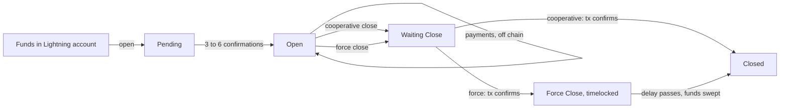

# Use Lightning

This guide takes you from creating a Lightning wallet to opening, using and closing a channel, in Decrediton's built-in Lightning wallet or with the command-line node `dcrlnd` and `dcrlncli`. [Lightning on Decred](index.md) explains what channels are and why they need liquidity.

!!! info "Applies to"
    Decrediton 2.1.7 and dcrlnd 0.8.1, as shipped in the Decred 2.1.7 bundle. Checked November 2026.

## Before you start

- **A suitable wallet.** Decrediton offers **Lightning Transactions** only in ordinary software wallets, not in watching-only, Trezor or Ledger wallets. Both light wallets (SPV, simplified payment verification) and full-node wallets work. For the command line, get `dcrlnd` and `dcrlncli` from the [command-line bundle](../wallets/command-line.md) and [verify the download](../security/verify-downloads.md).
- **Small amounts only.** Decrediton warns that Lightning "is still a work in progress and should be used with caution". A channel holds between 0.0002 DCR (20,000 atoms) and, by default, 10.73741823 DCR, and opening and closing it costs transaction fees.
- **Time online.** Decrediton's Lightning node runs only while the Lightning wallet is started, and cannot watch your channels the rest of the time.
- **A backup plan.** Your seed does not restore funds in open channels: [Back up and protect Lightning funds](backups-and-watchtowers.md) covers the channel backup file and watchtowers.
- **A peer.** Get its address from its operator: `<NODE_PUBKEY>@<HOST>:<PORT>`, a 66-character hexadecimal public key, then the host and port (9735 by default).

## How a channel moves your DCR

A channel locks DCR in a 2-of-2 multisignature output on the blockchain; payments then change only who owns how much of it, off chain. The diagram shows a channel's states, with Decrediton's labels.



The side that opens the channel owns its whole balance at first and pays its transaction fees. You can send only what is on your side (**Local** in Decrediton) and receive only what is on the peer's side (**Remote**), and each side keeps a reserve of 1% of the channel. For example, ignoring fees, a 1 DCR channel you open lets you send about 0.99 DCR and receive nothing. After you pay a 0.30 DCR invoice, you can receive about 0.29 DCR. What you can receive is your *inbound capacity*, covered in step 4.

## 1. Create the Lightning wallet

=== "Decrediton"

    1. Open **Lightning Transactions** in the sidebar.
    2. The first time, **Before You continue...** shows six slides about the risks. Open them all, then click **I understand and accept the risks**.
    3. Keep **Create New Wallet account** (the default), which creates `LN Account`. With **Use Existing Wallet Account**, the Lightning wallet would keep that account's keys unencrypted in memory and control all its funds.
    4. Leave **Restore SCB backup** (for a static channel backup from an earlier Lightning wallet) empty, and **Automatic Channel Creation** off: it would let the node open channels by itself with up to 60% of the account's spendable funds.
    5. Click **Start and Unlock LN Wallet** and enter your private passphrase.

    Once synced, the page becomes **Lightning Network** with the tabs **Overview**, **Channels**, **Send**, **Receive** and **Advanced**. Later, the page shows **Start Lightning Wallet**: click **Start and Unlock LN Wallet** again. Closing the wallet stops the Lightning node.

=== "Command line"

    1. Create `dcrlnd.conf` in the `dcrlnd` home directory (create the folder if it does not exist yet): `~/.dcrlnd/dcrlnd.conf` on Linux, `~/Library/Application Support/Dcrlnd/dcrlnd.conf` on macOS, `%LOCALAPPDATA%\Dcrlnd\dcrlnd.conf` on Windows.

        ```ini
        [Application Options]
        node = dcrw

        [dcrwallet]
        dcrwallet.spv = 1
        ```

        This runs `dcrlnd` with its own built-in light wallet. [Run a dcrlnd Lightning node](../../dev/operate/lightning-node.md) covers using your own `dcrd` or `dcrwallet` instead.

    2. Start the node and leave it running:

        ```bash
        dcrlnd
        ```

    3. In a second terminal, create the wallet:

        ```bash
        dcrlncli create
        ```

        Enter a wallet password of at least 8 characters, twice. Answer `n` to create a new seed, optionally set a seed passphrase, and write down the 24 words printed between `BEGIN LND CIPHER SEED` and `END LND CIPHER SEED`. This seed is not a 33-word Decred wallet seed: Decrediton and `dcrwallet` cannot restore it.

    4. After every restart of `dcrlnd`, run `dcrlncli unlock`.
    5. Run `dcrlncli getinfo` and wait for `"synced_to_chain": true`.

    !!! note "Testnet"
        Add `testnet = 1` under `[Application Options]` and run every command as `dcrlncli --testnet ...`.

!!! danger "Never restore an old copy of the Lightning folder"
    Copying an older `dcrlnd` folder (or `channel.db`) over a newer one can make your node publish an outdated channel state, letting the peer take the whole channel balance. Recover channels only from the seed plus the channel backup file ([Back up and protect Lightning funds](backups-and-watchtowers.md)).

## 2. Fund it and open a channel

### Fund the Lightning wallet

=== "Decrediton"

    Open **On-chain Transactions** > **Send**, click the accounts icon next to the address field (**Send funds to another account**), choose `LN Account`, and send a little more than the channel you plan to open, to cover fees. Once confirmed, it appears as **Confirmed Balance** under **Lightning Transactions** > **Overview** > **LN Account Overview**.

=== "Command line"

    ```bash
    dcrlncli newaddress p2pkh
    ```

    `p2pkh` is the only address type `dcrlnd` supports. Send DCR from your main wallet to the `address` value in the output. Once confirmed, `dcrlncli walletbalance` shows it in `confirmed_balance`, in atoms.

### Open a channel

=== "Decrediton"

    1. Open **Lightning Transactions** > **Channels**.
    2. Under **Create a Channel**, paste the peer's full address into **Counterparty Node** (`NodePubKey@ip:port`). A valid key shows **Valid PubKey**.
    3. Enter the **Amount to Commit**, in DCR, and click **Create Channel**.

    Decrediton publishes the funding transaction and shows **Channel Created**. Under **Manage Channels** the channel shows as pending, then open after 3 confirmations for small channels and up to 6 for the largest (with `dcrlnd` defaults on the peer's side), about 15 to 30 minutes.

    A node picked from **Recent Nodes** or **Search For Nodes** fills in only its public key: add `@host:port` unless your node is already connected to it.

=== "Command line"

    ```bash
    dcrlncli openchannel --node_key=<NODE_PUBKEY> --connect=<HOST>:<PORT> --local_amt=<ATOMS>
    ```

    `<NODE_PUBKEY>`, `<HOST>` and `<PORT>` come from the peer's address. `<ATOMS>` is the amount to commit: 50000000 for 0.5 DCR. Follow progress with `dcrlncli pendingchannels`; once confirmed, `dcrlncli listchannels` shows the channel with `"active": true`.

## 3. Pay an invoice

A Lightning payment request, called an *invoice*, says how much to pay, to which node, and for what. Mainnet invoices start with `lndcr`, testnet ones with `lntdcr`. Each can be paid once, before it expires.

Successful payments are final. The payer also pays the routing fees along the route, which Decrediton and `dcrlncli` cap by default at 5% of the amount (100% up to 1,000 atoms). A payment that cannot be routed within the cap fails without spending anything.

=== "Decrediton"

    1. Open **Lightning Transactions** > **Send**.
    2. Paste the invoice into **Lightning Payment Request Code**. A valid one shows **Valid Lightning Request** and its details. If it has no amount, enter one.
    3. Click **Send**. The **Send LN Payment** dialog shows the invoice amount as **Total Spent Amount**; any routing fee comes on top. Confirm.

    The payment appears under **Lightning Payments** as **Confirmed**, **Failed** or **Pending**.

=== "Command line"

    ```bash
    dcrlncli decodepayreq <PAY_REQ>
    dcrlncli payinvoice <PAY_REQ>
    ```

    `<PAY_REQ>` is the invoice. `decodepayreq` shows what it asks for. `payinvoice` shows the amount, fee limit and destination, asks `Confirm payment (yes/no):` and ends with `Payment status: SUCCEEDED` on success. Add `--amt=<ATOMS>` for an invoice with no amount.

## 4. Receive a payment

Decrediton and `dcrlncli` refuse to create any invoice, even one with no amount, until your channels with online peers can receive it. A fresh channel that you opened cannot: the peer's side holds nothing, not even its 1% reserve. Get inbound capacity first.

### Get inbound capacity

Decrediton shows your limits at the top of every Lightning tab: "You can Send total ... and Receive total ...". To raise the receive limit:

- **Spend first.** Each payment you make moves balance to the peer's side, which you can then receive back, less the peer's reserve.
- **Ask a peer to open a channel to you.** Decrediton's node does not accept incoming connections (it starts `dcrlnd` with `--nolisten`), so only a peer it is already connected to can do this. A command-line node can accept connections: see [Run a dcrlnd Lightning node](../../dev/operate/lightning-node.md).
- **Use a liquidity provider.** An operator running [dcrlnlpd](https://github.com/decred/dcrlnlpd) opens a channel to you for a fee; Decrediton has no client for it.

### Create an invoice

=== "Decrediton"

    1. Open **Lightning Transactions** > **Receive**.
    2. Enter the **Requested Amount**, or leave it at zero to let the payer choose. Above your receive limit, Decrediton shows **Cannot request more than total Receive capacity**.
    3. Optionally add a **Description**, which the payer sees, and click **Create Invoice**. If `dcrlnd` refuses, a notification gives the reason after "Failed to create invoice:".
    4. Click the new row under **Lightning Invoices** and give the payer the text under **Lightning Payment Request Code (Send this to Payer)**.

    Once paid, the invoice moves from the **Not Paid Yet** filter to **Received**. Invoices expire after 24 hours; **Cancel Invoice** withdraws an unpaid one.

=== "Command line"

    ```bash
    dcrlncli addinvoice --amt=<ATOMS> --memo="<DESCRIPTION>"
    ```

    `<ATOMS>` is the amount; leave out `--amt` to let the payer choose. The payer sees `<DESCRIPTION>`. Give the payer the `payment_request` value from the output. `dcrlncli lookupinvoice <R_HASH>`, with the output's `r_hash`, shows `"state": "SETTLED"` once paid.

    Without `--expiry` (in seconds), the invoice expires after 24 hours, although the help text still says one hour. `--ignore_max_inbound_amt` skips the capacity check, but the invoice still cannot be paid until your channels can receive it.

## 5. Close a channel

Closing publishes a transaction that returns each side's balance to its on-chain wallet, in one of two ways:

| | Cooperative close | Force close |
|---|---|---|
| When | Both nodes online and agree | The peer is offline or unresponsive |
| Your funds | Spendable once the closing transaction confirms | Locked by a relative time lock (CheckSequenceVerify, CSV), shown as **CSV Delay** in Decrediton's channel details, then swept to your wallet with one more transaction fee |
| Wait | Minutes | After the closing transaction confirms, with `dcrlnd` defaults on the peer's side: 288 blocks (about 1 day) for channels up to about 0.77 DCR, rising in proportion to 4,032 blocks (about 14 days) at the maximum size. Payments in flight can take longer |

!!! warning "A force close locks your funds"
    A force close cannot be undone, and your share cannot be spent until the delay ends. Try a cooperative close first; force close only when the peer stays offline.

=== "Decrediton"

    1. Open **Lightning Transactions** > **Channels** and click the channel under **Manage Channels**.
    2. Click **Close Channel** and confirm. Decrediton picks the close type from the channel state: **Attempt cooperative close of channel?** when the peer is online, **Attempt forced close of the channel?**, with a timelock warning, when it is offline.

    The channel shows as pending (**Waiting Close**, then **Force Close** with a **Limbo Balance** for a forced close) and finally **Closed**, with the funds back in the Lightning account.

=== "Command line"

    Find the channel's `channel_point` (`<TXID>:<INDEX>`) with `dcrlncli listchannels`, then:

    ```bash
    dcrlncli closechannel --funding_txid=<TXID> --output_index=<INDEX>
    ```

    Add `--force` for a force close. The output shows the `closing_txid`. For a force close, `dcrlncli pendingchannels` first lists the channel under `waiting_close_channels`. Once the closing transaction confirms, it moves to `pending_force_closing_channels`, where `blocks_til_maturity` counts down to the release of your funds.

## Check that it worked

- **Decrediton:** **Overview** > **LN Account Overview** shows **Open Channels** and their **Capacity**; each channel card shows its **Local** and **Remote** balances.
- **Command line:** `dcrlncli channelbalance` reports `local_balance`, `remote_balance`, `max_outbound_amount` (what you can send) and `max_inbound_amount` (what you can receive).
- Make a small test payment in each direction before relying on a channel.

## Troubleshooting

### Start and Unlock LN Wallet is grayed out

Its tooltip reads "Privacy Mixer, Autobuyer or Purchase Ticket Attempt running, please shut them off before unlock LN Wallet." Stop the mixer (**Privacy and Security** > **Privacy** > **Stop Mixer**) and the automatic ticket buyer.

### Opening a channel fails with "peer ... is not online"

Your node is not connected to that peer. Enter the full address including `@host:port` and check that the peer is reachable.

### "channel is too small" or "funding amount is too large"

The amount is outside the channel limits in [Before you start](#before-you-start). To commit more, open several channels.

### Creating an invoice fails with "not enough inbound capacity" or "no open channels"

Your channels cannot yet receive the amount, or you have none. Get inbound capacity first (step 4). The related error "no online channels found" usually means your channels' peers are offline.

### A payment fails

Check that the channel is active, that **You can Send total** covers the amount, and that the invoice has not expired (**Invoice expired**). Otherwise no route may have enough capacity: try a smaller amount or try later.

### A channel stays pending

Opening needs 3 to 6 confirmations while your node is running. Keep it running and check the funding transaction on a [block explorer](../wallets/block-explorer.md).

## Command reference

`dcrlncli help` lists every command and `dcrlncli help <COMMAND>` explains one. Upstream documentation is in the [dcrlnd repository](https://github.com/decred/dcrlnd/tree/v0.8.1/docs). Parts of its install notes are older than the code, and so is some of the built-in help, such as the `addinvoice` expiry default.

## Next steps

- [Back up and protect Lightning funds](backups-and-watchtowers.md): save the channel backup and add a watchtower.
- [Lightning on Decred](index.md): routing, liquidity and channel security.
- [Run a dcrlnd Lightning node](../../dev/operate/lightning-node.md): an always-on node that accepts incoming channels.
- [Privacy beyond mixing](../privacy/privacy-practices.md): what channel peers and routing nodes learn about you.
- [Payment channels in the whitepaper](../../whitepaper/19-ecosystem.md#sec:ecosystem-lightning): the base-layer features Lightning relies on.

*[SCB]: static channel backup
*[SPV]: simplified payment verification
*[CSV]: CheckSequenceVerify, a relative time lock
