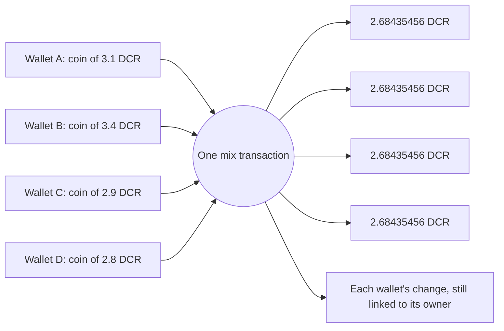
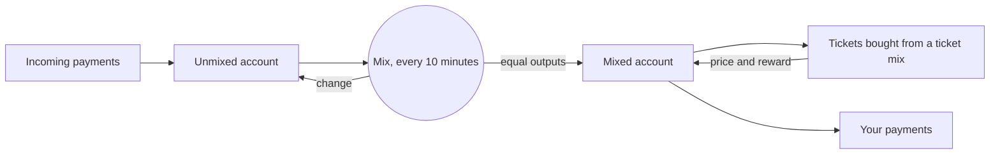

# Privacy and mixing

Every Decred transaction is public, so anyone can follow coins from one address to the next. StakeShuffle mixing, built into the official wallets, breaks that trail. This page is for anyone who wants to know what the blockchain reveals, what mixing hides and what it leaves visible, and why staking makes Decred's mixing stronger than it would be on its own.

## In this section

-   **[Mix your DCR](mix-your-dcr.md)**

    ---

    Turn on mixing in Decrediton, Bison Wallet or `dcrwallet`, check that it works, and spend or stake mixed funds without undoing it.

-   **[Privacy beyond mixing](privacy-practices.md)**

    ---

    Address habits, Tor, and the privacy trade-offs of light wallets, explorers, voting service providers (VSPs), the DCRDEX exchange and Lightning.

## What everyone can see

Decred, like Bitcoin, is a public ledger. Your name is not on it, but everything else is:

- **Amounts.** Every output shows exactly how many DCR it holds.
- **Addresses.** Every payment goes to an address, and every address's history is open to anyone with a [block explorer](../wallets/block-explorer.md).
- **The transaction graph.** Each transaction names the earlier outputs it spends, so coins can be traced back through every hop to where they came from.
- **Staking activity.** [Tickets](../staking/index.md), their price and the address that receives their return are public. So is every vote a ticket casts on blocks, [consensus rules](../governance/consensus-upgrades.md) and [treasury spends](../governance/treasury.md).

The ledger is *pseudonymous*: it holds addresses, not names. That protects you only until one address is tied to you. After that, analysts use a few well-known rules of thumb to connect the rest:

Coins spent together have one owner
:   A transaction that spends several outputs at once was almost always signed by one wallet, so all those addresses are grouped together.

Change goes back to the sender
:   Paying 3 DCR from a 10 DCR coin creates about 7 DCR of change. The output that is not a round number, or is spent later together with the sender's other coins, is usually the change.

Reused addresses link payments
:   Every payment to the same address is visibly connected.

Off-chain records fill in names
:   An exchange that checked your identity knows which address it sent your withdrawal to. A shop knows who placed an order. An explorer or wallet server can log which addresses your IP address looked up.

Put together, one identity link (an exchange withdrawal, say) can expose your balance, your income and everyone you pay.

## What mixing does

Mixing breaks the transaction graph. Several wallets that have never met build **one shared transaction** together. Each contributes a coin and receives back one or more new outputs of exactly the same value, paid to fresh addresses. (This kind of joint transaction is generally called a CoinJoin.) Because the new outputs are identical in value and the protocol hides who asked for which one, nobody can tell which output belongs to whom.

In the example below, four wallets each mix one coin into outputs of 2.68435456 DCR, one of Decred's standard sizes. The inputs and their change outputs stay linked to their owners; the four equal outputs do not.

What makes this trustworthy is how the outputs are chosen. Each wallet's new addresses pass through a cryptographic broadcast round (a "DC-net") that publishes all of them without revealing who sent which. The guarantee is strong:

- **Outside observers** see the inputs, the change and the equal outputs, but cannot match outputs to inputs better than by guessing.
- **The other participants** cannot do it either. Even if every other wallet in the mix but one were working together against you, they could not tell your output from that remaining wallet's.
- **The full nodes relaying the messages** cannot tell either.

The key exchange also combines ordinary elliptic-curve cryptography with a post-quantum scheme, so a recording of today's mix messages stays protected even if the elliptic-curve keys are broken in the future.

## StakeShuffle today

**StakeShuffle** is Decred's mixing protocol, based on published academic research on peer-to-peer mixing. Since Decred 2.0 (May 2024) it is fully **peer to peer**: there is no mixing server. Wallets send their mix messages over the ordinary Decred network, and up-to-date full nodes check and relay them much as they relay transactions.

A mix runs like this:

1. Your wallet announces that it wants to mix a coin, at a random moment so that the timing does not identify it. The announcement includes a proof that it can spend the coin, and states the size of the outputs it wants.
2. On every ten-minute mark (12:00, 12:10, 12:20 UTC and so on), each waiting wallet collects all the announcements for the same output size and starts a mix with them. On testnet the interval is 3 minutes.
3. The mix goes ahead only if at least **4 participants** are present. A single mix holds at most 64.
4. The participants exchange keys, run the DC-net broadcast, and each checks that its own outputs are in the final transaction before signing it.
5. The signed transaction is published and mined like any other.

If fewer than four wallets show up, nothing happens and your wallet tries again at the next ten-minute mark. Light wallets (SPV) take part in exactly the same way. Only wallets that speak the same version of the protocol mix together: Bison Wallet 1.0.6, a light wallet, uses an older version than Decrediton and `dcrwallet` 2.1.7, so it mixes only with other wallets on that older version and finds fewer partners.

!!! note "No extra software needed"
    One step of every mix needs a participant that can solve a particular equation. Wallets that have the separate `csppsolver` program installed do this for everyone, so mixing works without it as long as some participant in each mix runs one. Advanced users can build it from the [decred/cspp repository](https://github.com/decred/cspp) (`cmd/csppsolver`, which needs the FLINT libraries).

## Standard sizes

Amounts on the blockchain are always visible, so a mix only hides anything if its outputs are identical. Two wallets can mix together only when they ask for exactly the same output value. To bring as many wallets as possible together, `dcrwallet` (inside Decrediton and Bison Wallet too) mixes ordinary funds into ten fixed sizes, the powers of four from 2^18 to 2^36 atoms (1 DCR = 100,000,000 atoms):

| Standard size (DCR) | Atoms |
|---|---|
| 687.19476736 | 2^36 |
| 171.79869184 | 2^34 |
| 42.94967296 | 2^32 |
| 10.73741824 | 2^30 |
| 2.68435456 | 2^28 |
| 0.67108864 | 2^26 |
| 0.16777216 | 2^24 |
| 0.04194304 | 2^22 |
| 0.01048576 | 2^20 |
| 0.00262144 | 2^18 |

These sizes are wallet behavior, not a network rule. For each coin, the wallet picks the largest size that is below the current [ticket price](../staking/ticket-price-and-rewards.md) (also called stake difficulty) and that the coin can pay for, and asks for up to four outputs of it. Whatever is left returns to the wallet as change and is mixed again later at a smaller size.

**Worked example.** Suppose the ticket price is above 10.74 DCR (an example; read the live figure in your wallet or on dcrdata) and you mix a single coin of 25 DCR:

| Round | Coin mixed (DCR) | Mixed outputs received | Change returned (DCR) |
|---|---|---|---|
| 1 | 25.0000 | 2 × 10.73741824 | about 3.5251 |
| 2 | about 3.5251 | 1 × 2.68435456 | about 0.8408 |
| 3 | about 0.8408 | 1 × 0.67108864 | about 0.1696 |
| 4 | about 0.1696 | 1 × 0.16777216 | none |

After four mixes, 24.99805184 DCR sits in five outputs of standard sizes. Each round's own fee was under 0.0001 DCR. The last 0.0019 DCR or so was too small to mix again, so it went to the fee of the final mix instead of coming back as change.

## Why staking makes it stronger

A mix is only as good as the crowd you hide in, and Decred has a crowd most mixing systems lack: ticket buyers.

Every ticket bought in the same ticket price window (144 blocks, about 12 hours) costs exactly the same. When a wallet with mixing turned on buys a ticket, it does not pay from a coin directly. It first joins a mix whose outputs are each exactly the amount one ticket needs (the ticket price plus the ticket's small transaction fee), and buys the ticket from one of those outputs. Every mixing ticket buyer in that window asks for the same amount, so they all mix together.

As a result:

- Ticket purchases cannot be traced to the coins that paid for them. The coins going into the mix are visibly yours together; the ticket coming out is not.
- When a ticket votes, its price and reward return to the mixed account, so staked funds stay mixed from one ticket to the next.
- The change from ticket mixes is mixed at the same standard sizes as everyone else's coins, adding participants to ordinary mixes too.

How much DCR takes part in mixing is public: the **Privacy Participation** chart on [dcrdata](https://dcrdata.decred.org/charts?chart=privacy-participation) shows it over time.

## Mixed and unmixed accounts

Mixing only works if mixed and unmixed coins are never spent together, so every mixing wallet keeps them in separate [accounts](../wallets/how-wallets-work.md):

- The **unmixed account** receives new funds and the change from each mix. Decrediton names it `unmixed` by default and labels it **Unmixed Account**; Bison Wallet uses its default account.
- The **mixed account** receives the mixed outputs and the returns of tickets bought with mixed funds. Decrediton names it `mixed` (**Mixed Account**); Bison Wallet also uses `mixed`, plus a `dextrading` account for trading.

The diagram shows how DCR moves between them.

Once mixing is set up, spend only from the mixed account. Decrediton enforces this by default: it hides unmixed accounts from **Send** until you turn on **Allow sending from unmixed accounts** under **Privacy and Security** > **Privacy** and type a confirmation phrase. [Mix your DCR](mix-your-dcr.md) walks through the setup in each wallet.

## Disruptors and the safety of your funds

**Nobody can steal funds in a mix.** Your wallet signs the mix transaction only after checking that every output it asked for is in it, paid to its own addresses. A transaction missing your outputs never gets your signature and so can never be mined. Mixing is non-custodial throughout: your coins never leave your wallet's control.

What a participant *can* do is make a mix fail, by going silent or sending bad data. The protocol handles this:

- When a mix fails, the honest participants identify which participant misbehaved (with proof every participant can check) or went silent, exclude it, and rerun without it before the next ten-minute mark, as long as at least four remain.
- Since Decred 2.1, nodes and wallets record coins whose owners drop out of mixes partway through. A coin with two such strikes is barred from new mixes until 24 hours have passed since its last strike. Since 2.1.7, up-to-date nodes also refuse to relay ordinary transactions that spend it during that time.

That last rule can catch an honest wallet too. If you close your wallet in the middle of mixes again and again, the coins involved may be unmixable, and hard to spend, for up to a day. Stopping the mixer cancels any mix in progress, just as closing the wallet does. If you need to stop, do it away from the ten-minute marks: a mix normally finishes within about three minutes of the mark.

## What mixing does not hide

Mixing protects one thing: the link between a mixed output and the coin that paid for it. Plenty remains visible.

Your coin entering a mix, and its change
:   The input you contribute and the change you get back are publicly yours. An observer knows your coin was mixed and how big it was.

Amounts
:   Mixed outputs have standard values, but the values are still public.

Careless spending afterwards
:   Spending a mixed output together with an unmixed coin links them, and with them your history. Spending many mixed outputs in one payment shows they have one owner, and the total can hint at which coin they came from. In Bison Wallet 1.0.6, switching the privacy toggle off moves the entire mixed and trading balance back to the default account in **one** transaction, which ties all those mixed outputs together.

Address reuse and shared keys
:   Paying a mixed output to an address that already has a history, or giving out the extended public key (xpub) of your mixed account, undoes the mix.

Timing
:   Mixing a coin and immediately sending the same amount onward invites a guess. The longer and more ordinary the gap, the better.

A small crowd
:   Your output hides among the honest participants of its own mix. A mix can go ahead with as few as four.

Your IP address
:   Mix messages travel through the peer-to-peer network. Random delays make it harder, but a node directly connected to you may still guess that a message came from you. Tor and proxies help; see [Privacy beyond mixing](privacy-practices.md).

Records kept by others
:   Mixing changes nothing an exchange already knows about your withdrawal. A [VSP](../staking/vsps.md) knows which tickets are yours, because it votes them. A DCRDEX server sees your trades.

## What it costs

Mixing is cheap in money and moderately demanding in attention:

- **Fees.** Each participant pays the network fee for its own share of the mix transaction, at the standard rate of 0.0001 DCR per kilobyte. In the worked example above, that came to under 0.0001 DCR per round. Leftovers smaller than about 0.0026 DCR go to fees instead of coming back as change.
- **Time.** A large balance takes several rounds. Each round waits for the previous round's change to reach two confirmations and for enough participants to show up at a ten-minute mark.
- **An unlocked, online wallet.** The wallet must sign each mix with your private keys, so it stays unlocked and running the whole time. Decrediton warns that it must not be closed while the mixer runs; Bison Wallet says "The wallet must remain unlocked while mixing." Anyone with access to the computer while it is unlocked can spend from it.
- **Interruptions.** Decrediton runs the mixer, the automatic ticket buyer and manual ticket purchases one at a time, and sends no payment while any of them is running, so you stop the mixer to send. With mixing set up, the automatic ticket buyer mixes your unmixed funds too while it runs.
- **A software wallet.** Decrediton does not offer mixing for Trezor- or Ledger-backed wallets (see [Use a hardware wallet](../wallets/hardware-wallets.md)).
- **Current software.** Mixing depends on the version of the protocol your node and wallet speak. Run the latest release (see [Upgrading and mandatory releases](../run/upgrades.md)).

## A short history

Dates and changes below come from the Decred blog and the dcrd release notes.[^notes]

- **2019.** CoinShuffle++ mixing was announced in August 2019[^blog] and shipped in the Decred v1.5.0 wallets in December 2019. Wallets coordinated through a server run by the project. The server could not link outputs to inputs, but every mix depended on it.
- **2024.** Decred 2.0, released in May 2024, made StakeShuffle fully peer to peer, with full nodes relaying mix messages and no server at all.
- **2025.** Decred 2.1 added the 24-hour exclusion of coins that repeatedly disrupt mixes, and cut mixing bandwidth by about 15%.
- **2026.** Decred 2.1.6, released in August 2026 and mandatory because of a critical consensus fix, also "prevents a potential periodic deanonymization mixing attack" and improved mixing session expiry. Decred 2.1.7, in October 2026, fixed several mixing-related denial-of-service attacks and improved mixing performance.

[What changed: Coming back to Decred](../reference/whats-changed.md) covers retired features such as the old mixing server, for anyone following old instructions.

## Go deeper

- [StakeShuffle overview](../../whitepaper/18-mixing.md#sec:mixing-overview): what is mixed, the guarantees, and the threat model, in the whitepaper's own terms.
- [Epochs and session formation](../../whitepaper/18-mixing.md#sec:mixing-sessions): when mixes start, who takes part, and how many participants they need to proceed.
- [Blame and failure handling](../../whitepaper/18-mixing.md#sec:mixing-blame): how disruptors are identified and excluded from a mix.
- [Wallets and light clients](../../whitepaper/19-ecosystem.md#sec:ecosystem-wallets): how wallet accounts and mixed ticket purchases fit together.

## Next steps

- [Mix your DCR](mix-your-dcr.md): turn on mixing in your wallet and confirm it works.
- [Privacy beyond mixing](privacy-practices.md): the habits that keep mixed coins private, from address use to Tor.
- [How staking works](../staking/index.md): buy tickets with mixed funds and add your stake to the crowd.
- [Mixing for builders](../../dev/protocol/mixing.md): the modules, messages and RPCs behind StakeShuffle, for developers.

[^blog]: Decred blog, ["Iterating Privacy"](https://blog.decred.org/2019/08/28/Iterating-Privacy/), 28 August 2019.
[^notes]: dcrd release notes: [2.0.0](https://github.com/decred/dcrd/blob/master/docs/release-notes/release-notes-2.0.0.md), [2.1.0](https://github.com/decred/dcrd/blob/master/docs/release-notes/release-notes-2.1.0.md), [2.1.6](https://github.com/decred/dcrd/blob/master/docs/release-notes/release-notes-2.1.6.md), [2.1.7](https://github.com/decred/dcrd/blob/master/docs/release-notes/release-notes-2.1.7.md).

*[VSP]: voting service provider
*[VSPs]: voting service providers
*[SPV]: simplified payment verification
*[DCRDEX]: Decred's decentralized exchange protocol and server network
*[UTC]: Coordinated Universal Time
*[IP]: Internet Protocol
*[xpub]: extended public key
*[DC-net]: dining cryptographers network
