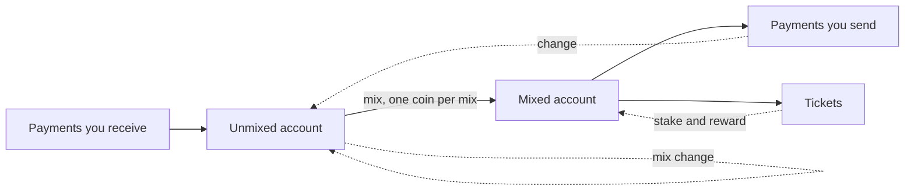

# Mix your DCR

This guide shows how to turn on StakeShuffle mixing in Decrediton, Bison Wallet or the command-line wallet, check that it works, and spend and stake mixed DCR without undoing the privacy. What mixing hides, and what it does not, is explained in [Privacy and mixing](index.md).

!!! info "Applies to"
    Decrediton 2.1.7, Bison Wallet 1.0.6 and dcrwallet 2.1.7. Checked November 2026.

## Before you start

- **Keep the wallet open, online and unlocked while it mixes.** Your wallet signs each mix as it happens. Decrediton must stay open while its mixer runs; Bison Wallet must be running with you logged in.
- **Allow time.** Mixes start once every 10 minutes on mainnet and need at least four participants mixing the same amount. One deposit is usually split over several mixes, so allow an hour or more.
- **Use current software.** Decred 2.1.6 fixed a potential periodic deanonymization mixing attack and 2.1.7 fixed mixing denial-of-service problems; see [Upgrading and mandatory releases](../run/upgrades.md). Bison Wallet 1.0.6 predates both: its built-in Decred wallet uses older mixing code without these fixes, and an older protocol version, so it never mixes with Decrediton or `dcrwallet` 2.1.7, only with other wallets on that older version (such as other Bison Wallet 1.0.6 users), and mixes can be slow to fill.
- **Some wallets cannot mix.** Decrediton wallets backed by a Trezor or Ledger and watching-only wallets cannot. In Bison Wallet only the built-in (native) Decred wallet can.
- **A light wallet (SPV) mixes too.** Mix messages travel over Decred's peer-to-peer network.

## How your wallet mixes

Mixing uses two [accounts](../wallets/how-wallets-work.md). Coins waiting to be mixed sit in the **unmixed account**. Each mix takes one of your coins and joins it with other wallets' coins in a single transaction (a CoinJoin) in which everyone receives outputs of exactly the same amount. The wallet mixes several eligible coins at once, each in its own mix. Your new outputs land in the **mixed account**, and an observer cannot tell which of them are yours. Change goes back to the unmixed account and is mixed in a later round.

The diagram shows the flow: in through the unmixed account, out through the mixed account, with every leftover sent back for mixing.



Mix amounts are standard: ten values from 0.00262144 to 687.19476736 DCR, each four times the last, so smaller coins are never mixed. For each coin, `dcrwallet` picks the largest standard amount that is below the current ticket price and fits, and creates up to four outputs of it. Only coins of the same amount mix together, so standard amounts keep the groups large ([what is mixed](../../whitepaper/18-mixing.md#sec:mixing-what), [pairing rules](../../whitepaper/18-mixing.md#sec:mixing-pairing)).

**Worked example.** You receive 100 DCR in one payment to the unmixed account while the ticket price is above 43 DCR, at the default fee rate of 0.0001 DCR/kB:

| Round | Coin mixed (DCR) | Mixed outputs received (DCR) | Change back to unmixed (DCR) |
|---|---|---|---|
| 1 | 100 | 2 × 42.94967296 | 14.10062518 |
| 2 | 14.10062518 | 1 × 10.73741824 | 3.36318164 |
| 3 | 3.36318164 | 1 × 2.68435456 | 0.67880178 |
| 4 | 0.67880178 | 1 × 0.67108864 | 0.00768784 |
| 5 | 0.00768784 | 2 × 0.00262144 | none |

The mixed account ends with 99.99745024 DCR in seven outputs. Fees took 0.00254976 DCR, most of it in the last round, which creates no change. Each round waits for its coin to have two confirmations and for the next 10-minute [epoch](../../whitepaper/18-mixing.md#sec:mixing-epochs).

## Turn mixing on

=== "Decrediton"

    1. Open **Privacy and Security** in the sidebar, then the **Privacy** tab.
    2. The first time, the tab shows **Privacy Configuration**. Click **Create default Accounts** to create accounts named `mixed` and `unmixed`, and enter your private passphrase. If an account named `mixed` or `unmixed` already exists, click **Create Needed Accounts** instead and enter a **Mixed Account Name** and an **Unmixed Account Name**. Accounts cannot be deleted once created.
    3. The **StakeShuffle** panel now shows your **Unmixed Balance** and **Mixed Balance**. To mix DCR held in other accounts, enter an amount under **Send to Unmixed Account** and click **Send to Self**.
    4. Once the unmixed account has a confirmed balance, click **Start Mixer**, enter your private passphrase and confirm.

    The status changes from **Mixer is not running** to **Mixer is running**. While it runs, Decrediton does not send transactions, buy tickets or start the automatic ticket buyer: click **Stop Mixer** first, and start it again afterwards.

=== "Bison Wallet"

    1. Open **Wallet** in the top menu and select Decred.
    2. In the privacy box, which reads **Privacy off**, click the toggle.
    3. The box changes to **Privacy active**.

    The default account becomes the unmixed account, next to a `mixed` account and a `dextrading` account for coins in use by trades. Everything in the default account, including coins you already hold, is now queued for mixing. After a restart, mixing resumes when you log in.

=== "Command line"

    1. With `dcrwallet` running and unlocked (start it with `--promptpass`), create the two accounts:

        ```bash
        dcrctl --wallet createnewaccount mixed
        dcrctl --wallet createnewaccount unmixed
        ```

    2. Stop `dcrwallet` and add these lines to `dcrwallet.conf` in the wallet's data directory (`~/.dcrwallet` on Linux, `~/Library/Application Support/Dcrwallet` on macOS, `%LOCALAPPDATA%\Dcrwallet` on Windows):

        ```ini
        [Application Options]
        mixing=1
        mixedaccount=mixed/1
        changeaccount=unmixed
        mixchange=1
        promptpass=1
        ```

    3. Start `dcrwallet` in a terminal and enter your private passphrase when asked. The log shows `Starting auto transaction creator`.

    What the settings do:

    - `mixing` turns on the mixing client.
    - `mixedaccount` names the account, and branch (`0` or `1`), that receives mixed outputs and ticket rewards.
    - `changeaccount` is the unmixed account, required when mixing.
    - `mixchange` mixes the unmixed account's coins into the mixed account, checking again at every new block.
    - `promptpass` unlocks the wallet at startup with no timeout, which mixing needs. Anyone with access to the running wallet or its remote procedure call (RPC) credentials can then spend from it.

    All options are listed in [dcrwallet configuration](../../dev/reference/dcrwallet-config.md).

You do not need `csppsolver`, a helper that solves one step of each mix and ships with none of these wallets. Without it, `dcrwallet` logs `Unable to start csppsolver; must rely on other peers publishing results` and keeps mixing, because each mix needs only one participant with a solver ([minimum participation](../../whitepaper/18-mixing.md#sec:mixing-minpeers)). Advanced users can build it from [decred/cspp](https://github.com/decred/cspp/tree/master/cmd/csppsolver) (it needs the FLINT C libraries); if set with `csppsolver=`, it must work or `dcrwallet` does not start.

## Receive new funds into the unmixed account

Have payments sent to the unmixed account, using a new address for every payment.

=== "Decrediton"

    Open **On-chain Transactions** > **Receive**, choose the unmixed account under **This address is for**, and click **Generate new address**. The mixed account is not offered here. Coins received into other accounts are mixed only after you move them with **Send to Unmixed Account**.

=== "Bison Wallet"

    With privacy active, **Receive** gives an unmixed-account address. Received coins are counted in the **Immature** balance, listed beneath it as **Unmixed**, and cannot be sent or traded until they are mixed and show under **Available**.

=== "Command line"

    ```bash
    dcrctl --wallet getnewaddress unmixed
    ```

## Check that mixing is working

A coin needs two confirmations and the next 10-minute window before its first mix, so wait at least 20 minutes.

=== "Decrediton"

    On the **Privacy** tab, **Logs** shows `Mixing output` when a coin joins a mix and `Completed CoinShuffle++ mix of output` when it succeeds. **Mixed Balance** grows as **Unmixed Balance** shrinks. In **On-chain Transactions** > **History**, the **Mixed** filter lists the mix transactions.

=== "Bison Wallet"

    Above the transaction history, clear **Hide Mixing Transactions** (ticked again each time you select Decred). Mixes appear with the type **Mix**, and the **Unmixed** balance shrinks.

=== "Command line"

    Watch the log, `logs/mainnet/dcrwallet.log` in the wallet's data directory (`~/.dcrwallet` on Linux, `~/Library/Application Support/Dcrwallet` on macOS, `%LOCALAPPDATA%\Dcrwallet` on Windows), for lines like these:

    ```text title="Expected log lines (example)"
    [INF] WLLT: Mixing output 5d3c…e1a0:0 (100 DCR)
    [INF] WLLT: Completed CoinShuffle++ mix of output 5d3c…e1a0:0 in transaction 9f27…4b6c
    ```

    Count the mixed outputs each account has received:

    ```bash
    dcrctl --wallet getcoinjoinsbyacct
    ```

    ```json title="Expected output (example)"
    {
      "mixed": 7
    }
    ```

    `dcrctl --wallet getbalance` shows each account's balance.

## Spend from the mixed account

Spend only from the mixed account. When a payment spends several mixed outputs, an observer learns that they share an owner, but still not where they came from. Its change goes back to the unmixed account to be mixed again.

=== "Decrediton"

    With the mixer stopped, open **On-chain Transactions** > **Send**. The mixed account is the default source, and unmixed accounts are not offered.

    To spend from another account anyway, tick **Allow sending from unmixed accounts** on the **Privacy** tab, type `I understand the risks` and click **Enable sending from unmixed accounts**. Such payments could be traced back to you: use it only when you have to, for example to empty a wallet, and clear the tick afterwards.

=== "Bison Wallet"

    With privacy active, **Send** and DCRDEX trades spend from the mixed account and the trading account that holds coins left over from trades. Coins still unmixed wait until they are mixed.

=== "Command line"

    ```bash
    dcrctl --wallet sendfrom mixed <ADDRESS> <AMOUNT>
    ```

    `<ADDRESS>` is the recipient and `<AMOUNT>` is in DCR. With `mixing` on, the change goes to the unmixed account. Avoid `sendtoaddress`, which always spends from the `default` account.

## Buy tickets with mixed funds

A mixed ticket purchase first joins a mix whose outputs are each the ticket price plus the ticket's small transaction fee (a "mixed split"); each ticket then spends one of them. The returned stake and reward go to the mixed account. Waiting for the next 10-minute window and enough other buyers makes the purchase slower than an unmixed one. For the choice of voting service provider (VSP) and the rest of the staking flow, see [Stake with Decrediton or Bison Wallet](../staking/stake.md).

=== "Decrediton"

    With the mixer stopped, open **Staking** > **Purchase Tickets**. Decrediton shows **You are purchasing mixed tickets**, and the **Account** list offers only the mixed account. Keep Decrediton open until the purchase completes. **Automatic Ticket Purchases** also mixes the unmixed account while it runs, so the mixer is not needed alongside it.

=== "Bison Wallet"

    With privacy active, **Purchase Tickets** buys from the mixed account through a mixed split. Change goes to the unmixed account.

=== "Command line"

    When mixing, the ticket buyer needs an account for the tickets' voting addresses. Create one (with the wallet unlocked):

    ```bash
    dcrctl --wallet createnewaccount voting
    ```

    Then extend `dcrwallet.conf`:

    ```ini
    [Application Options]
    enableticketbuyer=1
    purchaseaccount=mixed

    [Ticket Buyer Options]
    ticketbuyer.votingaccount=voting
    ```

    Add your VSP's `vsp.url` and `vsp.pubkey` under `[VSP Options]`, as described in [Stake with dcrwallet](../staking/stake-with-dcrwallet.md). Without `ticketbuyer.votingaccount`, `dcrwallet` logs `cannot run mixed ticketbuyer without --votingaccount` and exits at startup. With `mixing` on, a manual `purchaseticket` from the mixed account is mixed too and returns only when its mix completes. Solo stakers who vote from a separate wallet should follow [Vote without a VSP](../staking/solo-voting.md).

## Mistakes that undo mixing

!!! danger "Links on the blockchain are permanent"
    Mixing breaks the link between your coins and their past only as long as you never reconnect them. Once a transaction links them again, nothing can remove that link.

- **Spending mixed and unmixed coins together.** One transaction with both kinds of input ties your mixed coins to their history. The usual causes are leaving **Allow sending from unmixed accounts** on, consolidating coins by hand and "send everything" sweeps.
- **Paying into the mixed account yourself.** Coins sent there directly are unmixed, and the wallet may later spend them with mixed coins. Only mixing should pay into the mixed account.
- **Turning privacy off in Bison Wallet while it holds mixed coins.** Bison Wallet then moves the mixed and trading balances to the default account in one transaction, publicly tying all of those coins to one owner.
- **Reusing addresses.** Every payment to the same address is visibly linked.
- **Sharing an extended public key.** An account's extended public key (`dpub…`) reveals all its addresses. Giving the mixed account's key to a tracking app, tax tool or someone else's watching-only wallet shows that party all your mixed coins.
- **Sending mixed coins to a service that knows who you are.** An exchange or merchant that receives them knows they are yours from then on. See [Privacy beyond mixing](privacy-practices.md).

## Troubleshooting

### Start Mixer is greyed out

Decrediton shows **Insufficient unmixed account balance** until the unmixed account holds at least 0.00272144 DCR spendable, the smallest mix amount plus a fee; new coins must confirm first. **Start Mixer** is also greyed out during a manual ticket purchase. While the automatic ticket buyer runs, the panel shows **Autobuyer is running** and a **Stop Auto Buyer** button in place of **Start Mixer**.

### Nothing has mixed after an hour

- Check that the wallet is synced and has peers: Decrediton shows the peer count in the sidebar, and `dcrctl --wallet getpeerinfo` lists a light `dcrwallet`'s peers.
- `spvdisablerelaytx` in `dcrwallet` and `blocksonly` in `dcrd` both stop mix messages. Remove them.
- A mix needs at least four participants at the same amount in the same window. When few are mixing, wait for later windows.

### The command-line wallet does not mix

- If the log shows `Starting auto transaction creator` but no `Mixing output` lines ever appear, check that `mixing=1` is set: without it `mixchange` does nothing and logs nothing. `dcrctl --wallet mixaccount` then returns `Mixing is not configured`.
- An error mentioning a locked wallet means it was not unlocked: use `promptpass=1`. `dcrctl --wallet walletinfo` shows `"unlocked": true` when it is.
- `mixedaccount: account "mixed" does not exist` at startup means the accounts were not created. Remove the mixing lines, create the accounts, and add the lines back.

### A coin keeps failing to mix

Coins whose wallet repeatedly drops out of mixes (closed, locked or disconnected) are refused in new mixes for 24 hours, a relay policy since Decred 2.1.0. Keep the wallet online; the coin is tried again later.

### Account names are missing after a restore

Account names are not stored on the blockchain, so a wallet restored from its seed does not know which account was mixed. Decrediton offers **Set Mixed Account** when it finds accounts with mixed outputs; on the command line, `getcoinjoinsbyacct` shows which account holds them and `renameaccount` restores the names. See [Back up and restore your wallet](../wallets/back-up-and-restore.md).

## Next steps

- [Stake with Decrediton or Bison Wallet](../staking/stake.md): put mixed DCR into tickets.
- [Stake with dcrwallet](../staking/stake-with-dcrwallet.md): the command-line staking setup, with mixing.
- [Privacy beyond mixing](privacy-practices.md): address hygiene, Tor, and the privacy trade-offs of light wallets, VSPs and DCRDEX servers.
- [Privacy and mixing](index.md): what mixing protects against and what stays public.
- [The whitepaper's StakeShuffle threat model](../../whitepaper/18-mixing.md#sec:mixing-threat): the protocol's exact guarantees.

*[VSP]: voting service provider
*[SPV]: simplified payment verification
*[RPC]: remote procedure call
