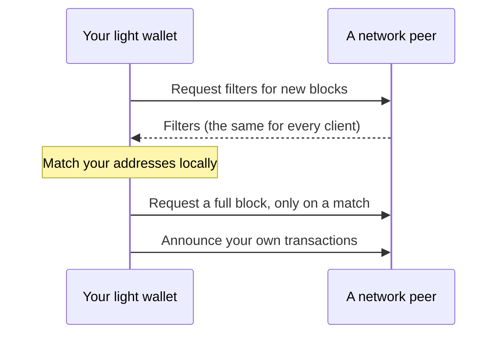

# Privacy beyond mixing

Mixing hides where your coins came from, but your addresses, your Internet Protocol (IP) address and the services you use can still give you away. This page covers the habits and settings that close those gaps.

!!! info "Applies to"
    Decrediton 2.1.7, Bison Wallet 1.0.6, and dcrd and dcrwallet 2.1.7. Checked November 2026.

## Before you start

- A wallet you control: Decrediton, Bison Wallet or `dcrwallet`. If you mix, set it up first with [Mix your DCR](mix-your-dcr.md).
- For the Tor steps: Tor Browser or the `tor` service from the [Tor Project](https://www.torproject.org/), running whenever your wallet runs.
- For the command-line steps: `dcrctl` and your config files.
- About 20 minutes.

## Three layers of privacy

| Layer | What leaks | Main defense |
|---|---|---|
| On-chain | Amounts, addresses and the trail of every coin | [Mixing](index.md), new addresses, separate accounts |
| Network | Your IP address, seen by every peer and service you connect to | Tor (your own full node also hides which blocks your wallet needs) |
| Behavioral | What you give services: extended public keys, identity documents, lookups | The habits on this page |

One layer does not cover another: a mixed coin is still linked to you if you look up its address on an explorer without Tor.

## Use a new address every time

Every payment to the same address is publicly linked to every other payment to it. Give each payment its own address; one seed yields as many as you need.

=== "Decrediton"

    Open **On-chain Transactions** > **Receive** and click **Generate new address** before you give an address out.

=== "Bison Wallet"

    In **Wallet** > **Decred**, click **Receive**. If the dialog shows "address has been used", click **New Address**.

=== "Command line"

    ```bash
    dcrctl --wallet getnewaddress
    ```

[Send and receive DCR](../wallets/send-and-receive.md) covers receiving in full.

### Check your wallet for reuse

`dcrwallet` can list every wallet address paid more than once. Decrediton and Bison Wallet have no reuse report.

=== "Command line"

    ```bash
    dcrctl --wallet auditreuse
    ```

    ```text title="Expected output (no reuse)"
    {}
    ```

    Otherwise each reused address appears with the outputs that paid it:

    ```text title="Expected output (reuse found)"
    {
      "<ADDRESS>": [
        "<TXID_1>:0",
        "<TXID_2>:1"
      ]
    }
    ```

    Each entry under `<ADDRESS>` is a transaction ID and output number. Ticket reward addresses count; votes and revocations do not. The check covers the wallet's whole history. Add a block height (`dcrctl --wallet auditreuse 1000000`) to list only reused addresses paid at least once at or after that block.

## Keep mixed and unmixed funds apart

Mixing protects a coin only while it never meets your unmixed history again ([account layout](index.md)):

- **Receive into the unmixed account,** so new funds are mixed before you spend them.
- **Spend from the mixed account only.** In Decrediton, leave **Allow sending from unmixed accounts** off.
- **Never spend mixed and unmixed coins together.** Coins in one transaction are treated as one owner's.
- **Avoid large, hasty spends.** Many mixed outputs in one payment show they belong together, and a same-sized payment right after a mix invites a guess.

### Never share mixed or voting extended public keys

An account's extended public key (xpub, starting `dpub` on mainnet) lets anyone derive every address of that account, past and future. Your mixed account's xpub ties all your mixed outputs together. So does the xpub of the account receiving your tickets' voting rights: with mixing on, the mixed account for tickets bought by hand, or `ticketbuyer.votingaccount` for automatic purchases.

Decrediton shows the key as **Extended Public Key** when you open an account under **Accounts** and click **Reveal Pubkey**. Use it only between your own wallets, as in [solo voting](../staking/solo-voting.md); never paste it into portfolio trackers, tax tools or support chats.

!!! danger "A shared xpub cannot be taken back"
    Whoever has an xpub can follow that account for as long as it is used. If a mixed account's xpub has leaked, treat its funds as unmixed and mix them again into an account whose key nobody else has.

## Hide your IP address with Tor

The peer-to-peer protocol has no encryption ([transport](../../whitepaper/15-p2p.md#sec:p2p-transport)). Every peer sees your IP address, and a peer that hears your transaction or mix message first can guess it came from you ([mixing threat model](../../whitepaper/18-mixing.md#sec:mixing-threat)). With Tor, peers and services such as voting service providers (VSPs) and the servers of DCRDEX, Decred's decentralized exchange, see a Tor relay instead.

Wallets reach Tor through a SOCKS5 proxy, a standard relaying protocol: `127.0.0.1:9150` for Tor Browser while it is open, `127.0.0.1:9050` for the `tor` service.

=== "Decrediton"

    1. Start Tor Browser or the `tor` service.
    2. Open **Settings** > **Connectivity**.
    3. Under **Proxy**, set **Proxy Type** to **SOCKS5** and **Proxy Location** to `127.0.0.1:9150` or `127.0.0.1:9050`.
    4. Click **Save proxy settings**, then **Save** in the **Reset required** dialog. Decrediton returns to the launcher.
    5. Open your wallet again.

    Only a **SOCKS5** proxy reaches `dcrd` and `dcrwallet`; with **HTTP**, **PAC** or **SOCKS4**, Decred network traffic stays direct.

    Untick the web requests you do not need in **Settings** > **Privacy and Security**: **Network Information**, **Decred Block Explorer**, **VSP Listing**, **Politeia** and **Update Check**.

=== "Bison Wallet"

    Bison Wallet 1.0.6 has no proxy setting in its interface. To send its DCRDEX server connections through Tor, add these lines to `dexc.conf` in its data folder (`~/.dexc` on Linux, `~/Library/Application Support/Dexc` on macOS, `%LOCALAPPDATA%\Dexc` on Windows) and restart it:

    ```ini
    [Application Options]
    torproxy=127.0.0.1:9050
    torisolation=true
    ```

    The built-in Decred wallet still reaches peers and VSPs directly. So do its fee lookups at dcrdata, unless you untick **External fee rate estimates** under **Settings** in **Wallet** > **Decred**, and every source left ticked under **Settings** > **Fiat Exchange Rate Sources**. For Decred traffic over Tor, connect your own proxied `dcrwallet` on the **External** tab when you add the Decred wallet.

=== "Command line"

    Add these lines to `dcrd.conf` and `dcrwallet.conf` in their data folders (`~/.dcrd` and `~/.dcrwallet` on Linux; `Dcrd` and `Dcrwallet` under `~/Library/Application Support` on macOS and `%LOCALAPPDATA%` on Windows), then restart both:

    ```ini
    [Application Options]
    proxy=127.0.0.1:9050
    torisolation=1
    ```

    `proxy` also covers Domain Name System (DNS) lookups. `torisolation` gives each connection its own Tor circuit, making them harder to correlate. With `proxy`, dcrd accepts no incoming connections, and dcrd 2.1.7 cannot run as an onion service ([Run a full node](../run/full-node.md)).

    `dcrwallet` does not proxy `localhost` or loopback and private-network IP addresses (127.0.0.0/8, 10.0.0.0/8, 172.16.0.0/12, 192.168.0.0/16, ::1, fc00::/7). Name your own `dcrd` by such an address, not a host name, or set `nodcrdproxy=1` to reach the `rpcconnect` node directly.

!!! warning "The `onion` option is not anonymous"
    dcrd's `onion=127.0.0.1:9050` sends only connections to `.onion` peers through Tor and reaches everyone else from your real IP address. Use `proxy` for privacy.

What each app's proxy setting covers:

| Connection | Decrediton (SOCKS5) | Bison Wallet (`torproxy`) | dcrd and dcrwallet (`proxy`) |
|---|---|---|---|
| Decred network peers | Yes | No | Yes |
| VSP requests | Yes | No | Yes (dcrwallet) |
| DCRDEX servers | No (`.onion` servers only, via `127.0.0.1:9050`) | Yes | Not applicable |
| Lightning peers | No | Not applicable | `dcrlnd` has its own Tor options |
| The app's own web requests | Yes | No | Not applicable |

## Know what light wallets reveal

A light wallet (SPV, simplified payment verification) does not download the whole chain, so it asks peers for data. Compact block filters keep your addresses out of those requests: your wallet tests each block's filter locally.



Peers still learn three things: your IP address (unless you use Tor), the transactions and mix messages your wallet announces, and which blocks you download. The last leak is small, blurred by false matches and by fetching from several peers ([light clients](../../whitepaper/16-filters.md#sec:filters-spv)); a full node has none.

To use only your own node, enter its address in Decrediton's **Settings** > **Connectivity** > **SPV Connect**, or set `spvconnect=` in `dcrwallet.conf`, and give that node a Tor proxy too. Bison Wallet's built-in light wallet cannot choose its peers.

## Know what services learn about you

None of these services can spend your funds; each can keep records.

### Block explorers

The operator sees your IP address and everything you open. Looking up several of your addresses in one session ties them together, as does following a transaction link from your wallet. Check payments in your wallet, and look things up through Tor Browser or your own dcrdata ([dcrdata API](../../dev/api/dcrdata-api.md), [Use the block explorer](../wallets/block-explorer.md)).

### Voting service providers

For each ticket you register, a [VSP](../staking/vsps.md) receives the ticket and its funding transaction, the fee payment, the ticket's voting key and your vote choices. It sees each request's IP address, and `vspd` logs it when a request fails. Use a proxy and buy tickets with mixed funds, or vote [without a VSP](../staking/solo-voting.md).

### DCRDEX servers and trading partners

A DCRDEX account is a key, not an identity, with no user name or password. Yet the server sees your [fidelity bond](../dex/index.md) transaction, every order (size, price and side), the coins funding each order with proof you own them, your receiving address, and your IP address unless Bison Wallet uses Tor. Both legs of a swap are ordinary on-chain transactions, so never fund a bond or trade from a coin you want kept apart from your trading history.

### Lightning channel peers

[Lightning](../lightning/index.md) payments stay off chain; channel opens and closes do not. Payments are onion-routed: a node on the route learns the amount, the timing and its neighbors, not the full path. Your channel peers know your node's public key and IP address, and every invoice contains that key, so all your invoices point to one node. Decrediton's proxy does not cover its Lightning node; a standalone `dcrlnd` can run over Tor ([Run a dcrlnd Lightning node](../../dev/operate/lightning-node.md)).

### Politeia

Anyone can list how each ticket voted on a proposal, with the ticket's largest commitment address. Mixing the funds behind your tickets keeps those votes from pointing to you.

## Acquire coins privately

An exchange that checked your identity knows which address it paid ([Get DCR](../start/get-dcr.md) compares the routes). Withdraw to a fresh address in your unmixed account and let the coins mix before you spend or stake them; mixing hides the later trail, not the exchange's records. Paying such an exchange from your mixed account reveals which mixed outputs were yours. DCRDEX needs no identity documents.

## Checklist

- [ ] A new address for every payment; `auditreuse` (or `auditreuse <HEIGHT>`, from the block where you changed your habits) returns `{}`.
- [ ] Funds arrive in the unmixed account and leave from the mixed account, never together.
- [ ] No mixed or voting xpub has left your own wallets.
- [ ] Decrediton uses a **SOCKS5** proxy, or `dcrd` and `dcrwallet` have `proxy` set.
- [ ] Unneeded requests are off in **Settings** > **Privacy and Security**.
- [ ] Explorer lookups go through Tor Browser.
- [ ] Tickets are bought with mixed funds.

## Check that it worked

=== "Decrediton"

    In **Settings** > **Logs**, expand the **decrediton** log. After the restart it shows `Setting up proxy socks5://127.0.0.1:9150` (or your port), then `Proxy successfully setup`, and the wallet syncs.

=== "Command line"

    `dcrctl --wallet auditreuse <HEIGHT>` prints `{}`, where `<HEIGHT>` is the block from which you used a new address every time (omit it if your wallet never reused one). For the node, run:

    ```bash
    dcrctl getnetworkinfo
    ```

    With the default listen settings, each entry under `networks` shows your proxy:

    ```text title="Expected output (excerpt)"
          "name": "IPV4",
          "limited": false,
          "reachable": false,
          "proxy": "127.0.0.1:9050",
    ```

    `"reachable": false` is expected: the node accepts no incoming connections. With `torisolation`, the `Onion` entry also shows `"proxyrandomizecredentials": true`.

Bison Wallet shows no proxy status in its interface.

## Troubleshooting

### Decrediton stops syncing after you set a proxy

Tor is not running, or the port is wrong: 9150 for Tor Browser, 9050 for the `tor` service. To undo, set **Proxy Type** to **No Proxy** and save.

### dcrwallet logs "proxy dial" errors

`dcrwallet` cannot reach Tor at the `proxy` address: start Tor, or correct the address. If the failing address is your own node named by a host name, the connection went to Tor, which cannot reach it; use the node's IP address, or `nodcrdproxy=1` for the `rpcconnect` node.

### `auditreuse` lists an address

The link is on chain and permanent. Stop giving that address out. If the coins sit in your mixed account, treat them as unmixed and send them to your unmixed account to be mixed again.

## Next steps

- [Mix your DCR](mix-your-dcr.md): set up mixing and stake mixed funds.
- [Run a full node](../run/full-node.md): run `dcrd` over Tor, and what that costs.
- [Vote without a VSP (solo voting)](../staking/solo-voting.md): stake without telling a VSP about your tickets.
- [Keep your DCR safe](../security/index.md): privacy depends on a computer nobody else controls.

*[VSP]: voting service provider
*[SPV]: simplified payment verification
*[DCRDEX]: Decred's decentralized exchange protocol and server network
*[IP]: Internet Protocol
*[xpub]: extended public key
*[DNS]: Domain Name System
*[SOCKS5]: a standard protocol for relaying connections through a proxy
