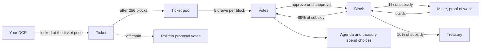

# Glossary

This page defines the Decred terms used across these docs, as they apply to Decred 2.1.7 and Bison Wallet 1.0.6. Each entry links to the page that explains the idea and, where one exists, to the whitepaper section that states the exact rule.

## How to use this glossary

- Terms are in alphabetical order. Jump to a letter: [A](#a) · [B](#b) · [C](#c) · [D](#d) · [E](#e) · [F](#f) · [G](#g) · [H](#h) · [I](#i) · [L](#l) · [M](#m) · [P](#p) · [Q](#q) · [R](#r) · [S](#s) · [T](#t) · [U](#u) · [V](#v) · [W](#w).
- Numbers are mainnet values. Unless an entry says otherwise, they are consensus rules, which every node enforces. Values marked "wallet default" or "policy" are settings of the software, not rules of the network.
- Block counts are converted to time at the 5-minute target, so "about" always applies.
- Live figures, such as the ticket price, the reward per vote or the treasury balance, change all the time and are not given here. Your wallet and the [dcrdata block explorer](https://dcrdata.decred.org/) show them.
- Labels in **bold** are exact labels from Decrediton or Bison Wallet.
- Sources: consensus values come from `dcrd`'s `chaincfg/mainnetparams.go` and `blockchain/standalone/subsidy.go` at release-v2.1.7 and from the whitepaper; wallet defaults from `dcrwallet`'s `config.go` at release-v2.1.7; UI labels from Decrediton's `app/i18n/translations/original.json` (2.1.7) and Bison Wallet's `client/webserver/locales/en-us.go` (v1.0.6).
- Programs such as `dcrd` and `vspd` are listed in [Decred software](#decred-software). Terms that no longer apply, such as "stakepool", are in [Retired terms](#retired-terms). If an old guide uses one, [What changed](whats-changed.md) says what replaced it.

Most of the terms fit into one picture. Miners build blocks, tickets vote on them, and every vote also carries the ticket holder's governance choices:

## Terms A to Z

### A

Abstain
:   A vote choice that counts neither for nor against. It is the default for every agenda and treasury spend until you set a choice. Abstentions are left out of both the quorum and the majority calculation, so an undecided ticket holder does not tilt the result.

    See [Vote with your tickets](../governance/vote.md) · whitepaper: [quorum and majority](../../whitepaper/13-voting.md#sec:voting-majority)

Account
:   A separate balance inside one wallet, derived from the same seed. Accounts help you keep funds apart, for example a mixed and an unmixed account. Moving DCR between accounts is an ordinary on-chain transaction with a fee.

    See [Manage accounts and passphrases](../wallets/accounts-and-passphrases.md) · whitepaper: [wallet account structure](../../whitepaper/05-addresses.md#sec:addresses-bip44)

Address
:   A string that tells a sender where to pay you. Mainnet addresses for ordinary payments start with `Ds`; testnet addresses start with `Ts` and simnet addresses with `Ss`. Wallets can make a new address for every payment, which helps privacy.

    See [Send and receive DCR](../wallets/send-and-receive.md) · whitepaper: [keys and addresses](../../whitepaper/05-addresses.md#sec:addresses-overview)

Agenda
:   A proposed change to the consensus rules that ticket holders vote on, named by a short id such as `maxtreasuryspend`. Agendas that change the rules come with a [DCP](#d) that specifies the change and new node software that contains it in dormant form. (One early agenda, `lnsupport`, was a non-binding poll with no DCP.) In Decrediton, agendas appear under **Governance** > **Consensus Changes**.

    See [Consensus rule votes](../governance/consensus-upgrades.md) · whitepaper: [consensus rule changes](../../whitepaper/13-voting.md#sec:voting-terms)

App password and app seed
:   Bison Wallet's own secrets. The **App Password** unlocks the app and all its wallets. The app seed restores your DCRDEX accounts, including fidelity bonds, and Bison Wallet's built-in wallets; Bison Wallet shows it under **View Application Seed** after you enter your app password. The app seed is not a 33-word Decred wallet seed.

    See [Install and set up Bison Wallet](../wallets/bison-wallet.md)

ASERT
:   The proof-of-work difficulty algorithm since block 794,368 (2023, [DCP-0011](https://github.com/decred/dcps/blob/master/dcp-0011/dcp-0011.mediawiki)). After every block it sets the difficulty from how far the chain is ahead of or behind its 5-minute schedule, with a half-life of 12 hours. The name stands for "absolutely scheduled exponentially rising targets".

    See [Mining Decred](../run/mining.md) · whitepaper: [ASERT](../../whitepaper/09-difficulty.md#sec:difficulty-asert)

Atom
:   The smallest unit of DCR: 1 DCR = 100,000,000 atoms. Some command-line tools and APIs show amounts in atoms.

    Whitepaper: [amounts](../../whitepaper/02-conventions.md#conv:amounts)

Atomic swap
:   A trade between two blockchains in which each side locks coins in a contract on its own chain. Either both sides receive the other's coins, or, after a time lock runs out, each side can take its own coins back. DCRDEX settles every trade this way, so the exchange server never holds funds.

    See [DCRDEX: Trading without custody](../dex/index.md) · whitepaper: [atomic swaps and DCRDEX](../../whitepaper/19-ecosystem.md#sec:ecosystem-dex)

### B

Bison Wallet
:   A multi-asset wallet and the client app for trading on DCRDEX (programs `bisonw` and `bwctl`). Its built-in DCR wallet is a light wallet that can stake through a VSP and mix with StakeShuffle. Decrediton 2.1.7 includes the same version, 1.0.6, in its **DEX** tab. It was called the DCRDEX client (`dexc`) before version 1.0.

    See [Install and set up Bison Wallet](../wallets/bison-wallet.md)

BLAKE3
:   The hash function used for proof of work since block 794,368 (2023), when ticket holders approved the `blake3pow` agenda ([DCP-0011](https://github.com/decred/dcps/blob/master/dcp-0011/dcp-0011.mediawiki)).

    See [Mining Decred](../run/mining.md) · whitepaper: [BLAKE3](../../whitepaper/03-crypto.md#sec:crypto-blake3)

BLAKE-256
:   The hash function that identifies blocks and transactions. It was also the proof-of-work hash until block 794,368, when BLAKE3 replaced it for mining only. Block hashes are still BLAKE-256 hashes, so they no longer start with a run of zeros.

    Whitepaper: [BLAKE-256](../../whitepaper/03-crypto.md#sec:crypto-blake256)

Block
:   A batch of transactions added to the chain, made of a header, the [regular tree](#r) and the [stake tree](#s). A new block arrives every 5 minutes on average, and a block can be at most 393,216 bytes.

    See [Miners, voters and the life of a block](../start/life-of-a-block.md) · whitepaper: [blocks](../../whitepaper/10-blocks.md#sec:blocks-terms)

Block explorer
:   A website that shows the contents of the blockchain. The Decred project's explorer is [dcrdata](https://dcrdata.decred.org/), which also shows tickets, votes, agendas, Politeia results and the treasury.

    See [Use the block explorer](../wallets/block-explorer.md)

Block reward
:   The block subsidy plus the transaction fees in a block.

    See [DCR supply and issuance](../start/supply-and-issuance.md)

Block subsidy
:   The new DCR created with each block. It started at 31.19582664 DCR and shrinks by a factor of 100/101 every 6,144 blocks (about 21.33 days). It is shared 1% to the miner, 89% to the voters and 10% to the treasury (see [subsidy split](#s)).

    See [DCR supply and issuance](../start/supply-and-issuance.md) · whitepaper: [the full block subsidy](../../whitepaper/11-subsidy.md#sec:subsidy-full)

Bond
:   See [fidelity bond](#f).

### C

Change
:   The part of a payment that comes back to you. A wallet spends whole coins ([UTXOs](#u)), so when a coin is larger than the payment, the wallet sends the rest to a new address of its own, much like change from a banknote.

    See [How a Decred wallet works](../wallets/how-wallets-work.md)

Coinbase
:   The first transaction of a block's regular tree. It creates the miner's share of the subsidy and collects the block's fees. The miner's share is scaled by the number of votes in the block: five votes pay it in full, three pay three fifths. If the next block disapproves the block, the coinbase is undone and the miner is not paid.

    See [Miners, voters and the life of a block](../start/life-of-a-block.md) · whitepaper: [the coinbase transaction](../../whitepaper/11-subsidy.md#sec:subsidy-coinbase)

Coinbase maturity
:   See [maturity](#m).

Coin type
:   The number that identifies a cryptocurrency in hierarchical deterministic (HD) key paths. Decred's is 42, from the SLIP-0044 registry. Wallets created by early versions of `dcrwallet` that used addresses under the legacy value 20 keep using it, and other wallet software may not find their funds when restoring the seed.

    See [How a Decred wallet works](../wallets/how-wallets-work.md) · whitepaper: [hierarchical deterministic keys](../../whitepaper/05-addresses.md#sec:addresses-hd)

Commitment address
:   An address of your own wallet that a ticket names when you buy it. The consensus rules require the vote or revocation that ends the ticket to pay the ticket price, plus any reward, to this address. This is why nobody, including a VSP, can redirect staked funds.

    See [How staking works](../staking/index.md) · whitepaper: [the commitment output](../../whitepaper/08-staking.md#sec:staking-commitment)

Confirmation
:   A transaction has one confirmation when it is in a block, and one more for each block built on top. In Decred a single confirmation is weaker than it looks: if the votes in the next block disapprove the block, its ordinary transactions are undone. Services usually wait for several confirmations. Decrediton counts one lower than this: it shows "Mined, block awaiting approval" while the transaction is only in the newest block, and "1 confirmation" once the next block has approved it.

    See [Send and receive DCR](../wallets/send-and-receive.md) · whitepaper: [stakeholder approval](../../whitepaper/10-blocks.md#sec:blocks-approval)

Consensus rules
:   The rules every full node checks for every block and transaction, such as how much new DCR a block may create. A block that breaks them is rejected, whoever mined it.

    See [How Decred is governed](../governance/index.md) · whitepaper: [index of consensus rules](../../whitepaper/B-rule-index.md#ch:rule-index)

Consensus rule vote
:   The on-chain vote that decides whether an [agenda](#a) activates. Tickets vote during a [rule change interval](#r) of 8,064 blocks (about 4 weeks). The agenda passes when at least 4,032 non-abstaining votes are cast and at least 75% of them say yes. It is then locked in for one more interval, so that everyone can upgrade, and activates at the start of the next. Every mainnet vote held so far has passed in its first interval.

    See [Consensus rule votes](../governance/consensus-upgrades.md) · whitepaper: [the upgrade cycle](../../whitepaper/13-voting.md#sec:voting-cycle)

Constitution
:   The short document that states Decred's founding principles. It is not enforced by software: decisions are made by ticket votes, on chain and on Politeia.

    See [The Decred Constitution](../governance/constitution.md)

### D

DCP (Decred Change Proposal)
:   A design document that specifies a change to the Decred protocol, written as "DCP-0013" with four digits. Every consensus rule change has one. DCPs are kept in the [decred/dcps](https://github.com/decred/dcps) repository.

    See [Consensus rule votes](../governance/consensus-upgrades.md)

DCR
:   The currency of the Decred network, written in capitals with a space before it: "2.5 DCR".

DCRDEX
:   The non-custodial exchange protocol and the network of servers that run it. Servers match orders; trades settle by atomic swaps between the traders' own wallets. DCRDEX collects no trading fees: traders pay only the blockchains' transaction fees. Bison Wallet is the app you use to trade on it.

    See [DCRDEX: Trading without custody](../dex/index.md) · whitepaper: [atomic swaps and DCRDEX](../../whitepaper/19-ecosystem.md#sec:ecosystem-dex)

Decrediton
:   The Decred project's desktop wallet for Windows, macOS and Linux. It runs `dcrwallet` underneath and works either as a full node or in **SPV Mode** (a light wallet). It covers staking, mixing, governance voting, Lightning and, through its **DEX** tab, DCRDEX trading.

    See [Install and use Decrediton](../wallets/decrediton.md)

Disapproval
:   The outcome when the votes in a block do not approve the block before it. Approval needs strictly more yes than no votes, so a 2–2 split disapproves. The disapproved block's regular tree is treated as never mined: its ordinary transactions are undone and its miner loses the subsidy and fees. Its stake tree, with tickets, votes and treasury transactions, stands. This is how stakeholders keep a check on miners.

    See [Miners, voters and the life of a block](../start/life-of-a-block.md) · whitepaper: [stakeholder approval of the previous regular tree](../../whitepaper/10-blocks.md#sec:blocks-approval)

### E

Epoch
:   A fixed time slot. The word has two uses in these docs.

    - *Mixing epoch:* StakeShuffle starts a new round of mixes every 10 minutes on mainnet (3 minutes on testnet; mixpool policy, not a consensus rule).
    - *DCRDEX epoch:* a market collects orders for a fixed period, set by the server, then matches them in shuffled order, so no trader gains from being a few milliseconds faster.

    See [Privacy and mixing](../privacy/index.md) and [DCRDEX: Trading without custody](../dex/index.md) · whitepaper: [mixing epochs](../../whitepaper/18-mixing.md#sec:mixing-epochs)

Expired ticket
:   A live ticket that was not drawn to vote within 40,960 blocks (about 142 days). At the target pool size this happens to about 0.7% of tickets, fewer than 1 in 100. It is revoked automatically and the ticket price comes back without a reward.

    See [How staking works](../staking/index.md) · whitepaper: [ticket states](../../whitepaper/08-staking.md#sec:staking-states)

Expiry
:   An optional block height written into a transaction after which it can no longer be mined. A transaction that misses its expiry becomes permanently invalid instead of waiting forever, and its coins can be spent again. Not to be confused with an [expired ticket](#e).

    Whitepaper: [expiry](../../whitepaper/07-transactions.md#sec:transactions-expiry)

### F

Fidelity bond
:   Funds you lock in a time-locked contract that only you can redeem, to show a DCRDEX server that you will complete your trades. Bonds replaced the old registration fee. A new bond's lock time is about two months out; the server counts it for about the first month, and Bison Wallet posts a replacement before then if you keep a **Target Tier** above zero. These timings are DCRDEX settings, not Decred consensus rules. Once the lock time has passed, the bond is refunded to you.

    See [DCRDEX: Trading without custody](../dex/index.md)

Full node
:   Software that downloads and checks every block and transaction against the consensus rules itself, instead of trusting others. For Decred this is `dcrd`. Solo voting needs one.

    See [Run a full node](../run/full-node.md)

### G

Gap limit
:   How many unused addresses in a row a wallet checks past the last used one when it scans for your funds, for example after a restore. The `dcrwallet` default is 20 addresses and 10 accounts (wallet defaults). Decrediton shows it as **Gap Limit**. Raise it if a restored wallet is missing funds.

    See [Back up and restore your wallet](../wallets/back-up-and-restore.md)

Genesis block
:   The first block of a chain, height 0. Decred's mainnet genesis block is dated 8 February 2016.

    Whitepaper: [the four networks](../../whitepaper/14-parameters.md#sec:parameters-networks)

### H

Hardware wallet
:   A device that keeps your private keys and signs each transaction after you confirm it on the device. Decrediton works with Trezor and Ledger. Hardware-backed wallets in Decrediton cannot stake: they cannot buy tickets or vote.

    See [Use a hardware wallet](../wallets/hardware-wallets.md)

HD wallet (hierarchical deterministic)
:   A wallet that derives all its keys and addresses from one seed in a fixed tree of accounts and branches. Every official Decred wallet works this way, which is why the seed alone restores the wallet.

    See [How a Decred wallet works](../wallets/how-wallets-work.md) · whitepaper: [hierarchical deterministic keys](../../whitepaper/05-addresses.md#sec:addresses-hd)

Hybrid proof of work and proof of stake
:   Decred's consensus design. Miners use proof of work to build blocks, and five tickets drawn at random vote on each block. A block needs at least 3 votes, so miners cannot extend the chain without ticket holders.

    See [Miners, voters and the life of a block](../start/life-of-a-block.md) · whitepaper: [the life of a block](../../whitepaper/01-intro.md#sec:intro-lifecycle)

### I

Immature ticket
:   A ticket that has been mined but cannot be drawn yet. It stays immature for 256 blocks (about 21 hours), then becomes live. From this point the ticket cannot be cancelled.

    See [How staking works](../staking/index.md) · whitepaper: [staking terminology](../../whitepaper/08-staking.md#sec:staking-terms)

### L

Light wallet (SPV)
:   A wallet that checks block headers and downloads only the blocks that concern it, using compact filters, instead of running a full node. SPV stands for simplified payment verification. It syncs fast and needs little disk space, but it cannot vote, so light wallets stake through a VSP. Decrediton calls this **SPV Mode**; `dcrwallet` enables it with `--spv`; Bison Wallet's built-in DCR wallet is a light wallet.

    See [How a Decred wallet works](../wallets/how-wallets-work.md) · whitepaper: [light clients](../../whitepaper/16-filters.md#sec:filters-spv)

Lightning Network
:   A network of payment channels for fast, low-fee DCR payments off chain. Two parties lock DCR in a channel and then pay each other, or route payments through other channels, without a block for each payment. Decred's implementation is `dcrlnd`; in Decrediton it is under **Lightning Transactions** in the sidebar.

    See [Lightning on Decred](../lightning/index.md) · whitepaper: [payment channels and the Lightning Network](../../whitepaper/19-ecosystem.md#sec:ecosystem-lightning)

Live ticket
:   A ticket in the ticket pool, waiting to be drawn. Every live ticket has the same chance in every draw: with the pool at its target, 1 in 8,192 per block, so the average wait is 8,192 blocks (about 28 days).

    See [How staking works](../staking/index.md) · whitepaper: [the lottery](../../whitepaper/08-staking.md#sec:staking-lottery)

### M

Mainnet
:   The real Decred network, where DCR has value. Testnet, simnet and regnet are networks for testing.

    See [Networks](../../dev/environment/index.md) · whitepaper: [the four networks](../../whitepaper/14-parameters.md#sec:parameters-networks)

Mandatory release
:   A software release that everyone running a node or wallet must install to stay on the same chain as the rest of the network, for example after a consensus bug fix or before an agenda activates. Decred 2.1.6 (August 2026) was one.

    See [Upgrading and mandatory releases](../run/upgrades.md)

Maturity
:   A waiting period before coins can be spent. Newly mined coins (coinbase outputs) and the DCR returned by a vote or revocation can be spent only after 256 blocks (about 21 hours). A new ticket also waits 256 blocks before it can be drawn.

    See [How staking works](../staking/index.md) · whitepaper: [coinbase maturity](../../whitepaper/11-subsidy.md#sec:subsidy-maturity)

Mempool
:   The set of valid transactions a node holds while they wait to be mined.

    Whitepaper: [pools and transaction classes](../../whitepaper/17-policy.md#sec:policy-pools)

Miner
:   A participant who runs proof-of-work hardware to build blocks. Since block 794,368 (2023) the miner of a block receives 1% of its subsidy, scaled by the number of votes, plus the block's transaction fees. Miners can join a mining pool to share rewards.

    See [Mining Decred](../run/mining.md) · whitepaper: [proof of work and difficulty](../../whitepaper/09-difficulty.md#ch:difficulty)

Missed ticket
:   A ticket that was drawn but whose vote did not make it into the next block, usually because the voting wallet was offline or the vote arrived too late. It is revoked automatically and the ticket price comes back without a reward.

    See [How staking works](../staking/index.md) · whitepaper: [staking terminology](../../whitepaper/08-staking.md#sec:staking-terms)

Mixed account
:   The wallet account that receives mixed outputs. Spending from it, or buying tickets from it, does not reveal where the coins came from. Its partner is the [unmixed account](#u). Decrediton labels them **Mixed Account** and **Unmixed Account**; in `dcrwallet` they are set with `--mixedaccount` and `--changeaccount`.

    See [Mix your DCR](../privacy/mix-your-dcr.md)

Mixing
:   Breaking the on-chain link between coins and their history by joining a transaction with other users. In Decred this is done with [StakeShuffle](#s). The wallet must stay running and unlocked while it mixes.

    See [Privacy and mixing](../privacy/index.md) · whitepaper: [StakeShuffle mixing](../../whitepaper/18-mixing.md#ch:mixing)

Mixpool
:   The part of `dcrd` that receives, checks and relays StakeShuffle mixing messages between peers. It is what made mixing peer-to-peer in Decred 2.0 (2024), with no central server.

    See [Privacy and mixing](../privacy/index.md) · whitepaper: [the mixpool](../../whitepaper/18-mixing.md#sec:mixing-mixpool)

### P

Politeia
:   Decred's proposal system at proposals.decred.org. Anyone can submit a proposal; ticket holders vote on it off chain, signing from their own wallets, which does not affect the tickets. Submissions get a signed censorship record and content is timestamped in the blockchain, so censorship would be visible. A proposal vote lasts 2,016 to 4,032 blocks (about 7 to 14 days) and, with the mainnet defaults, needs 20% of eligible tickets to vote and 60% of the votes cast to approve. In Decrediton it is under **Governance** > **Proposals**; `politeiavoter` votes from the command line.

    See [Politeia proposals](../governance/politeia.md) · whitepaper: [Politeia](../../whitepaper/19-ecosystem.md#sec:ecosystem-politeia)

Politeia key
:   One of the two public keys written into the consensus rules that may sign a treasury spend. A spend signed with any other key is invalid. Decrediton lists them under **Governance** > **Treasury Spending** > **Politeia Keys**, each marked **Pi key:**, so you can set a standing vote for every spend a key signs. Not to be confused with the personal identity key of a proposals.decred.org account.

    See [The treasury](../governance/treasury.md) · whitepaper: [treasury spend](../../whitepaper/12-treasury.md#sec:treasury-tspend)

Premine
:   The 1,680,000 DCR (8% of 21 million) paid out in block 1 by a fixed list written into the consensus rules: half to the founding developers and half as an airdrop to people who registered before launch.

    See [DCR supply and issuance](../start/supply-and-issuance.md) · whitepaper: [the block-one ledger](../../whitepaper/11-subsidy.md#sec:subsidy-ledger)

Private passphrase
:   The passphrase that encrypts a wallet's private keys. You need it to send, buy tickets and mix. It cannot be recovered if forgotten, but you can restore the wallet from its seed and choose a new one.

    See [Manage accounts and passphrases](../wallets/accounts-and-passphrases.md)

Proof of stake (PoS)
:   Securing and governing a network with votes weighted by locked coins. In Decred these are ticket votes, which approve blocks and decide governance questions.

    See [How staking works](../staking/index.md) · whitepaper: [the stake system](../../whitepaper/08-staking.md#ch:staking)

Proof of work (PoW)
:   Securing a network by making block producers spend computing power, so that rewriting history is expensive. Decred miners search for a block header whose BLAKE3 hash is below the difficulty target set by ASERT.

    See [Mining Decred](../run/mining.md) · whitepaper: [the proof-of-work check](../../whitepaper/09-difficulty.md#sec:difficulty-pow)

Proposal
:   A Politeia submission asking ticket holders to approve an idea or funding for work, usually with a budget in USD and paid in DCR from the treasury. A request for proposals (RFP) invites others to submit competing proposals by a deadline.

    See [Write a Politeia proposal](../governance/write-a-proposal.md)

Public passphrase
:   An optional passphrase that encrypts the public data in a `dcrwallet` wallet file, such as addresses and history, and must be entered to open the wallet. If none is set, `dcrwallet` uses a built-in default.

    See [Manage accounts and passphrases](../wallets/accounts-and-passphrases.md)

### Q

Quorum
:   The minimum participation a vote needs before its result counts.

    - *Consensus rule vote:* 4,032 non-abstaining votes in an 8,064-block interval, 10% of the maximum.
    - *Treasury spend:* 20% of the maximum votes in the 3,456-block window, which is 3,456 yes or no votes.
    - *Politeia proposal:* 20% of eligible tickets (mainnet default, a Politeia setting rather than a consensus rule).

    See [How Decred is governed](../governance/index.md)

### R

Regnet
:   A regression-test network for developers' automated tests, where blocks can be mined on demand.

    See [Networks](../../dev/environment/index.md)

Regular tree
:   The list of ordinary transactions in a block: payments, the coinbase and split transactions. Votes in the next block can disapprove it. Its counterpart is the [stake tree](#s).

    See [Miners, voters and the life of a block](../start/life-of-a-block.md) · whitepaper: [staking terminology](../../whitepaper/08-staking.md#sec:staking-terms)

Reorganization (reorg)
:   When a node switches from its current chain to a competing branch with more accumulated work, replacing one or more recent blocks. Transactions in the replaced blocks become unconfirmed again unless the new branch also contains them.

    Whitepaper: [reorganization](../../whitepaper/10-blocks.md#sec:blocks-reorg)

Revocation
:   The transaction that ends a missed or expired ticket and returns its ticket price, without a reward, to the commitment address. Since block 657,280 (2022, [DCP-0009](https://github.com/decred/dcps/blob/master/dcp-0009/dcp-0009.mediawiki)) every block must include the revocations for tickets that become missed or expired in it, so revocation is automatic and pays no fee. Wallets show the ticket as **Revoked**.

    See [How staking works](../staking/index.md) · whitepaper: [revocation transactions](../../whitepaper/08-staking.md#sec:staking-revocation)

Rule change interval
:   A run of 8,064 blocks (about 4 weeks) over which the votes on an agenda are counted. An agenda's status can change only at the boundary between two intervals.

    See [Consensus rule votes](../governance/consensus-upgrades.md) · whitepaper: [voting terminology](../../whitepaper/13-voting.md#sec:voting-terms)

### S

Seed
:   The master secret of a Decred wallet, shown as 33 words or 64 hexadecimal characters. It restores every key, account and address in the wallet. Anyone who has it can take your funds, and if you lose it nobody can recover it. A Decred seed uses its own word list and is not a BIP-39 phrase.

    See [Back up and restore your wallet](../wallets/back-up-and-restore.md)

Simnet
:   A private simulation network that developers run on their own machines, with tickets, voting and treasury rules like mainnet but very low difficulty.

    See [Set up a private simnet](../../dev/environment/simnet.md)

Solo voting
:   Voting your own tickets with your own always-online, unlocked voting wallet connected to a full node, instead of using a VSP. There is no VSP fee, but a missed vote is your loss.

    See [Vote without a VSP (solo voting)](../staking/solo-voting.md)

SPV
:   See [light wallet (SPV)](#l).

Split transaction
:   A transaction your wallet makes before a ticket purchase to create a coin of the ticket price plus the ticket's transaction fee. With mixing on, the split transaction itself goes through a StakeShuffle mix.

    See [Ticket price, rewards and costs](../staking/ticket-price-and-rewards.md)

Stake difficulty
:   See [ticket price](#t).

Stake tree
:   The second list of transactions in a block, holding every ticket purchase, vote and revocation and every treasury transaction. Disapproval never undoes it. Its counterpart is the [regular tree](#r).

    Whitepaper: [staking terminology](../../whitepaper/08-staking.md#sec:staking-terms)

Stake validation height
:   The first block that must contain votes: 4,096 on mainnet, 768 on testnet and 144 on simnet and regnet. A related value, the stake enabled height (512 on mainnet, 32 on the test networks), is the first height at which tickets can become live. Both matter mainly when starting a new network.

    See [Set up a private simnet](../../dev/environment/simnet.md) · whitepaper: [early heights](../../whitepaper/08-staking.md#sec:staking-early)

Stake version interval
:   A run of 2,016 blocks (about 1 week) over which the software versions of voters are counted. A vote on an agenda can start only after 75% of the votes in an interval come from software that knows about it.

    See [Consensus rule votes](../governance/consensus-upgrades.md) · whitepaper: [stake version](../../whitepaper/13-voting.md#sec:voting-stake-version)

Stakebase
:   The first input of a vote. It spends nothing and creates the vote reward, much as the coinbase creates the miner's reward. Revocations have no stakebase.

    Whitepaper: [the vote subsidy](../../whitepaper/08-staking.md#sec:staking-subsidy)

StakeShuffle
:   Decred's mixing protocol. Several wallets, at least 4 per mix (a rule of the mixing software, not a consensus rule), jointly build one transaction whose mixed outputs all have the same standard amount. As long as at least two participants are honest, neither outside observers nor the other participants can tell which mixed output belongs to whom. Mixes run peer-to-peer through `dcrd` since Decred 2.0 (2024). StakeShuffle is Decred's implementation of the CoinShuffle++ protocol, so older guides call it CoinShuffle++ or CSPP.

    See [Privacy and mixing](../privacy/index.md) · whitepaper: [StakeShuffle mixing](../../whitepaper/18-mixing.md#sec:mixing-overview)

Staking
:   Locking DCR in tickets so that they vote on blocks and governance, and earn a reward when they vote.

    See [How staking works](../staking/index.md)

Subsidy split
:   How each block subsidy is shared. Since block 794,368 (2023, [DCP-0012](https://github.com/decred/dcps/blob/master/dcp-0012/dcp-0012.mediawiki)) it is 1% to the miner, 89% to the voters and 10% to the treasury. The miner's share shrinks if the block has fewer than five votes; the voters' and treasury's shares do not.

    See [DCR supply and issuance](../start/supply-and-issuance.md) · whitepaper: [splitting the subsidy](../../whitepaper/11-subsidy.md#sec:subsidy-split)

### T

Testnet
:   The public test network (in software, `testnet3`), where coins have no value. Addresses start with `Ts`.

    See [Networks](../../dev/environment/index.md)

Ticket
:   A transaction that locks DCR at the current ticket price in exchange for one future vote. When the ticket votes, the ticket price comes back with a reward; if it is missed or expires, the price comes back without one. A ticket cannot be cancelled once mined. Its lifecycle states, as wallets show them, are unmined, immature, live, voted, missed, expired and revoked.

    See [How staking works](../staking/index.md) · whitepaper: [ticket purchase transactions](../../whitepaper/08-staking.md#sec:staking-ticket)

Ticket buyer
:   A wallet feature that buys tickets automatically as funds allow. In Decrediton it is **Automatic Ticket Purchases**; in `dcrwallet` it is enabled with `--enableticketbuyer`. The wallet must stay running and unlocked.

    See [Stake with Decrediton or Bison Wallet](../staking/stake.md)

Ticket lottery
:   The draw, run after every block, that picks the 5 tickets allowed to vote in the next block. Every node computes it from the block's header and the live ticket pool, so all nodes get the same winners.

    See [How staking works](../staking/index.md) · whitepaper: [the lottery](../../whitepaper/08-staking.md#sec:staking-lottery)

Ticket pool
:   The set of live tickets. The ticket price moves to keep it near its target of 40,960 tickets. dcrdata shows the current size under "Ticket Pool Size".

    See [How staking works](../staking/index.md) · whitepaper: [ticket states](../../whitepaper/08-staking.md#sec:staking-states)

Ticket price
:   The amount of DCR one ticket locks, also called stake difficulty. It is the same for everyone and is recalculated every 144 blocks (about 12 hours). The algorithm ([DCP-0001](https://github.com/decred/dcps/blob/master/dcp-0001/dcp-0001.mediawiki)) compares the number of tickets, counting immature ones, with the previous interval and with a target of 42,240, and raises or lowers the price to steer the pool toward its target. It never goes below 2 DCR. Wallets show it as **Ticket Price**.

    See [Ticket price, rewards and costs](../staking/ticket-price-and-rewards.md) · whitepaper: [stake difficulty (DCP-0001)](../../whitepaper/09-difficulty.md#sec:difficulty-sdiff-v2)

Tier
:   On DCRDEX, the trading level of your account on a server. Your fidelity bonds set it, and higher tiers allow larger orders. Completing trades builds reputation that raises your limits further; failing to complete a swap is penalized. Bison Wallet shows **Target Tier** and **Actual Tier**.

    See [Trading on DCRDEX](../dex/trading-guide.md)

Transaction fee
:   The fee paid to the miner for including a transaction, charged per kilobyte of transaction size. The minimum that `dcrd` relays is 0.0001 DCR/kB (policy), and `dcrwallet` pays 0.0001 DCR/kB by default (`txfee`, a wallet default). Ticket purchases pay the same rate as other transactions.

    See [Send and receive DCR](../wallets/send-and-receive.md) · whitepaper: [minimum relay fee](../../whitepaper/17-policy.md#sec:policy-minfee)

Treasury
:   The project fund held by the consensus rules themselves rather than by any person or key. It receives 10% of every block subsidy through the treasurybase, plus any treasury adds. Money leaves it only through treasury spends approved by ticket votes and within a spending limit. Decrediton shows the **Available Treasury Balance**; dcrdata shows its history.

    See [The treasury](../governance/treasury.md) · whitepaper: [the decentralized treasury](../../whitepaper/12-treasury.md#sec:treasury-overview)

Treasury add (TADD)
:   A transaction that sends DCR into the treasury. Anyone can make one, for example with `dcrwallet`'s `sendtotreasury` method.

    See [The treasury](../governance/treasury.md) · whitepaper: [treasury add](../../whitepaper/12-treasury.md#sec:treasury-tadd)

Treasury spend (TSPEND)
:   The only transaction that can take money out of the treasury. It must be signed with a [Politeia key](#p) and approved by ticket votes over a window of 3,456 blocks (about 12 days). Yes votes must reach 60% of all votes cast plus all votes still possible in the window, and at least 20% of the window's maximum votes must be cast. Spending in any 6,912-block period (about 24 days) is also capped by the limit in [DCP-0013](https://github.com/decred/dcps/blob/master/dcp-0013/dcp-0013.mediawiki): about 4% of the treasury balance, or about 10,781 DCR if that is more. In Decrediton you vote under **Governance** > **Treasury Spending**.

    See [The treasury](../governance/treasury.md) · whitepaper: [treasury spend voting](../../whitepaper/12-treasury.md#sec:treasury-votes)

Treasury vote interval
:   The 288-block (about 1 day) rhythm of treasury spend votes. Voting windows are counted in these intervals, and an approved treasury spend can be mined only in a block at an interval boundary.

    Whitepaper: [the voting window](../../whitepaper/12-treasury.md#sec:treasury-window)

Treasurybase
:   The transaction in each block that pays the treasury its 10% share of the subsidy. It sits in the stake tree, so disapproval of a block does not cancel it. It replaced payments to a project-controlled address when the decentralized treasury activated at block 552,448 (2021, [DCP-0006](https://github.com/decred/dcps/blob/master/dcp-0006/dcp-0006.mediawiki)).

    See [The treasury](../governance/treasury.md) · whitepaper: [treasurybase](../../whitepaper/12-treasury.md#sec:treasury-tbase)

### U

Unmined ticket
:   A ticket purchase that has been broadcast but not yet included in a block. If it is not mined before the ticket price changes, the wallet drops it and the coins become spendable again.

    See [How staking works](../staking/index.md)

Unmixed account
:   The account that holds coins not yet mixed, including the change that mixing produces. Decrediton calls it **Unmixed Account** and blocks sending from it unless you turn on **Allow sending from unmixed accounts**.

    See [Mix your DCR](../privacy/mix-your-dcr.md)

UTXO (unspent transaction output)
:   A coin: an output of an earlier transaction that has not been spent yet. A wallet's balance is the sum of the UTXOs it can spend, and every transaction spends whole UTXOs and creates new ones.

    See [How a Decred wallet works](../wallets/how-wallets-work.md) · whitepaper: [the UTXO model](../../whitepaper/07-transactions.md#sec:transactions-utxo)

### V

Vote
:   The transaction a drawn ticket casts in the next block. It approves or disapproves the previous block's regular tree, carries the holder's choices on any open agendas and treasury spends, and pays the ticket price plus the vote reward to the commitment address. Each block contains 3 to 5 votes.

    See [How staking works](../staking/index.md) · whitepaper: [vote transactions](../../whitepaper/08-staking.md#sec:staking-vote)

Vote choices
:   The settings that tell whoever votes your tickets how to vote on agendas and treasury spends; anything you do not set is cast as abstain. With a VSP, your wallet sends your choices to the VSP. You can change them until a ticket votes.

    See [Vote with your tickets](../governance/vote.md)

Vote reward
:   The new DCR a vote receives. Each vote gets one fifth of the voters' 89% share, which is 17.8% of the block subsidy, however many votes the block contains. Live values are on dcrdata.

    See [Ticket price, rewards and costs](../staking/ticket-price-and-rewards.md) · whitepaper: [the vote subsidy](../../whitepaper/08-staking.md#sec:staking-subsidy)

Voted ticket
:   A ticket whose vote was included in a block. Its ticket price and reward become spendable 256 blocks (about 21 hours) later. Wallets show it as **Voted**.

    See [How staking works](../staking/index.md)

Voting rights
:   The right to cast a ticket's vote, held by whoever has the private key for the ticket's voting address. You can give it to a VSP without giving up the funds, which stay tied to your commitment address.

    See [Voting service providers](../staking/vsps.md)

VSP (voting service provider)
:   A service that runs always-online voting wallets and votes your tickets with your choices. It is non-custodial: it receives only the voting rights, never your funds. Requests and responses are signed, so either side can prove what was agreed. VSPs run `vspd`; the list is at [decred.org/vsp](https://decred.org/vsp/).

    See [Voting service providers](../staking/vsps.md) · whitepaper: [voting service providers](../../whitepaper/19-ecosystem.md#sec:ecosystem-vsp)

VSP fee
:   The fee a VSP charges per ticket: a percentage, set by the VSP, of the reward a vote is expected to earn. It is paid once, in a separate transaction, and is not refunded if the ticket misses or expires. Your wallet refuses to pay more than a maximum (`vsp.maxfee` in `dcrwallet`, 0.2 DCR by default, a wallet default). Decrediton shows it as **VSP Fee**.

    See [Voting service providers](../staking/vsps.md)

### W

Watching-only wallet
:   A wallet built from an extended public key (starting with `dpub` on mainnet) instead of a seed. It shows balances and makes receiving addresses but cannot spend or sign. Decrediton offers it as **Watch only** when you create a wallet; hardware-backed wallets work the same way on the computer side.

    See [How a Decred wallet works](../wallets/how-wallets-work.md)

Watchtower
:   A Lightning service that watches the chain on your behalf and acts if a channel partner tries to close a channel with an old balance while you are offline.

    See [Back up and protect Lightning funds](../lightning/backups-and-watchtowers.md)

## Decred software

Program names are written in lowercase code font. The graphical wallets, Decrediton and Bison Wallet, are in the A to Z list above.

| Program | What it is |
|---|---|
| `dcrd` | The full node: it checks and relays blocks and transactions, and serves wallets. |
| `dcrwallet` | The wallet program behind Decrediton, also run directly from the command line. |
| `dcrctl` | Command-line client that sends commands to `dcrd`, or to `dcrwallet` with `--wallet`. |
| `dcrlnd`, `dcrlncli` | The Lightning node and its command-line client (`dcrlnd` v0.8.1 ships in the Decred 2.1.7 bundle). |
| `politeiavoter` | Command-line tool for voting on Politeia proposals; part of the command-line bundle. |
| `dcrinstall` | Command-line installer for the command-line suite. |
| `bisonw`, `bwctl` | Bison Wallet's program and its command-line control tool. |
| `vspd` | Server software that VSPs run (current version 1.5.0). |
| `dcrdata` | Block explorer software, run by the project at dcrdata.decred.org. |
| `gominer`, `dcrpool` | Mining software and mining pool software. |

## Retired terms

These terms appear in old guides, forum posts and the legacy documentation but no longer describe how Decred works. [What changed](whats-changed.md) has the full list of retired features and options.

| Retired term | What it was | What replaced it |
|---|---|---|
| Stakepool, stake pool, pool fee | Shared voting services running `dcrstakepool`. Tickets gave voting rights to a 1-of-2 multisignature "redeem script", and the pool fee was paid inside the ticket. Wallet options `pooladdress`, `poolfees` and `ticketbuyer.votingaddress`. | VSPs running `vspd`. Wallets gained `vspd` support in Decred 1.6 (2021); Decrediton hid legacy stakepool purchasing in 1.7 (2022) and removed it in 1.8 (2023), and `dcrwallet` dropped the old options in 2.1.0 (2025). The fee is now a separate transaction and the VSP holds only the voting key. |
| CSPP server | The central server, cspp.decred.org, that coordinated mixes from Decred 1.5 (2019) until 2.0. Options `csppserver` and `csppserver.ca`. | Peer-to-peer StakeShuffle, relayed by `dcrd`'s mixpool, since Decred 2.0 (2024). |
| CoinShuffle++, CSPP | The research protocol that StakeShuffle implements; older guides used it as the name of Decred mixing. | The name StakeShuffle. |
| Manual revocation | Before block 657,280 (2022), the wallet holding the voting rights had to broadcast a revocation for each missed or expired ticket, for example with `revoketickets` or a button in Decrediton. | Automatic revocations ([DCP-0009](https://github.com/decred/dcps/blob/master/dcp-0009/dcp-0009.mediawiki)): blocks must include them, with no fee and no action from you. |
| Ticket fee | A separate per-kilobyte fee rate for ticket purchases (`ticketfee`, `setticketfee`), raised to compete for the 20 ticket slots in each block. | No separate setting in `dcrwallet` 2.1.7: tickets pay the normal transaction fee rate. At most 20 new tickets per block is still a consensus rule. |
| `getblocktemplate` | A mining RPC from Bitcoin-style nodes. | `dcrd` does not provide it. Mining software such as `gominer` and `dcrpool` fetches work and submits solutions with `getwork`, and learns of new work through the `notifywork` notification. |
| 60/30/10 split | The launch subsidy split: 60% miners, 30% voters, 10% treasury. | 10/80/10 from block 657,280 (2022, DCP-0010), then 1/89/10 from block 794,368 (2023, DCP-0012). |
| BLAKE-256 mining | Proof of work with BLAKE-256 until block 794,368. | BLAKE3 with the ASERT difficulty algorithm (DCP-0011, 2023). BLAKE-256 still identifies blocks and transactions. |
| Registration fee (DCRDEX) | A one-time, non-refundable fee to open an account on a DEX server. | Refundable fidelity bonds, since DCRDEX 0.6 (2023). |
| DCRDEX client, `dexc` | The former name of the trading app. | Bison Wallet (`bisonw`), since version 1.0. Its data folder is still named `.dexc` or `Dexc`. |

## Next steps

- [What is Decred?](../start/what-is-decred.md): see how these terms fit together in ten minutes.
- [How staking works](../staking/index.md): the ticket terms in context, with a lifecycle diagram.
- [Decred at a glance: Key numbers](key-numbers.md): the main numbers in one table.
- [What changed: Coming back to Decred](whats-changed.md): what replaced each retired feature and option.
- [Frequently asked questions](faq.md): short answers to the questions newcomers ask first.

*[ASERT]: absolutely scheduled exponentially rising targets
*[CSPP]: CoinShuffle++
*[DCP]: Decred Change Proposal
*[DCRDEX]: Decred's decentralized exchange protocol and server network
*[DEX]: decentralized exchange
*[HD]: hierarchical deterministic
*[PoS]: proof of stake
*[PoW]: proof of work
*[RFP]: request for proposals
*[SPV]: simplified payment verification
*[TADD]: treasury add
*[TSPEND]: treasury spend
*[USD]: United States dollars
*[UTXO]: unspent transaction output
*[UTXOs]: unspent transaction outputs
*[VSP]: voting service provider
*[VSPs]: voting service providers
