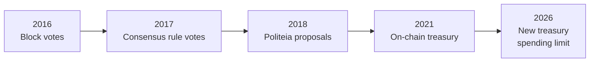

# A short history of Decred

This page tells the story of Decred from the design papers of 2013 to the 2.1 releases of 2026: who started it, why block one paid 1.68 million DCR, and how each major feature arrived. It is for newcomers who want context and for returning users who want to know what changed while they were away. A dated timeline with sources closes the page.

!!! abstract "In short"
    - **2013–2015:** a hybrid proof-of-work and proof-of-stake design, built by the developers of btcsuite, whose `btcd` is a Bitcoin full node written in Go.
    - **February 2016:** mainnet launch. Block one paid 1,680,000 DCR (8% of 21 million): half airdropped to registered participants, half to the founding developers for pre-launch work.
    - **2016–2026:** every power stakeholders hold today was added step by step: block votes (2016), consensus rule votes (2017), Politeia proposals (2018) and an on-chain treasury (2021). In 2026 stakeholders voted in a new, balance-based treasury spending limit.
    - Since the first votes of 2017, every new consensus feature has been activated by ticket vote, and every mainnet vote so far passed in its first voting interval. Security fixes, such as the one in dcrd 2.1.6, ship instead as mandatory releases.

## Why Decred exists

Decred started from a criticism of Bitcoin's governance. In a pure proof-of-work (PoW) currency, miners order transactions and also hold an effective veto over rule changes, while the people who hold the currency have no formal voice. Disputes are settled informally, with no agreed procedure and no agreed moment when a decision has been made. A second problem is funding: a decentralized currency has no owner to pay for its development.[^motivation]

Two earlier designs showed how proof of stake (PoS) could be layered on top of proof of work so that coin holders take part in approving blocks:

- **MemCoin2** (2013), a white paper by Adam Mackenzie, known on the Bitcointalk forum as tacotime. It proposed stakeholder "tickets" chosen by lottery to vote on each PoW block, and an internal voting system for major decisions about the chain's future.
- **Proof of Activity** (2014), an academic paper by Bentov, Lee, Mizrahi and Rosenfeld.

Decred's own design was set out in the [Decred Technical Brief (DTB001)](https://decred.org/dtb001.pdf), version 0.1, dated December 2015 and published by Company 0, LLC, the company of the btcsuite developers. It cites both earlier papers.

### Built from btcsuite, not forked from Bitcoin

The code was written in Go on top of btcsuite's `btcd`, which explains the ISC license and the "btcsuite developers" copyright line that `dcrd` still carries. Decred is not a fork of the Bitcoin blockchain: it started its own chain from a new genesis block and shares no transaction history with Bitcoin. It also changed a great deal of the protocol, including tickets, votes, the stake transaction tree and new signature types. [Decred for Bitcoin developers](../../dev/start/decred-for-bitcoin-developers.md) lists the differences.

## Launch, airdrop and premine (2015–2016)

Decred was announced on the Bitcointalk forum on 15 December 2015. The genesis block is timestamped 8 February 2016, 18:00 UTC, and block one was mined minutes later.

Block one is special. Instead of paying a normal block subsidy, it had to pay a fixed list of 3,146 outputs written into the software, 1,680,000 DCR in total, which is 8% of the roughly 21 million DCR that will ever exist. This list is a consensus rule: a block one that paid anything else would be invalid.[^ledger]

| Share | Amount | Outputs | Who received it |
|---|---|---|---|
| Airdrop | about 840,000 DCR (4%) | 2,972 outputs of 282.63795424 DCR each | people who registered for the airdrop before launch |
| Development costs | about 840,000 DCR (4%) | 174 outputs | Company 0 and the developers, as compensation for building Decred before launch |

### Why a premine

When the project was announced, the developers explained on the forum that the 8% would be split equally between them and the airdrop participants, so they would hold half of all coins in existence at launch.[^ann] The project's earlier documentation adds that the pre-launch development had been funded out of pocket, and gives three reasons for the premine:

- to compensate that pre-launch work;
- to put coins into many hands from the first day, so the ticket lottery had participants;
- to reach people likely to contribute to the project.

According to the same documentation, airdrop applicants were screened to remove duplicate and fraudulent sign-ups, and the coins were given away without conditions.

From launch, 10% of every block subsidy also went to the development organization, paid to a fixed address controlled by its key holders. That share is the origin of today's treasury, which became an on-chain account in 2021.

!!! warning "There is no airdrop today"
    The launch airdrop was the only one Decred has ever held. Since block one, the protocol creates new coins only through the block subsidy. Treat any offer of "free DCR" or a "Decred airdrop" as a scam, and never enter your seed to claim one.

### Tickets start voting

Tickets could be bought from block 512. From block 4,096, mined on 21 February 2016, every block has had to carry the votes of at least three of the five tickets chosen for it, and those votes decide whether the previous block's regular transactions stand. That rule has applied to every block since. [Miners, voters and the life of a block](../start/life-of-a-block.md) explains how it works.

Early users ran the command-line tools or Paymetheus, a Windows wallet. Decrediton, the cross-platform desktop wallet, appeared on 26 December 2016 as an early demo for Linux and macOS.

## Governance arrives (2017–2018)

Decred v1.0.0, released on 26 April 2017, opened the first on-chain consensus rule votes. A consensus rule vote lets ticket holders accept or reject a change to the network's rules: the new code ships dormant in the software and takes effect only if at least 75% of the non-abstaining votes over a four-week interval say yes.

An agenda that changes the rules is specified in a Decred Change Proposal (DCP). The first two agendas both took effect at block 149,248 on 9 July 2017:

- `sdiffalgorithm` (DCP-0001) replaced the ticket price algorithm with one that keeps the ticket pool close to its target size.
- `lnsupport` asked whether work on Lightning Network support should begin. It had no effect on the rules.

`lnfeatures` (DCP-0002 and DCP-0003) followed on 26 November 2017 and added the script features payment channels need. Lightning on Decred depends on them. [Consensus rule votes](../governance/consensus-upgrades.md) records every agenda in plain language.

On 15 October 2018 Politeia went into production. Politeia is Decred's proposal system: registered users publish proposals, the community discusses them, and tickets vote on them off-chain. Its records are timestamped on the Decred chain, so censorship by its operators can be proven. The announcement described the launch as handing stakeholders control over the roughly 570,000 DCR of project subsidy accumulated until then.[^politeia]

At that point treasury spending still needed the key holders of the organization address to act. Politeia votes decided what should be funded, but nothing on chain forced the payment. Removing that gap was the next major goal. [Politeia proposals](../governance/politeia.md) explains how proposals work today.

Light wallets (SPV, simplified payment verification) arrived in September 2018, with an experimental mode in dcrwallet v1.3.0.

## Privacy, the treasury and DCRDEX (2019–2021)

Much of what defines Decred today arrived in these years.

**Privacy.** CoinShuffle++ mixing was announced on the Decred blog on 28 August 2019 and reached the wallets in Decred v1.5.0 on 16 December 2019. A mix joins coins from many users into one transaction with equal-sized outputs, so an observer cannot tell whose coins went where. In this first version a central server, `cspp.decred.org`, coordinated the mixes. Today the protocol is called StakeShuffle. [Privacy and mixing](../privacy/index.md) explains it.

**Lightning and light wallets.** `fixlnseqlocks` (DCP-0004) took effect on 9 May 2019 and completed the consensus support for Lightning. `headercommitments` (DCP-0005) followed on 13 March 2020. It commits block filters to the block header, so light wallets can check the data that nodes send them.

**DCRDEX and VSPs.** DCRDEX, a decentralized exchange that settles trades with atomic swaps and never holds users' coins, had its first release (v0.1.0) on 29 October 2020. It was bundled with Decred v1.6.0 on 25 January 2021. A day later vspd 1.0.0 replaced the old stakepool software as the reference voting service provider (VSP). With vspd, the VSP fee is paid per ticket in a separate transaction and no account with the VSP is needed. As before, the VSP holds only voting rights, never funds. [Voting service providers](../staking/vsps.md) covers today's model.

**The decentralized treasury.** The `treasury` agenda (DCP-0006) took effect at block 552,448 on 8 May 2021. The treasury share of each block subsidy no longer went to an address controlled by keys. It became a balance in the consensus state. A treasury spend (TSPEND) is valid only if it is signed by one of two Politeia keys and approved by ticket votes on chain.

The first treasury spend, of about 0.1 DCR, was mined on 22 May 2021. The first large payment, about 1,006 DCR, followed on 28 December 2021.[^tspends] The diagram summarizes how the power of ticket holders grew from launch to the on-chain treasury, and the spending limit they adopted in 2026.

## Automatic revocations and subsidy changes (2022–2023)

On 8 May 2022 four agendas took effect together at block 657,280:

- `reverttreasurypolicy` (DCP-0007) changed the treasury spending limit. The limit introduced with DCP-0006 compared spending with the average of earlier windows, which differed from the policy stakeholders had approved on Politeia and, according to DCP-0007, blocked treasury payments for a time. The new limit allowed spending of up to 150% of the treasury's income in the same window.
- `explicitverupgrades` (DCP-0008) made transaction and script version upgrades explicit, so future changes can be deployed more safely.
- `autorevocations` (DCP-0009) made revocation of missed and expired tickets automatic. Until then, ticket holders had to revoke these tickets by hand to recover their funds. Now every block must contain the revocations itself.
- `changesubsidysplit` (DCP-0010) changed the block subsidy split from 60% PoW, 30% PoS and 10% treasury to 10%, 80% and 10%. DCP-0010 gives the reason: analysis showing that most PoW hash power was highly centralized and was being used to manipulate Decred markets.

On 29 August 2023, at block 794,368, two more agendas took effect:

- `blake3pow` (DCP-0011) replaced the BLAKE-256 proof-of-work hash with BLAKE3 and the difficulty algorithm with ASERT (absolutely scheduled exponentially rising targets), and reset the mining difficulty at activation. The aim was to make the existing specialized mining hardware, application-specific integrated circuits (ASICs), obsolete and break up the concentration of hash power. Block hashes, which identify blocks, still use BLAKE-256.
- `changesubsidysplitr2` (DCP-0012) moved the split to 1% PoW, 89% PoS and 10% treasury, the split in force today.

[Mining Decred](../run/mining.md) describes mining after these changes, and [DCR supply and issuance](../start/supply-and-issuance.md) shows how the split affects new coins.

## Peer-to-peer mixing, Bison Wallet and the 2.1 releases (2024–2026)

**Mixing without a server.** dcrd 2.0.0 (17 May 2024) and dcrwallet 2.0.0 (21 May 2024) moved StakeShuffle onto the peer-to-peer network. Mix messages are now relayed by the nodes themselves, and no central coordinator exists. Upgrading was required to keep mixing.

**Bison Wallet.** DCRDEX v1.0.0 (4 September 2024) renamed the DCRDEX client to Bison Wallet. It also added Decred staking and mixing, so one light wallet can hold, stake, mix and trade DCR. The 2.1.7 release bundles Bison Wallet 1.0.6. Bison Wallet 1.1 is tagged (v1.1.0-rc2) but unreleased as of November 2026.

**DCP-0013 and the treasury limit.** The income-based limit from 2022 shrinks along with the block subsidy, and DCP-0013 explains that it would leave most of the treasury unspendable over time. dcrd 2.1.0 (26 November 2025) shipped the `maxtreasuryspend` agenda.

Voting began at block 1,036,288 on 14 December 2025. The agenda took effect at block 1,052,416 on 8 February 2026, ten years to the day after the genesis block. The final tally was 24,451 yes, 3 no and 14,188 abstain votes.[^dcp13] The new limit allows spending of up to 4% of the treasury balance per window of about 24 days, with a fixed floor. [The treasury](../governance/treasury.md) explains it.

**Security releases.** dcrd 2.1.6 (18 August 2026) was a mandatory release. Its notes describe a critical consensus-related security fix, state that everyone had to upgrade or risk being forked from the network, and add a fix for a potential mixing deanonymization attack.

dcrd 2.1.7 (14 October 2026) added spend safeguards, which its notes call a response to "the previous inflation bug". A node that detects an impossible spend now shuts down rather than keep running in an unsafe state. vspd 1.5.0 (24 August 2026) requires dcrd and dcrwallet 2.1.6 or later. [Upgrading and mandatory releases](../run/upgrades.md) explains how to stay current.

## Timeline

Heights and activation blocks come from the DCPs and the whitepaper's vote history, and dates of on-chain events are the timestamps of those blocks (UTC). Release dates are those of the GitHub release pages.

| Date | Event | Source |
|---|---|---|
| 2013 | MemCoin2 hybrid PoW/PoS paper by Adam Mackenzie | [paper](https://decred.org/research/mackenzie2013.pdf) |
| December 2015 | Decred Technical Brief (DTB001) v0.1 | [brief](https://decred.org/dtb001.pdf) |
| 15 Dec 2015 | Decred announced on Bitcointalk | [thread](https://bitcointalk.org/index.php?topic=1290358.0) |
| 8 Feb 2016 | Genesis block and block one (1,680,000 DCR ledger) | [block 1](https://dcrdata.decred.org/block/1) |
| 21 Feb 2016 | Block 4,096: first block carrying ticket votes | [block 4096](https://dcrdata.decred.org/block/4096) |
| 26 Dec 2016 | First Decrediton release (v0.7.0, demo) | [release](https://github.com/decred/decred-binaries/releases/tag/v0.7.0) |
| 26 Apr 2017 | Decred v1.0.0 opens the first consensus rule votes | [release](https://github.com/decred/decred-binaries/releases/tag/v1.0.0) |
| 9 Jul 2017 | `sdiffalgorithm` (DCP-0001) and `lnsupport` active, block 149,248 | [DCP-0001](https://github.com/decred/dcps/blob/master/dcp-0001/dcp-0001.mediawiki) |
| 26 Nov 2017 | `lnfeatures` (DCP-0002, DCP-0003) active, block 189,568 | [DCP-0002](https://github.com/decred/dcps/blob/master/dcp-0002/dcp-0002.mediawiki) |
| 21 Sep 2018 | Decred v1.3.0: experimental SPV mode in dcrwallet | [release](https://github.com/decred/decred-binaries/releases/tag/v1.3.0) |
| 15 Oct 2018 | Politeia in production | [announcement](https://blog.decred.org/2018/10/15/Politeia-in-Production/) |
| 9 May 2019 | `fixlnseqlocks` (DCP-0004) active, block 342,784 | [DCP-0004](https://github.com/decred/dcps/blob/master/dcp-0004/dcp-0004.mediawiki) |
| 28 Aug 2019 | CoinShuffle++ mixing announced | [announcement](https://blog.decred.org/2019/08/28/Iterating-Privacy/) |
| 16 Dec 2019 | Decred v1.5.0: mixing in the wallets, through a central server | [release](https://github.com/decred/decred-binaries/releases/tag/v1.5.0) |
| 13 Mar 2020 | `headercommitments` (DCP-0005) active, block 431,488 | [DCP-0005](https://github.com/decred/dcps/blob/master/dcp-0005/dcp-0005.mediawiki) |
| 29 Oct 2020 | First DCRDEX release (v0.1.0) | [release](https://github.com/decred/dcrdex/releases/tag/release-v0.1.0) |
| 25 Jan 2021 | Decred v1.6.0, the first bundle to include DCRDEX | [release](https://github.com/decred/decred-binaries/releases/tag/v1.6.0) |
| 26 Jan 2021 | vspd 1.0.0 replaces the stakepool software | [release](https://github.com/decred/vspd/releases/tag/release-v1.0.0) |
| 8 May 2021 | `treasury` (DCP-0006) active, block 552,448 | [DCP-0006](https://github.com/decred/dcps/blob/master/dcp-0006/dcp-0006.mediawiki) |
| 22 May 2021 | First treasury spend (0.1 DCR), block 556,416 | [dcrdata treasury](https://dcrdata.decred.org/treasury) |
| 28 Dec 2021 | First large treasury spend (about 1,006 DCR), block 619,776 | [transaction](https://dcrdata.decred.org/tx/f57f2f35abcfc58cb8d45da6315982610203c1335ee0d68b36240f22c24a557a) |
| 8 May 2022 | DCP-0007, 0008, 0009 and 0010 active, block 657,280 | [DCP-0009](https://github.com/decred/dcps/blob/master/dcp-0009/dcp-0009.mediawiki) |
| 29 Aug 2023 | `blake3pow` (DCP-0011) and `changesubsidysplitr2` (DCP-0012) active, block 794,368 | [DCP-0011](https://github.com/decred/dcps/blob/master/dcp-0011/dcp-0011.mediawiki) |
| 17 May 2024 | dcrd 2.0.0: peer-to-peer StakeShuffle mixing | [release](https://github.com/decred/dcrd/releases/tag/release-v2.0.0) |
| 4 Sep 2024 | DCRDEX v1.0.0: the client becomes Bison Wallet | [release](https://github.com/decred/dcrdex/releases/tag/v1.0.0) |
| 26 Nov 2025 | dcrd 2.1.0 ships the `maxtreasuryspend` vote | [release](https://github.com/decred/dcrd/releases/tag/release-v2.1.0) |
| 8 Feb 2026 | `maxtreasuryspend` (DCP-0013) active, block 1,052,416 | [DCP-0013](https://github.com/decred/dcps/blob/master/dcp-0013/dcp-0013.mediawiki) |
| 18 Aug 2026 | dcrd 2.1.6: mandatory consensus security fix | [release](https://github.com/decred/dcrd/releases/tag/release-v2.1.6) |
| 24 Aug 2026 | vspd 1.5.0 | [release](https://github.com/decred/vspd/releases/tag/release-v1.5.0) |
| 14 Oct 2026 | Decred 2.1.7, with Bison Wallet 1.0.6 | [release](https://github.com/decred/decred-binaries/releases/tag/v2.1.7) |

## Old information to watch for

Forum posts, videos and the old documentation from these years describe features that no longer exist: the 60/30/10 split, BLAKE-256 mining, manual ticket revocation, stakepools, the central mixing server and the DCRDEX registration fee. [What changed: Coming back to Decred](whats-changed.md) maps each one to what replaced it.

## Go deeper

- [Main-network vote history](../../whitepaper/13-voting.md#sec:voting-history): every consensus rule vote, with its start, lock-in and activation heights and the published percentages.
- [The block-one ledger](../../whitepaper/11-subsidy.md#sec:subsidy-ledger): the exact outputs of the premine and how to check them.
- [The legacy treasury arrangement](../../whitepaper/12-treasury.md#sec:treasury-legacy): how the treasury worked before DCP-0006 and why it was replaced.
- [The whitepaper's motivation section](../../whitepaper/01-intro.md#sec:intro-motivation): the problems Decred's design sets out to solve.

## Next steps

- [What is Decred?](../start/what-is-decred.md): the whole system as it works today.
- [How Decred is governed](../governance/index.md): the four kinds of decision tickets make.
- [How staking works](../staking/index.md): how to take part in the votes this history describes.
- [DCR supply and issuance](../start/supply-and-issuance.md): the premine in the context of the full supply schedule.
- [What changed: Coming back to Decred](whats-changed.md): for returning users, what replaced each retired feature.

[^motivation]: Summarized from the [whitepaper's motivation section](../../whitepaper/01-intro.md#sec:intro-motivation), which cites MemCoin2 and Proof of Activity as the earlier designs Decred built on.
[^ledger]: The [whitepaper's block-one ledger section](../../whitepaper/11-subsidy.md#sec:subsidy-ledger) lists the amounts: 2,972 entries of 28,263,795,424 atoms total 840,000.00000128 DCR, and the other 174 entries total 839,999.99999872 DCR. The premine is the [block-one transaction on dcrdata](https://dcrdata.decred.org/tx/5e29cdb355b3fc7e76c98a9983cd44324b3efdd7815c866e33f6c72292cb8be6).
[^ann]: Reply by the project account in the [announcement thread](https://bitcointalk.org/index.php?topic=1290358.msg13412287#msg13412287), 31 December 2015, which also describes the 10% development subsidy.
[^politeia]: [Politeia in Production](https://blog.decred.org/2018/10/15/Politeia-in-Production/), Decred blog, 15 October 2018.
[^tspends]: Treasury spends are listed on the [dcrdata treasury page](https://dcrdata.decred.org/treasury).
[^dcp13]: Tally for the voting interval of blocks 1,036,288 to 1,044,351, from the [dcrdata agenda page](https://dcrdata.decred.org/agenda/maxtreasuryspend). The activation height is in [DCP-0013](https://github.com/decred/dcps/blob/master/dcp-0013/dcp-0013.mediawiki) and in the whitepaper's vote history.

*[ASERT]: absolutely scheduled exponentially rising targets
*[ASICs]: application-specific integrated circuits
*[DCP]: Decred Change Proposal
*[PoS]: proof of stake
*[PoW]: proof of work
*[SPV]: simplified payment verification
*[TSPEND]: treasury spend
*[VSP]: voting service provider
