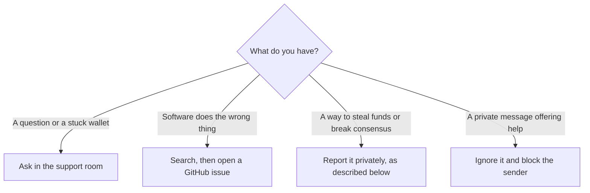

# Get help and join the community

Decred has no company help desk: help comes from users and contributors in public chat rooms and issue trackers. This page says where they are, how to avoid scams and how to take part.

## Pages in this section

-   **[Frequently asked questions](faq.md)**

    ---

    Short answers to what newcomers ask first.

-   **[Glossary](glossary.md)**

    ---

    Decred terms defined in plain words.

-   **[Key numbers](key-numbers.md)**

    ---

    Block time, ticket lifetime, subsidy split and more in one table.

-   **[What changed](whats-changed.md)**

    ---

    What was retired, for returning users and readers of old guides.

-   **[A short history of Decred](history.md)**

    ---

    From launch to today.

## Where to take what

Anything that could cost other people money goes to a private channel; everything else stays public:

## Official channels

The current list is on [decred.org/community](https://decred.org/community/). Use links from that page, not links posted in chats or search ads.

| Channel | Use it for |
| --- | --- |
| [Matrix](https://chat.decred.org/) | The main chat. Help is in the [support room](https://decred.org/matrix-support/) (`#support:decred.org`) |
| Discord | Community chat; the invite is on the community page |
| [Telegram](https://t.me/Decred), [Reddit](https://reddit.com/r/decred), [X](https://x.com/decredproject) | Announcements and discussion |
| [Bison Relay](https://bisonrelay.org/) | A peer-to-peer chat app where some of the community meets |

Rooms on the `:decred.org` server include `#general`, `#dev`, `#decrediton` and `#dex`.

## Ask for help safely

Scammers watch the help channels and answer questions in private. Decred's community page says admins will never direct message (DM) you or give support that way.

1. **Ask in a public room and stay there.** Anyone who messages you first is a scammer, however official they look.
2. **Never share your seed, passphrases or wallet files.** No real helper needs them, and no website can "validate" a wallet with them.
3. **Never install remote-access software,** run a stranger's command, or send DCR to "unlock" funds.
4. **Download wallets only** from [decred.org/wallets](https://decred.org/wallets/) or the official GitHub releases, and [verify the download](../security/verify-downloads.md).

!!! danger "If you already shared your seed"
    Assume someone will empty the wallet. Follow [Keep your DCR safe](../security/index.md) at once and move your funds to a new wallet with a new seed.

When you ask, give the app and version, your operating system and the exact error. [Wallet troubleshooting](../wallets/troubleshooting.md) and [DEX troubleshooting](../dex/troubleshooting.md) may already have the answer.

## Report a bug

Search existing issues first; if you are not sure it is a bug, ask in `#support`.

| Software | Repository |
| --- | --- |
| Decrediton | [decred/decrediton](https://github.com/decred/decrediton/issues) |
| Bison Wallet | [decred/dcrdex](https://github.com/decred/dcrdex/issues) |
| `dcrd`, `dcrwallet`, `dcrctl` | [decred/dcrd](https://github.com/decred/dcrd/issues), [decred/dcrwallet](https://github.com/decred/dcrwallet/issues), [decred/dcrctl](https://github.com/decred/dcrctl/issues) |
| `vspd` (a problem with one voting service provider goes to its operator) | [decred/vspd](https://github.com/decred/vspd/issues) |
| proposals.decred.org | [decred/politeiagui](https://github.com/decred/politeiagui/issues) |
| dcrdata block explorer | [decred/dcrdata](https://github.com/decred/dcrdata/issues) |

Other software has its own repository under [github.com/decred](https://github.com/decred).

Attach logs: Decrediton shows them under **Settings** > **Logs**, and `dcrd`, `dcrwallet` and Bison Wallet keep a `logs` folder in their data directories. Logs can contain addresses that tie you to your coins, so remove what you would not post publicly.

## Report a security vulnerability

Never open a public issue for a flaw that could cost users money, break consensus or expose private data. Report it privately to the Decred bug bounty at [bounty.decred.org](https://bounty.decred.org/#submit-vulnerability), which the treasury funds.

- **In scope** (as of November 2026): `dcrd`, `dcrwallet`, Decrediton, `vspd`, `dcrlnd` (with limits), dcrwebapi (the API behind decred.org) and cspp's `csppsolver`. Bison Wallet and dcrtime left the scope on August 8, 2026.
- The deposit, the rewards and the full rules are on the bounty site.

For other software, open an issue asking a maintainer for a private channel, without giving details.

## Help without writing code

- **Translate** Decrediton. Translations are accepted from well-known community members, and even the basic flow needs a GitHub account and git: see the [community translators guide](https://github.com/decred/decrediton/blob/master/app/i18n/community_translators.md) and `#translations`.
- **Improve these docs:** see [Contribute to these docs](../../dev/contributing/docs.md).
- **Test** new releases, or **answer questions** publicly in `#support`.
- **Write, design or organize** in rooms such as `#marketing`, `#design` and `#events`.

## Become a paid contributor

Paid work is funded from the [treasury](../governance/treasury.md) through budgets that ticket holders approve in [Politeia proposals](../governance/politeia.md). Ask in `#recruiting` which funded teams need help, see [Contributing to Decred software](../../dev/contributing/index.md) for development work, or propose your own with [Write a Politeia proposal](../governance/write-a-proposal.md).

## Further reading

[decred.org](https://decred.org/) keeps the official wallet, exchange and VSP lists, [the Decred blog](https://blog.decred.org/) has project news, and [dcrdata](https://dcrdata.decred.org/) shows live chain data. The [whitepaper's governance and ecosystem chapter](../../whitepaper/19-ecosystem.md#ch:ecosystem) covers Politeia, VSPs and DCRDEX.

## Next steps

- [Frequently asked questions](faq.md): the quickest route to an answer.
- [Keep your DCR safe](../security/index.md): the scams that cost people coins.
- [What is Decred?](../start/what-is-decred.md): the overview to read first.
- [Vote with your tickets](../governance/vote.md): the simplest way to take part.

*[DM]: direct message
*[VSP]: voting service provider
