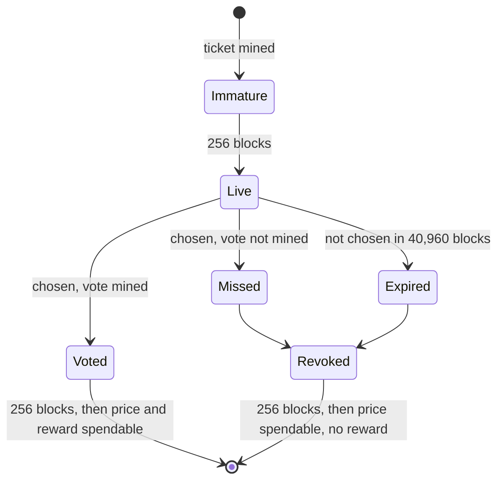

# Decred at a glance: Key numbers

This page collects the fixed numbers behind Decred: blocks, coins, tickets, the three kinds of stakeholder vote, and mixing. Each row says what the number means for you and links to the whitepaper rule that defines it.

All values are for mainnet. Protocol values come from dcrd's [`chaincfg/mainnetparams.go`](https://github.com/decred/dcrd/blob/release-v2.1.7/chaincfg/mainnetparams.go) at release-v2.1.7 and from the whitepaper's [parameter tables](../../whitepaper/14-parameters.md#sec:parameters-tables) and [derived quantities](../../whitepaper/14-parameters.md#sec:parameters-derived). Times assume the 5-minute block target, so they are approximate: real blocks arrive a little faster or slower.

The **Kind** column says what sort of number each one is:

Consensus
:   Enforced by every full node. Changing it takes a [consensus rule vote](../governance/consensus-upgrades.md) by ticket holders.

Derived
:   Follows arithmetically from consensus values.

Relay policy
:   A default in the node software for which transactions it passes on. Not a consensus rule.

Wallet
:   Behavior or a default of the wallet software (dcrwallet, which Decrediton and Bison Wallet build on).

Politeia setting
:   A parameter of the off-chain proposal system. Not enforced by the blockchain.

Mixing protocol
:   A rule of the StakeShuffle mixing protocol that nodes and wallets follow. Not a consensus rule.

Network encoding
:   A per-network constant in dcrd's chain parameters that software uses to write addresses and keys. Not a consensus rule.

A row with two kinds lists both.

Numbers that change all the time (the current ticket price, pool size, supply and treasury balance) are not constants and are not listed in the tables. See [Read the live numbers](#read-the-live-numbers) for where to find them.

## Blocks

| Number | Value | What it means | Kind and rule |
|---|---|---|---|
| Target block time | 5 minutes (288 blocks a day) | Mining difficulty adjusts so that a block arrives every 5 minutes on average. | Consensus · [Parameter tables](../../whitepaper/14-parameters.md#sec:parameters-tables) |
| Difficulty adjustment | Every block, 12-hour half-life | Difficulty rises or falls a little with every block, set by ASERT (absolutely scheduled exponentially rising targets). If blocks run 12 hours ahead of or behind schedule, difficulty doubles or halves. | Consensus · [ASERT](../../whitepaper/09-difficulty.md#sec:difficulty-asert) |
| Proof-of-work hash | BLAKE3, since block 794,368 | The hash function miners compute. It replaced BLAKE-256 after a stakeholder vote (Decred Change Proposal DCP-0011). | Consensus · [Proof-of-work hash](../../whitepaper/09-difficulty.md#sec:difficulty-powhash) |
| Maximum block size | 393,216 bytes (384 KiB) | The largest a block, or a single transaction, may be. | Consensus · [Block size limits](../../whitepaper/10-blocks.md#sec:blocks-size) |
| Votes per block | 5 tickets chosen; at least 3 votes required | Every block must carry at least 3 of the 5 chosen tickets' votes. The previous block's regular transactions stand only if more of those votes approve them than disapprove. | Consensus · [Stakeholder approval](../../whitepaper/10-blocks.md#sec:blocks-approval-mechanism) |
| Coinbase maturity | 256 blocks (about 21 hours) | Newly mined coins can be spent only after 256 more blocks. | Consensus · [Coinbase maturity](../../whitepaper/11-subsidy.md#sec:subsidy-maturity) |

## Coins and issuance

| Number | Value | What it means | Kind and rule |
|---|---|---|---|
| Smallest unit | 1 DCR = 100,000,000 atoms | Amounts are stored in atoms. Some tools and remote procedure call (RPC) results show atoms. | Consensus · [Amounts](../../whitepaper/05-addresses.md#sec:addresses-amounts) |
| Total supply | About 21 million DCR | Issuance shrinks toward zero. Under the whitepaper's ideal assumptions (every block has 5 votes and none is disapproved) the total tops out at 21,000,015.55 DCR. Missed votes make the real total lower. | Derived · [Total supply](../../whitepaper/11-subsidy.md#sec:subsidy-supply) |
| Block subsidy at launch | 31.19582664 DCR per block | The new coins created per block when the chain started. Today's subsidy is smaller. | Consensus · [The full block subsidy](../../whitepaper/11-subsidy.md#sec:subsidy-full) |
| Subsidy reduction | × 100/101 every 6,144 blocks (about 21 days) | Every 6,144 blocks the subsidy drops by about 1%. There are no sudden halvings. | Consensus · [The full block subsidy](../../whitepaper/11-subsidy.md#sec:subsidy-full) |
| Subsidy split | 1% miner, 89% voters, 10% treasury | The split since block 794,368 (DCP-0012). It started at 60/30/10 and was 10/80/10 from block 657,280 to 794,367. | Consensus · [Splitting the subsidy](../../whitepaper/11-subsidy.md#sec:subsidy-split) |
| Reward per vote | 17.8% of the block subsidy | The voters' 89% shared by 5 votes. Each vote earns this share of the subsidy of the block it votes on. | Consensus · [The three shares](../../whitepaper/11-subsidy.md#sec:subsidy-shares) |
| Missing votes | Miner's share × votes ÷ 5 | A block with only 3 or 4 votes pays the miner proportionally less. Missed votes earn nothing. | Consensus · [The three shares](../../whitepaper/11-subsidy.md#sec:subsidy-shares) |
| Block-one allocation | 1,680,000 DCR (8% of 21 million) | Created once, in block 1, and divided between the original developers and an airdrop to early participants. | Consensus · [Block-one ledger](../../whitepaper/11-subsidy.md#sec:subsidy-ledger) |
| End of issuance | Block 10,979,328 | The last block that creates any new coins, about 104 years after launch at the 5-minute target. | Derived · [Total supply](../../whitepaper/11-subsidy.md#sec:subsidy-supply) |

The [DCR supply and issuance](../start/supply-and-issuance.md) page explains the schedule and its history.

## Tickets

| Number | Value | What it means | Kind and rule |
|---|---|---|---|
| Minimum ticket price | 2 DCR | The ticket price (also called stake difficulty) never goes below this. | Consensus · [Stake difficulty](../../whitepaper/09-difficulty.md#sec:difficulty-sdiff-v2) |
| Ticket price change | Every 144 blocks (about 12 hours) | The price is fixed for 144 blocks, then recalculated. The old price is multiplied by two ratios: the number of live and immature tickets compared with the previous recalculation, and the same number compared with the target of 42,240 (40,960 live plus 1,280 immature). A growing pool, or one above target, pushes the price up; a shrinking pool, or one below target, pushes it down. When the two pull in opposite directions, the stronger one decides. | Consensus · [Stake difficulty (DCP-0001)](../../whitepaper/09-difficulty.md#sec:difficulty-sdiff-v2) |
| Target ticket pool | 40,960 live tickets (8,192 × 5) | The pool size the ticket price steers toward. The real pool is usually close to it, but not exactly at it. | Derived · [Derived quantities](../../whitepaper/14-parameters.md#sec:parameters-derived) |
| New tickets per block | At most 20 | A block can include up to 20 ticket purchases, so at most 2,880 tickets can be bought at one price. | Consensus · [Tickets](../../whitepaper/01-intro.md#sec:intro-tickets) |
| Ticket maturity | 256 blocks (about 21 hours) | A new ticket is immature and cannot be chosen until 256 blocks after the block that mined it. | Consensus · [Life of a ticket](../../whitepaper/08-staking.md#sec:staking-life) |
| Average wait to vote | 8,192 blocks (about 28 days) | How long a live ticket waits on average when the pool is at its target size. Any single ticket may wait much less or much more. | Derived · [Tickets](../../whitepaper/01-intro.md#sec:intro-tickets) |
| Ticket expiry | 40,960 blocks (about 142 days) after maturity | A ticket not chosen in this time expires. It is then revoked automatically, and its price is returned without a reward. | Consensus · [Life of a ticket](../../whitepaper/08-staking.md#sec:staking-life) |
| Chance of expiring | About 0.7% (fewer than 1 in 100) | The odds that a ticket is never chosen, with the pool at its target size. | Derived · [Tickets](../../whitepaper/01-intro.md#sec:intro-tickets) |
| Vote and revocation maturity | 256 blocks (about 21 hours) | After a ticket votes or is revoked, the returned DCR can be spent only after 256 more blocks. | Consensus · [Maturity of vote and revocation outputs](../../whitepaper/12-treasury.md#sec:treasury-stake-maturity) |

### Worked example: How long a ticket locks your DCR

The diagram shows a ticket's path from the block that mines it to spendable funds, through the immature, live, voted, missed, expired and revoked states, with the block counts that decide each step.



Adding up the block counts gives the time your DCR is locked:

| Case | Blocks | Time |
|---|---|---|
| Typical: chosen after the average wait | 256 + 8,192 + 256 = 8,704 | About 30 days |
| Worst case: never chosen | 256 + 40,960 + 256 = 41,472 | About 144 days, with no reward |

A ticket cannot be cancelled once bought. The [How staking works](../staking/index.md) page covers the whole lifecycle.

## Consensus rule votes

| Number | Value | What it means | Kind and rule |
|---|---|---|---|
| Voting interval | 8,064 blocks (about 28 days) | Votes on a rule change are counted per interval. | Consensus · [Quorum and majority](../../whitepaper/13-voting.md#sec:voting-majority) |
| Upgrade threshold | 75% of votes over 2,016 blocks (about 7 days); 950 of the last 1,000 blocks | Voting can start only after 75% of votes in a 2,016-block interval come from upgraded wallets, and 950 of the last 1,000 blocks from upgraded miners. | Consensus · [The upgrade cycle](../../whitepaper/13-voting.md#sec:voting-cycle) |
| Quorum | 4,032 votes (10% of 40,320 possible) | At least 4,032 yes and no votes in an interval. Abstain, the default choice, does not count. | Consensus · [Quorum and majority](../../whitepaper/13-voting.md#sec:voting-majority) |
| Pass threshold | 75% of yes and no votes | A choice needs 75% of the non-abstaining votes to win. If neither side reaches it, voting continues in the next interval. | Consensus · [Quorum and majority](../../whitepaper/13-voting.md#sec:voting-majority) |
| Activation delay | One more interval (8,064 blocks) | A passed change locks in, then activates one interval later, so everyone has about 28 days to upgrade. From the start of voting to activation takes at least about 8 weeks. | Consensus · [The upgrade cycle](../../whitepaper/13-voting.md#sec:voting-cycle) |

## Treasury spend votes

| Number | Value | What it means | Kind and rule |
|---|---|---|---|
| Treasury funding | 10% of every block subsidy | Paid into the treasury by every block, plus any treasury add (TADD) transactions. | Consensus · [Splitting the subsidy](../../whitepaper/11-subsidy.md#sec:subsidy-split) |
| Who can propose a spend | Holders of the 2 Politeia keys | Only a treasury spend (TSPEND) signed with one of the two keys written into the consensus rules can be voted on. | Consensus · [Treasury parameters](../../whitepaper/12-treasury.md#sec:treasury-params) |
| Treasury vote interval | 288 blocks (about 1 day) | A treasury spend can be mined only in a block whose height is a multiple of 288. | Consensus · [The voting window](../../whitepaper/12-treasury.md#sec:treasury-window) |
| Voting window | 3,456 blocks (about 12 days) | Each treasury spend has a window of 12 intervals in which tickets vote on it. | Consensus · [The voting window](../../whitepaper/12-treasury.md#sec:treasury-window) |
| Quorum | 3,456 votes (20% of 17,280 possible) | Yes and no votes together must reach 20% of the votes the window can hold. | Consensus · [Tallying and approval](../../whitepaper/12-treasury.md#sec:treasury-tally) |
| Approval | 60% | Yes votes must reach 60% of all votes cast plus all votes still possible in the window. | Consensus · [Tallying and approval](../../whitepaper/12-treasury.md#sec:treasury-tally) |
| Earliest approval | 2,304 blocks (about 8 days) after the window opens | The soonest a spend can be mined, even if every ticket votes yes. | Derived · [The voting window](../../whitepaper/12-treasury.md#sec:treasury-window) |
| Spending limit (DCP-0013) | 4% per 6,912 blocks (about 24 days) | Within any 6,912 blocks, total spends may not exceed 4% of the treasury balance plus the spends already made in that span. The limit never drops below about 10,781 DCR and never exceeds the balance. In force since block 1,052,416. | Consensus · [The balance-based policy](../../whitepaper/12-treasury.md#sec:treasury-policy-dcp13) |

The [treasury](../governance/treasury.md) page explains how spends are proposed, voted on and audited.

## Politeia proposal votes

Politeia votes happen off the blockchain: each ticket's vote is a signed message sent to the Politeia server. The rules below come from Politeia's code, not from consensus.

| Number | Value | What it means | Kind and rule |
|---|---|---|---|
| Vote duration | 2,016 to 4,032 blocks (about 7 to 14 days) | The range an administrator can choose from when starting a vote on mainnet. | Politeia setting · [Politeia](../../whitepaper/19-ecosystem.md#sec:ecosystem-politeia) |
| Eligible tickets | Tickets live 256 blocks before the vote starts | The ticket list is fixed when the vote begins. A ticket bought later cannot vote on that proposal. | Politeia setting · [Politeia](../../whitepaper/19-ecosystem.md#sec:ecosystem-politeia) |
| Quorum | 20% of eligible tickets | At least this share of the eligible tickets must vote. | Politeia setting · [Politeia](../../whitepaper/19-ecosystem.md#sec:ecosystem-politeia) |
| Approval | 60% of votes cast | At least 60% of the votes must be yes. | Politeia setting · [Politeia](../../whitepaper/19-ecosystem.md#sec:ecosystem-politeia) |

Each vote records its own quorum and approval percentages. On mainnet, Politeia's administration interface does not accept values below 20% and 60%, and these are the figures the Decred Constitution gives. An approved proposal binds no software: funding is paid through treasury spends, which tickets then vote on again. See [Politeia proposals](../governance/politeia.md).

## Mixing

| Number | Value | What it means | Kind and rule |
|---|---|---|---|
| Mix epoch | Every 10 minutes | Wallets that want to mix are grouped into a new mix every 10 minutes. | Mixing protocol · [Epochs](../../whitepaper/18-mixing.md#sec:mixing-epochs) |
| Minimum participants | 4 | A mix goes ahead only with at least 4 participants. At least one of them must be able to run the final solving step. | Mixing protocol · [Minimum participation](../../whitepaper/18-mixing.md#sec:mixing-minpeers) |
| Maximum participants | 64 per mix | The largest group in a single mix. | Mixing protocol · [Constants](../../whitepaper/18-mixing.md#sec:mixing-constants) |
| Mixed output amounts | 10 fixed sizes, from 0.00262144 to 687.19476736 DCR | When the wallet mixes coins, it splits them into these standard amounts (powers of 4 in atoms), so mixed outputs all look alike. Mixed ticket purchases use outputs sized to the ticket price instead. | Wallet |

The ten amounts are 0.00262144, 0.01048576, 0.04194304, 0.16777216, 0.67108864, 2.68435456, 10.73741824, 42.94967296, 171.79869184 and 687.19476736 DCR. The [Privacy and mixing](../privacy/index.md) page explains how a mix works and what it hides.

## Transactions and wallets

| Number | Value | What it means | Kind and rule |
|---|---|---|---|
| Minimum relay fee | 0.0001 DCR per kB (10,000 atoms) | The lowest fee rate nodes pass on, and dcrwallet's default fee rate. | Relay policy, Wallet · [Minimum relay fee](../../whitepaper/17-policy.md#sec:policy-minfee) |
| Seed | 33 words, or 64 hexadecimal characters | The backup that restores a wallet. Decred seeds use the PGP word list and are not BIP-39 seeds. | Wallet |
| Address gap limit | 20 unused addresses (default) | During a restore, the wallet stops looking for used addresses after 20 unused ones in a row. | Wallet |
| Address prefix | Ds | Ordinary mainnet addresses start with `Ds` (testnet addresses start with `Ts`). | Network encoding · [Network prefixes](../../whitepaper/05-addresses.md#sec:addresses-prefixes) |

Every other address and key prefix, default port and data directory is listed in [Ports, paths and prefixes](../../dev/reference/index.md).

## On testnet

Testnet runs the same rules with shorter timings and coins of no value. The main differences, from dcrd's [`chaincfg/testnetparams.go`](https://github.com/decred/dcrd/blob/release-v2.1.7/chaincfg/testnetparams.go):

| Number | Mainnet | Testnet |
|---|---|---|
| Target block time | 5 minutes | 2 minutes |
| Minimum ticket price | 2 DCR | 0.2 DCR |
| Target ticket pool | 40,960 tickets | 5,120 tickets |
| Ticket maturity | 256 blocks | 16 blocks |
| Ticket expiry | 40,960 blocks | 6,144 blocks |
| Consensus voting interval | 8,064 blocks | 5,040 blocks |
| Treasury vote interval and window | 288 and 3,456 blocks | 60 and 240 blocks |
| Mix epoch | 10 minutes | 3 minutes |
| Address prefix | Ds | Ts |

See [Networks](../../dev/environment/index.md) for the full comparison.

## Read the live numbers

The ticket price changes every 144 blocks; the ticket pool size, coin supply and treasury balance change with every block. The dcrdata block explorer at [dcrdata.decred.org](https://dcrdata.decred.org) shows all of them on its home page; [Use the block explorer](../wallets/block-explorer.md) explains what each figure means.

=== "Decrediton"

    The **Staking** page shows the current ticket price. The **Governance** page shows **Available Treasury Balance** at the top: the original treasury address and the decentralized treasury combined, as Decrediton reads them from dcrdata. For the pool size and supply, use dcrdata.

=== "Bison Wallet"

    On the DCR wallet's page, the **Staking** box shows the **Ticket Price** and the current **Vote Reward**. For the pool size, supply and treasury balance, use dcrdata.

=== "Command line"

    With `dcrd` running and synced, ask it directly:

    ```bash
    dcrctl getstakedifficulty
    dcrctl getblockheader $(dcrctl getbestblockhash)
    dcrctl getcoinsupply
    dcrctl gettreasurybalance
    ```

    - `getstakedifficulty` returns the ticket price in DCR: `current` for the latest block and `next` for the next block. They differ only when the next block starts a new 144-block price window.
    - `getblockheader` shows the live ticket pool size as `poolsize`.
    - `getcoinsupply` returns the total coins issued so far, in atoms.
    - `gettreasurybalance` returns the mature treasury balance (`balance`), in atoms.

## Next steps

- [How staking works](../staking/index.md): what these ticket numbers mean for your DCR, step by step.
- [Ticket price, rewards and costs](../staking/ticket-price-and-rewards.md): how to estimate a vote reward from live data.
- [How Decred is governed](../governance/index.md): how consensus votes, treasury votes and Politeia fit together.
- [Glossary](glossary.md): plain definitions of the terms used on this page.
- [What changed: Coming back to Decred](whats-changed.md): which older numbers (such as the 60/30/10 split) no longer apply.

*[DCP]: Decred Change Proposal
*[TSPEND]: treasury spend
*[TADD]: treasury add
*[ASERT]: absolutely scheduled exponentially rising targets
*[RPC]: remote procedure call
*[KiB]: kibibyte (1,024 bytes)
