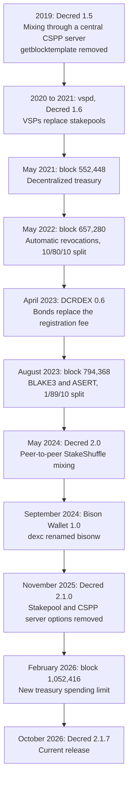

# What changed: Coming back to Decred

Decred has changed a lot since many guides, videos and forum posts were written. This page maps each retired feature, wallet option, number and service to what replaced it, so you can tell at a glance whether an instruction still applies.

Everything here is checked against Decred 2.1.7 (dcrd, dcrwallet, Decrediton) and Bison Wallet 1.0.6, the current releases in November 2026. Removed options come from comparing each program's `config.go` at its older release tags with `release-v2.1.7`. Block heights and agenda names come from the whitepaper's [main-network vote history](../../whitepaper/13-voting.md#sec:voting-history).

!!! warning "Upgrade old software first"
    Decred 2.1.6 (August 2026) was a mandatory release with a critical consensus fix, and nodes older than that risk following the wrong chain. If you are starting an old node or wallet, install the current release before doing anything else. See [Upgrading and mandatory releases](../run/upgrades.md).

## If you followed an old guide

Find the instruction your guide gives in the left column.

| If the guide tells you to... | Today | Details |
|---|---|---|
| Register with a "stakepool", get an API key, or back up and import a redeem script | Stakepools are gone. Voting service providers (VSPs) need no account and no script. | [Stakepools became VSPs](#stakepools-became-vsps) |
| Set `pooladdress`, `poolfees` or `ticketbuyer.votingaddress` | These options no longer exist. `dcrwallet` refuses to start if they are set. | [Removed dcrwallet options](#removed-dcrwallet-options) |
| Revoke missed or expired tickets, or press a revoke button | Revocation is automatic. There is nothing to do. | [Revocations are automatic](#revocations-are-automatic) |
| Set a ticket fee (`ticketfee`, `setticketfee`) | Tickets pay the ordinary transaction fee rate. | [Ticket fees are ordinary fees](#ticket-fees-are-ordinary-fees) |
| Point the wallet at a CoinShuffle++ (CSPP) server (`csppserver`) | Mixing is peer to peer. Turn it on with `mixing` and no server. | [Mixing no longer uses a server](#mixing-no-longer-uses-a-server) |
| Expect a mix every 15 minutes | A mix can start every 10 minutes on mainnet. | [Mixing no longer uses a server](#mixing-no-longer-uses-a-server) |
| Use the 60/30/10 split, or "6% per vote" | The split is 1/89/10. Each vote earns 17.8% of the block subsidy. | [Block reward split](#block-reward-split) |
| Mine with BLAKE-256 hardware, or call `getblocktemplate` | Mining uses BLAKE3. `dcrd` serves work through `getwork`. | [Proof of work](#proof-of-work) |
| Treat the treasury as an address you can watch or send to | The treasury is an on-chain account controlled by ticket votes. | [Treasury](#treasury) |
| Pay a DCRDEX registration fee, or run `dexc` / `dexcctl` | DCRDEX uses refundable fidelity bonds. The app is Bison Wallet (`bisonw`, `bwctl`). | [DCRDEX and Bison Wallet](#dcrdex-and-bison-wallet) |
| Install the Decred mobile wallet or Paymetheus | Paymetheus is discontinued and the mobile wallet has not been updated since 2022. Restore your seed in a current wallet. | [Retired wallet apps](#retired-wallet-apps) |
| Use `--addrindex` or `searchrawtransactions` to look up an address | Removed from `dcrd`. Use the dcrdata block explorer. | [Removed dcrd options](#removed-dcrd-options) |
| Get testnet coins from faucet.decred.org | That faucet does not work. | [Retired services and addresses](#retired-services-and-addresses) |

## When things changed

The diagram lists the changes in order, so you can date a guide by what it describes: a guide that tells you to use something removed at one of these points was written before it.



Block heights are where a consensus rule change took effect after a stakeholder vote. The dates are those of the activation block or of the software release.

## Staking

### Stakepools became VSPs

Until 2020, shared voting services ran software called `dcrstakepool` and were called stakepools. They were later renamed voting service providers (VSPs). In June 2020 a new design, `vspd`, was announced, and wallets supported it from Decred 1.6 (January 2021). Every listed VSP now runs `vspd`.

| | Stakepool (`dcrstakepool`, retired) | VSP (`vspd`, current) |
|---|---|---|
| Account | Sign up with the pool and link it to your wallet with an API key | No account. Pick a VSP when you buy a ticket. |
| Voting rights | Given to a 1-of-2 multisignature "redeem script" shared by you and the pool | Given to your own wallet's address. The VSP receives only the key it needs to vote. |
| Backup | You had to back up the redeem script, which your seed could not recreate | Nothing extra. Your seed recovers everything. |
| Fee | A share committed inside the ticket transaction | A separate small transaction for each ticket, paid to the VSP's fee address |
| Custody | The pool could never spend your funds | The VSP can never spend your funds |

What this means for you:

- Current wallets have no stakepool settings, and Decrediton has no way to import a redeem script. (`dcrwallet` keeps a general-purpose `importscript` RPC, but staking through a VSP needs no script.) Decrediton hid the old purchase screen in 1.7.0 and removed it in 1.8.0. `dcrwallet` 2.1.0 (November 2025) removed the remaining options and all stakepool code.
- Any ticket bought through a stakepool has long since voted, missed or expired: a ticket expires after 40,960 blocks (about 142 days). Those that missed or expired from block 657,280 (May 2022) on were revoked automatically, without the redeem script (see the next section). If a restored wallet still shows an older missed ticket as unrevoked, the funds are not lost, because a revocation no longer needs the script or a signature. Current wallets cannot create one, though, so ask for help through the channels on [Get help and join the community](index.md).
- To stake today, buy tickets through a VSP in Decrediton (**Staking** > **Purchase Tickets**), Bison Wallet or `dcrwallet`. See [Voting service providers](../staking/vsps.md) and [Stake with Decrediton or Bison Wallet](../staking/stake.md).

### Revocations are automatic

A ticket that is called to vote but does not vote is *missed*. One that is never called within 40,960 blocks *expires*. Either way, a *revocation* transaction returns the ticket price to you, with no reward.

Before the `autorevocations` agenda (Decred Change Proposal [DCP-0009](https://github.com/decred/dcps/blob/master/dcp-0009/dcp-0009.mediawiki)) took effect at block 657,280 (May 2022), the wallet holding the voting rights had to create and sign each revocation. Tickets stayed locked until it did, which is why old guides walk you through revoking, rebroadcasting or importing scripts.

Now every block must include revocations for all tickets that become missed or expired in it. A revocation needs no signature and pays no fee, so the miner of each block builds the ones it needs, and you do nothing. The returned funds can be spent 256 blocks (about 21 hours) after the revocation. See the whitepaper's [revocation transactions](../../whitepaper/08-staking.md#sec:staking-revocation).

Removed with manual revocation:

- the `revoketickets` wallet RPC (removed in `dcrwallet` 1.8.0) and the remaining manual revocation code (removed in 2.1.0);
- the node RPCs that listed missed tickets (removed in `dcrd` 1.8.0; listed in [Removed RPCs](#removed-rpcs));
- the revoke button in Decrediton's transaction details.

### Ticket fees are ordinary fees

Older wallets had a separate fee rate for tickets, set with the `ticketfee` option or the `setticketfee` RPC, and the old automatic ticket buyer had its own fee and price tuning options. In `dcrwallet` 2.1.7 a ticket purchase pays the same per-kilobyte rate as any other transaction: the `txfee` setting, which defaults to 0.0001 DCR/kB. There is nothing separate to set.

Two things have not changed. A block can still include at most 20 new tickets (a consensus rule). And a ticket bought through a VSP also pays the VSP fee, which `dcrwallet` caps with `vsp.maxfee` (wallet default 0.2 DCR). The current costs are explained in [Ticket price, rewards and costs](../staking/ticket-price-and-rewards.md).

## Mixing no longer uses a server

Decred's coin mixing, now called StakeShuffle (earlier CoinShuffle++, or CSPP), first ran on mainnet in August 2019 and shipped in Decred 1.5 (December 2019). Wallets then sent their mix requests to a central coordination server, cspp.decred.org, set with the `csppserver` and `csppserver.ca` options.

| | Before Decred 2.0 | Decred 2.0 and later |
|---|---|---|
| Coordination | One central server | Peer to peer: mix messages are relayed by `dcrd` nodes |
| Wallet setting | `csppserver=<ADDRESS>` | `mixing=1` |
| How often a mix can start (mainnet) | Old guides say every 15 minutes | Every 10 minutes |
| Server address | cspp.decred.org | None. That address no longer resolves. |

In `dcrwallet` 2.0, setting `csppserver` turned on `mixing` and logged a deprecation warning. Since 2.1.0 both server options are gone, and a configuration file that still contains them stops `dcrwallet` from starting. The account options from old guides (`mixedaccount`, `changeaccount`, `mixchange`, `ticketsplitaccount` and `ticketbuyer.votingaccount`) still exist in 2.1.7.

Mixing still needs a solver for one step, but only one participant in each mix needs to run one. Your wallet mixes without installing anything extra. In Decrediton, mixing is under **Privacy and Security** > **Privacy** (**Start Mixer**). Bison Wallet has a mixing switch in its Decred wallet. See [Mix your DCR](../privacy/mix-your-dcr.md) and the whitepaper's [StakeShuffle overview](../../whitepaper/18-mixing.md#sec:mixing-overview).

## Issuance and mining

### Block reward split

Each block creates new DCR, the *block subsidy*, divided between the miner (proof of work, PoW), the five votes (proof of stake, PoS) and the treasury. Stakeholders have changed the split twice by consensus rule vote.

| Blocks | Agenda | Miner (PoW) | Votes (PoS) | Treasury | Each vote earns |
|---|---|---|---|---|---|
| Launch to 657,279 | none (original) | 60% | 30% | 10% | 6% of the subsidy |
| 657,280 to 794,367 (from May 2022) | `changesubsidysplit` ([DCP-0010](https://github.com/decred/dcps/blob/master/dcp-0010/dcp-0010.mediawiki)) | 10% | 80% | 10% | 16% |
| 794,368 onward (from August 2023) | `changesubsidysplitr2` ([DCP-0012](https://github.com/decred/dcps/blob/master/dcp-0012/dcp-0012.mediawiki)) | 1% | 89% | 10% | 17.8% |

A vote earns its share of the subsidy of the block it votes on. Guides, calculators and older copies of the Decred Constitution that use 60/30/10 overstate the miner's share and understate the vote reward. The subsidy itself still shrinks by a factor of 100/101 every 6,144 blocks, as it always has. See the whitepaper's [subsidy split](../../whitepaper/11-subsidy.md#sec:subsidy-split) and [DCR supply and issuance](../start/supply-and-issuance.md).

### Proof of work

| | Before block 794,368 | From block 794,368 (August 2023) |
|---|---|---|
| Mining hash | BLAKE-256 | BLAKE3 (`blake3pow` agenda, [DCP-0011](https://github.com/decred/dcps/blob/master/dcp-0011/dcp-0011.mediawiki)) |
| Difficulty | Exponential moving average (EMA) algorithm, retargeted every 144 blocks | ASERT (absolutely scheduled exponentially rising targets), adjusted every block with a 12-hour half-life |
| Hardware | BLAKE-256 application-specific integrated circuits (ASICs) | BLAKE-256 ASICs cannot mine Decred |

Block and transaction IDs are still BLAKE-256 hashes. Only the proof-of-work hash changed.

`dcrd` removed the `getblocktemplate` RPC in version 1.5.0 (2019). Mining software gets work with `getwork` or `notifywork` and submits blocks with `getwork` or `submitblock`. `dcrd` does not support CPU mining on mainnet. See [Mining Decred](../run/mining.md) and the whitepaper's [ASERT](../../whitepaper/09-difficulty.md#sec:difficulty-asert).

## Treasury

Ten percent of every block's subsidy has always funded the project, but where it goes and who decides how it is spent have changed.

- **Before block 552,448 (May 2021):** each block paid the treasury share to a fixed organization address, `Dcur2mcGjmENx4DhNqDctW5wJCVyT3Qeqkx`, a 2-of-3 multisignature address controlled by a legal entity. Its key holders decided how the funds were spent.
- **From block 552,448:** the `treasury` agenda ([DCP-0006](https://github.com/decred/dcps/blob/master/dcp-0006/dcp-0006.mediawiki)) moved the treasury into an on-chain account. Each block's share goes into it through a *treasurybase* transaction. Money leaves only through a treasury spend (TSPEND) that is signed with one of two Politeia keys and approved by ticket votes. Anyone can add funds with a treasury add (TADD). The old organization address no longer receives the treasury share.

The rule for how much can be spent has changed twice. Each limit applies to a rolling window of 6,912 blocks (about 24 days):

| Blocks | Policy | Spending limit per window |
|---|---|---|
| 552,448 to 657,279 | DCP-0006 | 150% of the average spent in the six previous windows, ignoring windows with no spending (16,000 DCR when none of them had any) |
| 657,280 to 1,052,415 | `reverttreasurypolicy` ([DCP-0007](https://github.com/decred/dcps/blob/master/dcp-0007/dcp-0007.mediawiki)) | 150% of the treasury's income in the same window |
| 1,052,416 onward (from February 2026) | `maxtreasuryspend` ([DCP-0013](https://github.com/decred/dcps/blob/master/dcp-0013/dcp-0013.mediawiki)) | 4% of the treasury balance (counting spends already made in the window), never less than about 10,781 DCR and never more than the balance |

To vote on treasury spends, use **Governance** > **Treasury Spending** in Decrediton. See [The treasury](../governance/treasury.md), the whitepaper's [legacy arrangement](../../whitepaper/12-treasury.md#sec:treasury-legacy) and its [expenditure policy](../../whitepaper/12-treasury.md#sec:treasury-policy).

## Wallets

### Retired wallet apps

| App | Status | What to do |
|---|---|---|
| Decred mobile wallet for Android and iOS (`dcrandroid`, `dcrios`) | No code changes since May 2022. Not on the official wallet list. | Restore its seed in Decrediton or `dcrwallet` (see [Choose a wallet](../wallets/index.md) for other current options). |
| Paymetheus (Windows) | Its repository says it is "no longer developed or supported". | Restore its seed in Decrediton. |
| DCRDEX client (`dexc`) | Renamed Bison Wallet in version 1.0 (September 2024). | See [DCRDEX and Bison Wallet](#dcrdex-and-bison-wallet). |

Restoring is covered in [Back up and restore your wallet](../wallets/back-up-and-restore.md).

!!! danger "Type a seed only into an official wallet's restore screen"
    Never paste a seed into a website, a form, a chat or a "migration tool". Anyone who has your seed can take your funds, and a stolen seed cannot be undone.

### Opening an old Decrediton wallet

Decrediton went from version 1.8 straight to 2.0 alongside Decred 2.0. Wallet files stay where they were. When Decrediton 2.1.7 opens a wallet made by an older version, it may show one or both of these screens:

**Migrate to per-account passphrases**
:   Since Decrediton 1.6.3, each account is locked separately, so that only the account a feature needs (ticket buying, mixing, the DEX) is unlocked. Enter your current private passphrase once. Every account then uses that same passphrase. This screen appears only once. Its **Decred docs** link points to the retired documentation site; this section replaces it.

**Process Managed Tickets**
:   Shown if the wallet has live tickets bought through a VSP that still need confirming. It confirms with each VSP that your tickets are known and paid for. The screen is not limited to old wallets: it can also appear after a restore or after you buy tickets. You can skip it if you have already confirmed them.

Screens from old guides that no longer exist in Decrediton 2.1.7: the stakepool purchase area, the script import button and the revoke button.

### Legacy coin type 20

Wallet keys are derived from your seed along a path that includes a *coin type*. Decred's registered coin type is 42. Wallets created by early versions of `dcrwallet` and Decrediton used the earlier coin type 20.

When `dcrwallet` (and therefore Decrediton) restores a seed, it first looks for funds under coin type 20. If it finds none, it switches to coin type 42. If it finds used addresses, it keeps using coin type 20 and logs a warning that seed restores "may not work with some other wallet software". So:

- An old seed restores correctly in Decrediton and `dcrwallet`.
- Another wallet that only checks coin type 42 may show an old seed's funds as missing. Restore in Decrediton or `dcrwallet` instead, then send the funds to a new wallet if you want to change apps.

See the whitepaper's [hierarchical deterministic keys](../../whitepaper/05-addresses.md#sec:addresses-hd).

### DCRDEX and Bison Wallet

| Before | Now |
|---|---|
| DCRDEX client, program `dexc` | Bison Wallet, program `bisonw` (since 1.0, September 2024) |
| Command-line control tool `dexcctl` | `bwctl` |
| One-time, non-refundable registration fee per server | Fidelity bonds: time-locked funds that return to you, and that build trading tier and reputation (since DCRDEX 0.6, April 2023) |

The data folder and configuration file kept their old names: `~/.dexc` on Linux, `~/Library/Application Support/Dexc` on macOS, `%LOCALAPPDATA%\Dexc` on Windows, with `dexc.conf` inside. Decrediton's **DEX** tab embeds the same 1.0.6 version. See [DCRDEX: Trading without custody](../dex/index.md).

## Removed command-line options

Both `dcrd` and `dcrwallet` read options from the command line and from a configuration file (`dcrd.conf`, `dcrwallet.conf`). If either contains an option that has been removed, the program prints an error and stops. In a configuration file the error names the file, the line and the option:

```text title="Example error"
<CONFIG FILE>:<LINE>: unknown option: pooladdress
```

`<CONFIG FILE>` and `<LINE>` are the path and line number of the offending entry. `dcrd` prefixes the message with `Error parsing config file:`. `dcrwallet` prints its full option list after the error, so scroll up to the first line to find it. On the command line the message reads ``unknown flag `pooladdress'`` instead. Delete or comment out the entry (start the line with `;`), add its replacement from the tables below, and start the program again.

### Removed dcrwallet options

Source: `dcrwallet` `config.go` at the 1.2.2, 1.4.0, 1.5.0, 1.6.0, 1.8.0, 2.0.0 and 2.1.0 tags, compared with `release-v2.1.7`.

| Removed option | Removed in | What it did | Use instead |
|---|---|---|---|
| `pooladdress` | 2.1.0 | Stakepool fee address | `vsp.url` and `vsp.pubkey` for the VSP you choose |
| `poolfees` | 2.1.0 | Stakepool fee percentage | Nothing: the VSP sets its fee. Cap it with `vsp.maxfee` (default 0.2 DCR). |
| `ticketbuyer.votingaddress` | 2.1.0 | Gave ticket voting rights to one fixed address, often a stakepool script | `vsp.url` and `vsp.pubkey` with a VSP. To give voting rights to a separate voting wallet, set `ticketbuyer.votingaccount` to an account that holds that wallet's imported extended public key (this option is also required when the ticket buyer uses mixing). Solo voting from the same wallet needs no option. |
| `stakepoolcoldextkey` | 2.1.0 | Stakepool operator setting for fee addresses | Operators run `vspd` (see [Run a voting service provider](../../dev/operate/vsp.md)) |
| `csppserver` | 2.1.0 (deprecated in 2.0.0) | Address of the central mixing server | `mixing=1` |
| `csppserver.ca` | 2.1.0 | Certificate for the mixing server | Nothing. Delete it. |
| `reuseaddresses` | 1.6.0 | Reused one address for ticket purchases | Nothing. Wallets use fresh addresses. |
| `disallowfree` | 1.6.0 | Forced every transaction to pay a fee | Nothing. Every transaction pays a fee (`txfee`). |
| `ticketfee` | 1.5.0 | Separate fee rate for tickets | `txfee` covers tickets too |
| `ticketaddress` | 1.5.0 | Older name of `ticketbuyer.votingaddress` | As for `ticketbuyer.votingaddress` |
| `ticketbuyer.maxfee`, `ticketbuyer.minfee`, `ticketbuyer.maxpriceabsolute`, `ticketbuyer.maxpricerelative`, `ticketbuyer.avgpricemode`, `ticketbuyer.maxperblock` and the other old ticket buyer tuning options | 1.5.0 (deprecated by 1.2) | Price and fee rules for the old automatic ticket buyer | `ticketbuyer.balancetomaintainabsolute` and `ticketbuyer.limit` |
| `addridxscanlen` | 1.5.0 | Address scan length | `gaplimit` |
| `datadir` | 1.5.0 | Wallet data folder | `appdata` |
| `prunetickets`, `automaticrepair`, `rollbacktest` | 1.5.0 | Old maintenance and testing switches | Nothing. Delete them. |

!!! warning "`ticketbuyer.maxfee` is not `vsp.maxfee`"
    The removed `ticketbuyer.maxfee` was a ticket fee rate per kilobyte. The current `vsp.maxfee` is the most you will pay a VSP for one ticket. Do not copy a value from one to the other.

The current options that replace these workflows are `mixing`, `csppsolver` (optional) and the `vsp.*` group (`vsp.url`, `vsp.pubkey`, `vsp.sync`, `vsp.maxfee`). Every current option is listed in [dcrwallet configuration](../../dev/reference/dcrwallet-config.md).

### Removed dcrd options

Source: `dcrd` `config.go` at the 1.4.0, 1.5.1, 1.6.0, 1.7.0 and 1.8.0 tags, compared with `release-v2.1.7`. The option set did not change between 1.8.0 and 2.1.7.

| Removed option | Removed in | What it did | Use instead |
|---|---|---|---|
| `addrindex`, `dropaddrindex` | 1.8.0 | Built or deleted an index of transactions by address, for `searchrawtransactions` | The dcrdata explorer and its API (see [Use the block explorer](../wallets/block-explorer.md)). `txindex` still indexes transactions by ID. |
| `nocheckpoints` | 1.8.0 | Turned off built-in checkpoints | Nothing. `dcrd` no longer uses checkpoints; `assumevalid` and `allowoldforks` cover the related cases. |
| `nocfilters`, `dropcfindex` | 1.7.0 | Turned off or deleted version 1 compact filters | Nothing. Light wallets (SPV) use version 2 filters. |
| `getworkkey` | 1.5.0 | Payment address for blocks mined through `getwork` | `miningaddr` |

These `dcrd` options still exist in 2.1.7 but are deprecated. The node starts and prints a warning:

| Deprecated option | Status | Use instead |
|---|---|---|
| `nodnsseed` | Deprecated since 1.6.0 | `noseeders` |
| `limitfreerelay`, `norelaypriority` | No effect since 1.8.0 | Nothing |
| `blockminsize`, `blockprioritysize` | No effect since 1.8.0 | Nothing |

### Removed RPCs

| RPC | Program | Removed in | Use instead |
|---|---|---|---|
| `getblocktemplate` | `dcrd` | 1.5.0 | `getwork`, `notifywork`, `submitblock` |
| `searchrawtransactions` | `dcrd` | 1.8.0 | The dcrdata API |
| `missedtickets`, `rebroadcastmissed`, `existsmissedtickets`, `existsexpiredtickets`, `notifyspentandmissedtickets` | `dcrd` | 1.8.0 | Nothing: revocations are automatic |
| `revoketickets` | `dcrwallet` | 1.8.0 | Nothing: revocations are automatic |
| `RevokeTicket`, `RevokeTickets` (gRPC) | `dcrwallet` | 2.1.0 | Nothing: revocations are automatic |
| `getticketfee`, `setticketfee` | `dcrwallet` | 1.6.0 | `settxfee` (one rate for all transactions) |
| `addticket` | `dcrwallet` | 1.6.0 | Nothing |
| `stakepooluserinfo`, `ticketsforaddress` | `dcrwallet` | 2.1.0 | Nothing. VSP operators use `vspd`. |

## Retired services and addresses

Status as checked in November 2026. Links on this site point only to working services.

| Service | Status | Use instead |
|---|---|---|
| docs.decred.org and devdocs.decred.org | Out of date | This site |
| cspp.decred.org (mixing server) | Does not resolve | Nothing. Mixing is peer to peer. |
| faucet.decred.org (testnet faucet) | Returns an error (HTTP 502) | See [Networks](../../dev/environment/index.md) for current testnet resources. |
| testnet.dcrdata.org (testnet explorer) | Returns an error (HTTP 503) | See [Networks](../../dev/environment/index.md). |
| cms.decred.org (contractor management) | Does not resolve | See [Get help and join the community](index.md) for how contributors are paid. |
| bisonwallet.org | Expired security certificate | Download Bison Wallet from the [Decred 2.1.7 release](https://github.com/decred/decred-binaries/releases/tag/v2.1.7) or through [decred.org/wallets](https://decred.org/wallets/). Check it with [Verify your download](../security/verify-downloads.md). |
| Stakepool lists | Stakepools no longer exist | The community-reviewed VSP list at [decred.org/vsp](https://decred.org/vsp/) |

Retired terms such as "stakepool", "pool fee", "CSPP server" and "registration fee" are defined in the [Glossary](glossary.md), with the current term for each.

## Next steps

- [Upgrading and mandatory releases](../run/upgrades.md): bring old software up to 2.1.7 safely before you do anything else.
- [Stake with Decrediton or Bison Wallet](../staking/stake.md): buy tickets the current way, through a VSP.
- [Mix your DCR](../privacy/mix-your-dcr.md): turn on peer-to-peer mixing.
- [Back up and restore your wallet](../wallets/back-up-and-restore.md): move an old seed into a current wallet.
- [Glossary](glossary.md): current and retired terms side by side.

*[API]: application programming interface
*[ASERT]: absolutely scheduled exponentially rising targets
*[ASICs]: application-specific integrated circuits
*[CSPP]: CoinShuffle++
*[DCP]: Decred Change Proposal
*[DEX]: decentralized exchange
*[EMA]: exponential moving average
*[PoS]: proof of stake
*[PoW]: proof of work
*[RPC]: remote procedure call
*[RPCs]: remote procedure calls
*[SPV]: simplified payment verification
*[TADD]: treasury add
*[TSPEND]: treasury spend
*[VSP]: voting service provider
*[VSPs]: voting service providers
