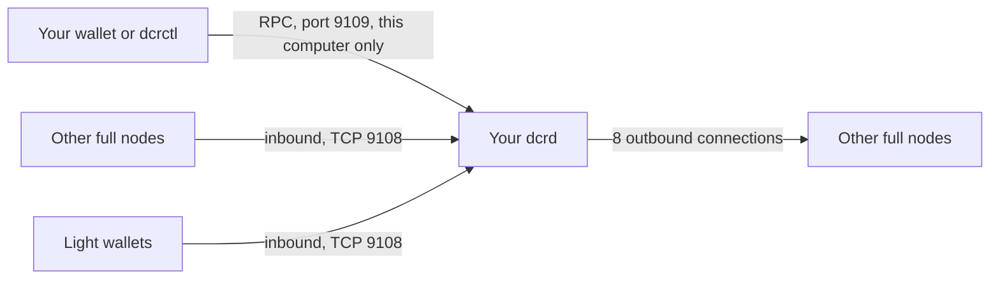

# Run a full node

A full node downloads every Decred block and checks every rule itself, instead of trusting anyone else's copy of the chain. This guide takes you from a first sync to a node that runs unattended, serves other nodes through port 9108 and can back solo voting, mining or a service.

!!! info "Applies to"
    dcrd and dcrctl 2.1.7 (Decred release v2.1.7) and Decrediton 2.1.7. Checked November 2026.

## What a full node does and why run one

`dcrd` is Decred's full node software. Once synced, it checks every new block in full (proof of work, every transaction and signature, every ticket vote, subsidy and treasury rule), keeps the set of unspent coins, relays valid blocks, transactions, votes and mixing messages to its peers, and answers your wallet and tools such as `dcrctl` over its remote procedure call (RPC) interface. Reasons to run one:

- **Verify instead of trust.** A wallet connected to your own node relies on nothing but the rules.
- **Privacy.** Your node downloads every block, so no peer learns which transactions interest you.
- **Serve the network.** With port 9108 open, new nodes and light wallets (SPV, simplified payment verification) can sync from yours.
- **Build on it.** Solo voting, solo mining, voting service providers (VSPs) and most other services need a full node.

`dcrd` holds no keys and no coins, and running it earns nothing. It can be switched off at any time without penalty and catches up when it starts again.

Your node keeps eight outbound connections to peers it picks, and accepts inbound connections from others only if they can reach port 9108 ([peer management](../../whitepaper/15-p2p.md#sec:p2p-peers) in the whitepaper has the limits):



### Decrediton's node or a standalone dcrd

Decrediton can run its own `dcrd` instead of working as a light wallet (**Settings** > **Connectivity**, **SPV** set to **Disabled**; [Install and use Decrediton](../wallets/decrediton.md) walks through it). That node verifies the chain for your wallet, but it runs only while Decrediton is open and accepts no inbound connections, because Decrediton starts it with `--nolisten`. The rest of this page is about the standalone `dcrd` from the command-line suite.

## Before you start

- **The command-line suite, verified.** [Set up the command-line wallet](../wallets/command-line.md) shows how to download it (or use dcrinstall), and [Verify your download](../security/verify-downloads.md) how to check it. Only `dcrd` and `dcrctl` are needed here; a wallet is optional.
- **A computer that can stay on.** Builds exist for Windows, macOS, Linux, FreeBSD and OpenBSD, including 32- and 64-bit ARM Linux for single-board computers.
- **Resources**, as below.

| Resource | What to plan for |
|---|---|
| Disk | At least double the raw chain size on dcrdata's [Blockchain Size chart](https://dcrdata.decred.org/charts?chart=blockchain-size) (for example, about 19.5 GB in November 2026), because the data directory also holds the unspent-coin database and indexes, and the chain grows every day. A solid-state drive (SSD) makes the first sync much faster. |
| Memory | At least 2 GB of RAM for `dcrd`, the minimum in dcrd's README. |
| Bandwidth | The first sync downloads the whole chain. After that, most traffic is upload to peers syncing from you. Measure it with `dcrctl getnettotals`; cap peers with `maxpeers` (default 125). On a metered connection, consider not opening the port. |
| Uptime | Not required for your own use. A node that serves others, or backs solo voting, should run around the clock. |

## 1. Start dcrd and let it sync

Start the node from the folder that holds the programs (or anywhere, if they are on your `PATH`):

```bash
dcrd
```

On Windows, run `.\dcrd.exe` in PowerShell. On its first start `dcrd`:

1. creates its home folder (`~/.dcrd` on Linux and BSD, `~/Library/Application Support/Dcrd` on macOS, `%LOCALAPPDATA%\Dcrd` on Windows);
2. writes `dcrd.conf` there from its built-in sample, with a random `rpcuser` and `rpcpass`, so the RPC server is enabled at once and listens only on this computer;
3. creates `rpc.cert` and `rpc.key` for that RPC server;
4. finds peers through the network's HTTPS seeders and starts syncing.

It syncs headers first, then blocks. Expect log lines like these, each starting with a timestamp (hashes, heights and peers will differ):

```text title="Expected output"
[INF] SYNC: Syncing headers to block height 1133580 from peer 203.0.113.7:9108 (outbound)
[INF] SYNC: Initial headers sync complete (best header hash 0000…, height 1133580)
[INF] SYNC: Performing initial chain sync...
[INF] SYNC: Processed 1205 blocks in the last 10.01s (… height 254311, progress 22.43%)
[INF] SYNC: Initial chain sync complete (hash 0000…, height 1133580)
```

How long the first sync takes depends mostly on disk speed and processor. You can stop `dcrd` at any time with ++ctrl+c++; it saves its progress and continues from there next time.

### Why the first sync is faster than checking everything

`dcrd` has a built-in *assume-valid* block, a historical block the developers verify before each release (height 1,026,597 in 2.1.7). For blocks up to and including it, `dcrd` skips the most expensive checks: signature scripts, input amounts, fees and subsidies. It still checks every header's proof of work and that each block's transactions match its header, so a changed historical transaction would be detected. Every later block gets every check.

To check everything from the first block, add this to `dcrd.conf` before the first sync, and expect it to take longer:

```ini
assumevalid=0
```

[The whitepaper's assume-valid section](../../whitepaper/10-blocks.md#sec:blocks-assumevalid) lists exactly what is skipped.

!!! note "Testnet"
    Add `testnet=1` to `dcrd.conf` (or start `dcrd --testnet`) for testnet. It uses port 19108 for peers and 19109 for RPC, stores its chain in `data/testnet3`, and needs `dcrctl --testnet`.

## 2. Accept incoming connections

By default `dcrd` already listens on all network interfaces on TCP port 9108. Other nodes can reach it only if your firewall and router let them in.

!!! warning "Open port 9108 only"
    Never forward or open port 9109. That is the RPC port, which controls your node; it listens only on this computer by default, and should stay that way.

**Allow port 9108 in the computer's firewall:**

=== "Windows"

    In PowerShell run as Administrator:

    ```powershell
    New-NetFirewallRule -DisplayName "dcrd peer port" -Direction Inbound -Protocol TCP -LocalPort 9108 -Action Allow
    ```

=== "macOS"

    The macOS firewall is off by default. If you have turned it on (**System Settings** > **Network** > **Firewall**), allow `dcrd` when macOS asks whether it may accept incoming connections.

=== "Linux"

    With ufw:

    ```bash
    sudo ufw allow 9108/tcp
    ```

    With firewalld:

    ```bash
    sudo firewall-cmd --permanent --add-port=9108/tcp
    sudo firewall-cmd --reload
    ```

**Forward the port on your router.** Forward external TCP port 9108 to port 9108 on the computer running `dcrd`, and give that computer a fixed local address (a DHCP reservation) so the rule keeps working. If your router supports Universal Plug and Play (UPnP), adding `upnp=1` to `dcrd.conf` asks it to open the port instead.

You do not need to tell `dcrd` your public address: once five of its outbound peers report the same address, it advertises that address to the network ([external address discovery](../../whitepaper/15-p2p.md#sec:p2p-external)).

**Check it worked.** After `dcrd` has synced, run:

```bash
dcrctl getnetworkinfo
```

Under `localaddresses` you should see your public address with port 9108. This only shows that `dcrd` knows its public address, not that other nodes can reach it. The proof that the port is open is inbound peers, which arrive only as other nodes learn your address, so give it time. Count them with:

```bash
dcrctl getpeerinfo | grep -c '"inbound": true'
```

In PowerShell: `((.\dcrctl.exe getpeerinfo | Out-String | ConvertFrom-Json) | Where-Object inbound).Count`. If the count stays at 0, see [No inbound peers](#no-inbound-peers).

## 3. Run over Tor (optional)

Tor hides your IP address from your peers, and hides from your internet provider that you run a Decred node. In dcrd 2.1.7 that has a cost: a node behind Tor accepts no inbound connections, so it serves no other nodes or light wallets, and it syncs more slowly.

!!! note "No onion service in dcrd 2.1.7"
    dcrd 2.1.7 cannot use onion addresses with `externalip` or `addpeer`, so every peer connection over Tor goes to an ordinary IP address. The onion-service setup in dcrd's `docs/configuring_tor.md` does not work with this version.

To route all of `dcrd`'s traffic through Tor:

1. Install Tor from [the Tor Project](https://www.torproject.org/) and make sure it is running. A standalone Tor listens on `127.0.0.1:9050`; Tor Browser listens on `127.0.0.1:9150` only while it is open.
2. Add to `dcrd.conf`:

    ```ini
    proxy=127.0.0.1:9050
    torisolation=1
    ```

    `proxy` sends every connection and every address lookup through Tor and turns off listening. `torisolation` makes Tor build a separate circuit for each peer, so your connections are harder to link.

3. Restart `dcrd`.

**Check it worked:** `dcrctl getnetworkinfo` lists `127.0.0.1:9050` as the `proxy` for each entry under `networks`, and `getpeerinfo` shows no inbound peers.

## 4. Keep it running

`dcrd` has no "daemon" mode of its own, so let your operating system start it at boot and restart it if it is killed. Always stop `dcrd` cleanly rather than cutting power, so it can flush its database.

=== "Windows"

    `dcrd` can install itself as a Windows service named `dcrdsvc` (shown as **Dcrd Service**). Put `dcrd.exe` in a permanent folder first, because the service records its path. Then, in PowerShell run as Administrator, in that folder:

    ```powershell
    .\dcrd.exe --service install
    sc.exe config dcrdsvc start= auto
    .\dcrd.exe --service start
    ```

    The `sc.exe` line changes the start type from manual to automatic. Stop the service with `.\dcrd.exe --service stop`; remove it with `.\dcrd.exe --service remove`.

    The service runs as the LocalSystem account. Its home folder is `C:\Windows\System32\config\systemprofile\AppData\Local\Dcrd`, which only PowerShell run as Administrator can read or write. On first start the service writes a new `dcrd.conf` there and syncs from scratch, unless you first copy your synced `data` folder into it. To use `dcrctl` from your own account, in PowerShell run as Administrator:

    1. Copy `rpc.cert` from the service's home folder to `%LOCALAPPDATA%\Dcrctl\`.
    2. Copy the `rpcuser` and `rpcpass` lines from the service's `dcrd.conf` into `%LOCALAPPDATA%\Dcrctl\dcrctl.conf`, and add:

        ```ini
        rpccert=C:\Users\<USERNAME>\AppData\Local\Dcrctl\rpc.cert
        ```

    `<USERNAME>` is your Windows user name. If the service's certificate is ever regenerated, copy it again.

=== "macOS"

    dcrd ships no macOS service file, but a launchd agent does the job. Save this as `~/Library/LaunchAgents/local.dcrd.plist`:

    ```xml
    <?xml version="1.0" encoding="UTF-8"?>
    <!DOCTYPE plist PUBLIC "-//Apple//DTD PLIST 1.0//EN" "http://www.apple.com/DTDs/PropertyList-1.0.dtd">
    <plist version="1.0">
    <dict>
      <key>Label</key>
      <string>local.dcrd</string>
      <key>ProgramArguments</key>
      <array>
        <string>/Users/<USERNAME>/decred/dcrd</string>
      </array>
      <key>RunAtLoad</key>
      <true/>
      <key>KeepAlive</key>
      <dict>
        <key>Crashed</key>
        <true/>
      </dict>
      <key>StandardErrorPath</key>
      <string>/Users/<USERNAME>/Library/Application Support/Dcrd/logs/stderr.log</string>
    </dict>
    </plist>
    ```

    Replace `<USERNAME>` with your macOS user name, and the program path with wherever your `dcrd` is (dcrinstall uses `~/decred`). The `logs` folder exists once `dcrd` has run, as in step 1. Then load and check the agent:

    ```bash
    launchctl bootstrap gui/$(id -u) ~/Library/LaunchAgents/local.dcrd.plist
    launchctl print gui/$(id -u)/local.dcrd
    ```

    Stop it with `launchctl bootout gui/$(id -u)/local.dcrd`. An agent runs only while you are logged in (for a Mac with no one logged in, use `/Library/LaunchDaemons` with a `UserName` key), and the Mac must be set not to sleep.

=== "Linux"

    dcrd ships a hardened systemd unit, [contrib/services/systemd/dcrd.service](https://github.com/decred/dcrd/blob/release-v2.1.7/contrib/services/systemd/dcrd.service). It runs `dcrd` as a dedicated `dcrd` user, from `/home/dcrd/decred/dcrd`, with its data in `/home/dcrd/.dcrd`. Set that up from the folder holding your verified programs:

    ```bash
    sudo useradd --system --create-home --home-dir /home/dcrd dcrd
    sudo mkdir /home/dcrd/decred
    sudo cp dcrd dcrctl /home/dcrd/decred/
    sudo chown -R dcrd:dcrd /home/dcrd/decred
    sudo -u dcrd mkdir -p /home/dcrd/.dcrd/data /home/dcrd/.dcrd/logs
    sudo curl -fsSL -o /etc/systemd/system/dcrd.service https://raw.githubusercontent.com/decred/dcrd/release-v2.1.7/contrib/services/systemd/dcrd.service
    ```

    Read the unit file, then start it and enable it at boot:

    ```bash
    sudo systemctl daemon-reload
    sudo systemctl enable --now dcrd
    systemctl status dcrd
    ```

    The `mkdir` line matters: the unit grants write access to `/home/dcrd/.dcrd`, `data` and `logs` by name, and systemd refuses to start it if they are missing. The unit also blocks `/usr/bin`, `/usr/local/bin` and similar folders, so keep the binary where it expects it. To skip a second sync, stop any `dcrd` you ran as yourself and copy its `~/.dcrd/data` into `/home/dcrd/.dcrd/data` (owned by `dcrd`) before the first start.

    Run `dcrctl` as the `dcrd` user, so it finds that user's credentials and certificate:

    ```bash
    sudo -u dcrd -H /home/dcrd/decred/dcrctl getblockchaininfo
    ```

    Stop the node with `sudo systemctl stop dcrd`. The unit (`Restart=on-abnormal`) restarts `dcrd` after it is killed, for example by the system running out of memory, but not when `dcrd` exits on its own with an error.

OpenBSD (`rc.d`) and illumos or Solaris (`smf`) users will find service files in the same [contrib/services](https://github.com/decred/dcrd/tree/release-v2.1.7/contrib/services) folder.

## 5. Check on your node

These read-only `dcrctl` commands answer the usual questions:

| Command | What it tells you |
|---|---|
| `dcrctl getblockchaininfo` | Sync state: `blocks`, `headers`, `syncheight`, `verificationprogress`, and `initialblockdownload` (`false` once synced) |
| `dcrctl getconnectioncount` | Number of connected peers |
| `dcrctl getpeerinfo` | Each peer's address, version, height and whether it is `inbound` |
| `dcrctl getnetworkinfo` | Your advertised `localaddresses`, proxy settings and relay fee |
| `dcrctl getnettotals` | Bytes received and sent since `dcrd` started |
| `dcrctl stop` | Shuts `dcrd` down cleanly |

A synced node looks like this (output shortened; your numbers will differ):

```text title="Expected output (example)"
{
  "chain": "mainnet",
  "blocks": 1133580,
  "headers": 1133580,
  "syncheight": 1133580,
  "bestblockhash": "…",
  …
  "verificationprogress": 1,
  …
  "initialblockdownload": false,
  …
}
```

Compare `blocks` with the latest height on [dcrdata](https://dcrdata.decred.org/); they should match within a block or two.

**Logs.** `dcrd` prints its log to the terminal (or the systemd journal: `journalctl -u dcrd`) and writes it to `logs/mainnet/dcrd.log` in its home folder, rotating the file at 10 MB.

## Upgrading safely

To upgrade, stop `dcrd`, replace the program with the new verified release and start it again; the chain data is kept. Some releases are mandatory, as 2.1.6 was, and 2.1.7 adds safeguards that shut the node down after a spend that should be impossible: [Upgrading and mandatory releases](upgrades.md) covers both, and where releases are announced.

## Troubleshooting

### No inbound peers

- Wait: other nodes need time to learn your address, and `dcrd` advertises it only once it is synced.
- If `localaddresses` in `dcrctl getnetworkinfo` is empty, check that you have not set `proxy`, `nolisten` or `connect`, all of which stop listening.
- Check the firewall rule and the router's port forward from step 2.
- Look at the external (WAN) address in your router's status page. If it starts with `100.64.` to `100.127.`, or differs from your public address, your provider uses carrier-grade network address translation (NAT), and port forwarding cannot work. Ask your provider for a public address, or use IPv6 if you have it: no port forwarding is needed, but allow inbound TCP 9108 both in the computer's firewall and in the router's IPv6 firewall.

### dcrctl cannot connect

- `dcrd` must be running, on the same network (`--testnet` on both, or neither).
- On its first run without a `dcrctl.conf`, `dcrctl` copies `rpcuser` and `rpcpass` from your own `dcrd.conf`. If `dcrd` runs under another account, or you changed the credentials later, put the current ones in `dcrctl.conf` yourself (see step 4).

### Sync stops or never starts

- Check the log for errors and that the computer's clock is correct.
- Outbound TCP connections must be allowed; a strict firewall or network can block them.
- If the log shows no peer connections at all, check the internet connection and, with `proxy` set, that Tor is running.
- A `No sync peer candidates available` warning means `dcrd` has peers, but none of them serves blocks and has at least as much of the chain as `dcrd` already knows about. `dcrd` tries again each time a new peer connects.

### dcrd stopped on its own

Read the end of the log (on macOS also `stderr.log`, if you used the agent above). If the disk is full, free space or move the chain with the `datadir` option. If the log shows one of the 2.1.7 safeguards, do not keep restarting the node: see [Upgrading and mandatory releases](upgrades.md) and ask in the [community channels](https://decred.org/community/).

## Next steps

- [Upgrading and mandatory releases](upgrades.md): keep your node in consensus when new releases ship.
- [Vote without a VSP](../staking/solo-voting.md): put your node to work voting your own tickets.
- [Set up the command-line wallet](../wallets/command-line.md): connect `dcrwallet` to your node.
- [Privacy beyond mixing](../privacy/privacy-practices.md): point a light wallet at your own node with **SPV Connect**.
- [Run dcrd in production](../../dev/operate/production-node.md): indexes, caches and remote RPC access for services.

*[RPC]: remote procedure call
*[SPV]: simplified payment verification
*[VSP]: voting service provider
*[VSPs]: voting service providers
*[UPnP]: Universal Plug and Play
*[NAT]: network address translation
*[SSD]: solid-state drive
*[WAN]: wide area network
*[DHCP]: Dynamic Host Configuration Protocol
