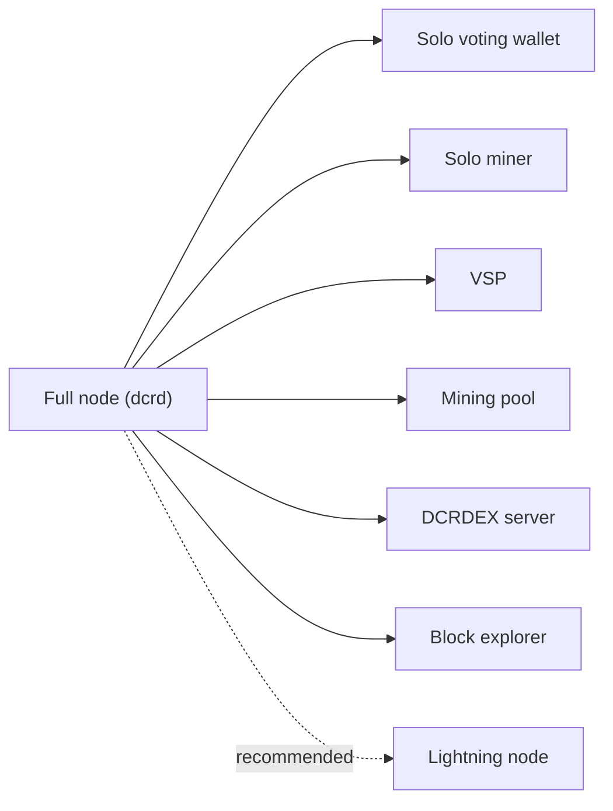

# Run Decred infrastructure

A wallet is enough to hold, stake, mix and vote. This section is for people who want more: to check every rule themselves with a full node, vote without a voting service provider (VSP), or mine. It also lists the public services and their operator guides.

## What you can run and why

Effort, roughly: **Low** is a spare computer that mostly runs unattended; **Medium** needs the command line and regular attention; **High** means always-on servers, monitoring and prompt upgrades; **Very high** is a public service others' money or votes depend on.

| What | Why run it | What it needs | Effort | Guide |
| --- | --- | --- | --- | --- |
| Full node (`dcrd`) | Check every block and transaction yourself. With port 9108 open, other nodes and light wallets (SPV, simplified payment verification) can connect to yours | Disk space for the whole chain ([live size on dcrdata](https://dcrdata.decred.org/charts?chart=blockchain-size)) and a steady connection. Decrediton runs one for you when **SPV** is set to **Disabled** (**Settings** > **Connectivity**) | Low | [Run a full node](full-node.md) |
| Solo voting wallet | Vote your own tickets with no VSP fee | A full node plus an always-online, unlocked `dcrwallet` with voting enabled, ideally on two or more servers. Command line only | High | [Vote without a VSP](../staking/solo-voting.md) |
| Miner | Earn 1% of each block's new coins plus its transaction fees | BLAKE3 mining hardware, power, and a pool or your own `dcrd` | High | [Mining Decred](mining.md) |
| VSP | Vote other people's tickets for a fee | `vspd` built from source; to be listed on decred.org, a front-end server and at least three voting servers in separate locations | Very high | [Run a voting service provider](../../dev/operate/vsp.md) |
| Mining pool (`dcrpool`) | Combine many miners' hashing and share the rewards | `dcrd`, plus `dcrwallet` to pay miners in public pool mode | High | [Mining infrastructure](../../dev/operate/mining.md) |
| DCRDEX server | Host markets for Bison Wallet traders | Linux or macOS, PostgreSQL, a full node with `txindex` for each coin such as DCR or BTC, and RPC endpoints for Ethereum and Polygon assets | Very high | [Run a DCRDEX server](../../dev/operate/dex-server.md) |
| Block explorer (`dcrdata`) | Your own copy of dcrdata and its API | `dcrd` with `txindex`, and PostgreSQL on an SSD | High | [dcrdata API](../../dev/api/dcrdata-api.md) |
| Lightning node (`dcrlnd`) | Route payments and run your own channels | `dcrd` (recommended for an always-on node) or light (SPV) mode, where its wallet syncs from peers instead; uptime while channels are open; channel backups | Medium to high | [Run a dcrlnd Lightning node](../../dev/operate/lightning-node.md) |

Most of these build on a full node, so start there. Only a miner in someone else's pool and a Lightning node in light mode can do without one:

!!! warning "Online wallets are targets"
    Solo voting, a VSP, a pool that pays miners and a Lightning node all keep an unlocked wallet on an internet-connected machine. Keep only what the job needs there, and keep spending seeds elsewhere where the design allows, as the solo voting and VSP guides describe.

To pay with Lightning from a desktop, no standalone node is needed: Decrediton starts one for you (**Lightning Transactions** in its sidebar). See [Lightning on Decred](../lightning/index.md).

## Pages in this section

-   **[Run a full node](full-node.md)**

    ---

    Requirements, setup, connectivity, Tor and running `dcrd` unattended.

-   **[Upgrading and mandatory releases](upgrades.md)**

    ---

    Where releases appear, which are mandatory, and the upgrade order.

-   **[Mining Decred](mining.md)**

    ---

    The miner's role and share, hardware, and solo versus pool mining.

## Operator guides in the developer docs

The service guides in the table assume system administration experience. Two more apply to every operator:

- [Operating Decred infrastructure](../../dev/operate/index.md): release channels, monitoring, and which guide covers which service.
- [Run dcrd in production](../../dev/operate/production-node.md): sizing, indexes, exposing RPC safely, and recovery.

## Keeping up with releases

Infrastructure has to stay current: Decred 2.1.6 was mandatory, and its notes say everyone must upgrade or risk being forked from the network. [Upgrading and mandatory releases](upgrades.md) covers where releases are announced and the upgrade order.

## Next steps

- [Run a full node](full-node.md): the foundation for everything else here.
- [Vote without a VSP](../staking/solo-voting.md): once your node runs.
- [Mining Decred](mining.md): whether mining makes sense for you.
- [Operating Decred infrastructure](../../dev/operate/index.md): before you offer a service to others.

*[VSP]: voting service provider
*[SPV]: simplified payment verification
