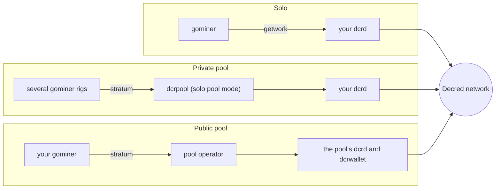

# Mining Decred

This page explains Decred proof-of-work mining as it works in 2026, for anyone considering it: what miners do and earn, which hardware can mine, whether mining pays, and how solo and pool mining start. The full setup is in the developer docs' [Mining infrastructure](../../dev/operate/mining.md) guide.

!!! abstract "At a glance"
    - **Miners propose blocks; ticket holders approve them.** A block needs votes from at least three of the five tickets drawn for its parent, and votes can strip the previous miner's reward.
    - **Miners get 1% of each block's new coins, plus fees.** Both shrink when votes are missing. Mined coins can be spent only after 256 blocks (about 21 hours).
    - **The hash is BLAKE3 and the difficulty algorithm is ASERT**, both since block 794,368 (August 2023, Decred Change Proposal DCP-0011). BLAKE-256 mining hardware no longer works.
    - **Mining uses `dcrd` plus `gominer`**, a graphics-card (GPU) miner you build from source, either solo or through a stratum pool. CPU mining is practical only on test networks.

This page explains mechanisms. It is not financial advice.

## What miners do

A miner builds a candidate block from waiting transactions and the latest ticket votes, then hashes the block header over and over, changing a few bytes each time, until the hash falls at or below a target. Finding such a hash takes a great deal of computation; checking it takes almost none. This is **proof of work (PoW)**: it decides who proposes the next block and makes rewriting history expensive.

**Proof of stake (PoS)** then checks the miner. Each new block draws five live tickets, and the next block is valid only if it carries votes from at least three of them. Voters keep miners in check in three ways:

- **A block without enough votes is a dead end.** Nothing can be built on it, so its miner's reward is lost.
- **Disapproval cancels the reward.** Unless more of the votes in the next block approve than disapprove, the block's ordinary transactions are undone, including the miner's reward.
- **Miners cannot change the rules.** Consensus rule changes take effect only after ticket holders vote for them.

[Miners, voters and the life of a block](../start/life-of-a-block.md) walks through this cycle in full.

## What miners earn

Each block creates new coins, the **block subsidy**, which falls by about 1% every 6,144 blocks (about 21.3 days). Since block 794,368 ([DCP-0012](https://github.com/decred/dcps/blob/master/dcp-0012/dcp-0012.mediawiki)) consensus rules split it 1% to the miner, 89% to the five voters (17.8% each) and 10% to the treasury. The miner also collects the block's transaction fees. Together these form the miner's reward, paid by the block's first transaction, the **coinbase**. Three rules shape it.

**Fewer votes, smaller reward.** The miner's subsidy share and the fees are both scaled by the number of votes in the block, divided by five. The part that is cut is never created. With the subsidy at block 1,000,000 as an example (6.22348887 DCR, from the whitepaper's test vectors):

| Votes in the block | Miner's subsidy share | Fees the miner can claim |
|---|---|---|
| 5 | 0.06223488 DCR | 100% |
| 4 | 0.04978790 DCR | 80% |
| 3 | 0.03734092 DCR | 60% |
| 0 to 2 | Block is invalid | — |

**Coinbase maturity.** The reward cannot be spent until 256 blocks have passed, about 21 hours. Until then Decrediton shows it under **Immature Rewards**, and `dcrwallet`'s `getbalance` reports it as `immaturecoinbaserewards`.

**Disapproval.** A disapproved block's whole reward is never created, but standard voting software approves blocks by default, so this is a backstop against misbehaving miners.

To see the current figure, open the [dcrdata explorer](https://dcrdata.decred.org/) and read **PoW Reward** in its **Mining** section. With your own full node, `getblocksubsidy` returns the amounts in atoms (1 DCR = 100,000,000 atoms) for a height and a number of votes; use the height from `dcrctl getblockcount` for today's figure:

```bash
dcrctl getblocksubsidy 1000000 5
```

```json title="Expected output"
{
  "developer": 62234888,
  "pos": 553890505,
  "pow": 6223488,
  "total": 622348881
}
```

`pow` is the miner's subsidy share (fees come on top), `pos` the five votes together, and `developer` the treasury's 10%. [DCR supply and issuance](../start/supply-and-issuance.md) explains the schedule and the history of the split.

## BLAKE3 and ASERT

Two consensus changes in [DCP-0011](https://github.com/decred/dcps/blob/master/dcp-0011/dcp-0011.mediawiki), approved by stakeholders (agenda `blake3pow`), define how Decred mining works today. They took effect at block 794,368 on 29 August 2023, together with the 1% split. The motivation: most hash power was concentrated in a small group of operators running application-specific integrated circuits (ASICs) built for BLAKE-256, and a new hash function would make that hardware obsolete.

### The hash

A **hash function** turns any input into a fixed-size number that looks random. Mining means hashing the 180-byte block header until the result, read as a number, is at or below the **target**. A lower target means more attempts on average, which is what **difficulty** measures.

Since block 794,368 that proof-of-work hash is **BLAKE3**. The block's identifier, its **block hash**, is still BLAKE-256 of the same header. The two are now separate values, which is why newer block hashes on explorers no longer start with a run of zeros: the leading zeros that prove the work are in the BLAKE3 hash instead.

At the switch, difficulty was reset to a level that ordinary hardware could reach. On dcrdata it fell from about 3.55 billion at block 794,367 to about 101,000 at block 794,368.[^reset]

### Difficulty: ASERT

The network aims for one block every five minutes, whatever total hash power is mining. **ASERT** ("absolutely scheduled exponentially rising targets") keeps that pace. It compares the chain with an ideal schedule that starts at the block before the switch (block 794,367) and adds one block every five minutes:

- If the chain falls behind schedule, difficulty goes down. For every 12 hours behind, it halves.
- If the chain gets ahead of schedule, difficulty goes up. For every 12 hours ahead, it doubles.
- Difficulty is recalculated for every block, from the timestamp and height of the block it builds on, not in batches.

The 12 hours is the **half-life**, set by `WorkDiffV2HalfLifeSecs` (43,200 seconds) in `dcrd`'s mainnet parameters.

**Worked example.** Suppose the total hash power mining Decred suddenly doubles and stays there. These numbers follow from the formula; they are not live data.

| Time after the jump | Difficulty, compared with before | Average time between blocks |
|---|---|---|
| At once | 1× | about 2.5 minutes |
| 12 hours | about 1.5× | about 3.75 minutes |
| 24 hours | about 1.75× | about 4.4 minutes |
| 36 hours | about 1.9× | about 4.7 minutes |

The gap to the new level halves every 12 hours. The previous algorithm recalculated only every 144 blocks, so miners could jump in for a burst of cheap blocks and leave before the next adjustment ("hit-and-run" mining).

## Hardware and profitability

**GPUs** mine Decred with `gominer`, which supports OpenCL (AMD and NVIDIA cards) and CUDA (NVIDIA only); its README lists [user-reported hashrates](https://github.com/decred/gominer#user-reported-hashrates) for common cards. **BLAKE-256 ASICs** stopped being useful at block 794,368, and **CPUs** are impractical on mainnet ([see below](#cpu-mining-only-on-test-networks)). Whatever hardware others use, the network hashrate shows the competition you face.

### How to work out whether mining pays for you

Avoid any calculator that does not show its inputs. You need four numbers:

1. **Your hashrate.** Run `gominer -B` (benchmark mode) on your card. Builds of the `release-v2.0.0` tag still need a work source even in benchmark mode: a synced `dcrd` with peers and a `miningaddr` set, or a pool given with `--pool`. Master does not.
2. **The network hashrate.** Read **Hashrate** on dcrdata's home page, its [Hashrate chart](https://dcrdata.decred.org/charts?chart=hashrate), or `dcrctl getnetworkhashps` (an estimate over the last 120 blocks).
3. **The reward per block.** Use the **PoW Reward** figure above, plus typical fees.
4. **Your costs.** These include electricity for the GPU, the always-on node if you mine solo, any pool fee, and hardware wear.

Then:

- your share = your hashrate ÷ network hashrate;
- blocks per day ≈ 288 × your share (288 is one day of five-minute blocks);
- DCR per day ≈ blocks per day × reward per block, minus any pool fee.

**Worked example, with illustrative numbers.** A card doing 15 GH/s on a network of 7 TH/s (7,000 GH/s) has a share of about 0.21%. That is about 0.62 blocks a day, or one block every 1.6 days on average. At a reward of 0.05 DCR per block, it earns about 0.03 DCR a day before costs.

Two more facts belong in any estimate:

- **The miners' total is small by design.** All miners together share about 288 × the PoW reward per day, because only 1% of new coins go to proof of work.
- **Solo results are lumpy.** Finding blocks is random. In the example above, about one stretch in twenty of roughly five days (three average intervals) produces no block at all. A pool smooths this out for a fee.

## Solo mining: dcrd plus gominer

Solo mining means your own node gives work to your own miner, and every block you find pays your wallet directly. The diagram compares it with the two pool setups.



The solo setup has four parts:

1. **A synced full node.** Run `dcrd` 2.1.7 and let it sync fully ([Run a full node](full-node.md)). It hands out no work while syncing or without peers.
2. **A mining address.** Get a fresh receiving address (mainnet addresses start with `Ds`) from a wallet whose seed you have backed up. Add it to `dcrd.conf` and restart `dcrd`. You may add several `miningaddr` lines; `dcrd` picks one at random for each block template, which makes your blocks harder to link together.
3. **gominer, built from source.** There are no prebuilt binaries. Build the [`release-v2.0.0` tag](https://github.com/decred/gominer/tree/release-v2.0.0) or master with Go and your GPU vendor's OpenCL or CUDA tools, following its README. Then run `gominer -l` to check that it sees your GPUs.
4. **gominer's connection to dcrd.** When `dcrd` creates `dcrd.conf` on its first start, it fills in a random `rpcuser` and `rpcpass`. Copy those two lines into `gominer.conf`. If both programs run on the same computer, `gominer` finds `dcrd`'s Transport Layer Security (TLS) certificate (`rpc.cert`) on its own.

```ini title="dcrd.conf (add)"
miningaddr=<MINING_ADDRESS>
```

```ini title="gominer.conf"
rpcuser=<RPCUSER_FROM_DCRD_CONF>
rpcpass=<RPCPASS_FROM_DCRD_CONF>
```

`<MINING_ADDRESS>` is the `Ds…` address from your wallet; the other two values are copied exactly from `dcrd.conf`. On Linux the files are `~/.dcrd/dcrd.conf` and `~/.gominer/gominer.conf`.

Start `gominer` with no arguments. It subscribes to new work from `dcrd`, logs each device's hashrate, and logs `Submitted work successfully: block hash …` when it finds a block. Expect a short pause in new work after each block while `dcrd` waits for its votes; this is mining policy, not a consensus rule.

If `gominer` gets no work, `dcrd`'s reply says why: `Decred is downloading blocks...` (still syncing), `Decred is not connected` (no peers) or `no payment addresses specified via --miningaddr`.

To run several rigs against one node, `dcrpool` has a **solo pool mode** (`solopool=true`) that needs only `dcrd` and pays every reward to the node's mining addresses. The [Mining infrastructure](../../dev/operate/mining.md) guide covers why new work waits for votes, gominer builds and configuration, and dcrpool in detail.

!!! warning "Keep dcrd current"
    An outdated node can lose blocks or fall off the chain. `dcrd` 2.1.6 was a mandatory consensus fix, and the 2.1.7 notes warn that miners in particular risked stalled template generation from potential denial-of-service attacks. Follow [Upgrading and mandatory releases](upgrades.md).

## Pool mining

A **mining pool** combines many miners' hash power so that rewards arrive steadily instead of in rare lumps. You point `gominer` at the pool, which speaks the **stratum** protocol, instead of at your own node. The pool gives each miner easier targets, and each solution, called a **share**, proves how much work that miner did. When anyone in the pool finds a real block, the reward is divided by shares.

For pools running `dcrpool`, Decred's own pool software, the username is your payout address plus a name for the rig, as `address.name`:

```bash
gominer --pool stratum+tcp://<POOL_HOST>:<PORT> --pooluser <ADDRESS>.<RIG_NAME>
```

`<POOL_HOST>` and `<PORT>` come from the pool (`dcrpool` listens on port 5550 by default). `<ADDRESS>` is a `Ds…` address from your wallet, and `<RIG_NAME>` is any short name for this machine. Other stratum pools may also want `--poolpass`.

How `dcrpool`-based pools pay:

- **Payout schemes:** PPS (pay per share) or PPLNS (pay per last N shares, the default). In both, a found block's reward is divided among accounts by their shares.
- **Pool fee:** set by the operator, between 0.2% and 5%. The default is 1%.
- **Timing:** payouts are made once the block's coinbase matures, 256 blocks later.
- **Small amounts:** a payout too small to send (dust) is forfeited to the pool fee.

Know what you are trusting:

- **The pool holds the reward until it pays you.** If it stops operating, unpaid rewards can be lost.
- **You cannot audit its accounting from outside.** The pool decides how your shares are counted.
- **It must support BLAKE3.** gominer's README names `dcrpool` as the only known pool software that supports the current consensus rules.

These docs do not list or rank pools. Check a pool's fee, payout scheme and track record before you point hardware at it.

## CPU mining only on test networks

`dcrd` has a built-in CPU miner, intended for testing. Mainnet's parameters mark CPU mining as unsupported (`GenerateSupported` is false), so `dcrd` refuses the `generate` RPC there. The `--generate` option and `setgenerate` still start the CPU miner there, but `dcrd`'s sample configuration notes that mainnet difficulty is far too high for CPU mining to be worthwhile.

On **testnet** the CPU miner works: testnet has a two-minute target, a coinbase maturity of 16 blocks and a difficulty ceiling low enough for ordinary hardware. Blocks there still need three votes from testnet tickets. Start `dcrd` with a testnet mining address (testnet addresses start with `Ts`) and the CPU miner on:

```bash
dcrd --testnet --miningaddr=<TESTNET_ADDRESS> --generate
```

`<TESTNET_ADDRESS>` is a receiving address from a testnet wallet. While `dcrd` runs, `dcrctl --testnet setgenerate false` stops the miner and `dcrctl --testnet setgenerate true 1` starts it with one CPU worker. `gominer --testnet` mines testnet with a GPU.

A private **simnet** lets you mine blocks on demand, with no shared network at all. [Set up a private simnet](../../dev/environment/simnet.md) shows how, and [Networks](../../dev/environment/index.md) compares the test networks.

## Go deeper

- [Overview and selection of algorithms](../../whitepaper/09-difficulty.md#sec:difficulty-overview): which hash and difficulty rules apply to which blocks, and the parameters for every network.
- [ASERT](../../whitepaper/09-difficulty.md#sec:difficulty-asert): the exact difficulty formula, the anchor block and the difficulty reset.
- [BLAKE3](../../whitepaper/03-crypto.md#sec:crypto-blake3): the proof-of-work hash function as Decred uses it.
- [Coinbase maturity](../../whitepaper/11-subsidy.md#sec:subsidy-maturity): when mined coins become spendable, next to the rules for coinbase amounts and disapproval.

## Next steps

- [Mining infrastructure](../../dev/operate/mining.md): build and tune gominer, and deploy dcrpool as a private or public pool.
- [Run a full node](full-node.md): set up the `dcrd` that solo mining depends on.
- [Upgrading and mandatory releases](upgrades.md): keep your node on the right version through consensus changes.
- [Miners, voters and the life of a block](../start/life-of-a-block.md): how votes approve or disapprove what miners produce.
- [How staking works](../staking/index.md): the 89% side of the block subsidy.

[^reset]: dcrdata API, blocks 794,367 and 794,368. Checked November 2026.

*[PoW]: proof of work
*[PoS]: proof of stake
*[ASIC]: application-specific integrated circuit
*[ASERT]: absolutely scheduled exponentially rising targets
*[GPU]: graphics processing unit
*[DCP]: Decred Change Proposal
*[PPS]: pay per share
*[PPLNS]: pay per last N shares
*[TLS]: Transport Layer Security
