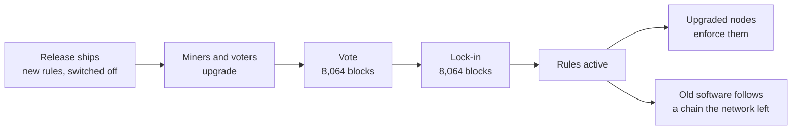

# Upgrading and mandatory releases

This page shows how to keep Decrediton, Bison Wallet and the command-line suite current, from spotting a release to installing it in the right order.

!!! info "Applies to"
    The Decred v2.1.7 release (Decrediton 2.1.7; `dcrd`, `dcrwallet` and `dcrctl` 2.1.7; dcrinstall v2.1.7) and Bison Wallet 1.0.6. Checked November 2026.

## Where releases are announced

Every release is published on GitHub with signed checksums and release notes. Only download from these pages or from [decred.org/wallets](https://decred.org/wallets/), never from a link someone sends you.

| Software | Release page | Current version |
|---|---|---|
| Decrediton, the command-line suite and Bison Wallet (its release notes cover only `dcrd` and `dcrwallet`) | [decred-binaries releases](https://github.com/decred/decred-binaries/releases) | 2.1.7 (Bison Wallet 1.0.6) |
| dcrinstall | [decred-release releases](https://github.com/decred/decred-release/releases) | v2.1.7 |

To hear about new releases, open a release page on GitHub and choose **Watch** > **Custom** > **Releases** (needs a GitHub account), or subscribe a feed reader to `https://github.com/decred/decred-binaries/releases.atom`.

With **Update Check** turned on under **Settings** > **Privacy and Security**, Decrediton asks GitHub at startup and shows **Update Available** on its start screen if a newer release exists. Bison Wallet checks the newest release page of github.com/decred/dcrdex at startup and once a day, and shows "New release available!" when that page is newer. That page lags behind decred-binaries (Bison Wallet 1.0.6 was published only there), so do not rely on the banner. The command-line programs do not check.

### Mandatory or recommended

Read the heading near the top of the `dcrd` release notes. It tells you how urgent the release is:

| Heading in the release notes | What it means | Examples |
|---|---|---|
| **Upgrade Mandatory** or **Upgrade Required** | Needed to stay on the network. Skipping it risks your node following a different chain from everyone else. | 2.1.6 (August 2026): critical consensus fix. 2.1.0 (November 2025): the `maxtreasuryspend` vote. |
| **Upgrade Required To Participate in StakeShuffle Mixing** (2.0.0: "...To Continue Participating in...") | The network works without it, but mixing does not. | 2.0.0 (May 2024), 2.0.5 (November 2024) |
| **Upgrade Highly Recommended** | Fixes problems such as denial-of-service attacks that could disrupt your node. | 2.1.7 (October 2026), 2.1.4 (April 2026) |
| No upgrade heading | Bug fixes and improvements. Upgrade when convenient. | 2.1.5 |

Today, run 2.1.7. Never run anything older than 2.1.6 on mainnet: older versions lack the 2.1.6 consensus fix.

## Why some upgrades are mandatory

Every node checks every block against the consensus rules, so nodes running different rules can end up on different chains. A release becomes mandatory for one of two reasons.

**A new consensus rule.** Decred changes its rules by a stakeholder vote on an **agenda**. The release ships the new rules switched off, and they switch on only if the vote passes. The sequence below shows how much warning you get.



Each interval of 8,064 blocks is about 4 weeks. Upgrading does not mean voting yes: your tickets abstain unless you set a choice. [Consensus rule votes](../governance/consensus-upgrades.md) walks through the process.

**A consensus bug fix.** 2.1.6 fixed a critical consensus vulnerability, and its notes say everyone had to upgrade "or risk being forked from the network".

### What happens if you do not upgrade

| You run | What happens |
|---|---|
| A full node (`dcrd`, or Decrediton in full-node mode) | Once the new rules are active, it rejects the first block valid only under them, and everything after it. Your wallet stops seeing new blocks, and balances and confirmations go stale. |
| A light wallet (SPV) | It checks block headers rather than every rule, so a header change, such as the switch to BLAKE3 proof of work, leaves an old light wallet unable to follow the chain. |
| A solo voting wallet | If its node is on the wrong chain, its tickets miss: each returns its price but earns no reward. Even before activation, an old wallet's votes on a new agenda do not count, and `dcrwallet` logs "Old vote version detected". |
| Tickets at a voting service provider (VSP) | The VSP's wallets vote for you, so its software must be current. Decrediton marks a VSP running old software **Out of date**. |
| A miner | Affected first, before the vote even starts: once 950 of the last 1,000 blocks carry the new block version, blocks with the old version are rejected, so an un-upgraded miner loses its rewards. For 2.1.0, upgraded nodes also stopped asking voting wallets to vote on old-version blocks from block 1,035,288, so those blocks could not collect the votes they need. |

The whitepaper defines exactly when an agenda becomes [active for a block](../../whitepaper/13-voting.md#sec:voting-activation). It also explains why, since [explicit version upgrades](../../whitepaper/13-voting.md#sec:voting-dcp8), old software rejects new transaction and script versions instead of accepting them unchecked.

## Before you start

- **Find your seed.** An upgrade does not touch your wallet, but the seed is your way back if anything goes wrong. Decrediton and `dcrwallet` show it only at wallet creation, so check you still have your written copy. Bison Wallet shows it again under **Settings** > **View Application Seed**. See [Back up and restore your wallet](../wallets/back-up-and-restore.md).
- **Finish your decentralized exchange (DEX) trades.** Do not stop Bison Wallet, or Decrediton with its **DEX** tab in use, while orders or swaps are active: a swap can fail and count against your account. As a quick check, Bison Wallet's **Sign Out** refuses with "cannot log out with active orders" while any are active.
- **Solo voters: plan a rolling upgrade**, one voting wallet at a time (see [Upgrade order](#upgrade-order)).
- **Allow a few minutes.** The first start after an upgrade can take longer while `dcrd` or `dcrwallet` upgrades its database.

## Upgrade steps

Whatever you install, [verify the download](../security/verify-downloads.md) first: check the manifest's signature, then the file's SHA-256 hash against the manifest. dcrinstall checks the downloads it fetches itself, but you still need to verify dcrinstall.

=== "Decrediton"

    Decrediton ships with its own `dcrd` and `dcrwallet`, and version 2.1.7 embeds Bison Wallet 1.0.6 for its **DEX** tab, so one upgrade covers full-node mode, light mode and the DEX.

    1. Download your installer from the [v2.1.7 release](https://github.com/decred/decred-binaries/releases/tag/v2.1.7) and verify it against `decrediton-v2.1.7-manifest.txt`.
    2. Close Decrediton. This also stops the mixer and the automatic ticket buyer.
    3. Install the new version over the old one, without uninstalling first:
        - **Windows**: run `decrediton-windows-amd64-v2.1.7.exe`.
        - **macOS**: open the `.dmg` for your Mac (`arm64` for Apple silicon, `amd64` for Intel) and drag Decrediton into Applications, replacing the old copy.
        - **Linux**: make `decrediton-linux-amd64-v2.1.7.AppImage` executable and run it, or run `decrediton` from the extracted `.tar.gz`.
    4. Start Decrediton and open your wallet. Wallets and settings live in Decrediton's data folder, not with the program, so they carry over.
    5. If you were mixing or buying tickets automatically, start them again: **Privacy and Security** > **Privacy** > **Start Mixer**, and **Staking** > **Purchase Tickets** > **Automatic Ticket Purchases**.
    6. If Decrediton shows **Resend Votes To Recently Updated VSPs**, choose **Continue**: a VSP you use has upgraded and needs your vote choices again.

    Expected result: **Settings** > **Sources** > **About Decrediton** shows "Version 2.1.7".

=== "Bison Wallet"

    1. Make sure no orders or swaps are active, then **Sign Out**.
    2. Stop Bison Wallet: press ++ctrl+c++ in the terminal running `bisonw`, or on Windows choose **Quit** from its system tray icon.
    3. Download the archive for your system, such as `bisonwallet-windows-amd64-v1.0.6.zip` or `bisonwallet-linux-amd64-v1.0.6.tar.gz`, from the [v2.1.7 release](https://github.com/decred/decred-binaries/releases/tag/v2.1.7) and verify it against `bisonwallet-v1.0.6-manifest.txt`.
    4. Extract the archive and replace your old `bisonw` and `bwctl` with the new ones.
    5. Start `bisonw` and open the web interface. On the **Unlock** screen, enter your app password and choose **Submit**. Your data in `~/.dexc`, `~/Library/Application Support/Dexc` or `%LOCALAPPDATA%\Dexc` carries over.

    Expected result: the main menu, which also holds **Settings** and **Sign Out**, shows "Version 1.0.6+release".

    !!! warning "Bison Wallet 1.1 will not trade with 1.0.x"
        Bison Wallet 1.1.0 exists only as release candidates (v1.1.0-rc2 is tagged) and has not been released. Its notes say 1.1 and 1.0.x clients and servers cannot trade with each other, and servers revoke active 1.0.x swaps when they upgrade. When 1.1 ships, finish all trades first.

=== "Command line"

    **With dcrinstall** (if you installed with it, or keep your files where it expects them):

    1. Download the newest dcrinstall for your system from the [decred-release v2.1.7 release](https://github.com/decred/decred-release/releases/tag/v2.1.7) and verify it against `dcrinstall-v2.1.7-manifest.txt`. An older dcrinstall stops with "Please update dcrinstall before continuing".
    2. Stop everything dcrinstall manages. It refuses to run while any of them is running:

        ```bash
        dcrctl --wallet stop
        dcrctl stop
        ```

        Stop `dcrlnd` (`dcrlncli stop`), `politeiavoter` and `bisonw` too, if you run them.

    3. Run dcrinstall. On Linux, macOS and the BSDs:

        ```bash
        chmod u+x dcrinstall-linux-amd64-v2.1.7
        ./dcrinstall-linux-amd64-v2.1.7
        ```

        On Windows, run `dcrinstall-windows-amd64-v2.1.7.exe` from a Command Prompt. Use the file name you downloaded.

        dcrinstall checks the signatures of the release manifests and the hashes of the archives, then replaces the programs in `~/decred` (`%USERPROFILE%\decred` on Windows) and leaves existing config files alone. It logs every step to `dcrinstall.log` in the same folder.

    4. Start `dcrd`, wait until it has synced, then start `dcrwallet`.

    **From the archive** (if you manage the files yourself):

    1. Download the archive for your system, such as `decred-linux-amd64-v2.1.7.tar.gz` or `decred-windows-amd64-v2.1.7.zip`, from the [v2.1.7 release](https://github.com/decred/decred-binaries/releases/tag/v2.1.7) and verify it against `decred-v2.1.7-manifest.txt`.
    2. Extract it. On Linux, for example:

        ```bash
        tar -xzf decred-linux-amd64-v2.1.7.tar.gz
        ```

    3. Stop `dcrwallet`, then `dcrd`, as above.
    4. Copy the new programs from the `decred-linux-amd64-v2.1.7` folder over the old ones. Your config files and data live elsewhere and are not affected.
    5. Start `dcrd`, wait until it has synced, then start `dcrwallet` and any programs that use it.

    Expected result:

    ```bash
    dcrd --version
    dcrwallet --version
    ```

    Each prints a line that starts with `dcrd version 2.1.7+release` or `dcrwallet version 2.1.7+release`.

## Upgrade order

For the command-line suite, **stop the programs that depend on others first, start the node first, and upgrade the node first.**

1. **`dcrd`.** A new `dcrwallet` checks the node's remote procedure call (RPC) API version and refuses an incompatible older node with "advertised API version … incompatible with required version …". A newer `dcrd` keeps working with an older `dcrwallet` of the same major version, so upgrading the node first is the safe order.
2. **`dcrwallet`**, once `dcrd` is running.
3. **Programs that use the wallet**: `dcrlnd`, `politeiavoter`, and services such as `vspd`.

**Voting servers one at a time.** If you vote solo with [several always-online wallets](../staking/solo-voting.md), upgrade them in turn so a ticket called during the upgrade is still voted by another server. On each server:

1. Stop `dcrwallet`, then `dcrd`. Replace both.
2. Start `dcrd` and wait until `dcrctl getblockchaininfo` shows `"initialblockdownload": false`.
3. Start `dcrwallet` and unlock it as you normally do.
4. Check it is ready before moving on:

    ```bash
    dcrctl --wallet walletinfo
    ```

    ```text title="Expected output (excerpt)"
    "daemonconnected": true,
    "unlocked": true,
    "voting": true,
    ```

Operators of VSPs, exchanges, pools and DEX servers have more to coordinate: see [Operating Decred infrastructure](../../dev/operate/index.md).

## 2.1.7 spend safeguards: when a node stops on purpose

In response to what its notes call "the previous inflation bug", 2.1.7 added checks for transaction spends that should never be possible. If one fires, `dcrd` shuts down rather than carry on in a possibly unsafe state. You are unlikely ever to see this. If you do:

- **What you see.** `dcrd` exits, and its last log entries include a critical line marked `[CRT] CHAN:` describing the problem. In Decrediton's full-node mode the wallet loses its node and stops syncing. Light wallets do not run `dcrd`, so the check does not stop them.
- **Your coins are not affected.** A stopped node moves no funds. Until it runs again, a wallet that depends on it cannot sync, send or vote, and solo-voted tickets may miss.
- **Keep the log**: `dcrd.log` in `logs/mainnet` under the `dcrd` folder (`~/.dcrd`, `~/Library/Application Support/Dcrd` or `%LOCALAPPDATA%\Dcrd`), or in Decrediton **Settings** > **Logs**.
- **Do not downgrade to get running again.** Older versions lack the safeguard.
- **Report it.** Send the critical log line through the channels on [Get help and join the community](../reference/index.md) and watch the [dcrd releases](https://github.com/decred/dcrd/releases). If the node stops again after a restart, leave it stopped until you have advice.

## Downgrading and database versions

Some upgrades convert your data to a newer format the first time they start, and the conversion is one-way. `dcrd`, `dcrwallet` and Bison Wallet all refuse to open data written by a newer version. `dcrd`, for example, stops with "the current blockchain database is no longer compatible with this version of the software".

| You want to | Possible? |
|---|---|
| Reinstall the same version | Yes. |
| Run an older `dcrd` on data a newer one has upgraded | No. Move `data/mainnet` in the `dcrd` folder (`~/.dcrd`, `~/Library/Application Support/Dcrd` or `%LOCALAPPDATA%\Dcrd`) aside and let the older version sync from scratch, which takes hours. |
| Run an older `dcrwallet` or Decrediton on an upgraded wallet | No. Restore your seed into a new wallet with the older version instead. |

If a new release causes you a problem, report it rather than going back.

## Troubleshooting

### dcrinstall says "Processes still running"

A Decred program is still running. Stop it (`dcrctl --wallet stop`, `dcrctl stop`, `dcrlncli stop`, or close Bison Wallet) and check your task manager or `ps` for leftovers, then run dcrinstall again.

### dcrinstall says it "requires all or none of the configuration files"

dcrinstall checks two groups of config files and needs either all or none of each group, each file in its default folder:

- `dcrctl.conf`, `dcrd.conf`, `dcrwallet.conf`, `dcrlnd.conf` and `politeiavoter.conf`, in `~/.dcrctl`, `~/.dcrd`, `~/.dcrwallet`, `~/.dcrlnd` and `~/.politeiavoter`;
- `dexc.conf` and `dexcctl.conf`, in `~/.dexc` and `~/.dexcctl` (dcrinstall always installs Bison Wallet too).

On macOS these folders are under `~/Library/Application Support`, and on Windows under `%LOCALAPPDATA%`, with a capitalized name such as `Dcrd`. The error lists the missing files. Complete the group, or upgrade from the archive instead.

### dcrwallet says the API version is incompatible

You started a newer `dcrwallet` against an older `dcrd`. Upgrade `dcrd` and start it first.

Decrediton shows a related message, beginning "The API of the currently running wallet", when its `dcrwallet` is not the version it requires. That normally happens only when Decrediton runs other programs through its `--custombinpath` option. Reinstall Decrediton 2.1.7, or update both `dcrd` and `dcrwallet` in that folder.

## Next steps

- [Verify your download](../security/verify-downloads.md): the signature and hash checks for every file on this page.
- [Vote with your tickets](../governance/vote.md): set your choice on an agenda after upgrading.
- [Consensus rule votes](../governance/consensus-upgrades.md): how a rule change is proposed, voted on and activated.
- [Run a full node](full-node.md): run `dcrd` unattended and keep it current.
- [Operating Decred infrastructure](../../dev/operate/index.md): upgrades for VSPs, exchanges, pools and DEX servers.

*[DEX]: decentralized exchange
*[RPC]: remote procedure call
*[SPV]: simplified payment verification
*[VSP]: voting service provider
