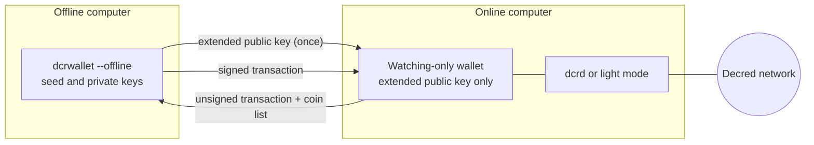

# Cold storage with an offline wallet

This guide sets up cold storage with `dcrwallet`: the private keys stay on a computer that never goes online, and a watching-only wallet on an online computer receives funds, shows the balance and broadcasts what the offline computer signs. Files move between the two on a Universal Serial Bus (USB) drive. It suits larger holdings, where a second computer and some command-line work are worth it.

!!! info "Applies to"
    dcrwallet, dcrctl and dcrd 2.1.7, and Decrediton 2.1.7 (for the watching-only wallet). Checked November 2026.

## When cold storage makes sense

A wallet on an everyday computer is "hot": malware that reads the wallet file and captures the passphrase can take the coins. Keys on an offline computer are out of a remote attacker's reach, but cold storage does not protect against a lost or discovered seed, theft of the computer with its passphrase, or signing a transaction without checking it.

Two ways to keep keys offline:

| | Hardware wallet | Offline `dcrwallet` (this page) |
|---|---|---|
| Keys kept on | a dedicated signing device | a spare computer that stays offline |
| Setup | short, in Decrediton (a Ledger first needs the Decred app from Ledger Live) | about an hour, command line on two computers |
| Each spend | confirm on the device | carry files between the computers |
| Staking from the cold keys | not possible | not possible (see [Staking with cold funds](#staking-with-cold-funds)) |
| Depends on | the device maker's hardware and firmware | Decred's own software, plus a clean operating system on the offline computer |

For most people a [hardware wallet](../wallets/hardware-wallets.md) is simpler. Choose this setup to sign with Decred's own software and inspect every transaction with it before signing.

## How it fits together

A Decred wallet account has an **extended public key**. From it, anyone can derive every receiving and change address of that account, but no private key ([the whitepaper's account structure](../../whitepaper/05-addresses.md#sec:addresses-bip44)). The online wallet holds only that key, so it sees everything and can sign nothing. The diagram shows what crosses between the two computers:



!!! warning "Keep the extended public key private"
    It reveals every address, the balance and the full history of the account, and combined with any one private key from the account it reveals all of them, as `dcrwallet` itself warns. Never give it to a voting service provider (VSP), an exchange or any other service.

## Before you start

- **Two computers.** The offline one has wireless and Bluetooth disabled or removed and never connects to a network again.
- **The command-line bundle** for each computer's system, for example `decred-linux-amd64-v2.1.7.tar.gz`. Download it on the online computer from the [decred-binaries v2.1.7 release](https://github.com/decred/decred-binaries/releases/tag/v2.1.7) and [verify it](verify-downloads.md) before copying it to the offline computer.
- **A USB drive** used only for this, and **paper** for the seed.
- **On the online computer:** `dcrwallet` running against your own `dcrd` or in light mode (simplified payment verification, SPV), set up as in [Set up the command-line wallet](../wallets/command-line.md). Decrediton can stand in for watching only (step 2).
- **A small test amount** for one practice receive and spend.

The commands use Linux and macOS shell quoting. Configuration paths below are for Linux; on macOS use `~/Library/Application Support/Dcrwallet` (and `Dcrctl`, `Dcrd`), on Windows `%LOCALAPPDATA%\Dcrwallet` (and `Dcrctl`, `Dcrd`).

## Step 1: Create the offline wallet

On the offline computer:

1. Extract the bundle and create three configuration files. They hold a login the programs use to talk to each other, not your wallet passphrase.

    ```ini title="~/.dcrwallet/dcrwallet.conf"
    offline=1
    username=<RPC_USER>
    password=<RPC_PASSWORD>
    ```

    ```ini title="~/.dcrctl/dcrctl.conf"
    rpcuser=<RPC_USER>
    rpcpass=<RPC_PASSWORD>
    ```

    ```ini title="~/.dcrd/dcrd.conf"
    rpcuser=<RPC_USER>
    rpcpass=<RPC_PASSWORD>
    ```

    Choose any values for `<RPC_USER>` and `<RPC_PASSWORD>`, the same in all three files. `offline=1` stops `dcrwallet` from connecting to a node or peers; `dcrd` only decodes transactions (step 4).

2. Create the wallet:

    ```bash
    dcrwallet --create
    ```

    Enter a strong **private passphrase** twice; answer **no** to "Do you want to add an additional layer of encryption for public data?"; answer **no** to "Do you have an existing wallet seed you want to use?" so that a new seed is generated on this computer; write down the 33 seed words, then type `OK`; answer **no** to importing an additional account.

    !!! danger "The seed is the cold storage"
        Anyone who reads the seed can spend every coin, and only the seed recovers them if the offline computer fails. Keep it on paper, never photographed or typed into an online device, and store copies as in [Back up and restore your wallet](../wallets/back-up-and-restore.md). Never restore a seed that has been on an online computer: its keys are not cold.

3. Start the wallet and leave it running in its own terminal:

    ```bash
    dcrwallet
    ```

    On the first start it prints `*** ATTENTION ***` and asks for the private passphrase, then stays unlocked. On later starts, use `dcrwallet --promptpass` to unlock it.

4. In a second terminal, export the default account's extended public key:

    ```bash
    dcrctl --wallet getmasterpubkey
    ```

    The result is one line starting with `dpub`: despite the command's name, the key of the `default` account, not of the whole wallet. Save it to a text file on the USB drive. During setup, nothing else leaves the offline computer.

!!! note "Practicing on testnet"
    Add `testnet=1` to all three configuration files (and to the online computer's). Testnet extended public keys start with `tpub`.

## Step 2: Create the watching-only wallet

On the online computer, use the key from the USB drive:

=== "Decrediton"

    1. On the wallet selection screen, choose **Restore Existing Wallet**.
    2. Enter a **Wallet Name**.
    3. Open **Advanced Options**, tick **Watch only** and paste the key into **Master Pub Key**.
    4. Select **Continue**.

    Decrediton cannot broadcast a transaction signed elsewhere, so for spending (step 4) also set up the command-line watching-only wallet from the same key.

=== "Command line"

    If this computer has no `dcrwallet` wallet yet, create one from the key:

    ```bash
    dcrwallet --createwatchingonly
    ```

    Paste the key at `Enter HD wallet public key:`, answer the public data question, and look for `The watching only wallet has been created successfully.` Then start `dcrwallet` as usual (connected to `dcrd`, or with `--spv`); it has no private passphrase.

    If this computer already runs a `dcrwallet` wallet, import the key (`<XPUB>`) into it as a separate watching-only account instead:

    ```bash
    dcrctl --wallet importxpub cold <XPUB>
    ```

    Then use the account name `cold` on the online computer wherever this page says `default` (`getnewaddress cold` to receive). If funds reached the account before the import, run `dcrctl --wallet rescanwallet`.

## Step 3: Receive funds

Get a receiving address from the watching-only wallet:

=== "Decrediton"

    Open **On-chain Transactions** > **Receive** and select **Generate new address**.

=== "Command line"

    ```bash
    dcrctl --wallet getnewaddress
    ```

The first time, prove that the address belongs to the offline wallet before sending much to it:

1. Find an index at least as high as the address's. For a command-line address, run `dcrctl --wallet accountaddressindex default 0` on the online computer: it prints the next receiving index. For a Decrediton address, use `19`: Decrediton keeps its own wallet, which that index does not count, and 19 covers the first 20 receiving addresses.
2. On the offline computer, record the addresses up to that index, then check the address:

    ```bash
    dcrctl --wallet accountsyncaddressindex default 0 <INDEX>
    dcrctl --wallet validateaddress <ADDRESS>
    ```

    The result must include `"ismine": true`. If `ismine` is missing, the offline wallet does not know the address: check `<INDEX>`, or take the test address from the command-line wallet instead. If it is still missing, the watching-only wallet holds a different key: stop and redo step 2.

Then send a small test amount and practice step 4 with it.

## Step 4: Spend from cold storage

A spend goes online, offline, online: build an unsigned transaction, check and sign it, broadcast it. The example pays 50 DCR to an exchange deposit address.

### Build the transaction (online)

1. Create a transaction with the payment only:

    ```bash
    dcrctl --wallet createrawtransaction '[]' '{"<DESTINATION>":50}'
    ```

    `<DESTINATION>` is the address you are paying. The result is a line of hex.

2. Let the watching-only wallet add the coins to spend and a change output:

    ```bash
    dcrctl --wallet fundrawtransaction <HEX> default
    ```

    The result has `"hex"`, the funded, unsigned transaction, and `"fee"`. It pays 0.0001 DCR per kB by default (a wallet setting) and spends only coins with at least one confirmation. Save the `"hex"` value in `unsigned.txt` on the USB drive.

3. Save the data the offline wallet needs:

    ```bash
    dcrctl --wallet listunspent > unspent.json
    dcrctl --wallet accountaddressindex default 0
    dcrctl --wallet accountaddressindex default 1
    ```

    Copy `unspent.json` to the USB drive and note the two numbers: the next receiving index and the next change index.

### Check and sign (offline)

1. Record the addresses the online wallet has used since the last session, on both branches (change lands on branch 1):

    ```bash
    dcrctl --wallet accountsyncaddressindex default 0 <RECEIVE_INDEX>
    dcrctl --wallet accountsyncaddressindex default 1 <CHANGE_INDEX>
    ```

    The offline wallet never sees the blockchain: it can sign only for coins at addresses recorded this way.

    Note both numbers each session. They come from the online computer, so each should grow by only a few since the last session; if either jumps by more than 20 (the wallet's default gap limit), do not sign. A wallet restored from the seed looks only 20 unused addresses ahead and may never find change sent further.

2. Start `dcrd` in another terminal to decode the transaction. Pointed at an address that does not exist, it never looks for peers:

    ```bash
    dcrd --connect=127.0.0.1:1
    ```

    Then decode:

    ```bash
    dcrctl decoderawtransaction "$(cat unsigned.txt)"
    ```

3. Read the result before signing; this check is the point of air-gapped signing:

    - **Outputs (`vout`):** one must pay exactly 50 DCR to `<DESTINATION>`. Every other output must be your change: `dcrctl --wallet validateaddress <ADDRESS>` must show `"ismine": true`.
    - **Inputs (`vin`):** a Decred signature does not cover the amounts of the coins it spends ([the whitepaper's signature hash](../../whitepaper/06-script.md#sec:script-sighash)), so a compromised online computer could understate an input's `amountin` and hide a large fee for miners. Look up each input (`txid` and `vout`) on [dcrdata](../wallets/block-explorer.md) from a third device, or in your own records: those amounts minus the outputs must leave only a small fee, well under 0.001 DCR for an ordinary transaction at the default rate. Do not rely on the `"fee"` the online computer reported.

4. Sign, giving the wallet the coin list it cannot look up itself:

    ```bash
    dcrctl --wallet signrawtransaction "$(cat unsigned.txt)" "$(cat unspent.json)"
    ```

    ```text title="Expected output (shortened)"
    {
      "hex": "0100000003a2af...",
      "complete": true
    }
    ```

    `"complete": true` means every input is signed. Save the `"hex"` value in `signed.txt` on the USB drive.

### Broadcast (online)

1. Send it to the network:

    ```bash
    dcrctl --wallet sendrawtransaction "$(cat signed.txt)"
    ```

    The result is the transaction ID. A broadcast transaction cannot be reversed.

### Check that it worked

Look up the transaction ID on dcrdata, or run `dcrctl --wallet gettransaction <TXID>` on the online computer. After a confirmation, the watching-only wallet shows the reduced balance and the change as a new coin.

## Staking with cold funds

Cold keys cannot stake. A ticket bought through a VSP needs its VSP fee paid, requests signed with the key of its reward address and its voting key handed to the VSP ([Voting service providers](../staking/vsps.md)), all with private keys online. `purchaseticket` has a `dontsigntx` option, and Decrediton shows unsigned tickets for a watch-only wallet, but in 2.1.7 neither pays a VSP fee nor registers the ticket, so nobody would vote it.

To stake part of your holdings, fund a separate staking wallet, with its own seed, by a cold spend (step 4), and [stake with it](../staking/stake-with-dcrwallet.md) (or with Decrediton or Bison Wallet). It is a hot wallet: secure it like any other, and move what you do not restake back to cold storage.

## Shared custody with multisig

An m-of-n multisignature address needs signatures from m of n keys to spend, for example 2-of-3 for shared custody or inheritance. On mainnet these addresses start with `Dc` ([pay-to-script-hash in the whitepaper](../../whitepaper/06-script.md#sec:script-p2sh)). Decrediton has no multisig screens; it is all done with `dcrctl`. In steps 1 to 3, type each command after `dcrctl --wallet`:

1. Each participant shares the `"pubkey"` that `validateaddress <ADDRESS>` shows for an address in their own wallet.
2. Every participant's wallet runs `addmultisigaddress <M> '["<PUBKEY_1>","<PUBKEY_2>","<PUBKEY_3>"]'`, with the same keys in the same order. It returns the address and watches it.
3. Fund the address from any wallet. If you use `sendtomultisig`, always give it the number of required signatures: it defaults to 1, and it always spends from the `default` account whatever account you name.
4. To spend, one participant runs `dcrctl --wallet getmultisigoutinfo <TXID> <VOUT>` to see the coin's `amount`, then builds an unsigned transaction:

    ```bash
    dcrctl --wallet createrawtransaction '[{"txid":"<TXID>","vout":<VOUT>,"tree":0,"amount":<AMOUNT>}]' '{"<DESTINATION>":<AMOUNT_MINUS_FEE>}'
    ```

    `<TXID>` and `<VOUT>` identify the payment to the multisig address: `<TXID>` is its transaction ID, and to find `<VOUT>`, decode the `hex` that `dcrctl --wallet gettransaction <TXID>` prints with `dcrctl decoderawtransaction` and take the `n` of the output whose `addresses` lists the multisig address. `<AMOUNT>` is its `amount` in DCR, and `<AMOUNT_MINUS_FEE>` is that amount minus the transaction fee. For 2-of-3, a fee of 0.00004 DCR is enough: the signed transaction is about 360 bytes and the minimum relay fee is 0.0001 DCR per 1,000 bytes. [Scripts for builders](../../dev/protocol/scripts.md#with-dcrwallet) gives the size of other m-of-n spends. Do not use `redeemmultisigout` instead: at the default fee rate it pays too little for an address with two or more keys, and `dcrd` rejects the transaction.
5. M participants sign in turn. Each unlocks their wallet, signs, and passes the `hex` value from the result to the next:

    ```bash
    promptsecret | dcrctl --wallet walletpassphrase - 300
    dcrctl --wallet signrawtransaction <HEX>
    ```

    `<HEX>` is the unsigned transaction for the first signer and the previous signer's `hex` after that. A light wallet that has not recorded the payment to the multisig address needs a second argument describing it; see [Scripts for builders](../../dev/protocol/scripts.md#with-dcrwallet).
6. Check the signatures. `signrawtransaction` can show `"complete": true` while signatures are still missing, so do not rely on it. Decode the last `hex` with `dcrd`:

    ```bash
    dcrctl decoderawtransaction <HEX>
    ```

    Under `vin`, the input's `scriptSig` `asm` must list M signatures (long hex strings ending in `01`) followed by the redeem script.
7. Broadcast it through a synced `dcrd`, which prints the transaction ID or the reason it refuses:

    ```bash
    dcrctl sendrawtransaction <HEX>
    ```

    A broadcast transaction cannot be reversed.

Back up the redeem script (`createmultisig` with the same arguments prints it) alongside the seeds: without it the coins cannot be spent. Rehearse on testnet first.

## Pitfalls

- **The gap limit.** The watching-only wallet refuses to hand out more than 20 unused addresses in a row (the wallet default `gaplimit`) and fails with `policy violation`. Reuse addresses you already generated, or run `getnewaddress default wrap` to cycle through them.
- **Unused signed transactions stay valid.** Anyone holding one can broadcast it until its coins are spent. To limit this, give `createrawtransaction` an expiry height as a fourth argument, for example 288 blocks (about a day) above what `dcrctl --wallet getblockcount` prints: `dcrctl --wallet createrawtransaction '[]' '{"<DESTINATION>":50}' 0 <EXPIRY>`. It then cannot be mined at or after that height. To drop an unsent one, delete `signed.txt` and make any replacement spend at least one of the same coins.
- **Keep the software verified and current.** Carry each release to the offline computer only after [verifying it](verify-downloads.md), and move nothing but the text files this page names. Follow [mandatory upgrades](../run/upgrades.md) on the online computer.

## Troubleshooting

### Signing shows `"complete": false` and `no address with id`

The offline wallet has not recorded the address of one of the coins. Repeat the index sync in [Check and sign](#check-and-sign-offline) with fresh numbers from `accountaddressindex` on the online computer, then sign again.

### Signing shows `wallet locked: default`

The offline wallet is locked. Stop it (`dcrctl --wallet stop`) and start it again with `dcrwallet --promptpass`.

### `accountsyncaddressindex` replies `operation not supported in offline mode`

This happens when the index is above 19 on an offline wallet. The addresses are recorded anyway: `dcrctl --wallet validateaddress <ADDRESS>` for the address you need should show `"ismine": true`.

### `sendrawtransaction` fails with `high fees`

The transaction's fee works out at more than 1,000 times the default fee rate. Do not override it: check the inputs and outputs again as in [Check and sign](#check-and-sign-offline).

## Next steps

- [Back up and restore your wallet](../wallets/back-up-and-restore.md): store and test the cold seed backup.
- [Use a hardware wallet](../wallets/hardware-wallets.md): the simpler alternative for keeping keys offline.
- [Stake with dcrwallet](../staking/stake-with-dcrwallet.md): set up the separate staking wallet.
- [Keep your DCR safe](index.md): the threats this setup does and does not cover.

*[VSP]: voting service provider
*[SPV]: simplified payment verification
*[USB]: Universal Serial Bus
