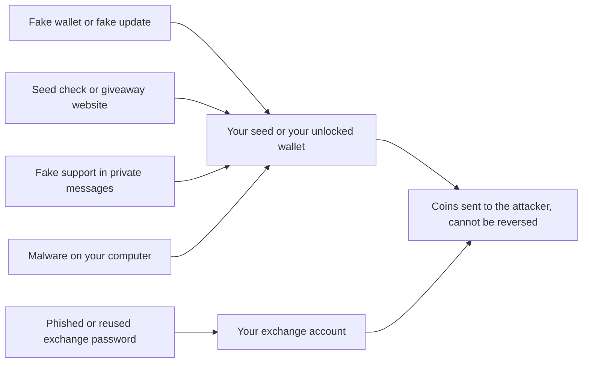
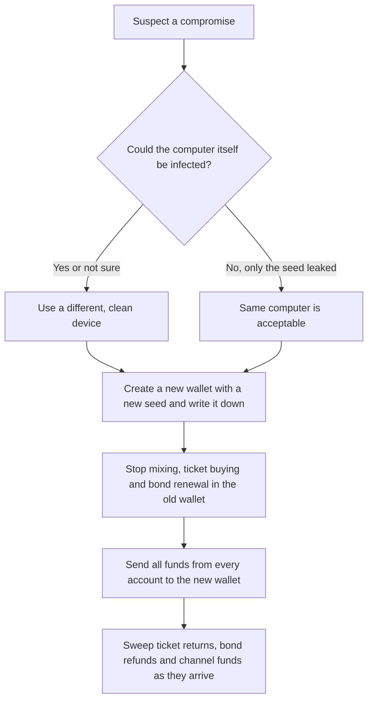

# Keep your DCR safe

Almost nobody loses DCR to broken cryptography. They lose it because someone tricked them into revealing their seed, ran software that stole it, or emptied an account they did not control. This page is for every Decred holder: it covers the common attacks, the habits that stop them, and what to do after a compromise.

## In this section

<div class="grid cards" markdown>

-   **[Verify your download](verify-downloads.md)**

    ---

    Confirm that a Decrediton, Bison Wallet or command-line download is genuine before you run it.

-   **[Cold storage with an offline wallet](cold-storage.md)**

    ---

    Keep larger amounts on a computer that never goes online, and still receive and spend them.

</div>

## How people actually lose coins

Whoever holds the keys can move your DCR, and all of a wallet's keys come from one **seed**: the 33 words (or 64 hexadecimal characters) that Decrediton and `dcrwallet` show when you create a wallet, or the 15-word **app seed** in Bison Wallet. [How a Decred wallet works](../wallets/how-wallets-work.md) explains seeds, keys and passphrases.

Nearly every theft ends with the attacker getting your seed, your unlocked wallet, or the login to an account that holds coins for you.



Typical examples:

Fake wallets and fake updates
:   A search ad, a lookalike site or an "urgent security update" message offers a copy of "Decrediton" or "Decred Wallet" that works normally until it sends your seed to its author.

Seed-harvesting websites
:   A site offers to "validate", "sync", "unlock staking rewards" or "claim an airdrop" once you enter your seed. No legitimate service ever asks for it.

Fake support
:   Someone answers your public question by private message and asks for your seed or for remote-access software to "take a look". Decred's own [community page](https://decred.org/community/) states that admins never direct message you or offer support that way.

Malware
:   Pirated software, game cheats, "free trading bots" and browser extensions can carry code that hunts for seeds and wallet files, records your typing, or swaps a pasted address for the attacker's.

Exchange account takeovers
:   A reused password, phishing email or hijacked phone number lets someone log in to your exchange account and withdraw the balance.

Outdated or unverified software
:   Old releases lack security fixes, and unofficial downloads may not be what they claim.

Coins are also lost when a seed was never written down, or cannot be found after its owner dies. See [Back up and restore your wallet](../wallets/back-up-and-restore.md) and [Planning for inheritance](#planning-for-inheritance).

## Rules that stop almost all of them

1. **Your seed goes only into your own wallet's restore screen.** Keep it offline, on paper or stamped in metal. Never type it into a website, chat, form or email, photograph it, or store it in a file or cloud notes. Anyone who sees it can take every coin, from anywhere, without your passphrase.
2. **Download wallets only from the [official wallet list](https://decred.org/wallets/) or the [Decred releases page on GitHub](https://github.com/decred/decred-binaries/releases), then [verify the download](verify-downloads.md).** Decred's own wallets (Decrediton, Bison Wallet and the command-line suite) are not browser extensions, so treat any extension offered as a "Decred wallet" as a fake.
3. **Treat anyone who contacts you first as a scammer.** That includes "support", "admins", "recovery services" and people offering investments. Ask for help only in public channels listed on [decred.org/community](https://decred.org/community/), and never let a stranger connect to your computer.
4. **Free coins are always a scam.** Giveaways, airdrops, "send 10 DCR, get 20 back" and guaranteed returns are ways to take your coins or your seed.
5. **Check the address before you send.** Compare its start, middle and end with the address the receiving wallet shows. Mainnet addresses for ordinary payments start with `Ds`. For a large amount, send a small test first. A sent transaction cannot be reversed.
6. **Keep most of your DCR away from your everyday computer.** Use a hardware wallet or cold storage for long-term holdings, as described in [Hot, voting and cold funds](#hot-voting-and-cold-funds).
7. **Keep your software current, from official sources only.**

## Securing the computer that runs your wallet

Malware that controls the computer running your wallet can read anything you type or display there, including your seed and passphrase.

- **Keep everything updated, and install as little as possible.** Most malware relies on holes that updates have already closed, and every program you add is code you are trusting. Avoid pirated software, cracks, cheats, unknown browser extensions and anything a stranger asked you to install.
- **Encrypt the disk and lock the screen.** This protects the wallet files if the computer is lost or stolen.
- **Use a strong, unique private passphrase.** Decrediton and `dcrwallet` encrypt your private keys in the wallet file (`wallet.db`) with it. It protects a stolen copy of that file, not against malware that watches you type it. [Manage accounts and passphrases](../wallets/accounts-and-passphrases.md) shows how to change it.
- **Keep the seed off the computer and your phone.** Decrediton warns that other programs can read a seed copied to the clipboard, and phone photos are often backed up to the cloud automatically.
- **Know when your keys are in memory.** Automatic ticket buying, mixing, solo voting and Lightning need the wallet unlocked while they run. Decrediton warns that a running Lightning wallet keeps unencrypted keys in memory and controls all funds of its account, so give Lightning a dedicated account holding only what you plan to use there.
- **For larger amounts, separate the wallet from everyday use:** a dedicated computer or user account, a hardware wallet, or an [offline signing wallet](cold-storage.md).

## Keep your software current

Some releases are mandatory: Decred 2.1.6 (August 2026) fixed a critical consensus vulnerability, and nodes that did not upgrade risked being forked from the network. [Upgrading and mandatory releases](../run/upgrades.md) explains how to recognize them and upgrade each app, always from the official sources above and never from a link in a message.

## Hot, voting and cold funds

Splitting your DCR by how often you need it limits what one mistake can cost. Decred adds a third tier: DCR locked in tickets.

| Tier | Where the keys are | Who can move the DCR | Good for |
|---|---|---|---|
| Hot | A wallet on an internet-connected computer you use every day | Anyone who gets the seed, or the wallet while it is unlocked | Spending, trading, mixing |
| Voting | DCR locked in tickets bought from your wallet | Nobody, until the ticket votes or is revoked. Then the funds go only to addresses in the wallet that bought it | Staking and governance |
| Cold | A hardware wallet, or a wallet on a computer that never goes online | Only someone who signs on that device, or who has its seed | Long-term holdings |

Why the voting tier is different
:   Consensus rules lock a ticket's funds. When it votes, or is revoked after being missed or expiring, the ticket price and any reward can only go to the reward addresses written into it at purchase. A [voting service provider (VSP)](../staking/vsps.md) receives only the key that lets it vote. It cannot move or redirect the funds.

What the voting tier does not protect
:   The returned funds land in the wallet that bought the ticket, and anyone with that wallet's seed can spend them. Tickets bought from a hot wallet return to a hot wallet. Cold keys cannot stake: [Cold storage](cold-storage.md) explains how to fund a separate staking wallet from cold funds and move the returns back to cold addresses afterwards.

Hardware-backed wallets keep the keys off the computer but cannot buy tickets, vote or mix ([Use a hardware wallet](../wallets/hardware-wallets.md)).

## An exchange balance is not a wallet

The exchange holds the keys to DCR you keep there, so it can freeze withdrawals, be hacked or shut down, and you cannot stake or vote with that balance. Your security also depends on your exchange login.

- Use a long, unique password and an authenticator app or security key rather than text-message codes, because phone numbers can be hijacked.
- Turn on withdrawal address allowlists and login alerts if offered, and reach the exchange only by typing its address yourself.
- Withdraw to a wallet whose seed you hold when you finish trading ([Get DCR](../start/get-dcr.md)). [DCRDEX](../dex/index.md) lets you trade without handing over custody.

## Planning for inheritance

If you die or become unable to act, your heirs need to reach your DCR without exposing it to anyone else meanwhile. Tickets need nothing from you: a VSP keeps voting them, missed or expired tickets are revoked automatically, and the funds return to your wallet's addresses for whoever holds the seed.

What your heirs need:

- **The seed, and a way to find it.** Keep it somewhere secure that a trusted person knows about, such as a safe deposit box. A will is a poor place for it: many people read a will, and in some places it becomes public.
- **A short letter, kept apart from the seed.** Say that the words are a Decred wallet seed, which app made it, and where to download that app. A Decrediton or `dcrwallet` seed has 33 words; a Bison Wallet app seed has 15 words (older Bison Wallet installations show a long hexadecimal string instead). These are not interchangeable, and neither works in BIP39 (Bitcoin Improvement Proposal 39) wallets, although Bison Wallet uses the same word list. A wrong app may show an error, or occasionally an empty wallet, and an heir may wrongly conclude the funds are gone. Point them to [Back up and restore your wallet](../wallets/back-up-and-restore.md).
- **Any extra secret that is part of the key.** A private passphrase is not needed: the heir sets a new one when restoring. A Trezor passphrase is different: Decrediton warns that it cannot be changed and that losing it loses the funds.
- **The Lightning channel backup, if you use Lightning.** Funds in open channels cannot be recovered from the seed alone ([Back up and protect Lightning funds](../lightning/backups-and-watchtowers.md)).
- **A list of accounts held elsewhere.** Each exchange releases balances through its own process, which starts with knowing the account exists.

Choose carefully who can reach the seed: anyone who reads it can take the coins today, not only after your death.

## If you think you have been compromised

If someone else may have your seed (you typed it into a website, read it to "support", photographed it, or ran suspicious software), assume they will empty the wallet as soon as they can, and act before you are sure.

!!! danger "Move your funds to a new seed now"
    A seed that someone else has seen can never be made secure again. Changing the private passphrase does not help, because the seed alone recreates every key. Send everything to a wallet with a new seed, and never restore the old seed anywhere.

The response, in order:



### Move your funds

First, on a device you trust, create the new wallet, write down its seed, and copy a receive address from it. If malware may be involved, use a different computer or reinstall the operating system first: anything typed on an infected computer, including a new seed, may be stolen too.

=== "Decrediton"

    1. Create the new wallet from the launcher with **Create a New Wallet**, write down the seed, and copy an address from **On-chain Transactions** > **Receive**. Then use **Settings** > **Close Wallet** and open the old wallet.
    2. In the old wallet, open **Privacy and Security** > **Privacy** and choose **Stop Mixer**. While the automatic ticket buyer runs, the button reads **Stop Auto Buyer** instead: choose it, then **Stop Mixer** if that appears. Decrediton refuses to send while either is running.
    3. If privacy is enabled, turn on **Allow sending from unmixed accounts** in the same **Privacy** tab so that every account can be emptied.
    4. Open **On-chain Transactions** > **Send**. Choose an account in **From**, select **Send all funds from selected account**, paste the new address and check it, then choose **Send** and enter your private passphrase to confirm the transfer.
    5. Repeat for every account that still shows a balance.

=== "Bison Wallet"

    1. Set up a fresh Bison Wallet installation, with a new app seed, on a clean device, and copy a DCR address from its **Receive** button.
    2. In the old installation, open **Wallet** and select DCR. If the privacy toggle shows **Privacy active**, switch it to **Privacy off**; Bison Wallet then moves the mixed and trading balances back into the default account.
    3. Cancel any open orders. Then, in **Settings**, open each server under **Registered Dexes:** and switch off **Auto Renew**, so that no new fidelity bonds (the funds a trading account locks with a server) are posted.
    4. Choose **Send**, paste the new address in **Address**, and click the amount next to **Balance**. This fills in the whole balance and ticks **Subtract fees from amount sent.**; leave that box ticked. Choose **Send**, then enter your app password in the confirmation form and choose **Confirm**.
    5. The app seed also controls the wallets for your other assets in Bison Wallet. Move each of them to the new installation the same way.
    6. Existing bonds stay locked until their lock time, about two months after each was posted, and are then refunded to the old installation. Keep it available and move each refund as it arrives.

=== "Command line"

    Restart `dcrwallet` with the ticket buyer and mixing off: drop `--enableticketbuyer` and `--mixing` from the command line, and comment out `enableticketbuyer` and `mixing` in `dcrwallet.conf`. Then sweep each account:

    ```bash
    dcrctl --wallet listaccounts
    dcrctl --wallet sweepaccount default <NEW_ADDRESS>
    promptsecret | dcrctl --wallet walletpassphrase - 60
    dcrctl --wallet signrawtransaction <UNSIGNED_TX>
    dcrctl --wallet sendrawtransaction <SIGNED_TX>
    ```

    - `<NEW_ADDRESS>` is an address from the new wallet (`dcrwallet --create` on a clean machine).
    - `<UNSIGNED_TX>` is the `unsignedtransaction` value that `sweepaccount` returns. It spends every output in the account with at least one confirmation.
    - `promptsecret` reads your private passphrase without showing it; `walletpassphrase` then unlocks the wallet for 60 seconds.
    - `<SIGNED_TX>` is the `hex` value from `signrawtransaction`; check that `complete` is `true`. `sendrawtransaction` prints the transaction hash.

    Repeat for each account with a balance, and sweep again later for funds that were still unconfirmed.

If the old wallet runs Lightning, close its channels, cooperatively where possible ([Use Lightning](../lightning/use-lightning.md)). Channel funds appear in no account balance until the channels close; then send the Lightning account's balance to the new wallet.

Check on the [block explorer](../wallets/block-explorer.md) that the new address shows the incoming amounts; the old wallet should show no spendable balance.

### Tickets you already own

Tickets cannot be cancelled or moved. Each pays its ticket price and any reward to the old wallet when it votes or is revoked. Those funds become spendable 256 blocks (about 21 hours) later, to anyone with the old seed.

- Keep the old wallet open and synced. Decrediton's **Accounts** view shows **Locked By Tickets** and **Immature Staking Rewards**.
- Sweep each return to the new wallet as soon as it is spendable. An attacker watching the same addresses may win some of these races, but each one you win is DCR saved.
- A VSP keeps voting your tickets; the votes need nothing from you.

### After the move

- Change every password you typed on the affected device, starting with your email and exchange accounts.
- Treat the old seed as burned. Destroy the paper only once the old wallet is empty and every ticket return, bond refund and channel balance has been swept.
- Ignore offers to recover stolen coins for a fee. Nobody can reverse a confirmed transaction; "recovery services" are a second scam aimed at victims.
- Warn others in the public [community channels](https://decred.org/community/) about the site, app or account that fooled you.

If you think you have found a vulnerability in Decred software itself, report it privately through the [Decred bug bounty program](https://bounty.decred.org/) instead of posting it publicly. Check its scope list first: Bison Wallet is not covered.

## Go deeper

- [Hierarchical deterministic keys](../../whitepaper/05-addresses.md#sec:addresses-hd): how one seed produces, and can rebuild, every key in a wallet.
- [The ticket commitment output](../../whitepaper/08-staking.md#sec:staking-commitment): the rule that sends ticket funds only to the addresses chosen at purchase.
- [Voting service providers](../../whitepaper/19-ecosystem.md#sec:ecosystem-vsp): why a VSP gets no custody, and how automatic revocation returns funds.

## Next steps

- [Verify your download](verify-downloads.md): confirm your wallet is genuine before trusting it with funds.
- [Back up and restore your wallet](../wallets/back-up-and-restore.md): check that your seed backup works and that someone can find it.
- [Cold storage with an offline wallet](cold-storage.md): move long-term holdings off your everyday computer.
- [How staking works](../staking/index.md): put DCR in the voting tier and take part in governance.
- [Get help and join the community](../reference/index.md): the official channels, and how to ask for help without getting scammed.

*[VSP]: voting service provider
*[DCRDEX]: Decred's decentralized exchange protocol and server network
*[BIP39]: Bitcoin Improvement Proposal 39, a seed-phrase standard
