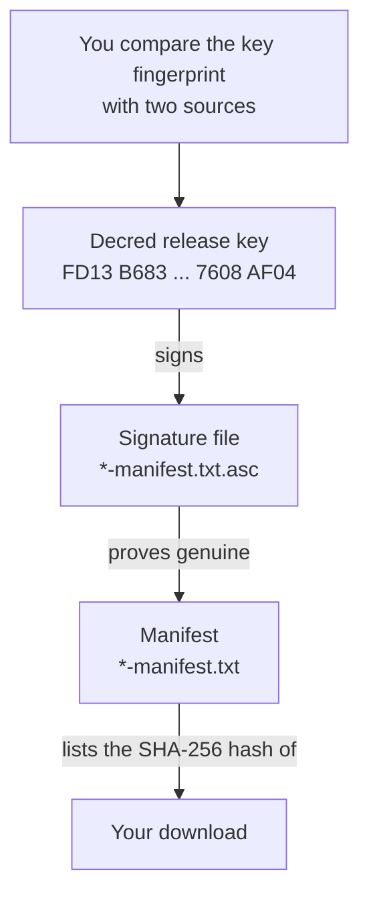

# Verify your download

This page shows how to confirm, on any operating system, that a Decred wallet download is the genuine release before you run it. It covers Decrediton, the command-line suite, Bison Wallet and dcrinstall.

!!! info "Applies to"
    The Decred v2.1.7 release (Decrediton 2.1.7; dcrd, dcrwallet and dcrctl 2.1.7; dcrinstall v2.1.7) and Bison Wallet 1.0.6. Checked November 2026.

## Why verify

A wallet holds the keys to your money, so a fake wallet can empty it. Attackers copy wallet websites, buy search ads for lookalike pages and post "download" links in chats. A tampered file looks and installs like the real one.

Two checks catch this:

1. **The signature check** proves that the release's manifest, a short text file listing the correct hash of every download, was signed by the Decred release key and has not been changed since.
2. **The hash check** proves that your file is exactly the file the manifest lists. A SHA-256 hash is a 64-character fingerprint of a file. Change one byte of the file and the hash changes completely.

You need both. The hash check alone only proves your file matches *a* manifest, which a fake site could also supply. The signature check alone says nothing about the file you actually downloaded.

Each link in this chain vouches for the next; the only thing you check by hand is the key's fingerprint:



Verification has limits. It proves the file is the official build. It does not prove the software is free of bugs, and it cannot protect a computer that is already infected with malware.

## What a release contains

Each release page has the downloads, one manifest per product, and a signature file (`.asc`) for each manifest. Download your file, its manifest and the manifest's `.asc` into the same folder, and keep their original names.

| You want | Release page | Your file (examples) | Manifest and signature |
|---|---|---|---|
| Decrediton | [decred-binaries v2.1.7](https://github.com/decred/decred-binaries/releases/tag/v2.1.7) | `decrediton-windows-amd64-v2.1.7.exe`, `decrediton-darwin-arm64-v2.1.7.dmg`, `decrediton-linux-amd64-v2.1.7.AppImage` | `decrediton-v2.1.7-manifest.txt` and `.asc` |
| Command-line suite (dcrd, dcrwallet, dcrctl and more) | [decred-binaries v2.1.7](https://github.com/decred/decred-binaries/releases/tag/v2.1.7) | `decred-windows-amd64-v2.1.7.zip`, `decred-linux-amd64-v2.1.7.tar.gz` | `decred-v2.1.7-manifest.txt` and `.asc` |
| Bison Wallet | [decred-binaries v2.1.7](https://github.com/decred/decred-binaries/releases/tag/v2.1.7) | `bisonwallet-windows-amd64-v1.0.6.zip`, `bisonwallet-darwin-arm64-v1.0.6.tar.gz` | `bisonwallet-v1.0.6-manifest.txt` and `.asc` |
| dcrinstall | [decred-release v2.1.7](https://github.com/decred/decred-release/releases/tag/v2.1.7) | `dcrinstall-windows-amd64-v2.1.7.exe`, `dcrinstall-linux-amd64-v2.1.7` | `dcrinstall-v2.1.7-manifest.txt` and `.asc` |

In file names, `darwin` means macOS, `amd64` is a 64-bit Intel or AMD processor (most PCs, older Macs), and `arm64` is a 64-bit ARM processor (Apple silicon Macs, ARM Windows laptops). Start from the [official wallet list](https://decred.org/wallets/) on decred.org, or type the GitHub address yourself, rather than following links from chats or search ads.

!!! note "Bison Wallet 1.0.6 is on the decred-binaries page"
    The Bison Wallet download link on decred.org/wallets opens the dcrdex v1.0.6 tag page, which has no downloads. Use the decred-binaries v2.1.7 release instead. Recent Bison Wallet release pages on github.com/decred/dcrdex (v1.0.3 to v1.0.5, the newest as of November 2026) carry a manifest but no `.asc` signature, so their files can be hash-checked but not signature-checked.

## Before you start

- About 10 minutes, and a terminal: PowerShell on Windows, Terminal on macOS or Linux.
- GnuPG (also written GPG), the free OpenPGP program that checks signatures. Step 1 installs it.
- Your download, its manifest and the manifest's `.asc` file, all in one folder (this page assumes your Downloads folder).

## Step 1: Install GnuPG and import the Decred release key

You do this once per computer. The same key has signed Decred releases for years, so a key imported for an earlier release still works.

1. Install GnuPG and open a terminal in your Downloads folder.

    === "Windows"

        Install [Gpg4win](https://www.gpg4win.org/), which includes GnuPG. Then open a new PowerShell window and run:

        ```powershell
        cd $HOME\Downloads
        gpg --version
        ```

    === "macOS"

        Install [GPG Suite](https://gpgtools.org/), whose MacGPG component provides the `gpg` command, or, if you already use Homebrew, run `brew install gnupg`. Then open Terminal and run:

        ```bash
        cd ~/Downloads
        gpg --version
        ```

    === "Linux"

        Most distributions include GnuPG. If `gpg --version` is not found, install the `gnupg` package with your package manager (for example `sudo apt install gnupg`). Then run:

        ```bash
        cd ~/Downloads
        gpg --version
        ```

    `gpg --version` should print a version number, such as `gpg (GnuPG) 2.4.9`.

2. Import the Decred release key from a keyserver:

    ```bash
    gpg --keyserver hkps://keyserver.ubuntu.com --recv-keys FD13B6835E248FAF4BD1838D6DF634AA7608AF04
    ```

    ```text title="Expected output"
    gpg: key 6DF634AA7608AF04: public key "Decred Release <release@decred.org>" imported
    gpg: Total number processed: 1
    gpg:               imported: 1
    ```

    Use keyserver.ubuntu.com: keys.openpgp.org holds this key without its name and email, and GnuPG refuses it from there ("new key but contains no user ID - skipped").

    ??? note "No keyserver access? Import the key from this page instead"
        Save the block below as `decred-release.asc` in your Downloads folder, then run `gpg --import decred-release.asc`. The output is the same as above. It is the key embedded in dcrinstall's source code ([`cmd/dcrinstall/pubkey.go`](https://github.com/decred/decred-release/blob/v2.1.7/cmd/dcrinstall/pubkey.go)). Check its fingerprint in the next step, exactly as for a keyserver import. There the two `sub` lines may appear in the opposite order; only the fingerprint matters.

        ```text
        -----BEGIN PGP PUBLIC KEY BLOCK-----

        mQINBFapILEBEADZxw+4Z8LlqsXCz3j3Ap04SF8zYenlsw123OJZEh9RFERd19bo
        +l2RueFqi5vJDGWpXZ+eHxvgevvOO3r0AiIgAByAP7RQQxip4j6M2xnEBdVb9UV5
        baO93JcyBRDnII/zh6Zf4pqngiYEz7juySsnVMrE7IFmIdT/WfoGW6FX8/kRXyzf
        RTScPZKxIEqwHSlLftlVGSxKL9H+RumEUjPaazLvER1XxtfvcaMGLpatZV3ccqjX
        3O+b3plccx0KbMStMtsB0VI+kcaFKg2gIQrbkHKzpDUI2AdaNJJCodM6j3LphBSS
        5ZXOknyThpYsxDDyYcncWC9gXrGJfrirO/DPrV1NIj4luBbwyWVT1x9rp2PcUYmG
        ZIq0cR4C/mxtlo9OKoyj2cxgoT4WlzlCimRSGtylkWOAx6JQLeKPWt1tZquJB3NT
        Jby7x62AyqXhSMnNPDROKL37tkyWehFlAm8KNa6P8R4vctjjJDQ61yw6jskkJaNA
        Qz2UNAX+Ztx5KA0Z2HEmJb1jp67EH+3kfAv7R1U51gutzuM7J+vDnNQbwQeuq6os
        Y/yssU+OQidLjkojZc7aHz2iym6cw6IlrLTLCnnQQPzAe8CjskrfjwDOejDkPCYO
        AkMtgs6/rsJZnCFJ8Pro7NbREt5KT06CPp4nqXNRbtBOHsa1n8wb/M9TQwARAQAB
        tCNEZWNyZWQgUmVsZWFzZSA8cmVsZWFzZUBkZWNyZWQub3JnPokCMgQTAQIAHAIb
        AwIeAQIXgAUCVqkhhwYLCQgHAwIFFQoJCAsACgkQbfY0qnYIrwRtvA/+JAWw/8cU
        xNe5vyWle4uzHakyO25qdH4+TonHbhqyoF2F8BLvkOU3CmtBgXRAZ8Z2jdAczfuJ
        u1338BJuHoAIVpvtPzRLLsrrl3LOruiCCYsxm7FKpdYWGanTwpUaHiqHj5LaeIt7
        IQjPT3g+uIZ6NsN2RZDzjXZOFD0kZ9EM2b0GqrNpuIQTJafaqGSkOohPiA6b+Sen
        7E/XriEo2RWHgNJP7m4xKF0nGDdMxmV0Wrcv6PBJLhZF1RMZSSsFFeTkoHti3113
        H9oTKmuw5TUIfYjenGY2rXzkR8xZmCr6BiiUgRFVyVtToG6skLtUvkN3aT0QueDt
        u+Lr7QFpM3T9cYqJsg4Gd/9gPUPU6o6r82YlOmB7AQuu99pZ/4KrNIY8saZPRNuS
        Q3IHxZQKaCcuzfy65q48QXj9AMX1KSPYZqze51wu8iywfOsq+GC1zw8+gI6alDUl
        CjsLxL7MqCR7zHxfmzi7oyNHtqMPdoG4MPFfamoSHgiN1Xck1OKtaVstq0VAmZCp
        ixl+e327jwYnF73QtZ7TWrJj6UO1chnGGQzVE1JtHCqzbaVbRVg/8gYClG5aUAjP
        99pOv1QquwixuEArcTF91XNjhQYNuOitgSuqCC9b6fCpyXRzG7EB+z86W4J+rwF5
        7ATyPKE/rzngiRW0i9KFot5dBFZzyljtPaCJAjgEEwECACIFAlapILECGwMGCwkI
        BwMCBhUIAgkKCwQWAgMBAh4BAheAAAoJEG32NKp2CK8EilQP/0lobzbxfNbQCI++
        QGKSwTcy3mkYzIqKWujZQAwVoQk5W2J5cKft1kcS6exFCyj+DeBrWMVPXVQ+YVjC
        ODpL9Ewczz0aLOQihFKn5NgJ2epy5+BrpniBH7Frt9v/FVtc0+azhIHg3flvbY9S
        KwvNNbnNRI5DwHcBqySs+4m11qtGbVwgz2OdGHAL2XU8aijn3Y38XWzJpJ14xEBl
        jOXg7vgIuH7cYWi4S754hsnwb5iS9sN41lXX3D2wwQ/FtuNXDB/EpDJDDi+0vsS6
        sk5Rpe3gyT33aG5Vqk1aXk1yI/JRtgJzhXX9CHZ7CGR8ki5Ri7iUXfwGWgA6JARE
        8xcKW1gu4CJvvIZGe+8SKeX2g/Xcw4GMaCV4V9ReMiuYCXOOmyg0zwQ/OjJMOxYA
        UljYzUs7HIEyqN2u4adPlQhPYgTEYyRFIzsW7dvmmL+YKilT6cKp3GpX2dJiI3kE
        AX0d2aKsLpQFNLoA36BqCIrcbXbrpap1HFnFzx9F10blzL57dv8AmU48TShuyQ5T
        JeCuILJ7ZYxvcxnjFKYU8Wwwz/L52H0vOdx7gS7lhxL9HMoil9bfWZLu2i1TGGxx
        lsKf/QIYW5YzQXsGFieVv95VcZQpdRN/a3yQTwlePftnfQ2eZ0JARAP1IAcqnr64
        0aKnLs3WzuI5gBTH2P2B9ix6DDD7uQINBFapILEBEAC4BpeMb7QNk6mfKk2nrkDF
        dj2UgigAw2xsnkEUpHG6IufSlTOHF2hiJP7k86lbrIZGfQM9+9WBb2m+kik1Zh2I
        53vvXD460ZtGBBzD7UMvAf5BOvrpnX7rmqtjLpGUvPhrQ/6h8LrBH29jCn/8C8yL
        fl3B7A11C3YaxRVmR2TBXjMaYpmJ6Qhho4Jbw36/qscnZcPbFKTOs70uYAZD5hT7
        PYBQs+496bLiDTjk5SkU2WsSRQG7+IDmTIMC0tzIPKcf1H14lXDAqSWDJsEuF/6g
        zPc+Kg3GL0KW0hPHDb5+z5pfzKKBJQxWBwaPjAbGsn/WKFmuLMR6NzXZLoSt/EQq
        Bd6Ud9goW+4JKeZhlVEWIZ/C+uNOr5eqEM1qiaEJW3Hrw5lxn4PEYZ2h59VPjM46
        jsn5baRx54Wo/4oX8DpDlTyPM8ZOVkXDhHVgkHagygwLkiCQIyH9/htdVyIf0+33
        zBS+oIsW8TJgbMaVrb9zy8BFcKfpICIjm5gCdxAb5xtO0pJSiSv4Ga0TTPwhzbHF
        f6JpCohrg0ZpTpd2b4ZNOyshpWU8b9tdbSaoP3CQnpa7erzxOSI+xkAJODG+7DAz
        qZrs0dMSAzlTG8gKmq5ceVWFA68gwDOZk6ObV4qcLaAakTYMWPzDMYjVD+NiNVJx
        OYTBsj9lo8LaJSojNUmXzwARAQABiQIfBBgBAgAJBQJWqSCxAhsMAAoJEG32NKp2
        CK8EKJwQAJAKqVuurLX2ApEgeLUVqb18s7kKmDC9MBy11zhmAzH51xrJimzg4j3v
        QUjZqmV4iN4wPti/ME5RhwSgE9PeDXupsmGf//pD0YmTIWvOMhj4hASc4l6uNhlo
        E2j5tN0A8IZBVQO1PvJdVYi6KJIYZy07qOg79qYQR4yYAXDLZQTlyBefvhVbk0H9
        Ds8cC8gH9ag6Yn9t4TCfGhx7NP2j9W29OtnuDFt6GssgUt/1o1WILdMn2DzAdNr7
        f6VDCSLKMjc3WQFe1XmrbR/xiH2SqKAOF6UIx++H4p7XPZyBmDcdbGzkputPYey0
        tsvEN3ndyNLBsTgzPLALKiiXxvts798fjFWnZFVq1KmcZMj4+4yJLIBTBU1ZW0cC
        F3e31qzAEDJmrKcwhN9IzVWAhRhHxpkKc2oADR5Lmq9CcXMOYZF9aS83YlIJKZ8U
        WEgna802dzBcckBt2RvYxDYqs4iLLDdHjMGahTM3uieofIUXApUuSAMfTFvq5HSq
        0/UU/UekE+NMUn3UtW2XLl9B49aB5bcUtOYtcbIJu8lhHuNXc2+zL/s9zCTsVx5P
        XdCmEE81HfSxU/+7yhSxs10ixIporA2OxLYTUkzDDrqlK2N0ENjQp+39eVNTkGJd
        15SnkvhqDukr11hTqdIgrwqrHTF6o2mVK79h2AqZqbi5ISCPc/MvuQINBFapIcYB
        EACUE78/3F2br1jVCD8w/MC6rfxkleKjdfsafkkI10UPzhhMZAhgX1sXehF8luKC
        sbWJ/d92j5dHOy5O8j6WuUfVWZgHQh3HqTBujz3lMYZXC3JCsUPajpQx5VH43JRj
        pOz/Pw5Vy9RIS3UJ78vIAC2jqPc0wVknZmQ5JnF6nNGyU0AJYX7kwBM4685avPsI
        tdpdix93Z3NEcqmS1B4PF3bCU96gHzAAw7IfCuF6TGzraHV4OPVJxa8GJp4Ziwnn
        KD4vZzMx8FYMd8Egw50nsjFDL/DN2cFU512k/RSFFzXJ9y+NwnFwtZ3EobO8kQU0
        fFqW4AFyfwsJKBAl8JlhgqzqeepRp1r0y7xmuxKjLxPgnps6ucSYbsqQhBztUCy0
        fNW80gdb4kWz9bavY9165ALwCNuGQgLcLziKg4SwKiTJqurFcnAAgBg9X3pBFKJQ
        seiarGELGaf/ptVA74auYNeqySJoSRpUe+/9WvX05hcvb786/KpOBBfYPtmWW2tZ
        abo1T2FGiECNuqh0BqyxVQ3IVSBAY1IQjIGoXqR1Vh5kxmqW+5HxdlCKRZDBYk/5
        ufT2d1GnLPkc+a8dm0PZhfzkM2fYblIpLEwd2w/xZZhmyYnDIkoFZxEu7RzT3t3y
        ackos12ymyP4/qsCDf76VJ7KJhAE14MPiUHK0jGfalEZPQARAQABiQQ+BBgBAgAJ
        BQJWqSHGAhsCAikJEG32NKp2CK8EwV0gBBkBAgAGBQJWqSHGAAoJEG2Jft9RigMd
        GqEP/iIB3E2JpzlKAVBkBu0kQU7CHX7P4zcACayE3buOfzjgzLVk6IdwboH/LYT2
        0w+Qwkqo1MV6uTe+831Hd9jRLyEuyxklGliYbXvdGbA+vtpdYcRiVnR61ATUg3Yu
        d8MoLsqw+IK61W9e1M2puElKQ6Px/UmJTnfm3OsAnZ2BGJEpYJS1IYkxAKXqMVPE
        bdZlMD+8/O9Aq0h5ySW0aIn6GNiUbzPzq9QMviMHR7Nolnw4aangtDUAmlqHO6Gh
        3mUaIbPjt19HOFwHnCnv11CZRbyyoXonhZFxOATS13Av+hGg6J8S/gGSiV9fT+53
        O1BodBygKJ8Y7JJDFIc/rTt05HaqHbNhucFqCUf5WuDOQabjiWWkgxjUdh050CzK
        reYn8TGkTd6OCcmedUB3J4HmbhmwpkBw3ybAWvYhPoFi92/P7FtSThkaSbydnD8V
        Men8wy+OuhJtvDnxLc4YGlxWqsW9WelsdxAZZNdSMPDrpmvkXJflmvCiP+4wehvx
        Z3R2cgzOZjjYZlrD98IMjNdo87YTs4pxi+mEQNLYrLR404ZbhgTNkdFjKByM6EOl
        F5xebblJjaTSLvaCs5p1lLdLTMSD3+1JUMLYRBuLN46ePLlxuDwtgum5hiNes2Ry
        DGa/Gln73b/YtuGigcqi7ouesHuhcY0OwFuB4pu/8r+MbceYj3gP/jmZbVn2Yp3Q
        qCgQYf/XFiZ5cgXitanBeYPa4A9WNpK2CuF0mtcwaE/vhTki37N9y5OQjpllJ/fL
        equFTw7IPHcqcrQ7Fgeaf/lrWgVyNOUWiIJ9OJA4bjAJEMoD+qut8Ci8SPHe14Fr
        94xP+ZrM7b9ZmEPvQTAQWip3Gtx3Ydv8U5z4eCeNPU6PnOxEEDvlBsyQp2wG+8ft
        pLaidPZgfmdYoqLFIxhQiMUbQiDEmdZdlXCvMdOGF5oCxJDVFTovlaA7VgJMiUJG
        hO8TVU+hsH6IeUMoOzCucKN6jlbaYTH9gOm0eclp+cE2BRSPYCh+B9J7uJm7uZR6
        mW6uTx+pSyot6/eaJDo/EyBzvYdJK6eIdllFUfAO/S1LD160RPIsnevoYo7Yce3B
        Ud2Pasrf+8Ptp/sFHT1hwMCz44SnkK4un9VQ4L0WsMnNQZKGmyyE1+Ydz6iHwKHf
        lkGoJOmBU269MNKAh4qmwW9uG+T6Jxc50GLSzBAETtx3MYznEYjkcjCLnlb+x7Yh
        HBRWMXiXCQ5atlWig2t/urrkrkSegVNnaP0fOSL71qihX0sRlsvEJCIWktKWVmzt
        gcn75IpFzbTVTMtZoOgdFUSDPRSqNHA8hL+Itz2dUqHSktQ7pFK6ogIkvzx+7M7n
        O6GuapL0x1I9SeIk9WX9VRrpZmENhlri
        =JrM6
        -----END PGP PUBLIC KEY BLOCK-----
        ```

3. Check the key's fingerprint:

    ```bash
    gpg --fingerprint release@decred.org
    ```

    ```text title="Expected output"
    pub   rsa4096 2016-01-27 [SC]
          FD13 B683 5E24 8FAF 4BD1  838D 6DF6 34AA 7608 AF04
    uid           [ unknown] Decred Release <release@decred.org>
    sub   rsa4096 2016-01-27 [S]
    sub   rsa4096 2016-01-27 [E]
    ```

    The fingerprint on the second line must be exactly `FD13 B683 5E24 8FAF 4BD1 838D 6DF6 34AA 7608 AF04`. Compare it with a second, independent source too: the "Verifying Binaries" section of the [decred-binaries README](https://github.com/decred/decred-binaries#verifying-binaries) on GitHub shows the same fingerprint and the signing subkey `F516 ADB7 A069 852C 7C28 A02D 6D89 7EDF 518A 031D`.

!!! warning "The name proves nothing; the fingerprint does"
    Anyone can create a key named `Decred Release <release@decred.org>`. If the fingerprint differs by even one character, you have the wrong key: delete it with `gpg --delete-keys <FINGERPRINT>`, where `<FINGERPRINT>` is the fingerprint gpg printed with the spaces removed, and answer `y` when asked. Do not trust any signature it checks.

## Step 2: Verify the manifest signature

Run `gpg --verify` on the `.asc` file of the manifest you downloaded. GnuPG finds the manifest next to it by dropping `.asc` from the name. For the command-line suite:

```bash
gpg --verify decred-v2.1.7-manifest.txt.asc
```

For the others, use `decrediton-v2.1.7-manifest.txt.asc`, `bisonwallet-v1.0.6-manifest.txt.asc` or `dcrinstall-v2.1.7-manifest.txt.asc`.

```text title="Expected output"
gpg: assuming signed data in 'decred-v2.1.7-manifest.txt'
gpg: Signature made Wed 14 Oct 2026 09:15:15 AM EDT
gpg:                using RSA key F516ADB7A069852C7C28A02D6D897EDF518A031D
gpg: Good signature from "Decred Release <release@decred.org>" [unknown]
gpg: WARNING: This key is not certified with a trusted signature!
gpg:          There is no indication that the signature belongs to the owner.
Primary key fingerprint: FD13 B683 5E24 8FAF 4BD1  838D 6DF6 34AA 7608 AF04
     Subkey fingerprint: F516 ADB7 A069 852C 7C28  A02D 6D89 7EDF 518A 031D
```

The check passes when all of these hold:

- The output says `Good signature from "Decred Release <release@decred.org>"`.
- The `Primary key fingerprint` is `FD13 B683 5E24 8FAF 4BD1 838D 6DF6 34AA 7608 AF04`.
- The signature was made on the v2.1.7 release day, 14 October 2026, at about 13:15 UTC. GnuPG shows it in your computer's time zone and date format, so far east of UTC it can read 15 October.

The `WARNING: This key is not certified with a trusted signature!` lines are normal: you have not certified the key in GnuPG's web of trust, and your fingerprint check in step 1 replaces that.

If the output says `BAD signature`, the manifest was changed after signing. Stop: see [If verification fails](#if-verification-fails).

## Step 3: Check the file hash

Open the now-verified manifest in a text editor (Notepad, TextEdit or any other) and find the line that ends with your file name. Then compute your file's hash:

=== "Windows"

    ```powershell
    certutil -hashfile decred-windows-amd64-v2.1.7.zip SHA256
    ```

    ```text title="Expected output"
    SHA256 hash of decred-windows-amd64-v2.1.7.zip:
    a7649f2d3ab66e8e22fc2941b2aa615a4a37b7e195951c1ff1bdf8b91f9879b0
    CertUtil: -hashfile command completed successfully.
    ```

=== "macOS"

    ```bash
    shasum -a 256 decrediton-darwin-arm64-v2.1.7.dmg
    ```

    ```text title="Expected output"
    bf27ebb27fcbb2f4a7888d29ae0c725490a3c76bb894f65b78b51c0e95027558  decrediton-darwin-arm64-v2.1.7.dmg
    ```

=== "Linux"

    ```bash
    sha256sum decred-linux-amd64-v2.1.7.tar.gz
    ```

    ```text title="Expected output"
    751c11e81f9482b7a6427860a8b7c87f283a2918e08817c5a69b4161ede1441f  decred-linux-amd64-v2.1.7.tar.gz
    ```

    To let the computer compare for you, run `sha256sum --ignore-missing -c decred-v2.1.7-manifest.txt`. It checks every file from the manifest that is in the folder and prints `decred-linux-amd64-v2.1.7.tar.gz: OK` for a match or `FAILED` for a mismatch.

Replace the file name with the one you downloaded. The examples show the real v2.1.7 hashes of those three files, as listed in the signed manifests.

The 64 characters your command prints must match the manifest line exactly. Capital and lowercase letters count as the same (PowerShell's `Get-FileHash` prints capitals). In `decrediton-v2.1.7-manifest.txt` each file name starts with `*`, as in `*decrediton-darwin-arm64-v2.1.7.dmg`: the asterisk only marks a binary file and is not part of the name.

If the hashes match, your file is the genuine release and you can install it.

## Bison Wallet

Bison Wallet uses the same key and the same steps: verify `bisonwallet-v1.0.6-manifest.txt.asc` as in step 2, then check your archive's hash against `bisonwallet-v1.0.6-manifest.txt` as in step 3. Decrediton 2.1.7 also includes Bison Wallet 1.0.6 in its **DEX** tab, and verifying the Decrediton installer covers that copy.

## What dcrinstall verifies for you

dcrinstall is a command-line installer for the command-line suite and Bison Wallet. It does not install Decrediton.

First verify dcrinstall itself with steps 1 to 3, using `dcrinstall-v2.1.7-manifest.txt` and its `.asc`. dcrinstall cannot check itself. After that, every time it runs it checks the rest automatically, with the same Decred release key built into its code:

1. It downloads a signed list of the current manifests (the file `latest` in the decred-release repository) and checks the list's signature.
2. If the list names a newer dcrinstall than the one you are running, it stops with "Please update dcrinstall before continuing". It deliberately prints no download link. Get the new version from the official wallet list and verify it.
3. It downloads the command-line suite and Bison Wallet manifests, checks that each one matches the hash in the signed list, and checks each manifest's `.asc` signature.
4. It downloads the archive for your system and checks its SHA-256 hash against the manifest before unpacking it.

dcrinstall runs all of these checks before it installs anything. If one fails, it stops with an error such as "manifest PGP signature incorrect" or "SHA256 verification failed", and installs nothing. It also writes its progress to `dcrinstall.log` in its install folder (by default a folder named `decred` in your home folder). The file is replaced on each run, and the first two checks, of the signed list and the dcrinstall version, appear only in the terminal.

!!! danger "Never run dcrinstall with `-skippgp`"
    The `-skippgp` option turns off every signature check, so a tampered manifest would be accepted. There is no situation where an ordinary user needs it.

## If verification fails

Stop. Do not open, install or run the file, and do not enter a seed into it.

1. Delete the download, its manifest and its `.asc` file.
2. Check where the links came from. Type the address of the [official wallet list](https://decred.org/wallets/) or the GitHub release page yourself.
3. Download all three files again and repeat the steps. An interrupted download is the most common innocent cause of a hash mismatch.
4. If the signature is `BAD`, the key fingerprint is wrong, or the hash of a complete download still does not match, treat it as an attack. Do not use that computer for your wallet until you have checked it for malware, and report it through the official channels on [Get help and join the community](../reference/index.md).

If you already ran an unverified file and entered a seed into it, assume the seed is compromised: on a clean computer, create a new wallet with a new seed in a verified wallet app and send all funds to it as soon as possible. [Keep your DCR safe](index.md) covers the rest.

## Troubleshooting

### `Can't check signature: No public key`

The Decred release key is not in your keyring, or you imported it on another computer or user account. Repeat step 1.

### `no signed data` and `can't hash datafile`

GnuPG cannot find the manifest. Make sure the manifest and its `.asc` are in the current folder with their original names. Browsers sometimes rename a repeated download, for example to `decred-v2.1.7-manifest (1).txt`. Rename the file back, or name both files in the command: `gpg --verify decred-v2.1.7-manifest.txt.asc "decred-v2.1.7-manifest (1).txt"`.

### The keyserver import fails

If you used keys.openpgp.org, switch to keyserver.ubuntu.com as in step 1. If your network blocks keyservers, import the key block from step 1 instead. Either way, check the fingerprint afterwards.

### The hash does not match

Check that you compared the line for the exact file you downloaded: `arm64` and `amd64`, or `.AppImage` and `.tar.gz`, have different hashes. Check that the manifest matches the product and version of your file. If it still does not match, follow [If verification fails](#if-verification-fails).

### `gpg` is not recognized

GnuPG is not installed, or the terminal was opened before the installation finished. Install it as in step 1, close the terminal, open a new one, and run `gpg --version` again.

## Going further: Reproducible builds

The command-line suite and Bison Wallet archives and the dcrinstall executables are built by Decred's [release tool](https://github.com/decred/release), which is designed for reproducible builds: building the same source with the same Go version should give byte-identical files, with the same hashes as the signed manifest, so anyone can check the published files independently. [Releases and reproducible builds](../../dev/contributing/releases.md) shows how to rebuild a release and compare it.

## Next steps

- [Your first Decred wallet](../start/first-wallet.md): install your verified wallet and create a seed.
- [Install and use Decrediton](../wallets/decrediton.md), [Install and set up Bison Wallet](../wallets/bison-wallet.md) or [Set up the command-line wallet](../wallets/command-line.md): continue with the app you verified.
- [Upgrading and mandatory releases](../run/upgrades.md): verify each new release the same way when you upgrade.
- [Keep your DCR safe](index.md): the other habits that stop the attacks that cost people coins.

*[SHA-256]: Secure Hash Algorithm with a 256-bit output
*[GPG]: GNU Privacy Guard
*[GnuPG]: GNU Privacy Guard
*[OpenPGP]: the open standard for signing and encrypting data that GnuPG implements
*[DEX]: decentralized exchange
