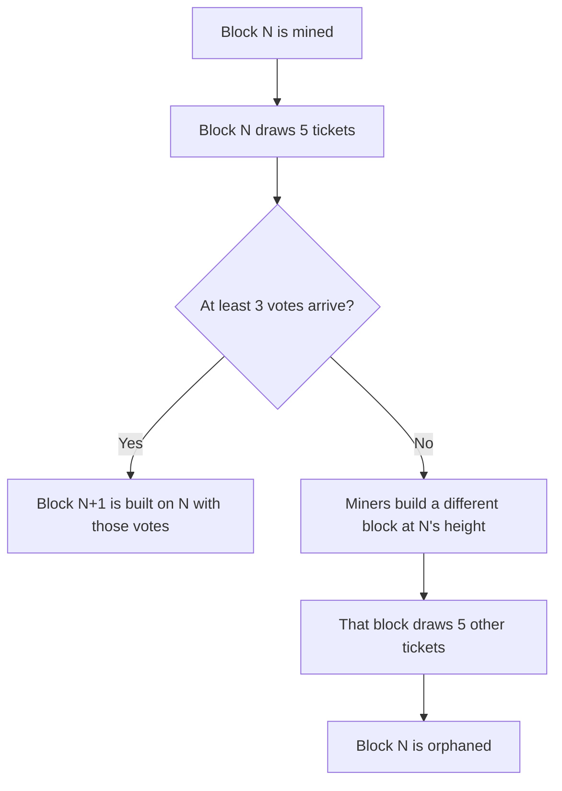

# Staking FAQ

Short answers to the staking questions that come up most often, for anyone who holds tickets or is about to buy one. Each answer links to the page that explains the topic in full. If you are new to staking, read [How staking works](index.md) first.

The answers describe the network today, with automatic revocations (since 2022) and the 1/89/10 block subsidy split (since 2023). If an older guide disagrees, it is out of date; [What changed](../reference/whats-changed.md) lists what was retired.

## Can I cancel a ticket?

No. Once a ticket is mined, the DCR in it can be spent only by the ticket's vote or by its revocation. That is a consensus rule, and no wallet, voting service provider (VSP) or support person can get around it. The lock-up is deliberate: it is what makes a ticket a real commitment to the network.

Plan for the full range of lock times before you buy:

- **Typical:** about 30 days. That is 256 blocks before the ticket can be drawn, an average wait of about 28 days, then 256 more blocks before the returned DCR can be spent.
- **Longest:** 41,472 blocks (256 + 40,960 + 256), about 144 days, if the ticket expires without being drawn.

See [How staking works](index.md) for the full ticket lifecycle.

## Do I need to stay online?

It depends on who votes your tickets. A ticket can be drawn at any moment while it is live, and its vote must reach miners before the next block is found (about five minutes on average), so something must always be online and ready to vote.

| How you stake | What must stay online |
|---|---|
| Through a VSP | Your wallet only while you buy, until the VSP has the fee. In Decrediton, **Staking** > **Ticket Status** should show **Paid Fee** or **Confirmed Fee**. Bison Wallet queues the tickets you ask for and buys them in the background (**Queued tickets**), so keep it running until none are queued. After that you can close the wallet: the VSP votes for you. If a ticket later shows **Fee Error**, open Decrediton again and use **Sync Failed VSP Tickets** on the same tab to retry the fee, or the ticket will be missed if it is drawn. |
| Automatic buying with a VSP | Your wallet, running and unlocked, for as long as you want tickets bought. Decrediton warns that it "must remain running" for **Automatic Ticket Purchases** to work. |
| Solo voting | Your voting wallet, unlocked and connected to a full node, every minute that any of your tickets is live. |

Your voting machine does not need to accept incoming connections. A vote goes out like any other transaction. See [Voting service providers](vsps.md) and [Vote without a VSP](solo-voting.md).

## Can a VSP steal my DCR or my reward?

No. When you buy a ticket, it records which of your addresses get paid when it votes or is revoked. Consensus enforces those payouts, so they cannot be redirected. The VSP receives only the ticket's voting key, which can sign a vote and nothing else. A VSP can let you down in three ways:

- **It fails to vote.** The ticket is missed. You get the ticket price back automatically, but lose the reward and the VSP fee.
- **It votes differently from the choices you set.** Votes are public on the blockchain, so you can check. A VSP running `vspd` signs every response with its own key, so it cannot later deny accepting your fee and your choices.
- **It learns which tickets are yours.** Like any website you connect to, it also sees your IP address.

[Voting service providers](vsps.md) covers custody, accountability and what to do if a VSP shuts down.

## What happens if my ticket misses its vote or expires? Do I have to revoke it?

You do not have to do anything. Since block 657,280 (2022, Decred Change Proposal [DCP-0009](https://github.com/decred/dcps/blob/master/dcp-0009/dcp-0009.mediawiki)), every block must include a revocation for each ticket that becomes missed or expired in it. The revocation pays no fee and returns the full ticket price to your addresses, spendable 256 blocks (about 21 hours) later, as with a vote's payout.

What you lose:

- the vote reward;
- the transaction fee you paid to buy the ticket;
- the VSP fee, which is not refunded;
- the time the DCR was locked.

A ticket is **missed** when it is drawn but its vote does not reach the next block, because the voting wallet was offline or locked or the vote reached the miner too late. It **expires** if it is never drawn within 40,960 blocks of going live, which at the target pool size happens to about 0.7% (fewer than 1 in 100) of tickets. Guides that tell you to revoke tickets by hand describe software from before 2022. See [How staking works](index.md).

## Does a bigger VSP vote more often?

No. The lottery draws each live ticket with the same chance, whoever votes it, so a VSP cannot make your ticket vote sooner. A VSP with many tickets sees more of them drawn in total, but yours are not drawn any more often. What a VSP can affect is whether your ticket gets voted at all when it is drawn, so look at its record of missed tickets and how long it has been running.

Size matters for the network, not for your reward. Each VSP holds the voting keys of all its tickets, so a large VSP concentrates voting power. The [VSP list on decred.org](https://decred.org/vsp/) advises stakers to avoid any provider with more than 5% of network votes. See [Voting service providers](vsps.md) for how to choose one.

## How much DCR do I need? Can I share a ticket?

To buy one ticket you need:

- **The ticket price** (also called stake difficulty). It is set by the network every 144 blocks (about 12 hours) and cannot go below 2 DCR, a consensus floor that the real price is far above.
- **A small transaction fee** for the purchase.
- **The VSP fee**, if you use a VSP. It is roughly the VSP's percentage of one vote reward, paid up front in a separate transaction.

The price changes all the time, so read it live. Decrediton shows **Current Price** on its **Staking** page, Bison Wallet shows **Ticket Price** in its staking panel, and [dcrdata](../wallets/block-explorer.md) shows it as **Current Ticket Price** on its home page. `dcrwallet` refuses to pay a VSP fee above `vsp.maxfee`, a wallet default of 0.2 DCR.

You cannot share a ticket with current software. The protocol allows a ticket to be funded from up to 64 inputs, with each funder repaid in proportion. But Decrediton 2.1.7, Bison Wallet 1.0.6 and `dcrwallet` 2.1.7 have no way to buy a ticket together with someone else. See [Ticket price, rewards and costs](ticket-price-and-rewards.md).

## When do I get my reward, and when can I spend it?

A drawn ticket votes on the block that drew it. Its vote is included in the next block, and that vote transaction pays the ticket price plus the reward straight to your addresses. Each vote earns 17.8% of a block's subsidy: the voters' 89% share split five ways. The reward is not reduced when fewer than five tickets vote. The returned DCR becomes spendable 256 blocks after the vote is mined.

Here is the timeline for a ticket mined at block *p*. The block numbers are fixed; the waiting time to be drawn is random.

| Event | Block | Time after purchase |
|---|---|---|
| Ticket mined (immature) | *p* | 0 |
| Ticket goes live and can be drawn | *p* + 256 | about 21 hours |
| Ticket drawn and votes | on average about 8,192 blocks later | about 29 days on average |
| Ticket price and reward spendable | 256 blocks after the vote | about 30 days on average |
| Last block in which it can vote | *p* + 256 + 40,960 | about 143 days |

[Ticket price, rewards and costs](ticket-price-and-rewards.md) explains how to estimate returns from live data.

## Are my vote choices fixed when I buy?

No. You can set and change your choices at any time until the ticket votes, and only then are they written to the blockchain for good. A ticket can be bought before an agenda or a treasury spend even exists, and if you set nothing, it votes abstain on agendas.

- **Decrediton:** set choices in **Governance** > **Consensus Changes** and **Treasury Spending**.
- **Bison Wallet:** use **Set Votes** in the staking panel.

With a VSP, the wallet sends your new choices to the VSP, so the wallet must be open and able to reach it when you change them. Politeia proposal votes work differently: your own wallet casts them during each proposal's voting period, and the VSP plays no part. Decrediton (**Governance** > **Proposals**) and `politeiavoter` can cast them; Bison Wallet 1.0.6 cannot. See [Vote with your tickets](../governance/vote.md).

## Can I stake from a hardware wallet or a light wallet?

**Hardware wallet: no.** Decrediton's Trezor and Ledger wallets cannot buy tickets or vote. The devices also cannot spend the payouts of votes and revocations. Never use a hardware wallet address as a ticket's reward address. For large holdings, [Cold storage with an offline wallet](../security/cold-storage.md) describes an offline signing setup.

**Light wallet (SPV, simplified payment verification): yes, through a VSP.** Decrediton in **SPV Mode**, Bison Wallet and `dcrwallet --spv` can all buy tickets and have a VSP vote them. A light wallet cannot vote on its own: a vote judges the previous block's transactions, which a light wallet does not check. `dcrwallet` refuses to start with both light mode and voting turned on. To vote yourself, you need a full-node wallet.

See [Use a hardware wallet](../wallets/hardware-wallets.md) and [How a Decred wallet works](../wallets/how-wallets-work.md).

## What happens if fewer than 3 tickets vote on a block?

No block can be built on top of it. A block is valid only if it carries votes from at least 3 of the 5 tickets drawn by its parent. When fewer than 3 votes turn up, miners mine a different block on the parent instead, which draws five other tickets, and the block without votes is orphaned.

If your ticket was drawn by a block that was orphaned, it has not missed: it stays live and can be drawn again. A block with only 3 or 4 votes is valid, but the drawn tickets left out are missed, and the miner's subsidy shrinks in proportion. See [Miners, voters and the life of a block](../start/life-of-a-block.md).

## Why is the target pool 40,960 tickets?

It is 8,192 × 5: the network parameter `TicketPoolSize` times the five tickets drawn per block. With 40,960 live tickets, each ticket has a 1 in 8,192 chance per block, an average wait of 8,192 blocks (about 28 days). Ticket expiry is set to the same 40,960 blocks, so at the target size a ticket expires undrawn with a probability of about 0.7% (fewer than 1 in 100).

The real pool drifts above and below the target, and the ticket price algorithm ([DCP-0001](https://github.com/decred/dcps/blob/master/dcp-0001/dcp-0001.mediawiki)) pushes it back. At each adjustment it scales the price by two things: how much the pool, counting immature tickets, grew or shrank since the last adjustment, and how far that count is from its 42,240 target (40,960 live plus 1,280 immature). dcrdata shows the current figure as **Ticket Pool Size**. See [Ticket price, rewards and costs](ticket-price-and-rewards.md).

## My restored wallet shows tickets without VSP status: what now?

Your tickets are safe. They are on the blockchain, and a VSP keeps voting any ticket whose fee it has received, whatever your wallet shows. What a restore from seed loses is the wallet's own record of which VSP each ticket uses. Without that record the wallet cannot show the fee status or send changed vote choices to the VSP.

- **Decrediton:** after a restore with live tickets, Decrediton offers **Process Managed Tickets** and **Process Unmanaged Tickets**. On the second screen, select the VSP you actually bought through.
- **dcrwallet:** set `vsp.url` and `vsp.pubkey` for that VSP, then link each ticket with `processunmanagedticket`.
- **Bison Wallet 1.0.6:** it has no relinking screen, but the VSP keeps voting tickets it was paid for.

Link a ticket only to the VSP it was bought through: linking it to another VSP can make the wallet pay a second fee, to that VSP. [Back up and restore your wallet](../wallets/back-up-and-restore.md) has the exact steps.

## Go deeper

- [Tickets in the whitepaper's introduction](../../whitepaper/01-intro.md#sec:intro-tickets): the ticket stages and the 40,960 target in one page.
- [Stake parameters and constants](../../whitepaper/08-staking.md#sec:staking-params): maturity, expiry, the 2 DCR minimum and the 20-tickets-per-block cap.
- [Life of a ticket](../../whitepaper/08-staking.md#sec:staking-life): the exact block heights at which a ticket can vote, miss or expire.
- [Replacement template when votes are missing](../../whitepaper/17-policy.md#sec:policy-toofew): how the reference node mines around a block that lacks votes.

## Next steps

- [Stake with Decrediton or Bison Wallet](stake.md): buy your first ticket through a VSP.
- [Voting service providers](vsps.md): choose a VSP and understand what it can and cannot do.
- [Ticket price, rewards and costs](ticket-price-and-rewards.md): estimate what staking returns, from live data.
- [Vote with your tickets](../governance/vote.md): set your choices on agendas, treasury spends and proposals.

*[VSP]: voting service provider
*[VSPs]: voting service providers
*[SPV]: simplified payment verification
*[DCP]: Decred Change Proposal
