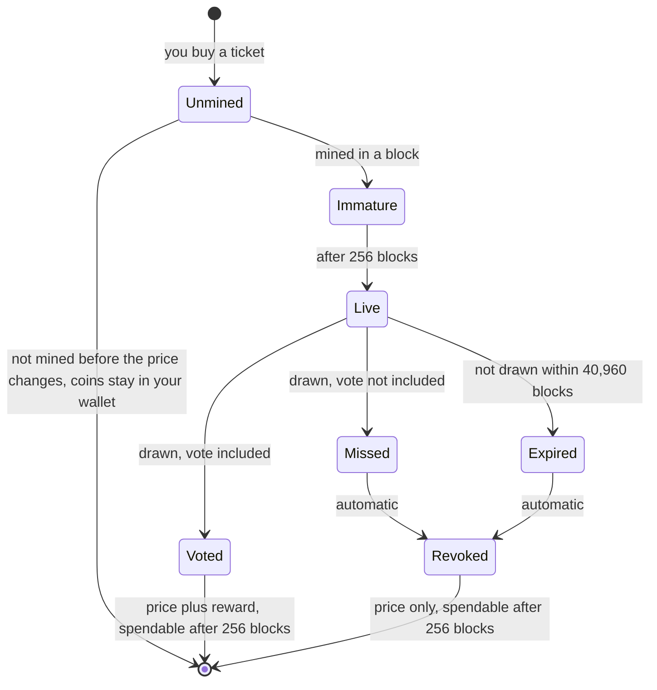

# How staking works

Staking in Decred means locking DCR in a **ticket** that votes on blocks and governance decisions and earns a reward when it votes. This page is for anyone thinking about staking: it explains what a ticket is, what happens to your DCR from purchase to return, what the ticket votes on, and what can go wrong, using the real mainnet numbers.

!!! abstract "Staking in one minute"

    - You lock DCR at the current **ticket price** and get one **ticket**, which carries one vote.
    - After about 21 hours the ticket enters a pool of about 40,960 tickets. Every block draws 5 of them at random to vote.
    - A ticket waits about 28 days on average to be drawn. When it votes, the ticket price comes back to you with a reward.
    - If a ticket is never drawn within about 142 days (about 0.7% of tickets), or misses its vote, the ticket price comes back without a reward.
    - The locked DCR can only ever return to your wallet. A ticket cannot be cancelled, and the timing is random.
    - A drawn ticket's vote must be broadcast promptly, at a moment nobody can predict, so stakers who cannot keep a voting wallet online all the time let a **voting service provider (VSP)** vote for them. A VSP never holds your funds.

## In this section

-   **[Ticket price, rewards and costs](ticket-price-and-rewards.md)**

    ---

    How the ticket price moves, how big a vote reward is, and how to estimate returns from live data.

-   **[Voting service providers](vsps.md)**

    ---

    What a VSP does and can never do, how its fee works, and how to choose one.

-   **[Stake with Decrediton or Bison Wallet](stake.md)**

    ---

    Buy tickets through a VSP in a graphical wallet, step by step.

-   **[Stake with dcrwallet](stake-with-dcrwallet.md)**

    ---

    Buy tickets through a VSP from the command line, by hand or automatically.

-   **[Vote without a VSP (solo voting)](solo-voting.md)**

    ---

    Run your own always-online voting wallets and pay no VSP fee.

-   **[Staking FAQ](faq.md)**

    ---

    Short answers to the staking questions people ask most.

## What a ticket is

A ticket is a special transaction that locks an amount of DCR equal to the current **ticket price** (also called stake difficulty). In exchange you get one vote, to be cast at a random time in the future. Buying ten tickets gives you ten votes, each drawn independently.

The ticket price is the same for everyone buying in a given block. The network recalculates it every 144 blocks (about 12 hours) to steer the number of tickets in the pool toward its target of 40,960, and it never drops below 2 DCR. You cannot choose a different price or bid for a better one. [Ticket price, rewards and costs](ticket-price-and-rewards.md) explains how the price moves; your wallet and the **Voting** section of the [dcrdata block explorer](https://dcrdata.decred.org/) show the live value as **Current Ticket Price**.

A ticket holds two separate rights, and this split is what protects your funds when someone else votes for you:

Voting rights
:   The right to cast the ticket's vote. Whoever holds this key decides how, and whether, the ticket votes. You can hand it to a VSP.

Reward commitment
:   An address in your own wallet, written into the ticket when you buy it. The consensus rules require every vote or revocation that ends the ticket to pay the locked amount, plus any reward, to exactly this address.[^outputs]

No one, including a VSP holding the voting rights, can redirect the money. **The DCR in a ticket can only ever come back to the wallet that bought it.**

## Why Decred has tickets

In a pure **proof of work (PoW)** currency, miners both produce blocks and hold an effective veto over rule changes, while the people who hold the currency have no formal voice. Decred adds **proof of stake (PoS)**: every block must carry votes from at least 3 of the 5 tickets drawn to vote on the block before it, or the network rejects it. Miners still do the work of building blocks, but they cannot extend the chain without stakeholders' votes.

Locking DCR for an unpredictable time, with the reward paid only for votes actually cast, makes ticket holders a committed group with something to lose. The same votes that keep the chain moving also carry the project's governance decisions. [Miners, voters and the life of a block](../start/life-of-a-block.md) walks through how a block is produced and approved.

## What your ticket votes on

A ticket votes on chain only once, when it is drawn. That single vote carries several decisions at the same time. Politeia proposals are voted separately, off chain.

| Decision | Where it is cast | What it decides |
|---|---|---|
| Block approval | In the ticket's on-chain vote | Whether the previous block's ordinary transactions stand. Unless more votes approve than disapprove, those transactions are undone and the miner is not paid. |
| Consensus rule changes | In the on-chain vote, during a rule vote | Whether a proposed rule change, called an agenda, activates. A vote runs for 8,064 blocks (about 4 weeks) and needs 75% of non-abstaining votes. |
| Treasury spends | In the on-chain vote, while a spend is open | Whether a **treasury spend (TSPEND)** from the project treasury is approved. Each spend is open for 3,456 blocks (about 12 days). |
| Politeia proposals | Signed from your own wallet, off chain | Whether the community supports a proposal or funding request on proposals.decred.org. |

A few points follow from this:

- **Set your choices before the ticket is drawn.** If you have not chosen, the ticket abstains on agendas and treasury spends. You can change your choices any time until the ticket votes. With a VSP, your wallet sends your choices to the VSP, which casts them for you.
- **Politeia voting is separate.** Tickets that are live at a snapshot taken when a proposal vote starts can vote on that proposal for its whole duration, even if they vote on chain in the meantime. Your own wallet signs the Politeia vote, even when a VSP holds the ticket's voting rights. A Politeia vote does not affect the ticket or its funds.
- **Only drawn tickets vote on chain.** Your ticket's choices count only for the agendas and treasury spends that happen to be open when it is drawn.

[How Decred is governed](../governance/index.md) explains each kind of decision, and [Vote with your tickets](../governance/vote.md) shows how to set your choices.

## The life of a ticket

Every ticket moves through the same states, and your wallet shows them under the same names. A ticket starts as unmined, matures for 256 blocks, then waits in the live pool until it is drawn to vote or expires. A missed or expired ticket is revoked automatically, so every path ends with your DCR back in your wallet.

### Unmined

Your wallet broadcasts the ticket purchase and it waits for a miner to include it in a block. At most 20 new tickets can enter each block. Wallets buy at exactly the current ticket price, so if the purchase has not been mined by the time the price changes, your wallet drops it and the coins become spendable again.

### Immature: 256 blocks, about 21 hours

Once mined, the ticket is immature for 256 blocks. It cannot be drawn yet. A broadcast ticket purchase cannot be reliably cancelled, and once it is mined the transaction fee you paid to buy it will not come back.

### Live: drawn at random

After 256 blocks the ticket joins the **live ticket pool**. After every block, each node draws 5 tickets from the pool, using a deterministic calculation from that block's header and the set of live tickets, so every node gets the same winners and miners cannot cheaply steer the draw.[^lottery] Every live ticket has the same chance in every draw, however old it is and however many tickets its owner holds.

With the pool at its target of 40,960 tickets, a ticket has a 1 in 8,192 chance of being drawn in each block. That gives these odds of having been drawn:

| Time live | Blocks | Chance the ticket has been drawn |
|---|---|---|
| about 1 week | 2,016 | about 22% |
| about 20 days | 5,678 | 50% |
| about 28 days (the average) | 8,192 | about 63% |
| about 57 days | 16,384 | about 86% |
| about 142 days (expiry) | 40,960 | about 99.3% |

These figures assume the pool is exactly at its target. The real pool size moves around the target; the **Ticket Pool Size** on dcrdata shows it live. A larger pool means longer waits, a smaller pool shorter ones.

### Voted: price plus reward, spendable after 256 blocks

When the ticket is drawn, the wallet holding its voting rights broadcasts a vote, and the next block includes it. The vote returns the ticket price plus the vote reward to your commitment address. Each vote earns one fifth of the 89% of the block subsidy set aside for voters (17.8% of the subsidy of the block it votes on), whether or not all five votes make it into the block; [Ticket price, rewards and costs](ticket-price-and-rewards.md) explains how big that is.

The returned DCR stays immature for another 256 blocks (about 21 hours) before you can spend it, the same rule that applies to newly mined coins.

### Missed or expired: revoked automatically, price returned

A ticket can end without voting in two ways:

Missed
:   The ticket was drawn, but its vote was not in the next block. Usually the voting wallet was offline or slow, or the miner of the next block did not receive the vote in time.

Expired
:   The ticket was never drawn in 40,960 blocks (about 142 days) in the live pool. At the target pool size this happens to about 0.7% of tickets, fewer than 1 in 100.

Either way, the ticket is **revoked**: a revocation transaction returns the ticket price, without a reward, to your commitment address. Since the `autorevocations` rule change (Decred Change Proposal [DCP-0009](https://github.com/decred/dcps/blob/master/dcp-0009/dcp-0009.mediawiki), active since 2022), every block must contain the revocations for tickets that become missed or expired in it. Nobody needs to do anything, and the revocation pays no fee. As with a vote, the returned DCR is spendable after 256 more blocks.

Before DCP-0009, wallets had to revoke missed and expired tickets themselves. Old guides that tell you to click a revoke button describe that retired step; [What changed](../reference/whats-changed.md) lists the others.

## Worked example: how long your DCR is locked

Suppose a ticket purchase is mined in block 1,200,000 (an example height). The ticket is immature until block 1,200,256 and can be drawn from the lottery that block runs, so its earliest possible vote is in block 1,200,257. Whatever happens next, the returned DCR needs 256 more blocks before you can spend it.

| Outcome | Blocks from purchase to spendable | About |
|---|---|---|
| Drawn in the first possible block | 256 + 1 + 256 = 513 | 43 hours |
| Drawn at the median wait (5,678 blocks) | 256 + 5,678 + 256 = 6,190 | 21 days |
| Drawn at the average wait (8,192 blocks) | 256 + 8,192 + 256 = 8,704 | 30 days |
| Expires | 256 + 40,960 + 256 = 41,472 | 144 days |

So plan for your DCR to be locked for about a month on average, and possibly for nearly five months. Add the few minutes, occasionally longer, that it takes for the purchase itself to be mined. Times are approximate because blocks arrive every 5 minutes only on average.

## Why a ticket needs an always-online voter

A drawn ticket's vote has to reach miners before the next block is found, so that block can include it. Miners can start working on that block a few seconds after they have 3 of the 5 votes, so a vote that is even slightly late risks being left out. The wallet holding the voting rights therefore has to be running, unlocked, and connected to a full node at a moment nobody can predict, day or night, for as long as the ticket is live. A light wallet (SPV) cannot vote at all: `dcrwallet` refuses to enable voting in light mode.

There are two ways to meet that requirement:

Use a VSP
:   A VSP runs several always-online voting wallets and votes your tickets according to the choices you set. You pay a small fee per ticket, the VSP fee, and give the VSP only the voting rights. It cannot touch your funds or the reward. This works with light wallets, including Decrediton in light mode and Bison Wallet. See [Voting service providers](vsps.md).

Vote yourself (solo voting)
:   You run your own full node and voting wallet, ideally more than one in different places, and keep them online and unlocked. There is no VSP fee, but a missed vote is your loss. See [Vote without a VSP](solo-voting.md).

!!! note
    Hardware-backed wallets (Trezor and Ledger in Decrediton) cannot stake: they cannot buy tickets or vote. See [Use a hardware wallet](../wallets/hardware-wallets.md).

## What it costs and what can go wrong

Staking has no penalty for voting the wrong way or for missing a vote. The protocol never confiscates staked DCR: the ticket price always comes back. The risks are about time, fees and lost rewards.

- **Your DCR is locked, and you cannot cancel.** From the moment the ticket is mined until it resolves, the locked DCR cannot be spent or sold. The lock usually lasts weeks and can last about 144 days. Only stake DCR you will not need before then.
- **The market moves while you wait.** The value of DCR can change while it is locked, and you cannot sell it until the ticket resolves.
- **Some costs are never returned.** The transaction fee for buying the ticket is paid whatever happens. With a VSP, the VSP fee is paid up front for each ticket and is not returned if the ticket misses or expires.
- **A missed or expired ticket earns nothing.** You get the ticket price back but no reward, so the fees above are a net loss on that ticket.
- **A VSP holds your vote.** A VSP cannot take your funds, but it could vote differently from your choices or fail to vote. VSPs sign what they agree to, so you can prove what you asked for; [Voting service providers](vsps.md) explains how to choose one and spread the risk.
- **Your seed still matters.** Returned DCR goes to addresses in your wallet. If you lose your seed, you lose the staked DCR along with everything else. [Back up and restore your wallet](../wallets/back-up-and-restore.md) also covers recovering tickets after a restore.

## Key numbers

All of these are mainnet consensus parameters, read from `chaincfg/mainnetparams.go` in dcrd 2.1.7.[^params] Values that change constantly, such as the ticket price, pool size and vote reward, are not listed; read them on dcrdata or in your wallet.

| What | Value |
|---|---|
| Tickets drawn per block | 5 (a block needs at least 3 votes) |
| Target pool size | 40,960 tickets |
| Ticket maturity | 256 blocks (about 21 hours) |
| Average wait to be drawn | 8,192 blocks (about 28 days) |
| Ticket expiry | 40,960 blocks in the live pool (about 142 days) |
| Maturity of returned DCR | 256 blocks (about 21 hours) |
| Ticket price recalculated | every 144 blocks (about 12 hours) |
| Minimum ticket price | 2 DCR |
| New tickets per block | at most 20 |

## Go deeper

- [Life of a ticket](../../whitepaper/08-staking.md#sec:staking-life): the exact block heights at which a ticket matures, can vote, and expires.
- [The lottery](../../whitepaper/08-staking.md#sec:staking-lottery): how every node draws the same five winners from the live pool.
- [Revocation transactions](../../whitepaper/08-staking.md#sec:staking-revocation): how automatic revocations return the ticket price with no signature and no fee.
- [Voting service providers](../../whitepaper/19-ecosystem.md#sec:ecosystem-vsp): why delegating the voting rights cannot put your funds at risk.

## Next steps

- [Stake with Decrediton or Bison Wallet](stake.md): buy your first ticket through a VSP.
- [Voting service providers](vsps.md): choose a VSP and understand its fee.
- [Ticket price, rewards and costs](ticket-price-and-rewards.md): see how big a reward is and how to estimate it from live data.
- [Vote with your tickets](../governance/vote.md): set your choices on agendas, treasury spends and proposals.
- [Mix your DCR](../privacy/mix-your-dcr.md): buy tickets with mixed funds for better privacy.

[^outputs]: The whitepaper's rules for [outputs created by stake transactions](../../whitepaper/08-staking.md#sec:staking-stake-outputs) and the [ticket states](../../whitepaper/08-staking.md#sec:staking-states) give the details.
[^lottery]: The whitepaper's [introduction to tickets](../../whitepaper/01-intro.md#sec:intro-tickets) summarizes the lottery and the target pool size.
[^params]: [dcrd chaincfg/mainnetparams.go at release-v2.1.7](https://github.com/decred/dcrd/blob/release-v2.1.7/chaincfg/mainnetparams.go): `TicketsPerBlock`, `TicketPoolSize`, `TicketMaturity`, `TicketExpiry`, `CoinbaseMaturity`, `StakeDiffWindowSize`, `MinimumStakeDiff`, `MaxFreshStakePerBlock`. The target pool size is `TicketPoolSize` × `TicketsPerBlock`.

*[VSP]: voting service provider
*[VSPs]: voting service providers
*[SPV]: simplified payment verification
*[PoW]: proof of work
*[PoS]: proof of stake
*[DCP]: Decred Change Proposal
*[TSPEND]: treasury spend
