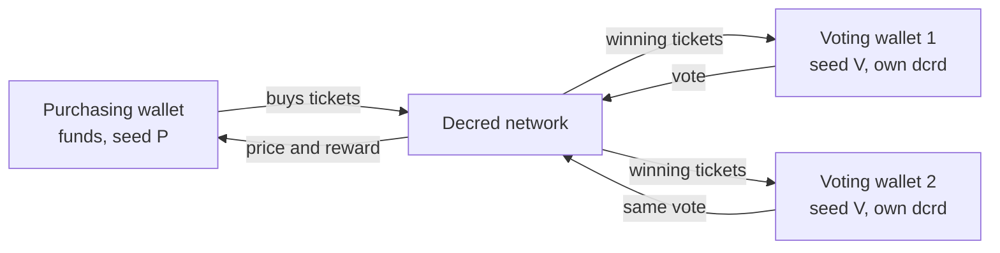

# Vote without a VSP (solo voting)

Solo voting means your own always-online wallets vote your tickets, so you pay no voting service provider (VSP) fee and depend on no one. This guide helps experienced command-line users decide whether it suits them, then sets up two or more voting wallets that hold no spendable funds.

!!! info "Applies to"
    dcrd, dcrwallet and dcrctl 2.1.7 (Decred release v2.1.7). Checked November 2026.

Decrediton 2.1.7 and Bison Wallet 1.0.6 cannot do this: neither votes tickets itself, so both stake through a VSP. Everything below uses `dcrwallet`.

## Before you start

- Working knowledge of [the command-line wallet](../wallets/command-line.md): config files, `dcrctl`, unlocking.
- Two or more Linux servers in different places (different providers or regions), each able to run a [full node](../run/full-node.md) around the clock. A home computer can be one of them.
- A separate computer for the purchasing wallet, which holds your funds. It needs to be online only while it buys tickets.
- Time: an afternoon for setup, plus prompt upgrades whenever a release is announced, for as long as you have live tickets.

## Is solo voting for you?

It suits you if all of these hold:

- You can keep at least two servers synced, unlocked and online 24 hours a day, and upgrade them within days of a release.
- The VSP fees you would save outweigh what the servers cost you.
- You accept that a missed vote is your loss: the ticket price comes back, the reward does not.

Solo voting does not change how often your tickets are drawn or what a vote earns. A ticket can be drawn until 41,216 blocks (about 143 days) after it was mined, so the voting wallets must run that long after your last purchase. [Voting service providers](vsps.md) compares the two side by side; if any of this gives you pause, use a VSP.

## How it works

A ticket names two things when it is bought ([the whitepaper's commitment output](../../whitepaper/08-staking.md#sec:staking-commitment)):

- a **voting address**: whoever holds its key can sign the ticket's vote;
- a **commitment address**: where the ticket price and reward must be paid. Consensus enforces this, so a voting key cannot redirect the money ([matching outputs to commitments](../../whitepaper/08-staking.md#sec:staking-payees)).

Each block draws five tickets. A voting wallet started with `--enablevoting` asks its `dcrd` for the winners of every new block (`notifywinningtickets`), signs a vote for each ticket it holds the voting key for, and broadcasts it. Two consequences:

- **It needs a full node.** Only a full node tracks the ticket pool. `dcrwallet` refuses light mode (SPV, simplified payment verification) together with voting: `--spv` plus `--enablevoting` stops it with "SPV voting is not possible".
- **It must be fast and unlocked.** Once a block has three votes, `dcrd`'s block template generator waits at most 2.5 seconds for the other two before building on it ([background template generation](../../whitepaper/17-policy.md#sec:policy-bg); this is mining policy, not consensus). A locked, offline or out-of-sync wallet misses. A missed ticket is revoked automatically and its price returned, without the reward.

## Choose a layout

Because only the voting key is needed to vote, the voting servers do not have to hold your funds. Run two or more voting wallets in different places, all restored from the same **voting seed**, and buy tickets from a separate **purchasing wallet** whose seed never touches a server:



Both voting wallets sign a vote for the same ticket. Both votes spend the ticket, so only one can be mined; the duplicate costs nothing. A vote pays no fee from the voting wallet's own funds, so the voting wallets need no balance.

There are two ways to arrange the keys:

| | Separate voting seed (recommended) | One seed everywhere |
|---|---|---|
| Voting servers hold | Voting keys only | Your whole wallet |
| A compromised server can | Vote your tickets against your choices | Spend everything the wallet receives, including every returned ticket price |
| Ticket buying | Purchasing wallet's automatic ticket buyer only | Any method |
| Hand tickets to a VSP later | No | Yes |
| Politeia votes from | Purchasing wallet | Any of the wallets |

The rest of this guide uses the separate voting seed.

!!! note "If you use one seed everywhere"
    - In step 2, restore your main seed on every voting server instead of creating a voting seed. Every server can then spend everything that wallet receives.
    - Skip step 3, and leave `ticketbuyer.votingaccount` out of step 4 unless you mix. Tickets bought by any method, `purchaseticket` included, are voted.
    - For mixed tickets, create a dedicated account on the purchasing wallet with `dcrctl --wallet createnewaccount voting` and set `ticketbuyer.votingaccount=voting`.
    - Create every account you add to the purchasing wallet (the voting account and the mixed and unmixed accounts alike) on every voting wallet too, in the same order, so the account numbers match. `dcrctl --wallet getmasterpubkey <ACCOUNT>` must print the same key on every wallet. A voting wallet does not see or vote tickets whose voting address is in an account it does not know.

## 1. Set up dcrd on each voting server

On every voting server, install and verify the command-line suite and start `dcrd`, as in [Set up the command-line wallet](../wallets/command-line.md), and let it finish its first sync. [Run a full node](../run/full-node.md) covers hardware and running `dcrd` as a service with the unit files in [dcrd's contrib/services](https://github.com/decred/dcrd/tree/release-v2.1.7/contrib/services). Opening the peer port 9108 is optional: a vote goes out like any other transaction.

## 2. Create the voting wallets

On the first voting server, create a new wallet. Its seed is the voting seed (seed V):

```bash
dcrwallet --create
```

Write the 33 words down and store them apart from your main seed. On every other voting server, run the same command, answer `yes` to "Do you have an existing wallet seed you want to use?", and type the voting seed.

Then give each one a `dcrwallet.conf` (in `~/.dcrwallet`):

```ini title="dcrwallet.conf (voting server)"
[Application Options]
username=<RPCUSER>
password=<RPCPASS>
enablevoting=1
```

`<RPCUSER>` and `<RPCPASS>` are the `rpcuser` and `rpcpass` from that server's `dcrd.conf`. Start the wallet once in a terminal with `dcrwallet --promptpass`, enter the private passphrase, and wait for `SYNC: Blockchain sync completed, wallet ready for general usage.` [Step 6](#6-run-the-voting-wallets-unattended) makes it start on its own.

!!! danger "Never use a voting wallet as a normal wallet"
    Do not send funds to a voting wallet or create addresses in it for payments. It is unlocked all the time on a machine exposed to the internet.

## 3. Connect the purchasing wallet to the voting key

On every voting server, read the voting account's extended public key:

```bash
dcrctl --wallet getmasterpubkey default
```

```text title="Expected output"
dpub...
```

All voting servers must print the same key. If one differs, it was not restored from the same seed: fix that before going on.

On the purchasing wallet (a normal `dcrwallet` with your funds, in full-node or light mode), import that key as a watching-only account named `voting`:

```bash
dcrctl --wallet importxpub voting <DPUB>
```

`<DPUB>` is the key printed above (it starts with `dpub`). The purchasing wallet can now derive voting addresses that only the voting servers can sign for.

## 4. Buy tickets with the ticket buyer

Add the ticket buyer to the purchasing wallet's `dcrwallet.conf`, with no `vsp.` options:

```ini title="dcrwallet.conf (purchasing wallet)"
[Application Options]
username=<RPCUSER>
password=<RPCPASS>
enableticketbuyer=1
purchaseaccount=default

[Ticket Buyer Options]
ticketbuyer.votingaccount=voting
ticketbuyer.balancetomaintainabsolute=<DCR TO KEEP>
ticketbuyer.limit=1
```

`<DCR TO KEEP>` is how much DCR the ticket buyer leaves unspent in the purchase account, for example `0`. On a full-node purchasing wallet, `<RPCUSER>` and `<RPCPASS>` are again the `rpcuser` and `rpcpass` from its `dcrd.conf`. For a light-mode purchasing wallet, also add `spv=1` under `[Application Options]`; `username` and `password` then only protect the wallet's own RPC server and can be any values you choose.

Start the wallet with `dcrwallet`; with the ticket buyer enabled it asks for the private passphrase and stays unlocked. On each new block it buys up to `ticketbuyer.limit` tickets (the default is 1) while the spendable balance is above `<DCR TO KEEP>`. Without mixing, `0` means up to 20, the most a block can hold. With mixing, the limit is the number of one-ticket mixed purchases started per block, and `0` buys nothing. Each purchase logs:

```text title="Expected output"
[INF] TKBY: Purchased ticket <TICKET HASH> at stake difficulty <PRICE>
```

When you have bought what you want, stop the wallet or remove `enableticketbuyer=1`. The ticket price and reward of each ticket come back to this wallet when it votes; it does not need to be online to receive them.

!!! warning "Do not use `purchaseticket` in this layout"
    In dcrwallet 2.1.7 the `purchaseticket` command ignores `ticketbuyer.votingaccount`: it takes the voting address from the purchase account (or, with mixing, the mixed account), which your voting servers cannot sign for. Such tickets will miss unless you vote them from the purchasing wallet itself or register them with a VSP. Buy only through the ticket buyer.

**Mixed tickets.** To buy tickets with mixed funds, set up mixing in the purchasing wallet as in [Mix your DCR](../privacy/mix-your-dcr.md). The ticket buyer then requires `ticketbuyer.votingaccount` and refuses to start without it ("cannot run mixed ticketbuyer without --votingaccount"); set it to `voting` as above, and keep `ticketbuyer.limit` at 1 or more.

## 5. Set your vote choices on every voting wallet

The voting wallets build the votes, so their choices count, not the purchasing wallet's. Set the same choices on every voting wallet; if they differ, a ticket votes with whichever wallet's vote is mined.

Consensus rule changes (agendas):

```bash
dcrctl --wallet getvotechoices
dcrctl --wallet setvotechoice <AGENDA ID> <CHOICE ID>
```

Treasury spends: a policy for each Politeia key covers every treasury spend (TSPEND) that key signs, and a policy for one spend overrides it:

```bash
dcrctl --wallet settreasurypolicy <PI KEY> <POLICY>
dcrctl --wallet settspendpolicy <TSPEND HASH> <POLICY>
```

`<AGENDA ID>` and `<CHOICE ID>` come from `getvotechoices`. `<POLICY>` is `yes`, `no` or `abstain`. The two mainnet Politeia keys (`<PI KEY>`) are `03f6e7041f1cf51ee10e0a01cd2b0385ce3cd9debaabb2296f7e9dee9329da946c` and `0319a37405cb4d1691971847d7719cfce70857c0f6e97d7c9174a3998cf0ab86dd`. `dcrctl gettreasuryspendvotes` lists the treasury spends in the mempool; each entry under `votes` has the spend's `hash` (the top-level `hash` is a block hash). Check your settings with `getvotechoices`, `treasurypolicy` and `tspendpolicy`. A ticket abstains on anything you leave unset.

Politeia proposal votes are signed with a ticket's commitment address key, so in this layout you cast them from the purchasing wallet with `politeiavoter`. See [Vote with your tickets](../governance/vote.md).

## 6. Run the voting wallets unattended

A voting wallet must unlock itself after every restart, or be unlocked by you. `dcrwallet` ships no service file, so choose one approach:

**Unlock from a protected config file (fully unattended).** Add the private passphrase to the voting wallet's `dcrwallet.conf` and make the file readable only by the account that runs the wallet:

```ini title="dcrwallet.conf (voting server, addition)"
pass=<PRIVATE PASSPHRASE>
```

```bash
chmod 600 ~/.dcrwallet/dcrwallet.conf
```

The passphrase is then stored in plain text: the sample config advises this only for voting-only wallets or wallets with minimal balances, which is what a separate voting seed gives you. Then run the wallet as a service. This systemd unit follows dcrd's shipped one and assumes both programs run as the `dcrd` user from `/home/dcrd/decred`, so the wallet finds `dcrd`'s `rpc.cert`. Adjust the paths to your install:

```ini title="/etc/systemd/system/dcrwallet.service"
[Unit]
Description=Decred voting wallet
After=network-online.target dcrd.service
Wants=network-online.target

[Service]
Type=simple
User=dcrd
Group=dcrd
ExecStart=/home/dcrd/decred/dcrwallet
Restart=on-abnormal
RestartSec=10s
NoNewPrivileges=true
PrivateTmp=true
ProtectSystem=strict
ReadWritePaths=/home/dcrd/.dcrwallet/

[Install]
WantedBy=multi-user.target
```

```bash
sudo systemctl enable --now dcrwallet
```

**Unlock by hand after each restart.** Run the wallet as a service without `pass=`, and after every restart unlock it with no time limit:

```bash
promptsecret | dcrctl --wallet walletpassphrase - 0
```

The passphrase never touches the disk, but the wallet cannot vote until you do this; your other voting wallets cover the gap. `dcrwallet --promptpass` inside `tmux` works the same way.

## 7. Manage the servers remotely

The safest way is to log in with Secure Shell (SSH) and run `dcrctl` on the server, leaving the wallet's remote procedure call (RPC) server on localhost, its default. To run `dcrctl` on your own computer instead, forward the port through SSH and copy the server's `~/.dcrwallet/rpc.cert`, which is valid for `127.0.0.1`:

```bash
ssh -N -L 29110:127.0.0.1:9110 <USER>@<VOTING SERVER>
dcrctl --wallet --walletrpcserver=127.0.0.1:29110 --rpccert=<CERT FILE> walletinfo
```

Run the second command in another terminal, with the server's `rpcuser` and `rpcpass` in your `dcrctl.conf`. `<CERT FILE>` is your copy of the certificate.

To expose the wallet's RPC server directly, do it only on a private network or virtual private network (VPN), and require client certificates:

1. On the server, with the wallet stopped, move the old `rpc.cert` and `rpc.key` aside and make a certificate for the name or private IP address you will connect to: `gencerts -L -H <SERVER NAME> ~/.dcrwallet/rpc.cert ~/.dcrwallet/rpc.key`. Copy the new `rpc.cert` to your computer.
2. On your computer, make a client certificate: `gencerts ~/.dcrctl/client.pem ~/.dcrctl/client-key.pem`. Append `client.pem` to the server's `~/.dcrwallet/clients.pem`.
3. In the server's `dcrwallet.conf`, set `rpclisten=<PRIVATE IP>:9110`, `rpclisten=127.0.0.1:9110` and `jsonrpcauthtype=clientcert`. Setting any `rpclisten` replaces the localhost default, hence the second line.
4. From then on, `dcrctl --wallet` on the server needs a client certificate too, for unlocking and for the checks below. Make one there the same way, append that `client.pem` to `~/.dcrwallet/clients.pem` as well, and add `--authtype=clientcert` to every `dcrctl --wallet` command on the server. Do not set `authtype=clientcert` in its `dcrctl.conf`: that would also apply to calls to `dcrd`, which still uses the username and password. Then start the wallet again.
5. From your computer, connect with `dcrctl --wallet --walletrpcserver=<SERVER NAME> --rpccert=<CERT FILE> --authtype=clientcert walletinfo`.

Never open ports 9109, 9110 or 9111 to the internet: an unlocked wallet will sign whatever its RPC is asked to.

## 8. Harden the voting servers

- Use each server for nothing else, keep its operating system updated, and log in with SSH keys only.
- Allow incoming connections only for SSH (from your addresses if possible), optionally port 9108, and, if you set up client-certificate access in step 7, port 9110 on the private interface only.
- Run `dcrd` and `dcrwallet` as an unprivileged user, with their config files at mode 600.
- Keep seed V on paper, offline. Even losing it together with every server loses no funds: your tickets miss and their price returns to the purchasing wallet.
- Spread the servers across providers or regions. A hosting provider can read a rented server's disk and memory; with a separate voting seed, that exposes voting keys only.

## Check that it worked

On each voting server:

```bash
dcrctl --wallet walletinfo
```

```text title="Expected output (excerpt)"
  "daemonconnected": true,
  "spv": false,
  "unlocked": true,
  ...
  "voting": true,
```

After your first purchase, `dcrctl --wallet ticketinfo` on the purchasing wallet shows each ticket and its `votingaddress`. `dcrctl --wallet gettickets true` on every voting server must list the same ticket hashes. When a ticket is drawn, the voting wallet logs `Voting on block <HASH> (height <HEIGHT>) using ticket <TICKET HASH>` in `~/.dcrwallet/logs/mainnet/dcrwallet.log`. Then `dcrctl --wallet ticketinfo` shows that ticket's `status` as `voted`, the `voted` count in `getstakeinfo` rises, and [the block explorer](../wallets/block-explorer.md) shows the ticket as voted.

## Monitor and upgrade without missing votes

- **Watch every server.** Alert if `walletinfo` shows `daemonconnected`, `unlocked` or `voting` as `false`, or if a server's block height falls behind. A rising `missed` count in `dcrctl --wallet getstakeinfo` means something is wrong.
- **Upgrade one server at a time.** Stop `dcrwallet` and `dcrd`, install and verify the new release, start `dcrd` and wait for it to sync, start and unlock `dcrwallet`, check `walletinfo`, and only then move to the next server. The others keep voting meanwhile.
- **Upgrade promptly.** Some releases are mandatory: 2.1.6 carried a critical consensus-related security fix, and nodes that did not upgrade risked being forked off the network. See [Upgrading and mandatory releases](../run/upgrades.md).
- **After an upgrade that adds an agenda**, set your choice for it on every voting wallet. A wallet offers choices only for the agendas its software knows.

## Move between a VSP and solo voting

**From a VSP to solo voting.** Remove the `vsp.` options from the purchasing wallet and buy new tickets as above. Tickets already registered with a VSP stay with it and are voted by it. In the one-seed layout your voting wallets vote them too; keep the same choices at the VSP and on your wallets.

**From solo voting to a VSP.** Configure a VSP for new purchases ([Stake with dcrwallet](stake-with-dcrwallet.md)). Keep the voting servers running until your last solo ticket has voted or expired. Tickets bought with a separate voting seed cannot be handed to a VSP, because registering a ticket gives the VSP its voting key and the purchasing wallet does not have it. In the one-seed layout, `dcrctl --wallet processunmanagedticket <TICKET HASH>` registers an existing ticket with the configured VSP, which charges its fee.

## Troubleshooting

### `SPV voting is not possible: disable --spv or --enablevoting`

The voting wallet is in light mode. Remove `spv=1` and connect it to a synced `dcrd`.

### The log shows `Failed to sign vote for ticket hash`

The usual cause is a locked wallet; if no other voting wallet voted, the ticket missed. Unlock it (step 6) and check that it stays unlocked after restarts.

### A voting server does not list a new ticket

- Compare `getmasterpubkey default` on that server with the key you imported. If they differ, restore that server from seed V again.
- Check the ticket's `votingaddress` in `ticketinfo` on the purchasing wallet. If the ticket was bought with `purchaseticket`, its voting key is in the purchasing wallet: run that wallet with `enablevoting=1` on a full node until the ticket is spent, or register the ticket with a VSP.
- If many purchases failed, the voting addresses may have skipped past the voting wallet's address gap limit (20 by default, a wallet setting). Run `dcrctl --wallet discoverusage <BLOCK HASH> false 200`, then `dcrctl --wallet rescanwallet <HEIGHT>`, where `<BLOCK HASH>` and `<HEIGHT>` identify a block from before your first purchase.

### Tickets miss although every server is up

Check that each `dcrd` is synced (`dcrctl getblockchaininfo`) and has peers (`dcrctl getpeerinfo`), and that every wallet shows `"voting": true`. A server that lags by even a few seconds can lose the race; more servers in better-connected locations help.

## Next steps

- [Vote with your tickets](../governance/vote.md): what agendas, treasury spends and Politeia proposals ask, and how to vote on proposals.
- [Upgrading and mandatory releases](../run/upgrades.md): where releases are announced and the safe upgrade order.
- [Run a full node](../run/full-node.md): requirements, Tor and running `dcrd` as a service.
- [dcrwallet configuration](../../dev/reference/dcrwallet-config.md): every option used on this page, with defaults.

*[RPC]: remote procedure call
*[SPV]: simplified payment verification
*[SSH]: Secure Shell
*[TSPEND]: treasury spend
*[VPN]: virtual private network
*[VSP]: voting service provider
