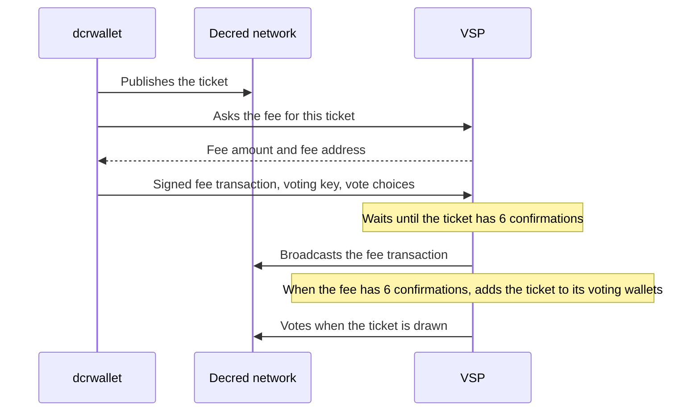

# Stake with dcrwallet

This guide is for command-line users who stake through a voting service provider (VSP) with `dcrwallet` and `dcrctl`, buying tickets by hand or with the built-in ticket buyer, with or without mixing. For a graphical wallet, see [Stake with Decrediton or Bison Wallet](stake.md).

!!! info "Applies to"
    dcrwallet and dcrctl 2.1.7 (Decred release v2.1.7). Checked November 2026.

## What happens when you buy through a VSP

A ticket locks DCR at the current [ticket price](ticket-price-and-rewards.md) (also called stake difficulty) and gives you a chance to vote. Voting needs a wallet that is online when your ticket is drawn, so you hand only the ticket's voting key to a VSP; the funds and the reward stay committed to your own addresses, as [Voting service providers](vsps.md) and the whitepaper's [ticket purchase transactions](../../whitepaper/08-staking.md#sec:staking-ticket) section explain.

The sequence below shows what your wallet and the VSP do for each ticket. Your part ends when the VSP accepts the fee payment.



`dcrwallet` does all of this by itself once `vsp.url` and `vsp.pubkey` are set. It must be running and unlocked from the purchase until its log says `Successfully processed` for the ticket.

!!! warning "Tickets cannot be cancelled"
    Once a ticket is mined, its price is locked until the ticket votes (after about 28 days on average) or, if it is never drawn, until it expires after 40,960 blocks (about 142 days), plus 256 blocks (about 21 hours) of maturity first. Vote rewards and returned funds become spendable 256 blocks after the vote or revocation. [How staking works](index.md) covers the whole lifecycle.

## Before you start

- `dcrwallet` 2.1.7 and `dcrctl` set up with config files, as in [Set up the command-line wallet](../wallets/command-line.md). A full node or a light wallet (SPV, `--spv`) both work for VSP staking.
- The wallet fully synced: `dcrctl --wallet syncstatus` shows `"synced": true`.
- Spendable DCR in the purchase account: per ticket, the ticket price (`difficulty` in `dcrctl --wallet getstakeinfo`) plus a small transaction fee and the VSP fee.
- Your private passphrase: buying and paying the VSP fee need the wallet unlocked; the ticket buyer needs it unlocked all the time.
- A VSP chosen from [decred.org/vsp](https://decred.org/vsp/). [Voting service providers](vsps.md) explains what to compare.

## 1. Configure the VSP

1. Open your VSP's website and copy the key shown after **VSP public key:** in the page footer. It is also the `pubkey` field of `https://<VSP_HOST>/api/v3/vspinfo`.
2. Add a `[VSP Options]` section to `dcrwallet.conf`, which is in `~/.dcrwallet` on Linux and BSD, `~/Library/Application Support/Dcrwallet` on macOS and `%LOCALAPPDATA%\Dcrwallet` on Windows:

    ```ini title="dcrwallet.conf"
    [VSP Options]
    vsp.url=https://<VSP_HOST>
    vsp.pubkey=<VSP_PUBKEY>
    vsp.sync=1
    vsp.maxfee=0.2
    ```

    `<VSP_HOST>` is the VSP's address from the list, and `<VSP_PUBKEY>` the key from step 1.

    | Option | What it does |
    |---|---|
    | `vsp.url` | The VSP that new tickets are registered with. `dcrwallet` works with one VSP at a time. |
    | `vsp.pubkey` | Lets the wallet check that every VSP response is signed by that VSP. Required with `vsp.url`. |
    | `vsp.sync` | At each start, asks the VSP about tickets whose fee is not yet confirmed and resumes their payment. Needs the wallet unlocked at startup (`--promptpass`, `pass=` or the ticket buyer). |
    | `vsp.maxfee` | The highest VSP fee the wallet pays for one ticket. Default 0.2 DCR, a wallet setting, not a consensus rule. |

3. Restart `dcrwallet`. A warning `Change account not set, using purchase account "default"` at startup is normal: VSP fee change returns to the purchase account.
4. Run `dcrctl --wallet walletinfo`. The `vsp` field should show your `vsp.url`.

The removed options `pooladdress`, `poolfees` and `ticketbuyer.votingaddress` no longer work; [What changed](../reference/whats-changed.md) lists their replacements.

!!! note "Testnet"
    Set `testnet=1` in `dcrwallet.conf`, add `--testnet` to every `dcrctl` command, and use a VSP marked `"network": "testnet"` in the [VSP listing](https://api.decred.org/?c=vsp).

## 2. Buy tickets manually

Manual buying suits occasional purchases.

1. Unlock the wallet without the passphrase showing on screen. The `0` keeps it unlocked until you lock it:

    ```bash
    promptsecret | dcrctl --wallet walletpassphrase - 0
    ```

2. Check that no price change is imminent. The price changes at every block height that is a multiple of 144 (about every 12 hours), and a ticket must be mined in the window it was priced in. If `blockheight` from `dcrctl --wallet getstakeinfo` is a block or two below the next multiple of 144, wait for the new price.
3. Buy:

    ```bash
    dcrctl --wallet purchaseticket default 1 2
    ```

    The positional arguments are the account (`default`), the minimum confirmations of the coins to spend (`1`) and the number of tickets (`2`); `dcrctl --wallet help purchaseticket` lists the rest. There is no spend-limit argument in 2.1.7: the wallet pays the current price.

    ```text title="Expected output"
    [
      "<TICKET_HASH>",
      "<TICKET_HASH>"
    ]
    ```

    When the account's balance or number of separate coins is too small, the wallet buys fewer tickets than you asked for and lists fewer hashes.

4. Watch the wallet log, `dcrwallet.log` in the `logs/mainnet` folder of the wallet's data directory. For each ticket you should see:

    ```text title="Expected log lines"
    [INF] WLLT: Published ticket purchase <TICKET_HASH>
    [INF] VSPC: VSP requires fee <AMOUNT> DCR
    [INF] VSPC: Successfully processed <TICKET_HASH>
    ```

5. After `Successfully processed`, lock the wallet with `dcrctl --wallet walletlock`, or leave it unlocked and running for an hour or more so it can record the VSP's final confirmation.

`Rescheduling status check` warnings while the wallet is locked are harmless: the next start with `vsp.sync=1` and `--promptpass` records the final status. A ticket not mined before the price changes can never be mined; the wallet drops it (`Removing old unmined ticket purchase`) and the DCR stays in your wallet.

## 3. Run the ticket buyer

The built-in ticket buyer checks at every new block whether the purchase account can afford another ticket, and buys it through your VSP. It needs `dcrwallet` running, synced and unlocked around the clock. Add these lines to `dcrwallet.conf`, next to the `[VSP Options]` section:

```ini title="dcrwallet.conf"
[Application Options]
enableticketbuyer=1
purchaseaccount=default

[Ticket Buyer Options]
ticketbuyer.balancetomaintainabsolute=20
ticketbuyer.limit=1
```

| Option | Default | What it does |
|---|---|---|
| `enableticketbuyer` | off | Starts the ticket buyer. |
| `purchaseaccount` | `default` | The account tickets and VSP fees are paid from. |
| `ticketbuyer.balancetomaintainabsolute` | 0 DCR | DCR the buyer aims to leave in the purchase account (fees can dip slightly into it). With 0 it spends everything spendable. |
| `ticketbuyer.limit` | 1 | Most tickets bought per block; 0 means no wallet limit. Consensus allows at most 20 new tickets in any block. |

At startup `dcrwallet` asks `Enter private passphrase` and stays unlocked, and the log shows `Starting auto transaction creator`. Each purchase logs the same lines as a manual one, then the `TKBY` subsystem logs `Purchased ticket <TICKET_HASH> at stake difficulty <PRICE>`.

**Example (made-up numbers).** With 100 DCR spendable, a ticket price of 25 DCR and 20 DCR kept, the buyer buys three tickets, one per block with `ticketbuyer.limit=1`, and stops when less than one ticket price remains above the 20 DCR. Fees are not counted in that check, so they can take the balance slightly below 20 DCR. The buyer never starts a purchase that could no longer be mined before the next price change.

!!! warning "Always pair the buyer with a voter"
    Without `vsp.url`, the ticket buyer still buys tickets, but nothing votes them unless this wallet or another one you run is a solo voter. Unvoted tickets are missed: the price comes back, the reward is lost. See [Vote without a VSP (solo voting)](solo-voting.md) for that setup.

For an unattended service, `pass=` unlocks the wallet at startup but stores the private passphrase in plain text; the sample config advises it only for voting-only wallets or wallets with minimal balances.

## 4. Buy with mixed funds

With mixing on, each ticket is bought from a split transaction (one that creates an output sized to pay for one ticket) that goes through a StakeShuffle mix, breaking the on-chain link between the ticket and the coins that paid for it. [Mix your DCR](../privacy/mix-your-dcr.md) explains mixing and the mixed and unmixed accounts; this section adds ticket buying.

1. Create the accounts while the wallet is unlocked and running without the options below. `dcrwallet` refuses to start if an option names an account that does not exist.

    ```bash
    dcrctl --wallet createnewaccount mixed
    dcrctl --wallet createnewaccount unmixed
    dcrctl --wallet createnewaccount voting
    ```

2. Set the mixing and ticket buyer options. If you added the section 3 lines, change them rather than adding a second copy: `purchaseaccount` becomes `mixed`.

    ```ini title="dcrwallet.conf"
    [Application Options]
    mixing=1
    mixedaccount=mixed/0
    changeaccount=unmixed
    mixchange=1
    enableticketbuyer=1
    purchaseaccount=mixed

    [Ticket Buyer Options]
    ticketbuyer.votingaccount=voting
    ticketbuyer.limit=1
    ```

    `mixedaccount` names the account and branch (`/0` or `/1`) that receive mixed outputs and voting rewards. `changeaccount` receives unmixed change and is required when mixing; `mixchange` keeps mixing that change. `ticketbuyer.votingaccount`, the source of the voting addresses, is required for the ticket buyer when mixing. The optional `ticketsplitaccount` holds the mixed split outputs and defaults to `mixedaccount`.

3. Send new funds to an address from the unmixed account (`dcrctl --wallet getnewaddress unmixed`). They are mixed into `mixed`, and the buyer buys from there.
4. Restart `dcrwallet` and leave it running and unlocked.

Each mixed purchase (one ticket) waits for a mix, which runs every 10 minutes on mainnet, so tickets appear more slowly. `ticketbuyer.limit` sets how many mixed purchases start per block; 0 buys nothing. Manual `purchaseticket` also mixes its split transaction when `mixing=1`, takes voting addresses from the mixed account, and returns when the mix completes.

You do not need to install the separate `csppsolver` program. Without it, `dcrwallet` logs `Unable to start csppsolver; must rely on other peers publishing results` and keeps mixing, as long as some other participant in each mix runs a solver.

## Check that it worked

| Command | What it shows |
|---|---|
| `dcrctl --wallet getstakeinfo` | Counts: `ownmempooltix` (unmined), `immature`, `live`, `voted`, `missed`, `expired`, and `totalsubsidy`, the DCR earned from votes. A light wallet has no `live`, `missed` or `expired` counts and counts mature tickets as `unspent`. |
| `dcrctl --wallet gettickets true` | The hashes of your live tickets; `true` adds immature ones. |
| `dcrctl --wallet ticketinfo` | One entry per ticket with `status`, `blockheight`, the `vote` or `revocation` that spent it, its vote `choices` and `vsphost`. |

In `ticketinfo`, an unmined ticket shows as `immature` with `blockheight` -1, and every ticket bought through a VSP should list it in `vsphost`. To follow a ticket on the block explorer, see [Use the block explorer](../wallets/block-explorer.md).

## Set vote choices

Your tickets vote on consensus rule changes (agendas) and treasury spends (TSPENDs) with the choices stored in your wallet. The wallet sends them to the VSP with each fee payment and pushes later changes for all your unspent tickets, which needs it running and unlocked, so set your choices before buying when you can.

```bash
dcrctl --wallet getvotechoices
dcrctl --wallet setvotechoice <AGENDA_ID> <CHOICE_ID>
dcrctl --wallet settreasurypolicy <PI_KEY> <POLICY>
dcrctl --wallet settspendpolicy <TSPEND_HASH> <POLICY>
```

`getvotechoices` lists the agendas this release knows (`<AGENDA_ID>`) with their choice ids (`<CHOICE_ID>`, typically `abstain`, `no` and `yes`). `<TSPEND_HASH>` is a treasury spend's transaction hash, and `<POLICY>` is `yes`, `no` or `abstain`. A policy per Politeia key (`<PI_KEY>`) covers every treasury spend that key signs. Mainnet has two keys:

- `03f6e7041f1cf51ee10e0a01cd2b0385ce3cd9debaabb2296f7e9dee9329da946c`
- `0319a37405cb4d1691971847d7719cfce70857c0f6e97d7c9174a3998cf0ab86dd`

[Vote with your tickets](../governance/vote.md) covers per-ticket choices, finding treasury spends under vote, errors from `setvotechoice`, and Politeia proposal votes, which are not cast through a VSP.

## Troubleshooting

### A ticket's VSP fee was not paid

The signs: `VSP requires fee` with no `Successfully processed` after it, an error such as `Ticket <TICKET_HASH>: reconcile payment: server fee amount too high: <FEE> > <MAXFEE>`, or a wallet stopped or locked before `Successfully processed`. Until the fee is paid, no VSP votes the ticket, and it will be missed when drawn.

1. If the error says `server fee amount too high`, the VSP asks more than `vsp.maxfee`. Raise `vsp.maxfee` if you accept that fee.
2. Restart `dcrwallet` so that it is unlocked at startup: start it with `--promptpass` (it asks for the private passphrase), or with the ticket buyer enabled. With `vsp.sync=1` it then asks the VSP about every ticket whose fee is not yet confirmed and retries the payment within about an hour. Unlocking later with `walletpassphrase` does not trigger this check.
3. To retry at once, or for a ticket the VSP never heard of, link it by hand:

    ```bash
    dcrctl --wallet processunmanagedticket <TICKET_HASH>
    ```

    This registers the ticket with the VSP in `vsp.url` and pays the fee if none was paid. Use it with the VSP the ticket was bought for. The wallet refuses a ticket whose fee it has recorded as paid to another VSP, but after a restore it has no such record, so follow [Back up and restore your wallet](../wallets/back-up-and-restore.md) instead.

### `purchaseticket` reports insufficient balance

The coins must have the minimum confirmations you asked for, and the price may have risen at the last price change. When the account has too few separate coins to pay each VSP fee from its own coin, `dcrwallet` first publishes a small transaction that splits off a coin for the fee, then buys one ticket; run `purchaseticket` again for the rest. A mixed purchase from the mixed account skips this split and fails with insufficient balance instead; wait for more mixed outputs.

### `dcrwallet` stops at startup naming an account

Messages such as `Failed to get account number for ticket purchase account "mixed"`, `purchaseaccount: account "mixed" does not exist` or `cannot run mixed ticketbuyer without --votingaccount` mean an option names a missing account or a required option is unset. Remove the option, start the wallet, create the account with `createnewaccount`, and put the option back. [Manage accounts and passphrases](../wallets/accounts-and-passphrases.md) covers accounts.

### The ticket buyer buys nothing

Check that the wallet is synced and unlocked (`walletinfo` shows `"unlocked": true`), that spendable funds minus `ticketbuyer.balancetomaintainabsolute` exceed the price, and that `ticketbuyer.limit` is not 0 with mixing on. `dcrctl --wallet debuglevel TKBY=debug` logs the buyer's reasons, such as `Skipping purchase: low available balance`.

## Next steps

- [Voting service providers](vsps.md): fees, choosing a VSP, and what happens if one fails.
- [Vote with your tickets](../governance/vote.md): agendas, treasury spends and Politeia proposals.
- [Mix your DCR](../privacy/mix-your-dcr.md): mixing in detail, and spending from the mixed account.
- [Vote without a VSP (solo voting)](solo-voting.md): run your own always-online voter instead.
- [dcrwallet configuration](../../dev/reference/dcrwallet-config.md): every option with its default.

*[VSP]: voting service provider
*[SPV]: simplified payment verification
*[TSPEND]: treasury spend
