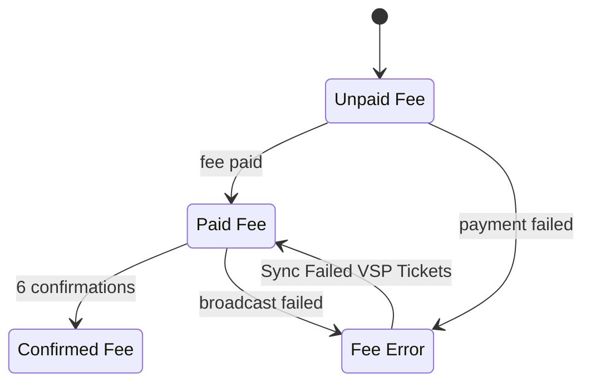

# Stake with Decrediton or Bison Wallet

This guide takes you from a funded wallet to registered tickets that a voting service provider (VSP) votes for you, in Decrediton or Bison Wallet's built-in Decred wallet. For the command line, see [Stake with dcrwallet](stake-with-dcrwallet.md).

!!! info "Applies to"
    Decrediton 2.1.7 and Bison Wallet 1.0.6. Checked November 2026.

## Before you start

- **Know what you are committing to.** A ticket locks its price for about a month on average and up to about 144 days, and it cannot be cancelled once mined. Read [How staking works](index.md) first.
- **A wallet that can stake**: [Decrediton](../wallets/decrediton.md), in light (SPV) or full-node mode, or [Bison Wallet](../wallets/bison-wallet.md)'s native Decred wallet. Trezor and Ledger wallets in Decrediton cannot stake.
- **Enough spendable DCR** for the ticket price (also called stake difficulty) times the number of tickets, plus a little for fees. Decrediton shows the live price as **Current Price** at the top of **Staking**, Bison Wallet in its **Ticket Price** box; [Ticket price, rewards and costs](ticket-price-and-rewards.md) explains it.
- **The wallet open and unlocked after each purchase**: at least until it has handed the VSP fee to the VSP (Decrediton then shows **Paid Fee**), and ideally for about an hour, while the VSP waits for two rounds of 6 confirmations (about 30 minutes each) before it takes the ticket on and the wallet records the result.
- **Recommended:** mixing, set up with [Mix your DCR](../privacy/mix-your-dcr.md), so your tickets cannot be linked to your earlier transactions. You can stake without it.

## Step 1: Choose a VSP

A VSP only gets the right to vote your tickets; it can never spend your DCR or the reward. [Voting service providers](vsps.md) explains its per-ticket fee and what to weigh; [decred.org/vsp](https://decred.org/vsp/) lists each VSP's fee, size, missed votes and software version. Spreading tickets over two or more VSPs limits what one outage can cost you.

=== "Decrediton"

    1. Click **Staking** in the sidebar. The first time, page through the **Before You continue...** tutorial, then click **I understand and accept the risks**.
    2. Stay on the **Purchase Tickets** tab and open the **VSP** field (**Select VSP...**).
    3. Pick a VSP from the list; hover over one to see its **Fee: … %**. VSPs marked **Out of date** run old software and cannot be chosen.
    4. For an unlisted VSP, type its address into the field (**Type to add new VSP**) and select it.
    5. Optionally tick **Always use this VSP** to keep this choice for future purchases.

    If the list is empty, Decrediton is not allowed to download it: click **Enable VSP Listing**, or turn on **VSP Listing** in **Settings** > **Privacy and Security**.

=== "Bison Wallet"

    1. Open **Wallet** and select **Decred**.
    2. In the **Staking** panel, click **Select a Voting Service Provider**.
    3. Click a row in the table (**URL**, **Fee Rate (%)**, **Live Tickets**), or type an unlisted VSP's address under **Or add custom VSP URL:** and click **Add**.

    The panel then shows the chosen VSP next to **VSP**; click it to change VSP for future tickets.

## Step 2: Buy tickets

=== "Decrediton"

    1. On **Staking** > **Purchase Tickets**, choose the **Account** to pay from. The default account is shown as **Primary Account**.
    2. Enter the number of tickets in **Amount**.
    3. Check the line that appears: **VSP Fee: … %**, then **Total** (tickets times price) and **Remaining** (what stays spendable in that account, out of which the fees, well under 1 DCR per ticket, are paid). If you ask for more than the account can pay, **Not enough funds** appears instead.
    4. Click **Purchase**. In **Ticket Purchase Confirmation**, enter your **Private Passphrase** and click **Continue**.

    When the purchase completes, Decrediton reports "You bought 2 tickets" (with your number). If you try to close Decrediton before then, it warns **Purchasing Tickets**: tickets "may not be registered with the VSP if you proceed now".

=== "Bison Wallet"

    1. In the **Staking** panel, click **Purchase Tickets**. The form shows the **Current Price** and your **Available Balance**.
    2. Enter the number of tickets under **How Many?** and click **Buy**. Bison Wallet uses the app password you signed in with; there is no separate confirmation.

    Bison Wallet confirms with "Purchasing 2 Tickets!" (with your number). Tickets it cannot buy at once wait as **Queued tickets** in the panel and are retried at each new block. The queue lives only in the running app: if you quit, or a purchase fails, the queued tickets are not bought.

## Step 3: Buy tickets automatically (Decrediton)

Decrediton's automatic ticket buyer keeps buying tickets while Decrediton is open. Bison Wallet 1.0.6 has none.

- At each new block it buys a ticket if the spendable balance above **Balance to Maintain** covers the price: at most one ticket per block.
- Each time you start the buyer, Decrediton picks the VSP for you, at random among listed, up-to-date VSPs whose fee is at or below your **Maximum Fee**. **VSP Listing** must be on.

To set it up:

1. On **Staking** > **Purchase Tickets**, click the settings (gear) button next to **Automatic Ticket Purchases**, below the purchase form.
2. In **Automatic ticket purchases**, fill in:
    - **Balance to Maintain**: DCR to leave untouched in the account.
    - **From**: the account to buy from.
    - **Maximum Fee**: the highest VSP fee you accept, in percent. Enter a whole number such as 1: Decrediton drops the decimals when it saves, so 0.5 becomes 0 and the buyer then cannot pick a VSP.
3. Click **Save**.
4. Flip the switch next to **Automatic Ticket Purchases**. **Start Ticket Buyer Confirmation** shows your **Balance To Maintain** and the **VSP** it picked. Enter your **Private Passphrase** and click **Continue**.

To stop it, flip the switch off. Closing Decrediton also stops it, after a warning (**Auto Ticket Buyer Still Running**).

!!! warning
    With **Balance to Maintain** at 0, the buyer turns every spendable DCR in the account into tickets, which cannot be cancelled. Set it to what you want to keep spendable.

## Step 4: Buy with mixed funds

Once mixing is set up, both wallets buy tickets from the mixed account and also mix, with StakeShuffle, the transaction that funds each ticket, so the ticket cannot be traced back to your earlier transactions. Mixes run every 10 minutes and need other participants, so a mixed purchase can take 10 minutes or more; keep the wallet open.

=== "Decrediton"

    - With privacy set up, the **Account** list offers only the **Mixed Account**, and the form says **You are purchasing mixed tickets**.
    - Only mixed DCR can buy tickets: run the mixer (**Privacy and Security** > **Privacy** > **Start Mixer**) until enough has moved from the **Unmixed Account** to the **Mixed Account**.
    - **Purchase** is disabled while the mixer (or the automatic buyer) is running; hovering over it shows "Privacy Mixer or Autobuyer running, please shut them off before purchasing a ticket." Click **Stop Mixer**, buy your tickets, then start the mixer again.
    - The automatic buyer will not start while the mixer runs either. While the buyer runs, it also mixes the **Unmixed Account**, doing the mixer's job.

=== "Bison Wallet"

    With the Decred wallet showing **Privacy active**, tickets are paid from the `mixed` account. Wait until mixing has moved enough DCR there before you buy.

## Step 5: Set your vote preferences

Your tickets vote on consensus rule changes (agendas) and treasury spends according to choices kept in your wallet. The wallet sends them to the VSP with the fee and again whenever you change them, so you can set them before or after buying. An agenda you never set is voted as abstain.

- **Decrediton**: **Governance** > **Consensus Changes** and **Governance** > **Treasury Spending**.
- **Bison Wallet**: **Set Votes** in the **Staking** panel, with sections **Agendas**, **Treasury Spends** and **Treasury Keys**.

Politeia proposal votes work differently; [Vote with your tickets](../governance/vote.md) covers all three kinds of vote.

## Step 6: Track your tickets and VSP fees

### Fee status (Decrediton)

**Staking** > **Ticket Status** lists your current tickets under **Live Tickets** with a **Fee Status** column. A healthy ticket goes from **Unpaid Fee** to **Confirmed Fee** within about an hour.

On **Paid Fee**, the VSP holds the fee transaction and broadcasts it once the ticket has 6 confirmations. On **Fee Error**, for example because the VSP was unreachable, the VSP will not vote the ticket until you fix it (see [Troubleshooting](#troubleshooting)).

Bison Wallet 1.0.6 shows no fee status. Keep it running for about an hour after buying.

### Ticket states

Decrediton's **Ticket History** tab shows each ticket as **unmined**, **immature** (256 blocks, about 21 hours), **live**, **voted**, **missed** or **expired**. Bison Wallet's **Tickets** button shows the same states. Missed and expired tickets are revoked automatically, which returns the price without a reward; they keep showing as **missed** or **expired**, and Decrediton may also list the revocation transaction as **revoked**.

Totals appear in **Staking Overview** on Decrediton's **Purchase Tickets** tab and in Bison Wallet's **Staking** panel.

## Check that it worked

- In Decrediton, every new ticket reaches **Confirmed Fee** on **Ticket Status**, and later shows **immature**, then **live**, on **Ticket History**.
- In Bison Wallet, the ticket appears in **Ticket History**; click its hash to open it in the block explorer.
- On [dcrdata](https://dcrdata.decred.org/), the ticket hash shows the ticket mined in a block and, later, its vote ([Use the block explorer](../wallets/block-explorer.md)).

## Troubleshooting

### A ticket shows Fee Error, or stays on Unpaid Fee

On **Staking** > **Ticket Status**, click **Sync Failed VSP Tickets** (shown only when a ticket has **Fee Error**), choose the VSP you bought the ticket through under **VSP Select** and the **Account**, enter your private passphrase and click **Continue**. For **Unpaid Fee**, keep Decrediton open, or enter your passphrase at **Process Managed Tickets** the next time it opens.

### Process Managed Tickets or Process Unmanaged Tickets appears at startup

These screens reconnect tickets to their VSPs, typically after a restore or after Decrediton was closed during a purchase. On either, click **Continue** and enter your private passphrase; on **Process Unmanaged Tickets**, first select the VSP you bought the tickets through. A different VSP could charge a second fee, so if unsure, click **Skip** and read [Back up and restore your wallet](../wallets/back-up-and-restore.md).

### Purchase is greyed out, or the automatic buyer will not start

**Purchase** is disabled while the mixer or the automatic buyer runs, and the automatic buyer while the mixer or a manual purchase runs: stop the other one first (**Stop Mixer**, or the **Automatic Ticket Purchases** switch). The automatic buyer also reports "No VSPs available for that fee rate. (Minimum is currently …%)" when your **Maximum Fee** is below every listed fee, and "Fill all fields." when a setting is missing.

### Purchase Tickets is not available right now

In light mode, Decrediton blocks purchases for one block just before the ticket price changes ("we are at the end of a ticket interval"). Wait for the next block.

### Fewer tickets than requested, or not enough funds

Decrediton's **Not enough funds** check counts only ticket prices, so leave a little extra for fees. If Decrediton bought fewer tickets than requested ("lacked enough spendable outputs") or reports "Not enough utxo", the account had too few separate coins: buy again, one ticket at a time if needed. In Bison Wallet, "available balance … is lower than projected cost" means price plus estimated fees exceed your balance: lower **How Many?**.

## Next steps

- [Vote with your tickets](../governance/vote.md): set your choices on agendas, treasury spends and Politeia proposals.
- [Ticket price, rewards and costs](ticket-price-and-rewards.md): estimate what a ticket earns from live data.
- [Staking FAQ](faq.md): quick answers on lock-up, rewards and restores.
- [Vote without a VSP (solo voting)](solo-voting.md): run your own always-online voting wallet instead.

*[VSP]: voting service provider
*[SPV]: simplified payment verification
