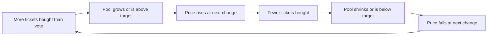

# Ticket price, rewards and costs

This page explains how Decred sets the ticket price, what a vote earns, what a ticket costs, and how to estimate a return from live figures. If tickets are new to you, read [How staking works](index.md) first.

!!! abstract "At a glance"
    - **The ticket price** (also called stake difficulty) is recalculated every 144 blocks, about 12 hours, from how many tickets exist. It never falls below 2 DCR, and it comes back to you in full.
    - **One vote earns 17.8% of a block's subsidy.** Read today's figure live; it falls by about 1% every 21.3 days.
    - **Your costs** are small network fees plus, if you use one, a voting service provider (VSP) fee. Neither is refunded.
    - **A return is not interest.** It is a share of newly created DCR, and it shrinks as more DCR is staked.

This page explains mechanisms. It is not financial or tax advice.

## What the ticket price is

A ticket locks an amount of DCR, the ticket price, until the ticket votes or is revoked. The price is a consensus rule: every ticket in a block must pay at least the price in force for that block, or the block is invalid.

The price is not a fee. The ticket price comes back to you in full when the ticket votes, misses or expires. What you give up is the use of that DCR while it is locked: about a month on average, and at most about 144 days (256 + 40,960 + 256 blocks).

## Why the price moves

Decred aims for a stable pool of 40,960 live tickets (8,192 × 5). At that size a ticket waits about 28 days on average to vote, and fewer than 1 in 100 tickets (about 0.7%) expire without voting. A much larger or smaller pool would change the average wait and the share of tickets that expire.

The ticket price is the lever that holds the pool near its target: a higher price discourages buying, a lower one encourages it. No one sets it by hand: every node computes it from the chain with the same formula.

Under the original algorithm the price swung so widely that most tickets were bought in a single cheap window and almost none in the windows after it. The current algorithm, [DCP-0001](https://github.com/decred/dcps/blob/master/dcp-0001/dcp-0001.mediawiki), was adopted by a stakeholder vote (agenda `sdiffalgorithm`, active from block 149,248) to make price changes smooth.

## How the price is calculated

Every 144 blocks (at block heights that are multiples of 144), the network computes a new price from three numbers:

- the current price;
- the number of tickets in the pool now, counting both live and immature tickets;
- the same count at the previous price change, 144 blocks earlier.

In plain words:

> next price = current price × (pool now ÷ pool at the last change) × (pool now ÷ 42,240)

The two ratios do different jobs:

- **The change ratio responds to demand.** If the pool grew since the last change, more tickets were bought than voted, and the price rises in proportion. If it shrank, the price falls.
- **The target ratio pulls the pool back to its target.** Even when demand is steady, a pool above target keeps pushing the price up, and a pool below target keeps pulling it down.

The figure 42,240 is the 40,960 live-ticket target plus the tickets expected to be immature at any moment. A new ticket stays immature for 256 blocks, and in a steady state five tickets are bought per block to replace the five that vote, so 256 × 5 = 1,280 tickets are maturing at any time. The dcrdata explorer compares the live pool with 40,960; the formula compares live plus immature tickets with 42,240. Both describe the same target.

The result is bounded: it can never go below 2 DCR (`MinimumStakeDiff`), or above an estimate of the total DCR supply divided by 8,192. Between price changes, every block carries the same price forward.

Together the two ratios form a feedback loop that holds the pool near its target:



### Worked example

These numbers are examples, not today's figures. In each case the current price is 200 DCR. Pool counts include immature tickets.

| Situation | Pool at last change | Pool now | Change ratio | Target ratio | Next price (DCR) |
|---|---|---|---|---|---|
| Steady, on target | 42,240 | 42,240 | 1.000 | 1.000 | 200.00 |
| Steady, above target | 43,000 | 43,000 | 1.000 | 1.018 | 203.60 |
| Growing, above target | 42,000 | 42,600 | 1.014 | 1.009 | 204.59 |
| Shrinking, below target | 42,000 | 41,500 | 0.988 | 0.982 | 194.16 |

The second row shows the restoring force at work: no new demand, yet the price still climbs by about 1.8% per change until enough tickets vote out of the pool to bring it back to target.

## Seeing and predicting the price

Wallets show the price for the next block, which is what a ticket bought now must pay.

=== "Decrediton"

    Open **Staking**. The page header shows **Current Price**.

=== "Bison Wallet"

    Open the DCR wallet. The **Staking** panel shows **Ticket Price** and **Vote Reward**. The **Purchase Tickets** dialog shows **Current Price** again.

=== "Command line"

    With `dcrd` running, ask it for the price of the tip block and of the next block:

    ```bash
    dcrctl getstakedifficulty
    ```

    `current` is the price in the latest block and `next` is the price for the next block. To see where the price may go at the next change:

    ```bash
    dcrctl estimatestakediff
    ```

    ```json title="Example output (your numbers will differ)"
    {
      "min": 128.13311397,
      "max": 137.30522474,
      "expected": 130.85145872
    }
    ```

    `min` assumes no more tickets are bought before the change, `max` assumes every remaining block is full of new tickets, and `expected` assumes buying continues at the average rate since the last change. `dcrctl estimatestakediff 500` adds a `user` estimate for 500 new tickets. A light-mode wallet shows the next price as `difficulty` in `dcrctl --wallet getstakeinfo`.

    For testnet, add `--testnet` to each command.

The [dcrdata block explorer](https://dcrdata.decred.org/) shows the same figures on its home page under **Voting**: **Current Ticket Price**, **Next Ticket Price** (with min and max), **Ticket Pool Size** (live tickets, with the distance from target), and **Next Ticket Price Change** (how far into the 144-block window the chain is). See [Use the block explorer](../wallets/block-explorer.md) for a tour.

!!! tip "Timing a purchase"
    The estimate firms up as the 144-block window nears its end. A purchase made in the last blocks before a price change may not be mined at the price it was built for (see [At most 20 new tickets per block](#at-most-20-new-tickets-per-block)).

## What a ticket costs

Buying one ticket involves three amounts:

| Amount | Paid to | Returned? |
|---|---|---|
| Ticket price | locked in the ticket | Yes, in full, when the ticket votes, misses or expires |
| Network transaction fees | miners | No |
| VSP fee (only if you use a VSP) | the voting service provider | No |

**Network transaction fees.** The wallet creates a split transaction that makes an output of the ticket price plus the ticket's own fee, then the ticket that spends it, and, with a VSP, a separate transaction that pays the VSP fee. Each pays the normal network fee, which at the `dcrwallet` default rate of 0.0001 DCR per kilobyte is a very small fraction of one DCR. The vote, and any revocation of a missed or expired ticket, cost nothing more: since 2022 revocations are created automatically and by rule carry no fee.

**The VSP fee.** A [VSP](vsps.md) votes for you so your wallet does not have to stay online. Each VSP sets a fee percentage, applied to the vote reward, not to the ticket price. `vspd` uses the reward projected two subsidy reductions ahead, so the fee comes out slightly below percentage × today's reward. You pay it when the ticket is registered with the VSP, and it is not returned if the ticket misses or expires. `dcrwallet` refuses a VSP fee above `vsp.maxfee`, a wallet default of 0.2 DCR, not a network rule. With [solo voting](solo-voting.md) there is no VSP fee, but your own voting wallet must stay online and unlocked.

## What one vote earns

Each block creates new DCR, the block subsidy. Since block 794,368 (the `changesubsidysplitr2` agenda, DCP-0012) it is split three ways:

| Share | Of the block subsidy | Goes to |
|---|---|---|
| Proof of stake | 89%, split equally between the 5 votes | the tickets that vote |
| Treasury | 10% | the project treasury |
| Proof of work | 1% | the miner |

So **one vote earns 17.8% of a block subsidy** (89% ÷ 5), using the subsidy of the block voted on, which is the block before the one containing the vote. The amount does not depend on how many tickets exist, on your ticket price, or on how many other votes the block contains. When the ticket votes, you receive the ticket price plus this reward, spendable 256 blocks (about 21 hours) later.

The block subsidy is multiplied by 100/101 every 6,144 blocks (about 21.3 days): almost 1% each time, about 16% over a year. Never copy a reward figure from an old post. Read it live:

- **dcrdata**: **Vote Reward** in the **Voting** section, in DCR per vote.
- **Bison Wallet**: **Vote Reward** in the **Staking** panel. It shows the reward projected 8,192 blocks ahead, around when a ticket bought now can be expected to vote, so it is slightly lower than dcrdata's figure.
- **Command line**: `dcrctl getblocksubsidy <HEIGHT> 5` returns the subsidy shares for a block with five votes, in atoms (1 DCR = 100,000,000 atoms). Divide `pos` by 5 for one vote's reward. Use the next block's height, which is one more than `dcrctl getblockcount`.

A ticket that misses its vote or expires earns nothing. Its price is returned, but the fees you paid are not.

## Estimating your return

### Per ticket

For one ticket, the net gain is:

> net reward = vote reward − VSP fee − network fees

and the return on the locked DCR is:

> return per ticket = net reward ÷ ticket price

**Example.** All numbers below are examples, not today's figures.

| Input | Example value |
|---|---|
| Ticket price | 250 DCR |
| Vote reward | 0.9 DCR |
| VSP fee rate | 2% of the vote reward, which comes to about 0.0176 DCR by the `vspd` formula |
| Network fees | 0.0003 DCR |
| Net reward | 0.9 − 0.0176 − 0.0003 = 0.8821 DCR |
| Return per ticket | 0.8821 ÷ 250 = 0.353% |

### Over time

A ticket's DCR is tied up for three periods:

1. **256 blocks** (about 21 hours) of immaturity after the ticket is mined.
2. **A wait in the live pool.** The average in blocks is about the live pool size divided by 5: 8,192 blocks (about 28 days) at the target size. Any one ticket may be chosen much sooner or much later.
3. **256 blocks** after the vote before the returned DCR can be spent.

That adds up to about 8,704 blocks, roughly 30 days, on average. Repeating the example about 12 times a year (365 ÷ 30.2) gives about 0.353% × 12.1 ≈ 4.3% for the example inputs. That assumes you re-buy at once every time and that the price and reward stay the same, and neither will. dcrdata's **Vote Reward** box shows its own versions: a percentage per reward period, and a yearly figure that simulates a year of re-buying as the subsidy falls. Neither subtracts VSP or network fees.

### Network-wide view

Every ticket that votes takes an equal slice of the same 89% of new issuance. Over a year, the stakers' total income is therefore roughly:

> yearly stake rewards ≈ 0.89 × block subsidy × 105,120 blocks per year

and the average yearly return is that amount divided by all the DCR locked in tickets (**Total Staked DCR** on dcrdata). This view explains the main limits on returns:

- **The subsidy shrinks**, about 16% each year, so returns fall over time even if nothing else changes.
- **More staking means more competition.** The pool is held near 40,960 tickets, so when more DCR wants to stake, the ticket price rises rather than the number of tickets. The same reward is spread over more locked DCR, and each DCR staked earns less.
- **Returns are neither interest nor guaranteed.** Nobody borrows your DCR. The reward is newly issued DCR paid for voting, and a missed or expired ticket earns nothing.
- **Everything here is measured in DCR.** These figures say nothing about what DCR is worth in any other currency.

## Why holders who do not stake are diluted

A holder who does not stake receives none of the new DCR that goes to voters, so their share of all DCR in existence falls a little with every block. Staking creates no value: it directs new issuance to the holders who lock their coins and vote, which is how Decred pays for its security and governance. [DCR supply and issuance](../start/supply-and-issuance.md) gives the full schedule and how to read the current supply.

## At most 20 new tickets per block

A block may contain at most 20 new tickets (`MaxFreshStakePerBlock`), so at most 2,880 tickets can enter the pool in one 144-block price window. This is a consensus rule. It stops anyone, however large, from flooding the pool in one go.

When more tickets are waiting than blocks can hold, they queue. In the block templates that `dcrd` builds for miners, waiting tickets are ordered by fee rate, so a higher fee gets a ticket mined sooner when space is short. This ordering is mining policy, not consensus. When there is room for every waiting ticket, a higher fee gains nothing.

A queued ticket can also run out of time. A ticket must pay at least the price in force in the block that includes it. If the price rises before a waiting ticket is mined, that ticket can never be mined, and nodes drop it from their memory pools. Its DCR never left your wallet on chain. The automatic ticket buyer in `dcrwallet`, which Decrediton's **Automatic Ticket Purchases** also uses, plans around price changes: it gives each ticket an expiry so that a ticket not mined before the next change drops out, and it cancels purchases still in progress at the old price as a change approaches. It skips buying only in the one block where its tickets could not be mined until after the change.

!!! warning "Buying is final"
    Once a ticket is mined it cannot be cancelled. Its DCR stays locked until the ticket votes or is revoked and the returned funds mature, which can take up to about 144 days. Only lock up DCR you will not need in that time.

## Taxes and records

Tax rules for staking rewards differ by country and change over time; this page gives no tax advice. Whatever applies to you, keep records: for each ticket, the purchase date, ticket price and fees paid, and the vote or revocation date with the amount returned.

In Decrediton, **On-chain Transactions** > **Export** writes these to a file. The **Tickets** export lists each ticket's purchase time, amount sent, status, and vote or revocation time with the amount returned. **Transactions**, **Balances** and **Daily Balances** cover the rest of the wallet.

## Go deeper

- [Stake difficulty](../../whitepaper/09-difficulty.md#sec:difficulty-stake): the consensus rule for the ticket price and when it is recalculated.
- [Stake difficulty version 2 (DCP-0001)](../../whitepaper/09-difficulty.md#sec:difficulty-sdiff-v2): the exact formula, its bounds and the supply estimate behind the ceiling.
- [The three shares of the subsidy](../../whitepaper/11-subsidy.md#sec:subsidy-shares): how proof-of-work, vote and treasury amounts are computed.
- [The vote subsidy](../../whitepaper/08-staking.md#sec:staking-subsidy): the rule that a vote is paid the subsidy of the block it votes on.

## Next steps

- [Voting service providers](vsps.md): choose a VSP and understand its fee before you buy.
- [Stake with Decrediton or Bison Wallet](stake.md): buy your first ticket step by step.
- [Stake with dcrwallet](stake-with-dcrwallet.md): buy and track tickets from the command line.
- [Staking FAQ](faq.md): short answers to common questions about missed votes, fees and timing.
- [DCR supply and issuance](../start/supply-and-issuance.md): the full subsidy schedule behind the vote reward.

*[VSP]: voting service provider
*[VSPs]: voting service providers
*[DCP]: Decred Change Proposal
