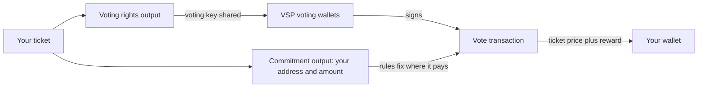
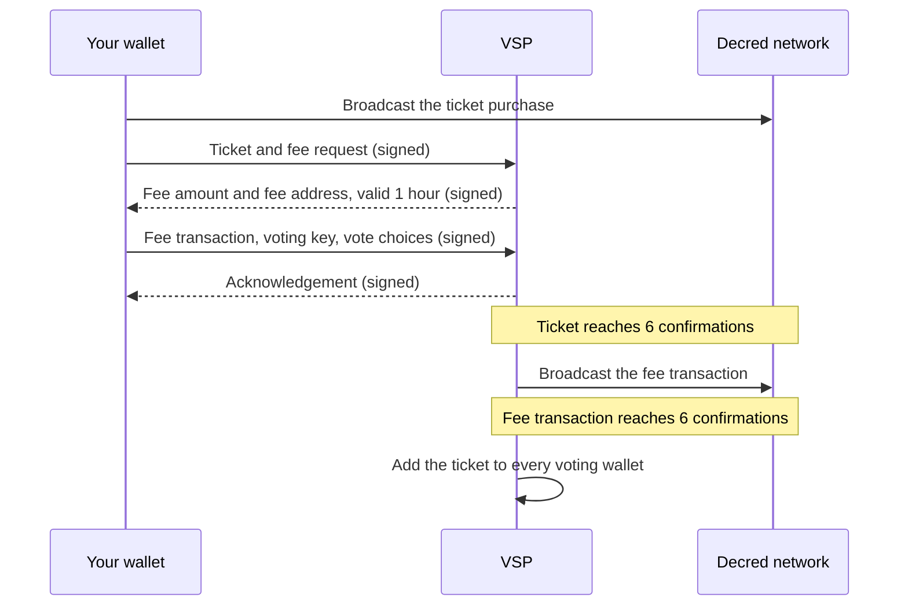

# Voting service providers

A voting service provider (VSP) votes your tickets for you, so your own wallet does not have to stay online for weeks. This page explains what you hand over, what you trust a VSP for, what it charges, how to choose one, and what happens to your DCR if it fails.

!!! abstract "In short"
    - A VSP receives only the right to vote one ticket. It can never spend, redirect or hold back your DCR or your reward.
    - You trust it for two things: to vote at all, and to vote the way you told it to.
    - Its fee is a percentage of the ticket's expected reward, paid once per ticket in a separate transaction.
    - If a VSP fails to vote, the ticket is revoked automatically and your ticket price comes back to you. You lose that ticket's reward and the fee.
    - Spreading tickets across several VSPs limits the damage any one of them can do.

## Why tickets need an always-online voter

A [ticket](index.md) waits in the ticket pool until the lottery draws it, which takes about 28 days on average and can take up to about 142 days. When it is drawn, a vote for it must be in the very next block, about five minutes later. If no vote arrives in time, the ticket is **missed** and earns nothing.

So the wallet holding the ticket's voting key has to be online, unlocked and connected to a full node at a moment nobody can predict. A VSP runs that wallet for you: several always-online voting wallets, usually in different places, that vote every ticket registered with them.

Unlike a mining pool, a VSP pools no rewards: your ticket is drawn as often as it would be in your own wallet, and its whole reward goes to you.

!!! note
    VSPs were formerly called "stake pools" and ran different software. Today's VSPs run `vspd`. See [What changed](../reference/whats-changed.md) if you are returning to Decred.

## What you hand over: only the right to vote

A ticket has separate outputs for separate jobs, and the consensus rules keep them apart. The diagram shows how voting rights and money take different paths:

- **The voting rights output** names the key that may sign a vote. Your wallet makes a fresh voting address for each ticket and gives the VSP that one private key. The key stays in your wallet too, because it comes from your seed.
- **The commitment output** records one of your own addresses and the amount you paid. Every vote or revocation of the ticket must pay the ticket price, plus any reward, to exactly that address. A vote that pays anywhere else is invalid and no node accepts it.

So control of the voting key is control over *how and whether* the ticket votes, and nothing else. A VSP can never:

- spend your ticket or the DCR in your wallet;
- redirect the ticket price or the reward to another address;
- hold your funds hostage or delay them. If it does not vote, the ticket is revoked automatically and the money returns to your commitment address (see [If your VSP goes offline or closes](#if-your-vsp-goes-offline-or-closes));
- make your ticket more or less likely to be drawn.

## What you trust a VSP to do

Using a VSP still involves trust, but only for two things.

**To vote at all.** If all its voting wallets are down when your ticket is drawn, the ticket is missed: the ticket price comes back, the reward and the VSP fee do not. Not every miss is the VSP's fault. When a miner finds the next block very quickly, it can be mined before the votes have spread, so every VSP has a few misses.

**To vote as you instructed.** A VSP could, in principle, vote tickets against their owners' choices on consensus rule changes and treasury spends. It would be caught: your choices are signed records (see [Two-way accountability](#two-way-accountability)) and every vote is public. The structural protection is that if no VSP holds many tickets, a dishonest one cannot swing a vote.

## The VSP fee

A VSP charges a fee once per ticket, paid in a separate, ordinary transaction to an address it gives you for that ticket. The ticket itself needs no special outputs, so any VSP can vote any ticket. Each VSP sets its own percentage and can change it at any time. The percentage applies to the ticket's **expected reward**, not to the ticket price:

> VSP fee ≈ fee percentage × the reward a vote is expected to earn

The expected reward is today's reward per vote reduced by the next two scheduled subsidy reductions, since a ticket waits about 28 days on average. The exact formula, in the whitepaper's [VSP section](../../whitepaper/19-ecosystem.md#sec:ecosystem-vsp), makes the fee very slightly smaller than this product.

**Worked example (example figures, not live values).** Suppose a vote is expected to earn 0.9 DCR and the VSP's fee is 2%. The fee is 2% of 0.9 DCR, about 0.018 DCR. The ticket price is not part of the fee: it is locked in the ticket and comes back to you when the ticket votes or is revoked. To see today's reward per vote, read [Ticket price, rewards and costs](ticket-price-and-rewards.md).

- **The fee is paid up front and is not refunded.** The ticket price comes back if the ticket misses or expires; the VSP fee and the ticket's transaction fee do not. `vspd` has no refund mechanism.
- **Your wallet caps the fee.** Before paying, the wallet compares the amount the VSP asks for with a maximum and refuses to pay if it is higher. In dcrwallet this is the `vsp.maxfee` option, default 0.2 DCR. Decrediton runs dcrwallet with that default, and Bison Wallet's built-in DCR wallet uses the same 0.2 DCR limit. This cap is a wallet setting, not a consensus rule.
- **A fee quote is valid for one hour.** If the VSP receives the payment after that, it rejects it and quotes again, at its current fee, the next time the wallet asks for one.

### How registration works

Registration happens in the background after you buy a ticket. The sequence shows why your wallet must stay open until the fee has been handed over:

Once the VSP has your fee transaction, your wallet can go offline. The two 6-confirmation waits take about an hour, long before the ticket matures after 256 blocks (about 21 hours). A ticket whose fee was never handed over is not registered and will be missed if drawn.

## Two-way accountability

Every message between your wallet and a VSP is signed, so each side can prove what the other said.

- **Your requests** are signed with the key of the ticket's commitment address, which only your wallet holds. This proves that the ticket's owner sent them. An owner can optionally register a different signing address once per ticket.
- **The VSP's replies** are signed with its own key, which it generates once and never changes. Its website shows it in the footer as **VSP public key**. Wallets check every reply against this key and reject any reply that fails. Each reply also repeats the request it answers, so a signed reply proves both what you asked for and that the VSP accepted it.

So if a VSP fails to vote tickets it was paid for, the owner can show its signed acknowledgement of the fee and voting key, and the VSP has to explain the misses. If an owner falsely claims a VSP ignored their wishes, the VSP can show the owner's signed request and the matching votes on the blockchain.

!!! warning "Keeping a record exposes voting keys"
    Wallets check these signatures but do not save the messages by default. dcrwallet can write them to its log at trace level for its `VSPC` log subsystem, but the log then also contains each ticket's voting private key. Anyone who reads that log could vote those tickets, so keep it private and never post it when asking for help.

## Choosing a VSP

The community-reviewed list of VSPs is at [decred.org/vsp](https://decred.org/vsp/). Decrediton and Bison Wallet offer the same list in their ticket purchase screens, and you can also enter the address of an unlisted VSP. The decred.org table has these columns:

| Column | What it tells you |
|---|---|
| **Address** | Its website, with stats and public key |
| **Last Updated** | When the listing last heard from it; stale can mean unreachable |
| **Live** | Tickets it holds now |
| **Voted** | Tickets it has voted |
| **Missed**, **Missed %** | Missed tickets, and their share of its voted, missed and expired tickets |
| **Fees** | Its fee percentage |
| **Age** | How long it has been running |

What to weigh:

- **Missed %.** Compare VSPs with each other rather than against zero, since every VSP has a few misses. A rate well above the others is a warning sign.
- **Size.** decred.org recommends avoiding providers with over 5% of network votes, to keep voting power spread out. Each VSP's own homepage shows its **Network Proportion**.
- **Fee.** One factor among several: a missed vote costs far more than a slightly higher fee.
- **Redundancy.** A listed VSP must run voting wallets on at least three machines in three or more separate locations. Its application programming interface (API) shows how many are online: `https://<VSP>/api/v3/vspinfo` (with `<VSP>` the address from the list) reports `totalvotingwallets` and `votingwalletsonline`.
- **Up to date.** Decrediton marks VSPs running outdated software as **Out of date**. Its automatic ticket buyer picks a random listed VSP whose fee is at or below the **Maximum Fee** you set, and skips out-of-date ones.

**Spread your tickets.** Using two or more VSPs means an outage at one of them costs you only some votes, and it keeps any single operator from holding much voting power.

## If your VSP goes offline or closes

Thanks to automatic revocations (Decred Change Proposal DCP-0009, in force since May 2022), a failed VSP can never trap your funds. What happens depends on what fails.

**Its website or API goes down, but its voting wallets keep running.** Tickets already registered keep voting. You cannot register new tickets or change vote choices until it comes back.

**All its voting wallets are down when your ticket is drawn.** The ticket is missed. The same block that records the miss must also include a revocation, which needs no signature and pays the ticket price back to your commitment address. Those funds become spendable after 256 blocks (about 21 hours). You lose that ticket's reward and the VSP fee.

**The VSP closes to new tickets.** A closed VSP shows "This Voting Service Provider is closed" on its homepage. It still votes tickets whose fees are already paid, but it accepts no new ones. Choose another VSP for future purchases.

**The VSP disappears for good.** Your remaining tickets with it will be missed and revoked one by one as they are drawn, returning the ticket price each time. To keep earning their rewards, you can vote them yourself: your wallet holds each ticket's voting key, so running it as a [solo voting](solo-voting.md) wallet lets you vote them directly.

### Changing VSP

Each ticket stays with the VSP that registered it. To change VSP, choose a different one for your next tickets. A ticket whose fee payment failed (**Fee Error** in Decrediton) can be registered with a different VSP; wallets do not move a ticket whose fee is already paid.

After restoring a wallet from its seed, the wallet has to ask each VSP again which of your tickets it holds. [Back up and restore your wallet](../wallets/back-up-and-restore.md) covers that step.

## Changing your vote choices

You set choices for consensus rule changes (agendas) and treasury spends in your wallet, which sends a signed update to every VSP holding your unspent tickets. The wallet must be open and unlocked to sign it. You can change choices at any time; a vote uses the choices the VSP holds when the ticket is drawn. On an agenda you never set, a ticket abstains.

Two limits to know:

- **Politeia proposals are not voted through a VSP.** You vote on proposals yourself, with the same tickets, in Decrediton or with `politeiavoter`. See [Vote with your tickets](../governance/vote.md).
- **An outdated VSP may not know a new agenda.** Decrediton warns about VSPs that have not upgraded: your paid tickets will still be voted, but your vote preferences will not be used.

## VSP or solo voting?

Solo voting means running your own always-online voting wallet instead of using a VSP. It removes the fee and the trust, and moves the uptime burden onto you.

| | Through a VSP | Solo voting |
|---|---|---|
| Fee | VSP fee on every ticket | None beyond transaction fees |
| Uptime | The VSP's job. Your wallet needs to be online only to buy and register tickets | Yours: online, unlocked and synced around the clock |
| Full node | Not needed: a light wallet (SPV) works | Required: dcrwallet cannot vote as a light wallet |
| Wallet apps | Decrediton, Bison Wallet or dcrwallet | dcrwallet on a server; Decrediton and Bison Wallet do not vote tickets themselves |
| Privacy | The VSP sees which tickets are yours, their reward addresses, and your IP address unless your connection to it goes through Tor | No third party is involved |
| Trust | The VSP must vote, and vote as you instructed | None beyond your own servers |
| Setup effort | Minutes in a wallet | One or more servers, monitoring and timely upgrades |

A VSP suits most stakers. Solo voting suits people who already run servers reliably and hold enough tickets for the saved fees to matter; several voting wallets in different places give them the redundancy a VSP provides. For the privacy side of using a VSP, see [Privacy beyond mixing](../privacy/privacy-practices.md).

## Running your own VSP

Public VSPs are run by community members who meet strict listing requirements. [Run a voting service provider](../../dev/operate/vsp.md) covers them, along with deployment, fee collection and upgrades.

## Go deeper

- [Voting service providers in the whitepaper](../../whitepaper/19-ecosystem.md#sec:ecosystem-vsp): delegation without custody, the registration protocol, the exact fee formula and the trust model.
- [The commitment output](../../whitepaper/08-staking.md#sec:staking-commitment): the ticket field that fixes where a vote or revocation must pay.
- [Revocation transactions](../../whitepaper/08-staking.md#sec:staking-revocation): how missed and expired tickets return their funds.
- [The lottery](../../whitepaper/08-staking.md#sec:staking-lottery): why no VSP can influence which tickets are drawn.

## Next steps

- [Stake with Decrediton or Bison Wallet](stake.md): choose a VSP and buy your first tickets.
- [Stake with dcrwallet](stake-with-dcrwallet.md): the same from the command line, including `vsp.url`, `vsp.pubkey` and `vsp.maxfee`.
- [Vote without a VSP (solo voting)](solo-voting.md): set up your own redundant voting wallets.
- [Vote with your tickets](../governance/vote.md): set agenda and treasury choices, and vote on Politeia proposals.
- [Staking FAQ](faq.md): short answers to common staking questions.

*[VSP]: voting service provider
*[VSPs]: voting service providers
*[SPV]: simplified payment verification
*[DCP]: Decred Change Proposal
*[API]: application programming interface
