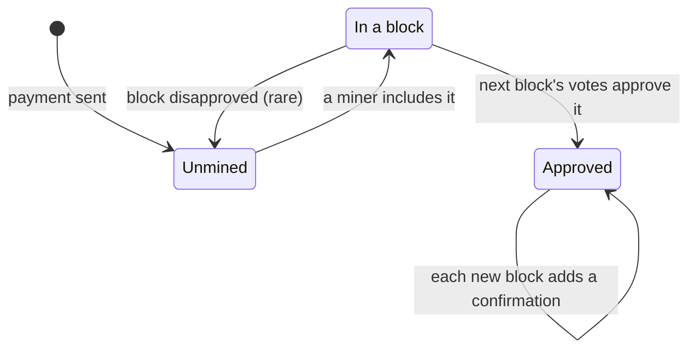

# Your first Decred wallet

This tutorial takes you from nothing to a working Decred wallet: install it from the official source, check the download, record your seed, then receive and send a small amount of DCR. Do this once with a small amount before you trust the wallet with real savings.

!!! info "Applies to"
    Decrediton 2.1.7 and Bison Wallet 1.0.6. Checked November 2026.

## What you will need

- **A computer** running Windows, macOS or Linux, with an internet connection.
- **Paper and a pen.** Your seed must be written by hand, not typed or photographed.
- **About 20 minutes,** plus about 10 minutes for your test payment to confirm.
- **A small amount of DCR to receive,** from a friend or an exchange account, that you would not mind losing while you practice. [Get DCR](get-dcr.md) lists the ways to obtain some.

Pick one wallet app. Every step below has a tab for each:

- **Decrediton** is the full-featured desktop wallet from the Decred project, with staking, mixing, governance voting and Lightning in one app. Choose it if you are unsure.
- **Bison Wallet** is a multi-asset light wallet (SPV) that runs on your computer and shows its screens in your web browser, at `http://127.0.0.1:5758`, an address on your own machine. It is built for trading on DCRDEX, Decred's non-custodial exchange, and can also stake and mix DCR.

If you prefer the command line, follow [Set up the command-line wallet](../wallets/command-line.md) instead. [Choose a wallet](../wallets/index.md) compares all the options.

## Step 1: Download the wallet from the official source

Fake wallet apps that steal coins are a common scam. Download only from the [Decred v2.1.7 release page](https://github.com/decred/decred-binaries/releases/tag/v2.1.7) on GitHub ([decred.org/wallets](https://decred.org/wallets/) links to it for Decrediton), never from a search ad, a chat message or a video description. The release page lists the files for both apps, including Bison Wallet 1.0.6.

=== "Decrediton"

    Download the installer for your system, plus the file `decrediton-v2.1.7-manifest.txt`:

    | System | File |
    |---|---|
    | Windows | `decrediton-windows-amd64-v2.1.7.exe` |
    | macOS with Apple silicon (M-series) | `decrediton-darwin-arm64-v2.1.7.dmg` |
    | macOS with an Intel processor | `decrediton-darwin-amd64-v2.1.7.dmg` |
    | Linux (x86-64) | `decrediton-linux-amd64-v2.1.7.AppImage` |

    Do not install it until you have checked it (Step 2).

=== "Bison Wallet"

    Download the archive for your system, plus the file `bisonwallet-v1.0.6-manifest.txt`:

    | System | File |
    |---|---|
    | Windows | `bisonwallet-windows-amd64-v1.0.6.zip` |
    | macOS with Apple silicon (M-series) | `bisonwallet-darwin-arm64-v1.0.6.tar.gz` |
    | macOS with an Intel processor | `bisonwallet-darwin-amd64-v1.0.6.tar.gz` |
    | Linux (x86-64) | `bisonwallet-linux-amd64-v1.0.6.tar.gz` |

    Builds for other processors and for FreeBSD and OpenBSD are on the same page. Do not run it until you have checked it (Step 2).

## Step 2: Check the download

A hash is a fingerprint of a file: if even one byte differs, the hash differs completely. The manifest lists the correct hash for every file in the release.

Open a terminal in the folder that holds your download and run the command for your system. The examples use the Decrediton file names; for Bison Wallet, use the name of your archive.

=== "Windows"

    ```powershell
    certutil -hashfile decrediton-windows-amd64-v2.1.7.exe SHA256
    ```

=== "macOS"

    ```bash
    shasum -a 256 decrediton-darwin-arm64-v2.1.7.dmg
    ```

=== "Linux"

    ```bash
    sha256sum decrediton-linux-amd64-v2.1.7.AppImage
    ```

The command prints a string of 64 letters and digits. Open the manifest in a text editor and find the line that ends with your file name. The two strings must match exactly. If they do not, delete the download and do not run it.

This check proves your file matches the manifest, not that the manifest is genuine. Before you store real value, also check the manifest's signature: see [Verify your download](../security/verify-downloads.md).

## Step 3: Create a wallet and write down the seed

Your **seed** is a list of words that can recreate your whole wallet, with every coin in it, on any computer. Whoever has the seed has your money, and if you lose it and your computer fails, nobody can recover your funds. [How a Decred wallet works](../wallets/how-wallets-work.md) explains why.

!!! danger "Your seed is the key to all your funds"
    - Write it on paper, in order, and check every word. Do not photograph it, copy it to the clipboard, or save it in a file, a password manager, cloud storage or an email.
    - Never type it into a website, a chat or a form. The only place it ever goes is the restore screen of an official wallet app.
    - Nobody genuine will ever ask for it: not Decred contributors, not "support" staff, not an exchange. Anyone who asks is trying to rob you.

=== "Decrediton"

    1. Install Decrediton:
        - **Windows:** run the `.exe` installer and follow its prompts.
        - **macOS:** open the `.dmg` and drag **Decrediton** into the **Applications** folder.
        - **Linux:** make the AppImage executable (in a terminal, `chmod u+x decrediton-linux-amd64-v2.1.7.AppImage`) and run it.
    2. Start Decrediton. Choose your language and click **Continue**.
    3. On **Privacy Options**, click **Standard**. This lets Decrediton reach services you will want later, such as the list of voting service providers (VSPs), update checks and the dcrdata block explorer. Politeia proposals are switched on separately, the first time you open **Governance** > **Proposals**. You can change these choices in the settings at any time.
    4. On **Simple Payment Verification (SPV)**, click **Enable SPV**. This makes Decrediton a light wallet (see Step 5).
    5. Page through the four introductory slides with **Next**, or click **Skip**. You can reopen them later from **Learn the Basics**.
    6. Click **Create a New Wallet**. Type any name under **Wallet Name** (it only labels the wallet on this computer) and click the button below it (labeled **Creating**).
    7. Decrediton shows 33 words. Write them down in order, numbering each one. Ignore **Copy seed words to clipboard**: other programs on your computer can read the clipboard.
    8. Read your paper back against the screen, word by word, then click **Continue**.

=== "Bison Wallet"

    1. Extract the archive. The folder contains `bisonw` (the wallet) and `bwctl` (a control tool you will not need).
    2. Start Bison Wallet:
        - **Windows:** double-click `bisonw.exe`. It runs as an icon in the system tray and opens your web browser for you.
        - **macOS and Linux:** open a terminal in the extracted folder and run `./bisonw`. Leave the terminal open while you use the wallet, then open `http://127.0.0.1:5758` in your web browser.
    3. On **New Password**, enter an app password under **Password** and again under **Password Again**, then click **Submit**. The app password unlocks Bison Wallet on this computer.
    4. On **Quick Configuration**, keep **Decred** ticked. The other wallets and the DCRDEX servers are optional; you can untick them now and add them later. Click **Submit**.
    5. On **Backup App Seed**, click **Backup Now**. Bison Wallet shows your app seed as 15 words.
    6. Write the words down in order, numbering each one, and read your paper back against the screen. Then click **Done**.

    !!! note "If macOS blocks Bison Wallet"
        macOS may refuse to open `bisonw` because Apple has not checked it. If your hash check in Step 2 passed, open **System Settings** > **Privacy & Security**, click **Open Anyway** (it is offered for about an hour after the blocked attempt), enter your login password, and run `./bisonw` again.

    The app seed restores Bison Wallet (its native wallets and DCRDEX accounts), not Decrediton. Note on the paper which app it belongs to.

## Step 4: Confirm the seed

Checking your written seed costs nothing while the wallet is empty. Finding a mistake after you have stored money in it could cost everything.

=== "Decrediton"

    1. On **Seed phrase verification**, each of the 33 rows offers three words. Using only your paper, select the correct word in each row.
    2. If you see "Some words from the seed are incorrect", fix the rows that do not match your paper. If your paper is wrong, click **Back**, correct the paper from the screen and start the check again.
    3. On the same screen, choose a **Private passphrase** and enter it again under **Repeat Private Passphrase**. Decrediton asks for it every time you send. Make it strong and store it separately from the seed.
    4. Click **Create Wallet**.

=== "Bison Wallet"

    Bison Wallet does not test you on the seed, so check it yourself:

    1. Open the menu (the three-line icon at the top right), click **Settings**, then click **View Application Seed**.
    2. Enter your app password and click **Show Me**.
    3. Compare every word with your paper. Correct the paper if anything differs.

The passphrase or password protects the wallet on this computer only. If you forget it, you can restore the wallet from the seed. If you lose the seed, the passphrase cannot help you.

## Step 5: Let the wallet sync

Before it can show your balance, the wallet must catch up with the Decred network. A light wallet fetches only block headers, small filters and the blocks that concern your addresses, so it is ready much sooner than a **full node**, which downloads and checks every block. [Install and use Decrediton](../wallets/decrediton.md) shows how to switch modes later.

=== "Decrediton"

    A progress bar shows the sync. When it finishes, Decrediton opens the **Overview** page of your new wallet with a balance of 0.

=== "Bison Wallet"

    Bison Wallet opens its **Wallet** view. Select **Decred** in the list of wallets. The **Block Sync** row shows progress; wait until it is complete.

## Step 6: Get a receiving address

An address is where someone sends you DCR. Decred mainnet addresses for everyday payments start with `Ds`. Your wallet can create as many as you like, and a fresh one for each payment protects your privacy.

=== "Decrediton"

    1. In the sidebar, click **On-chain Transactions**, then the **Receive** tab.
    2. Leave **This address is for** set to your **default** account.
    3. Click the copy icon (**Copy**) next to the address, or click **QR code** to show it as a QR code for a phone.
    4. Click **Generate new address** whenever you want a fresh one.

=== "Bison Wallet"

    1. In the **Wallet** view, select **Decred** and click **Receive**.
    2. Click the copy icon next to the address (Bison Wallet shows **Copied!**), or scan the QR code.
    3. Click **New Address** whenever you want a fresh one. If you see "address has been used", get a new one.

After pasting the address anywhere, compare its first and last few characters with your wallet: some malware swaps copied addresses for the attacker's.

## Step 7: Receive a small test amount and watch it confirm

Give your address to your friend, or paste it into your exchange's withdrawal form, and have them send the test amount. Your wallet does not need to stay open: it finds the payment on the blockchain the next time it syncs.

Decred adds a step that Bitcoin does not have: the tickets voting in each new block also approve or disapprove the ordinary transactions in the block before it. Your payment therefore goes from unmined, to in a block, to approved:



New blocks arrive about every 5 minutes, so a payment is usually approved in about 10 minutes, and sometimes longer. Decrediton counts the first confirmation only once the payment is approved. Other tools, such as the [dcrdata](https://dcrdata.decred.org) block explorer and the command-line wallet, count the block that includes the payment as its first confirmation, so their count can be one higher. [Miners, voters and the life of a block](life-of-a-block.md) and the [whitepaper's stakeholder approval rules](../../whitepaper/10-blocks.md#sec:blocks-approval) explain the approval step.

=== "Decrediton"

    1. Within seconds of sending, the payment appears under **Recent Transactions** on **Overview**. Its amount is already counted in your **Available** balance, although it is not yet confirmed.
    2. Click the transaction to open its details. It is marked **Pending** while it is unmined. Once it is in a block, the mark changes to **Confirmed** with "Mined, block awaiting approval" beside it. After the next block approves it, the count reads "1 confirmation", then "2 confirmations" and so on.

=== "Bison Wallet"

    1. The payment appears in the **Decred Transaction History** list under your Decred wallet, marked **Mempool** while it waits for a block. The amount is already included in your balance.
    2. Once a block includes it, the **Mempool** mark disappears.

Both apps add an incoming payment to your balance as soon as they see it, before any block includes it. Treat the payment as received only once it has at least one confirmation.

## Step 8: Send part of it back

Sending proves that you control the coins, not only that you can see them. Send part of your test amount back to your friend, to your exchange account's DCR deposit address, or to a new address of your own from Step 6.

!!! warning "A sent payment cannot be reversed"
    Nobody can cancel or refund a confirmed Decred transaction. Check the address character by character before you confirm. Mainnet addresses start with `D`; an address starting with `T` or `S` belongs to a test network and is a mistake.

=== "Decrediton"

    1. Click **On-chain Transactions**, then the **Send** tab.
    2. Paste the destination into **Send to** (the field shows "Recipient’s DCR Address").
    3. Enter the **Amount**. Check the **Estimated Fee** and **Total amount sending**. At Decrediton's default fee rate (0.0001 DCR per kilobyte) a simple payment costs less than 0.0001 DCR.
    4. Click **Send**. In **Transaction Confirmation**, enter your **Private Passphrase** and click **Continue**.

=== "Bison Wallet"

    1. In the **Wallet** view, select **Decred** and click **Send**.
    2. Paste the destination into **Address** and enter the **Amount**.
    3. Click **Send**. Review **Estimated Fee** and **Estimated Total Spend**.
    4. Enter your app password under **Password** and click **Confirm**.

The payment appears in your history straight away and confirms as in Step 7. Your balance drops by the amount plus the fee.

## If something goes wrong

**The payment has not appeared.** Check that your wallet has finished syncing and that the sender used your address exactly. Ask the sender for the transaction ID and look it up on dcrdata; if it is there, your wallet will find it once synced.

**Bison Wallet's page does not load.** The wallet must be running: on macOS and Linux, keep the terminal open; on Windows, check the tray icon and choose **Launch browser**.

For other problems, see [Wallet troubleshooting](../wallets/troubleshooting.md).

## What you learned

- Wallets come only from the official release page, and a hash check confirms the file matches the release manifest.
- The seed is the wallet. It lives on paper and goes nowhere except an official wallet's restore screen.
- The private passphrase or app password protects the wallet on one computer; the seed can replace it, but nothing can replace the seed.
- Decred addresses start with `Ds`. A payment counts as received once it is confirmed, which in Decrediton means the next block's votes have approved the block that holds it.
- Sent payments are final, so you check the address before you confirm.

## Next steps

- [Back up and restore your wallet](../wallets/back-up-and-restore.md): store the seed properly and practice a restore before adding more funds.
- [How staking works](../staking/index.md): what tickets are and how they earn rewards and a say in governance.
- [Stake with Decrediton or Bison Wallet](../staking/stake.md): buy your first ticket through a VSP.
- [Mix your DCR](../privacy/mix-your-dcr.md): break the public link between your coins and their past.
- [Keep your DCR safe](../security/index.md): the scams and mistakes that cost people coins, and how to avoid them.

*[DCR]: the Decred currency
*[SPV]: simplified payment verification
*[VSP]: voting service provider
*[DCRDEX]: Decred's decentralized exchange protocol and server network
