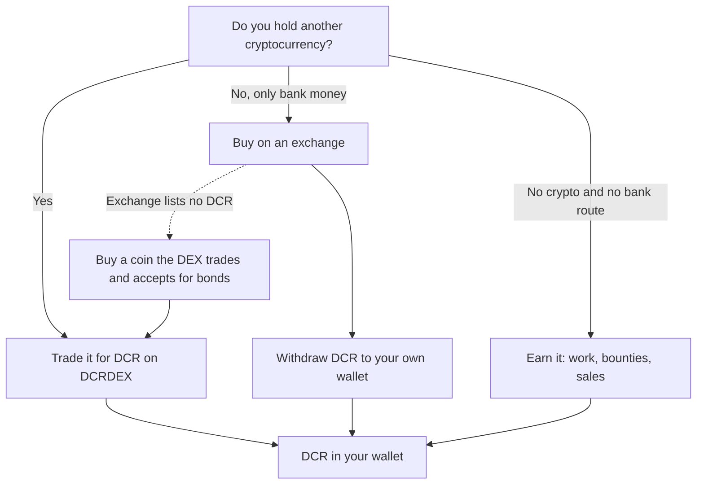

# Get DCR

This page compares the ways to acquire DCR and walks newcomers through the two most common: trading for it without custody on DCRDEX, and buying on an exchange, then withdrawing to your own wallet.

!!! info "Applies to"
    Decrediton 2.1.7, Bison Wallet 1.0.6 and dcrwallet 2.1.7. Exchange list checked November 2026.

Until your coins reach a wallet whose seed only you hold, someone else can freeze, lose or misdirect them, so this page prefers routes that keep you in control.

## Before you start

- A Decred wallet you control, with its seed written down and checked. If you do not have one yet, follow [Your first Decred wallet](first-wallet.md) first.
- For DCRDEX: Bison Wallet 1.0.6, or Decrediton 2.1.7 (its **DEX** tab runs the same DCRDEX client), plus some of another cryptocurrency to trade.
- For an exchange: an account there, which usually means passing identity checks that can take days.

## Ways to get DCR at a glance

| Route | Who holds the coins along the way | Identity checks | Typical time |
|---|---|---|---|
| Trade on DCRDEX | You. The swap runs wallet to wallet, with no middleman holding funds | None. A fidelity bond secures access instead | Minutes to hours per trade |
| Buy on an exchange, then withdraw | The exchange, until you withdraw | Usually required | Hours to days, including account setup |
| Instant swap service | The operator, from your deposit until it pays out | Sometimes, possibly only after you deposit | Minutes to hours |
| Earn it (work, bounties, selling goods) | You, once paid | Depends on who pays you | Weeks or more |
| Staking or mining | You | None | Needs DCR or hardware first |

The choice mostly comes down to whether you already hold another cryptocurrency, as this flow shows.



## Trade for DCR on DCRDEX

DCRDEX is Decred's exchange without custody. A server matches buy and sell orders, but it never holds anyone's coins. Each trade settles as an atomic swap: both traders lock their coins in on-chain contracts that pay the other side only when the swap completes, or refund the owner after a time limit if it does not.

Neither the server nor the other trader can take your coins, provided your wallet stays online long enough to complete or refund the swap (see the warning below). The [whitepaper's DCRDEX section](../../whitepaper/19-ecosystem.md#sec:ecosystem-dex) describes the contracts in detail.

What to expect:

- **You need another cryptocurrency first.** DCRDEX trades coin for coin, not bank money or cards; each server shows its markets when you connect.
- **You post a fidelity bond before you can trade.** A bond is not a fee: it is your own funds, locked in an on-chain contract that returns them to your wallet when it expires (on mainnet, after about 2 months). Bison Wallet also sets aside funds for a replacement bond and posts it automatically before the old one expires, so your funds stay locked as long as you keep a trading tier. To get them back, set your trading tier to zero in the exchange's settings; the funds return once the existing bonds expire. Each server lists the assets it accepts for bonds under **Select your bond asset**.
- **No trading fees.** DCRDEX collects none. You pay the normal network transaction fees on both chains. On the Decred side, the fee for claiming your DCR comes out of the DCR you receive, so you do not need DCR to start.
- **Trades are not instant.** Each swap waits for confirmations on both chains and can take hours.
- **New accounts start with low limits.** Your limit rises as you complete trades, or if you post a larger bond, so start small. Failing to complete a matched swap, for example because your wallet went offline, counts against your account and can suspend your trading.

!!! warning "Keep your wallet app running until your trades settle"
    The swap needs your wallet online to finish. Short disconnections are fine, but the DCRDEX project warns that losing internet access for more than about 20 hours during settlement can lose funds. Do not close Bison Wallet or Decrediton, or shut down the computer, while a trade is in progress.

If you hold coins on a centralized exchange that does not list DCR, you can still use this route: buy a coin that the server both trades against DCR and accepts for bonds (check its **Select your bond asset** screen first), withdraw it to Bison Wallet, and trade it there.

[Your first trade on DCRDEX](../dex/first-trade.md) takes you through connecting to a server, posting a bond and placing a small order. [DCRDEX: Trading without custody](../dex/index.md) explains the model.

## Buy on an exchange, then withdraw to your own wallet

Centralized exchanges let you pay with bank money or another cryptocurrency. The trade-off is custody: while your DCR sits there, the exchange holds it, and an exchange can be hacked, freeze your account, go bankrupt or stop withdrawals. Treat an exchange as a place to buy, not a place to keep.

The current list of services that carry DCR is on [decred.org/exchanges](https://decred.org/exchanges/). The page itself warns that, apart from DCRDEX, none of them lets you keep custody of your funds throughout the exchange process. The list is not a ranking or an endorsement: check each service's reputation, fees and availability in your country.

### 1. Buy DCR

Follow the exchange's own steps to deposit money and buy DCR. Expect identity checks (often called KYC, "know your customer") before you can deposit or withdraw.

### 2. Get a fresh receiving address from your wallet

Use a new address for each withdrawal. Mainnet Decred addresses usually start with `Ds`.

=== "Decrediton"

    1. Open **On-chain Transactions** > **Receive**.
    2. Under **This address is for**, choose the account to receive into.
    3. Select **Generate new address**, then select the copy icon next to the address (its tooltip reads **Copy**).

=== "Bison Wallet"

    1. Open **Wallet** and select your Decred wallet.
    2. Select **Receive**. Use **New Address** if you want a different address from the one shown.
    3. Copy the address.

=== "Command line"

    ```bash
    dcrctl --wallet getnewaddress
    ```

    This returns a new address from the `default` account. Add an account name to use a different one.

### 3. Send a small test withdrawal

In the exchange's withdrawal form, paste the address and withdraw a small amount first.

- Compare the first and last several characters of the pasted address with your wallet. Some malware swaps addresses on the clipboard.
- If the exchange offers more than one network for DCR, choose the Decred network. A token on another chain is not DCR and will not appear in a Decred wallet.
- Note the exchange's withdrawal fee and minimum.

!!! danger "Withdrawals cannot be reversed"
    Once the exchange sends a transaction, nobody can undo it. A wrong address, or the wrong network, can mean the coins are gone.

### 4. Withdraw the rest

When the test amount shows up in your wallet, withdraw the remainder to a fresh address the same way.

## Instant swap services

Instant swap services convert one coin to another without an account: you send, say, Litecoin to a deposit address, and the service sends DCR to the address you give it. They are not atomic swaps: from the moment your deposit arrives until the service pays out, the operator holds your coins.

decred.org warns that some services of this "instant" type may ask for personal information after funds have been deposited, and if you refuse, your coins can be stuck. Before using one, read its terms on identity checks, refunds and whether the quoted rate is fixed, and send a small amount first to a fresh address from your own wallet. If a swap stalls, only the operator can release or refund it.

## Earn DCR

Contract work
:   Decred has no company behind it. Development, design, marketing and other work is proposed on [Politeia](../governance/politeia.md), approved by ticket holders, and paid in DCR from the [treasury](../governance/treasury.md). See [Write a Politeia proposal](../governance/write-a-proposal.md).

Bug bounties
:   The Decred bug bounty program pays rewards in DCR for security vulnerabilities in core software. Details are on [Get help and join the community](../reference/index.md).

Selling goods or services
:   You can accept DCR directly from another person into your own wallet. decred.org/exchanges also lists payment processors for merchants.

Staking
:   Tickets bought with DCR vote on blocks and earn part of each block's new coins. Staking needs DCR to begin: the ticket price (also called stake difficulty) is never below 2 DCR, and the funds stay locked until the ticket votes (about 28 days on average after it matures) or, if it misses or expires, is revoked, plus 256 blocks (about 21 hours) before the returned funds can be spent. See [How staking works](../staking/index.md).

Mining
:   Proof-of-work (PoW) miners receive 1% of each block's new coins. Mining needs dedicated BLAKE3 hardware; `dcrd` cannot mine on mainnet. See [Mining Decred](../run/mining.md) before spending anything on equipment.

## Privacy when acquiring coins

Every route leaves a trail:

- **Exchanges with identity checks** link your name to the address you withdraw to, and the Decred blockchain is public, so anyone who knows that address can follow the coins from there. [Mixing](../privacy/mix-your-dcr.md) with StakeShuffle breaks that on-chain link, but it does not erase the exchange's records.
- **DCRDEX** asks for no identity, but swaps are public transactions on both chains, and the server sees your network address unless you hide it, for example with Tor.
- **Reusing an address** links payments together. Use a fresh one each time.

[Privacy beyond mixing](../privacy/privacy-practices.md) covers these habits in depth.

## Scams to avoid

Scammers target people buying their first DCR. These rules have no exceptions:

- **There is no Decred airdrop or giveaway.** Decred's only airdrop was paid in block 1, in February 2016. Any "airdrop", "claim" or "giveaway" today is a scam.
- **Nobody will double your DCR.** Any offer to send back more than you send is theft.
- **Nobody needs your seed.** Not support staff (real support never messages you first), not an exchange, not a "recovery" service. Type your seed only into the official wallet's restore screen.
- **Get wallets only from decred.org or the official GitHub releases**, and [verify the download](../security/verify-downloads.md).

[Keep your DCR safe](../security/index.md) covers the other common attacks.

## Check that it worked

1. Your wallet shows the incoming transaction. In Decrediton it appears under **On-chain Transactions** > **History**.
2. For an exchange withdrawal, look up the exchange's transaction ID on [dcrdata](https://dcrdata.decred.org). It should show your address as an output and a growing number of confirmations, one per block (about every 5 minutes).
3. If you trade on DCRDEX, the order's status changes from **settling** to **executed**, each of its matches shows **Complete**, and the DCR appears in your Decred wallet balance.

[Use the block explorer](../wallets/block-explorer.md) explains what dcrdata shows.

## Troubleshooting

### The exchange says "sent" but the wallet shows nothing

Look up the transaction ID on dcrdata. If it is there with your address, let the wallet finish syncing and check that you are viewing the account the address belongs to. If it is not there, the exchange has not broadcast it yet; ask its support.

### Withdrawal sent to the wrong network or address

A transaction on the Decred network cannot be reversed. If you chose a different network in the exchange's form, only the exchange can help, so contact it with the transaction details. Never pay a "recovery" service that contacts you.

### A DCRDEX order will not place or the bond is pending

A bond must confirm on chain before you can trade, and new accounts have low limits. See [DEX troubleshooting](../dex/troubleshooting.md).

## Next steps

- [Your first trade on DCRDEX](../dex/first-trade.md): buy DCR without handing your coins to anyone.
- [Send and receive DCR](../wallets/send-and-receive.md): addresses, fees and confirmations for everyday use.
- [Back up and restore your wallet](../wallets/back-up-and-restore.md): make sure the coins you just received are recoverable.
- [How staking works](../staking/index.md): what to do with DCR once you have it.

*[DCRDEX]: Decred's decentralized exchange
*[DEX]: decentralized exchange
*[KYC]: know your customer
*[PoW]: proof of work
