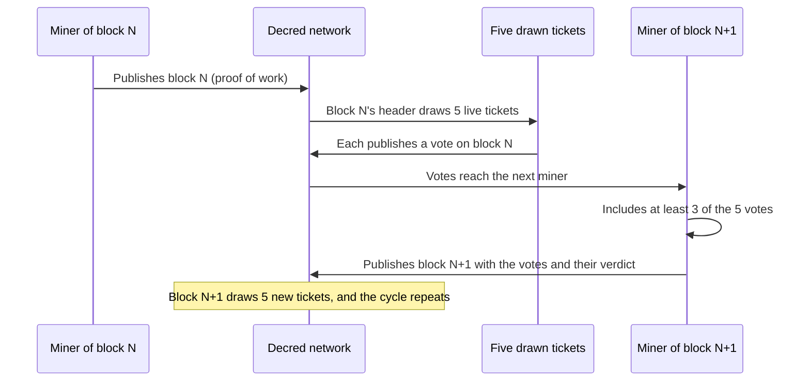

# Miners, voters and the life of a block

Every Decred block is made by two groups working in turn: miners, who propose blocks with proof of work, and ticket holders, whose votes let the chain move on. This page follows one block from start to finish, without math, and shows what the two-step design protects against. The pages on staking and governance build on it.

!!! abstract "In short"
    - A miner finds a block about every five minutes.
    - That block draws five tickets at random. Their holders vote on it.
    - The next block must include at least three of those five votes, or it is not valid.
    - Unless a strict majority of the included votes approve the earlier block (a tie counts as disapproval), that block's ordinary transactions are undone and its miner is not paid.
    - Each block's new coins are split three ways: 1% to the miner, 89% to the five voters, 10% to the treasury.

## A new block about every five minutes

A block is a batch of transactions added to the shared ledger. Decred's consensus rules target one block every five minutes on mainnet. Two kinds of participant take part in every block:

- **Miners** run hardware that does proof of work (PoW). The first to solve the puzzle proposes the next block.
- **Stakeholders** lock DCR in **tickets**. Tickets are drawn at random to vote, and each vote is a small transaction that approves or disapproves a block. This is Decred's proof of stake (PoS).

Think of miners as drafting each page of the ledger, and ticket holders as signing off on a page before the next one can be written. Miners cannot skip the sign-off, and stakeholders cannot write pages themselves.

## Proof of work: Miners compete to propose a block

A miner gathers waiting transactions and the latest votes into a candidate block, then hashes its header over and over until the result falls below a target. Finding that hash takes a great deal of computation. Checking it takes almost none, so every node can confirm the work was done.

- **Hash function:** BLAKE3 since block 794,368 (August 2023), when stakeholders approved Decred Change Proposal DCP-0011 (agenda `blake3pow`). Before that it was BLAKE-256, and the change made the specialized machines built for BLAKE-256 obsolete.
- **Difficulty:** recalculated for every block by an algorithm called ASERT (absolutely scheduled exponentially rising targets). Mining gets harder when blocks come faster than one per five minutes and easier when they come slower, with a half-life of 12 hours.

Proof of work decides who proposes a block and makes rewriting history expensive. On Decred it does not, on its own, decide which blocks the chain keeps. [Mining Decred](../run/mining.md) covers the miner's side.

## Proof of stake: Five live tickets are drawn to vote on each block

To get a ticket, a holder locks an amount of DCR called the **ticket price** (also called stake difficulty). The price adjusts every 144 blocks to steer the pool toward about 40,960 tickets. After a 256-block wait (about 21 hours) the ticket becomes **live** and joins the pool.

When a block is added to the chain, its header seeds a lottery that draws five live tickets. Every node runs the same lottery and gets the same five winners. Nobody can pick them in advance, and the miner cannot see the winners until it has already done the work for the block.

Each winning ticket's holder, or a voting service provider (VSP) acting for them, then publishes a **vote**. A vote:

- names the block it is voting on;
- says whether that block's ordinary transactions should stand (approve or disapprove);
- carries the holder's choices on any open consensus rule votes and treasury spends;
- pays back the ticket price plus a reward.

A ticket votes once and is then finished. A ticket that is drawn but whose vote does not make it into the next block is **missed**: it is revoked automatically and returns the ticket price with no reward. [How staking works](../staking/index.md) follows a ticket from purchase to vote.

## Step by step

The diagram shows one turn of the cycle: block N is mined, five tickets vote on it, and block N+1 carries their votes and their verdict.

In words:

1. **A miner finds block N.** It contains ordinary transactions, ticket purchases, votes on the block before it, and the miner's own reward.
2. **Block N draws five winning tickets.** Every node computes the same five from block N's header.
3. **The five tickets vote.** Their voting wallets see block N and publish their votes straight away.
4. **The next miner builds block N+1 on top of block N.** Block N+1 is valid only if it contains votes from at least three of the five tickets drawn by block N. Votes from any other ticket are not accepted.
5. **Block N+1 records the verdict.** Its header says whether the included votes approve block N's ordinary transactions. Approval needs more approving votes than disapproving ones, so a two-against-two tie disapproves, and so do two disapprovals out of three votes.

Every block since block 4,096, about two weeks after launch in 2016, has had to carry votes.

### When fewer than three votes arrive

If fewer than three of block N's tickets vote, no valid block can be built on block N. It is a dead end. Miners instead mine a different block at the same height on top of block N−1. That replacement block has a different header, so it draws a different set of five tickets. The chain continues from whichever block at that height gathers three votes. The block left behind and its reward are abandoned.

By default, `dcrd`'s mining code switches to such a replacement automatically when the latest block is short of votes. That behavior is mining policy, not a consensus rule.

## What disapproval does

Disapproval is the stakeholders' veto over a single block. It does not delete the block. Block N stays in the chain, with its proof of work and its votes. What is undone is its **regular tree**: the ordinary payments and the miner's reward.

When block N+1 disapproves block N:

- **Block N's ordinary transactions are treated as never mined.** They go back to the pool of unconfirmed transactions and can be mined again, unless they have expired or their coins were spent another way in the meantime.
- **The miner of block N loses its reward:** its 1% share of the new coins and all the fees it claimed.
- **Block N's stake transactions stand:** votes, tickets, revocations and treasury transactions.
- **The treasury's 10% for block N is still paid,** by a separate stake transaction (the treasurybase).
- **The voters in block N+1 are paid either way.** A vote earns the same reward whether it approves or disapproves.

### Worked example

Example only, using real figures from November 2026, when each block created about 5 DCR in new coins.

Alice sends Bob 10 DCR, and the payment is mined in block N. The miner of block N claims about 0.05 DCR plus fees. Block N also contains five votes on block N−1 and a ticket bought by Carol.

Block N draws five tickets. Four of them vote, and block N+1 includes all four. Two approve and two disapprove. Approval needs a strict majority, so the header of block N+1 marks block N as **disapproved**:

| What was in block N | After block N+1 disapproves |
|---|---|
| Alice's 10 DCR payment to Bob | Back to unconfirmed. Mined again in block N+1 or later. |
| Miner's reward (about 0.05 DCR plus fees) | Never created |
| Five votes on block N−1 | Stand. Their holders keep the ticket price and reward. |
| Carol's ticket | Still a ticket, maturing as usual |
| Treasury share (about 0.5 DCR) | Paid |

In this example the fifth ticket's vote was not included, so that ticket is missed. Block N+1 had only four of five votes, so its own miner also earns a little less (see [Who earns what per block](#who-earns-what-per-block)).

For Bob, this means a payment that is only in the newest block can still be undone by disapproval, on top of the usual risk of a chain reorganization (a competing branch of blocks replacing the most recent ones). Once the next block approves it, stakeholders have accepted the payment. [Blocks, confirmations and reorganizations](../../dev/protocol/blocks-and-confirmations.md) explains what this means for services that accept DCR.

!!! note "Disapproval is rare in practice"
    The dcrdata explorer lists nine disapproved blocks on mainnet, all from November and December 2016.[^disapproved] `dcrwallet`, which also votes inside Decrediton and on the VSPs' servers, always marks its mainnet votes as approving: none of the official wallets can disapprove a block on mainnet, and `dcrwallet`'s disapprove setting works only on test networks. Using the veto would take coordinated stakeholders running modified voting software. The other protections described below do not depend on disapproval and work in every block.

## What this protects against

Because the chain can only grow with votes from randomly drawn tickets, hash power alone is not enough to control Decred:

- **No secret chains.** In a pure proof-of-work system, a miner with enough hash power can mine a longer chain in private, then publish it to undo recent payments. On Decred, every block in that private chain draws its own tickets, owned by people who never see the block and so never vote on it. Unless the attacker also controls a large share of all live tickets, the private chain cannot get past its first block.
- **Blocks without votes are worthless.** A block that never gathers three votes cannot be built on, so it is abandoned along with its reward. Miners therefore build on blocks that ticket holders are voting on.
- **Rule changes need stakeholder approval.** A change to the consensus rules takes effect only after tickets vote for it: at least 75% of the votes that pick a side in one 8,064-block interval (about four weeks), with enough votes cast to meet a quorum. Miners cannot force a rule change through. A group of miners that splits off to run different rules still needs ticket holders to run its software and vote on its blocks. Dropping the voting requirement altogether would mean leaving Decred's rules, and full nodes would reject those blocks. [Consensus rule votes](../governance/consensus-upgrades.md) explains the process.
- **Misbehaving miners can lose their reward.** A miner that mines empty blocks or censors transactions can, in principle, have its blocks disapproved, which costs it the reward.

It works in the other direction too: stakeholders cannot produce blocks without proof of work. Neither group can run the chain without the other.

## Who earns what per block

Each block creates new coins, the **block subsidy**. The subsidy started at 31.19582664 DCR per block and is cut by about 1% every 6,144 blocks (about 21.3 days). Since block 794,368 (August 2023, DCP-0012) it has been split 1/89/10:

| Who | Share of the subsidy | Example: November 2026, subsidy about 5 DCR |
|---|---|---|
| Miner of the block | 1%, plus the block's transaction fees | about 0.05 DCR plus fees |
| Each of the five voters | 17.8% (89% ÷ 5), plus their ticket price back | about 0.89 DCR |
| All five voters together | 89% | about 4.45 DCR |
| Treasury | 10% | about 0.5 DCR |

These shares are consensus rules. Formerly the split was 60/30/10 and then 10/80/10. Each change was approved by stakeholder vote. A vote is paid from the subsidy of the block it votes on, not the block it appears in. [DCR supply and issuance](supply-and-issuance.md) has the exact amounts, the history and the supply limit.

**Fewer votes, smaller miner reward.** The miner's reward, both its 1% subsidy share and the fees, is scaled by the number of votes in its block:

| Votes in the block | Miner receives | Voters left out |
|---|---|---|
| 5 | 100% of its share | none |
| 4 | 80% | 1 missed ticket, no reward |
| 3 | 60% | 2 missed tickets, no reward |
| 0 to 2 | Block is not valid | — |

The reward of a vote that was left out is never created, and the part of the miner's reward that was cut is paid to no one. The treasury's 10% is paid in full in every valid block. The scaling is there so that a miner gains nothing by leaving votes out. At today's 1% share the penalty is small, though: leaving out one vote costs the miner a fifth of about 0.05 DCR, plus a fifth of the fees.

## Two transaction trees

Every Decred block holds two separate lists of transactions: the **regular tree**, with ordinary payments and the miner's reward, which the next block's votes can disapprove, and the **stake tree**, with tickets, votes, revocations and treasury transactions, which always stands.

On a block's page in the [dcrdata explorer](https://dcrdata.decred.org/), the **Votes** table's **Last Block** column shows each vote's verdict (**Approve** or **Disapprove**) on the previous block. [Use the block explorer](../wallets/block-explorer.md) walks through the rest of the page.

## Limits of the model

The design moves final authority from hash power to ticket holders. It has limits:

- **Voting power follows money.** One ticket is one vote, not one person.
- **VSPs concentrate voting.** A VSP never holds its users' funds, but its servers cast the votes for every ticket it handles. Users choose how their tickets vote on rule changes and treasury spends, and the VSP votes that way. If a large VSP goes offline, many tickets miss at once. In November 2026 the VSPs listed on decred.org voted for about one live ticket in eight, and three of them handled nearly two thirds of those.[^vsps] The rest are voted by solo voters' own wallets or by services not on that list. [Voting service providers](../staking/vsps.md) explains the trade-offs, and [Vote without a VSP](../staking/solo-voting.md) explains the alternative.
- **Turnout depends on online wallets.** A ticket that is drawn while its voting wallet is offline is missed. Missed votes are rare. From late October to mid-November 2026, dcrdata's **Missed Votes** chart showed between zero and seven missed votes in each 144-block window of 720 possible votes. The worst window since September 2026 had 23.[^missed] When votes are missed, the miner's reward shrinks and each missed holder loses that ticket's reward.
- **Miners still choose transactions.** Within a block, the miner decides which transactions to include and in what order. Votes check the result after the fact. They do not choose the contents.

## Go deeper

- [The whitepaper's life of a block](../../whitepaper/01-intro.md#sec:intro-lifecycle): the same cycle in one page, with the reasoning behind it.
- [Votes in a block](../../whitepaper/08-staking.md#sec:staking-block-votes), [stakeholder approval](../../whitepaper/10-blocks.md#sec:blocks-approval) and [its consequences](../../whitepaper/10-blocks.md#sec:blocks-approval-consequences): the exact rules for the vote count, the verdict and what disapproval undoes.
- [Splitting the subsidy](../../whitepaper/11-subsidy.md#sec:subsidy-split): how the 1/89/10 split and the vote scaling are computed.
- [ASERT](../../whitepaper/09-difficulty.md#sec:difficulty-asert): how mining difficulty follows the five-minute schedule.

## Next steps

- [Your first Decred wallet](first-wallet.md): install a verified wallet before you hold or stake any DCR.
- [How staking works](../staking/index.md): buy tickets and earn the voters' 89% share.
- [How Decred is governed](../governance/index.md): the other decisions votes carry, from rule changes to treasury spends.
- [Use the block explorer](../wallets/block-explorer.md): look up a block and see its votes for yourself.
- [Mining Decred](../run/mining.md): the miner's side of the cycle.

[^disapproved]: The dcrdata **Stakeholder Disapproved Blocks** page lists blocks 80,740 to 88,068 (nine blocks, 14 November to 9 December 2016). Checked November 2026.
[^vsps]: The 13 mainnet VSPs in decred.org's VSP list (served by api.decred.org) reported about 5,300 live tickets between them, against a pool of about 41,000 live tickets on dcrdata. The counts are reported by the VSPs themselves. Checked November 2026. These figures change constantly; the [VSP list](https://decred.org/vsp/) shows the current counts.
[^missed]: [dcrdata Missed Votes chart](https://dcrdata.decred.org/charts?chart=missed-votes), last 40 windows before block 1,133,576 (zero to seven missed votes each). Since 1 September 2026 the highest windows were 23 (29 October), 20 (28 October) and 12 (8 October). Checked November 2026.

*[PoW]: proof of work
*[PoS]: proof of stake
*[VSP]: voting service provider
*[VSPs]: voting service providers
*[DCP]: Decred Change Proposal
*[ASERT]: absolutely scheduled exponentially rising targets
