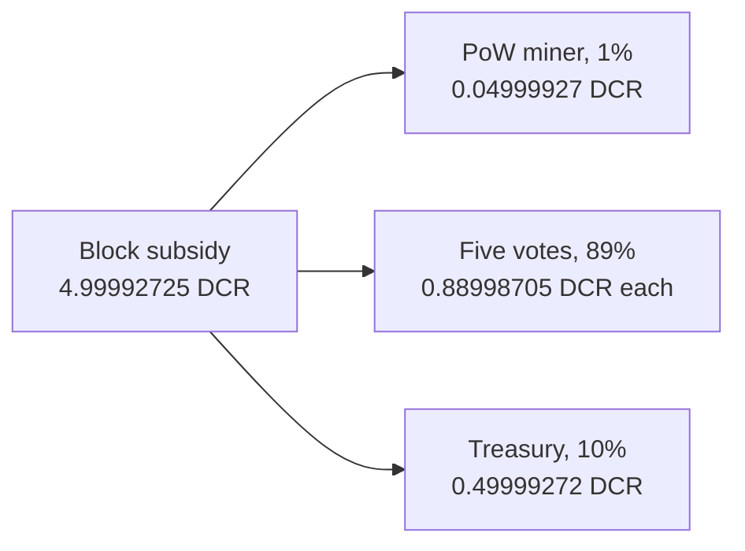

# DCR supply and issuance

This page explains where every DCR comes from: how many will ever exist, how fast new coins are created, who receives them, and what was paid out when the network launched. It is for anyone who holds DCR or is thinking about it, and needs no technical background.

!!! abstract "At a glance"
    - **Total supply:** about 21 million DCR, ever. There is no tail emission.
    - **New coins per block:** started at 31.19582664 DCR and falls by about 1% every 6,144 blocks (about 21.3 days).
    - **Who gets them today:** 89% to the five tickets that vote on each block, 10% to the treasury, 1% to the proof-of-work miner.
    - **At launch:** block one paid 1.68 million DCR (8% of 21 million), half as an airdrop and half to Company 0 and the founding developers.
    - **End of issuance:** the last new coins are created in block 10,979,328, about 104 years after launch.

## Where new DCR comes from

Decred creates new coins in exactly two ways:

- **The block subsidy.** Every block creates a fixed, slowly shrinking amount of new DCR. The block subsidy is split between the miner who found the block, the ticket holders whose votes it contains, and the project treasury.
- **The block-one ledger.** The very first block after the genesis block paid a fixed list of outputs written into the software, 1.68 million DCR in total. This happened once and can never happen again.

Transaction fees are not new money. They move existing DCR from the sender to the miner. The block subsidy plus the fees a block collects is called the block reward.

No other rule creates coins. There is no mechanism for a second airdrop or a later distribution, so treat any offer of a "DCR airdrop" as a scam.

## About 21 million DCR, ever

The subsidy schedule adds up to about 21 million DCR. Two details make the exact figure slightly different from 21,000,000:

- **The ceiling is a little over 21 million.** Each vote is paid at the rate of the block it votes on, which is the block before the one that contains it. When the subsidy steps down, the votes in the first block of the new step are still paid at the old, slightly higher rate. Over a century of steps this adds about 15.55 DCR, so the largest possible supply is 21,000,015.55 DCR. The [whitepaper's total supply section](../../whitepaper/11-subsidy.md#sec:subsidy-supply) derives this figure from the subsidy code in `dcrd`.
- **The real total will be lower.** The ceiling assumes every block carries five votes and every miner claims its full entitlement. Missed votes and disapproved blocks mean part of the subsidy is never created (see [Missed votes and disapproved blocks](#missed-votes-and-disapproved-blocks) below), so the ceiling will never be reached.

You may also see 20,999,999.98 DCR quoted, for example as the ultimate supply in the dcrdata explorer's API and in older documents. The dcrdata figure (20,999,999.98394320 DCR) is what the same schedule gives if each vote is paid at the rate of the block that contains it, which leaves out the 15.55 DCR timing effect. Both figures describe the same schedule; the difference is under one ten-thousandth of a percent.

No consensus rule caps the total supply directly. The cap is a consequence of the subsidy schedule: from block 11,010,048 on the full subsidy is zero, and no rule creates coins after that.

## How the block subsidy shrinks

The full block subsidy started at 31.19582664 DCR per block. Every 6,144 blocks (about 21.3 days at the 5-minute block target), it is multiplied by 100/101, a cut of slightly less than 1%. These are consensus rules (`BaseSubsidy`, `MulSubsidy`, `DivSubsidy` and `SubsidyReductionInterval` in `dcrd`), unchanged since launch. Only the split between recipients has changed.

The small, frequent cuts add up. After 70 of them (block 430,080, a little over four years at the target block time) the subsidy has fallen to about half its starting value. Bitcoin reaches the same reduction with one sudden halving every 210,000 blocks; Decred spreads it over steps of about 1%.

The table shows the schedule at a few milestones. The years assume 5-minute blocks, which mainnet has closely matched so far. The supply column is the ceiling described above; the real supply at each point is somewhat lower.

| Reduction step | Starts at block | Around | Full subsidy per block | Maximum supply by end of step |
|---|---|---|---|---|
| 0 | 0 | 2016 (launch) | 31.19582664 DCR | 1,833,290 DCR |
| 106 | 651,264 | 2022 | 10.86502835 DCR | 14,324,538 DCR |
| 130 | 798,720 | 2023 | 8.55692819 DCR | 15,742,637 DCR |
| 200 | 1,228,800 | 2027 | 4.26404419 DCR | 18,380,188 DCR |
| 300 | 1,843,200 | 2033 | 1.57646462 DCR | 20,031,439 DCR |
| 500 | 3,072,000 | 2045 | 0.21548080 DCR | 20,867,628 DCR |
| 1000 | 6,144,000 | 2074 | 0.00148792 DCR | 20,999,104 DCR |
| 1787 | 10,979,328 | 2120 | 0.00000005 DCR | 21,000,015.55 DCR |

The first step's supply includes the 1.68 million DCR paid by block one. Figures come from the schedule table in the [whitepaper's total supply section](../../whitepaper/11-subsidy.md#sec:subsidy-supply).

## Who receives new coins today

Since block 794,368 (August 2023), each block's subsidy is split three ways:

- **1% to the proof-of-work (PoW) miner** who found the block, paid in the block's coinbase transaction (the first transaction in a block, which creates the miner's coins).
- **89% to proof-of-stake (PoS) voters**: the five [tickets](../staking/index.md) chosen to vote on the previous block. Each vote earns a fifth of that share, 17.8% of the subsidy.
- **10% to the [treasury](../governance/treasury.md)**, the on-chain fund that ticket holders approve or reject spending from.

The diagram shows one block's subsidy divided between its recipients, using the figures from the worked example below.



### Worked example

Example: every block from 1,130,496 to 1,136,639 (reduction step 184, mined in November 2026) has a full subsidy of 4.99992725 DCR. A block in that range with five votes pays:

| Recipient | Share | Amount |
|---|---|---|
| PoW miner | 1% | 0.04999927 DCR |
| Each of the five votes | 17.8% | 0.88998705 DCR |
| All five votes together | 89% | 4.44993525 DCR |
| Treasury | 10% | 0.49999272 DCR |
| **Total created** | | **4.99992724 DCR** |

The missing 0.00000001 DCR (one atom, the smallest unit: 1 DCR = 100,000,000 atoms) is rounding: each share is rounded down separately, and the leftover is never created. The miner also collects the block's transaction fees on top of its share.

For comparison, a five-vote block in the first reduction step (from block 4,096, when voting began) paid the miner 18.71749598 DCR, each vote 1.87174959 DCR and the treasury 3.11958266 DCR.

What a vote earns relative to the ticket price is covered in [Ticket price, rewards and costs](../staking/ticket-price-and-rewards.md).

## How the split changed by stakeholder vote

The split has changed twice, each time through a [consensus rule vote](../governance/consensus-upgrades.md) in which ticket holders approved a Decred Change Proposal (DCP). The treasury's 10% has never changed.

| Blocks | Dates | PoW | Votes (each of five) | Treasury | Set by |
|---|---|---|---|---|---|
| 1 to 657,279 | 2016 to May 2022 | 60% | 30% (6%) | 10% | Original rules |
| 657,280 to 794,367 | May 2022 to August 2023 | 10% | 80% (16%) | 10% | DCP-0010, agenda `changesubsidysplit` |
| 794,368 onward | August 2023 onward | 1% | 89% (17.8%) | 10% | DCP-0012, agenda `changesubsidysplitr2` |

Both changes passed with more than 99% of the non-abstaining votes.[^votes] The proposals gave the same reason: analysis showing that most proof-of-work hash power was concentrated in a few hands and that newly mined coins were being used against Decred's markets. Moving most of the subsidy to ticket holders reduced what that hash power could earn. DCP-0012 was voted on together with DCP-0011, which changed the mining algorithm to BLAKE3 at the same block.[^dcps] The [whitepaper's split variants table](../../whitepaper/11-subsidy.md#sec:subsidy-variants) gives the exact fractions.

Two more details from the early chain:

- **Votes started at block 4,096.** Blocks 2 to 4,095 had no votes, so their vote share (about 38,315 DCR in total) was never created.
- **The treasury share changed destination, not size.** Until block 552,448 (2021) the 10% was paid in each block's coinbase to an address held by the project organization. Since the `treasury` agenda (DCP-0006) activated, it goes to the on-chain treasury, and every spend from it needs stakeholder approval.

The schedule itself could change only the same way: a published proposal, a stakeholder vote reaching 75% of non-abstaining votes, and a software upgrade. It never has.

## Missed votes and disapproved blocks

The subsidy is an upper limit on what a block may create, not an amount that is always paid. Two situations shrink it, and the DCR lost is never created later:

- **Missed votes.** A block needs at least three of its five votes to be valid. For each missing vote, that vote's 17.8% is not created, and the miner's 1% share is cut by a fifth. The miner's share of transaction fees is cut the same way, and the unclaimed part of the fees is destroyed. The treasury share is paid in full as long as the block is valid. This makes a miner who leaves votes out lose part of its own reward.
- **Disapproved blocks.** The votes in each block also approve or disapprove the previous block's regular transactions. If they disapprove, that block's miner loses its subsidy and the fees it claimed: the miner subsidy is never created, and the block's regular transactions go back to waiting for confirmation and can be included again in a later block. The block's votes still count, and so, since the treasury change in 2021, does its treasury share. How this works is explained in [Miners, voters and the life of a block](life-of-a-block.md).

For example, in the worked example above a block with only four votes pays the miner 0.03999941 DCR, four votes 3.55994820 DCR in total, and the treasury 0.49999272 DCR. The remaining 0.89998692 DCR is never created.

Example (November 2026): at block 1,133,575 the dcrdata explorer reported a supply of about 17,696,782 DCR. The ceiling for that height, with every block fully voted and claimed, is about 17,912,741 DCR. Missed votes and disapproved blocks had kept the supply about 216,000 DCR, or 1.2%, below the maximum. (This supply figure counts the subsidy each block claims in its coinbase and votes. A miner that pays itself less than its entitlement is not reflected, so the figure can slightly overstate the coins that exist.)

## When issuance ends

Because each share is rounded down separately, the shares reach zero at different times. At the 5-minute block target:

| Last new coins | Block | Around |
|---|---|---|
| PoW miner share | 10,401,791 | 2114 |
| Treasury share | 10,954,751 | 2120 |
| Vote share (five votes of one atom each) | 10,979,328 | 2120 |

No block after 10,979,328 creates any new DCR. From then on, miners are paid only by transaction fees, and votes earn nothing beyond the return of the ticket price. That is far in the future: the maximum schedule passes 95% of the total around 2033, and the real supply, which is somewhat lower, a year or two after that.

Over the whole schedule, if every block were fully voted, the 21 million DCR would come from these sources:

| Source | Maximum DCR | Share of all DCR |
|---|---|---|
| Vote subsidy | 9,588,905 | 45.66% |
| PoW subsidy | 7,795,279 | 37.12% |
| Treasury subsidy | 1,935,831 | 9.22% |
| Block-one ledger | 1,680,000 | 8.00% |

Miners received the largest share in the early years under the 60/30/10 split, which is why their lifetime share is so much more than 1%.

## The launch: What block one paid

Decred launched in February 2016. Block one, mined on 8 February 2016, paid 1,680,000 DCR (8% of 21 million) in 3,146 outputs listed in the software. The block's miner received nothing beyond that fixed list.

- **Airdrop, about 840,000 DCR.** 2,972 outputs of 282.63795424 DCR each went to people who had registered for the airdrop before launch and passed its review. The coins were given away unconditionally.
- **Development costs, about 840,000 DCR.** The other 174 outputs went to Company 0, the company that led Decred's development, and its developers, as compensation for the work and expenses of building Decred before launch.

The outputs are fixed by a consensus rule: a block one that paid anything else would be invalid. The [whitepaper's block-one ledger section](../../whitepaper/11-subsidy.md#sec:subsidy-ledger) lists the amounts and gives a digest of the full list, also summarized in its [parameters chapter](../../whitepaper/14-parameters.md#sec:parameters-ledger). You can inspect the [block-one transaction on dcrdata](https://dcrdata.decred.org/tx/5e29cdb355b3fc7e76c98a9983cd44324b3efdd7815c866e33f6c72292cb8be6). The background to the premine and the airdrop is in [A short history of Decred](../reference/history.md).

## Transaction fees go to miners

Every ordinary transaction pays a fee, and the miner of the block that includes it collects it, scaled by the number of votes as described above. Fees on Decred are small. The default rate is 0.0001 DCR per kilobyte: that is the minimum `dcrd` relays (`minrelaytxfee`) and the default `dcrwallet` pays (`txfee`). Both are relay policy and wallet defaults, not consensus rules. A simple payment of about 250 bytes costs about 0.000025 DCR at that rate.

Fees do not add to the supply. They only move existing coins.

## Check the live figures yourself

The supply and the current rewards change with every block, so this page gives them only as dated examples. Read the current values from these sources:

- **The dcrdata explorer.** The [dcrdata home page](https://dcrdata.decred.org/) shows **Total Coin Supply**, **Vote Reward**, **PoW Reward**, **Treasury Block Reward** and **Next Block Reward Reduction** (a progress bar showing how far the current 6,144-block step has run, with the time left until the next cut). Under **Charts**, **Circulation** plots the supply over time and **Missed Votes** shows the votes that cost the network subsidy. [Use the block explorer](../wallets/block-explorer.md) explains the rest of dcrdata.
- **Your own node.** If you run `dcrd`, you can ask it directly. Decrediton and Bison Wallet do not display the coin supply.

=== "Command line"

    Show the total supply so far, in atoms (1 DCR = 100,000,000 atoms):

    ```bash
    dcrctl getcoinsupply
    ```

    ```text title="Example output"
    1769678198399482
    ```

    That example is 17,696,781.98 DCR. Your figure will be larger, because supply grows with every block.

    Show how a block's subsidy is split, given its height and number of votes:

    ```bash
    dcrctl getblocksubsidy 1130500 5
    ```

    ```text title="Expected output"
    {
      "developer": 49999272,
      "pos": 444993525,
      "pow": 4999927,
      "total": 499992724
    }
    ```

    All amounts are in atoms. `developer` is the treasury share (the field keeps its old name), `pos` is all five votes together, and `pow` is the miner's share before fees. Change the second number to see what a block with three or four votes pays.

Setting up `dcrd` and `dcrctl` is covered in [Set up the command-line wallet](../wallets/command-line.md).

## Go deeper

- [The full block subsidy](../../whitepaper/11-subsidy.md#sec:subsidy-full): the exact formula and why it must be computed step by step.
- [Splitting the subsidy](../../whitepaper/11-subsidy.md#sec:subsidy-split): the three shares, how missing votes scale them, and the vote timing rule.
- [The block-one ledger](../../whitepaper/11-subsidy.md#sec:subsidy-ledger): the consensus rule that fixes block one's outputs, with the full amount breakdown.
- [Total supply](../../whitepaper/11-subsidy.md#sec:subsidy-supply): the 21,000,015.55 DCR ceiling, its assumptions and the full schedule.

## Next steps

- [How staking works](../staking/index.md): how to earn the 89% vote share with tickets.
- [Ticket price, rewards and costs](../staking/ticket-price-and-rewards.md): what a vote reward means as a return, from live data.
- [The treasury](../governance/treasury.md): where the 10% goes and how stakeholders control it.
- [Miners, voters and the life of a block](life-of-a-block.md): how votes approve blocks and why that limits miners.
- [A short history of Decred](../reference/history.md): the launch, the airdrop and the premine in context.

[^votes]: `changesubsidysplit` had 60.14% yes, 0.15% no and 39.79% abstain; `changesubsidysplitr2` had 62.95% yes, 0.45% no and 36.59% abstain. See the [whitepaper's vote history](../../whitepaper/13-voting.md#sec:voting-history).
[^dcps]: [DCP-0010](https://github.com/decred/dcps/blob/master/dcp-0010/dcp-0010.mediawiki), [DCP-0011](https://github.com/decred/dcps/blob/master/dcp-0011/dcp-0011.mediawiki) and [DCP-0012](https://github.com/decred/dcps/blob/master/dcp-0012/dcp-0012.mediawiki), with activation blocks [657,280](https://dcrdata.decred.org/block/657280) (8 May 2022) and [794,368](https://dcrdata.decred.org/block/794368) (29 August 2023).

*[DCP]: Decred Change Proposal
*[PoW]: proof of work
*[PoS]: proof of stake
