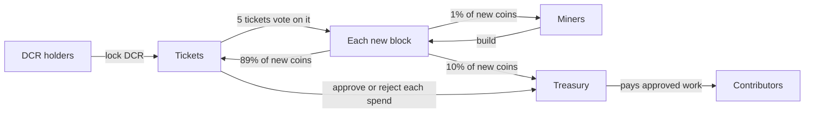

# What is Decred?

A plain-language picture of the whole Decred system for someone who has only heard the name: what it is for, who runs it, how it differs from Bitcoin, and what to read next.

## Decred in one paragraph

Decred is a cryptocurrency that has run since 8 February 2016. Its currency is DCR. Like Bitcoin, it is a public ledger kept by a network of independent computers and secured by miners. Unlike Bitcoin, the people who hold the currency have the final say. By locking DCR in *tickets*, holders vote on every block miners produce, on every change to the network's rules, and on every payment from a treasury that receives 10% of each block's new coins. The treasury funds development, so Decred does not depend on donations or a sponsoring company. Decred's own wallets also include coin mixing for privacy, trading without handing your coins to an exchange, and Lightning payments.

## The problem Decred set out to solve

Every cryptocurrency faces two questions that have little to do with technology.

**Who decides how the rules change?** In a currency secured only by proof of work (PoW), miners order transactions into blocks and also hold an effective veto over rule changes: a change takes hold only if miners build blocks that follow it. Holders, who live with the consequences, have no formal voice, and contested changes are settled by informal negotiation with no agreed procedure.

**Who pays for development?** A decentralized currency has no owner to pay its developers. Projects rely on donations, on companies whose interests may differ from the network's, or on a founders' allocation that eventually runs out.

Decred answers both with one mechanism: give holders a vote that is part of the consensus rules, and use that same vote to approve blocks, rule changes and spending.

## Who runs Decred

No company owns or controls Decred. Anyone can run a node, mine or buy tickets, and the software is open source (`dcrd`, `dcrwallet` and Decrediton use the ISC license). Most treasury spending pays independent contractors for programs of work that ticket holders approved.

The diagram below shows how the parts fit together: miners build blocks, holders lock DCR in tickets that vote on those blocks, and the treasury pays contributors only for spending those tickets approve. Only ticket holders vote on rule changes and treasury spending.

## Two groups that check each other

Decred combines proof of work with proof of stake (PoS), so every block needs both computation and votes:

1. A miner finds a block, as in Bitcoin.
2. That block draws five tickets at random from the pool of tickets eligible to vote. Every node computes the same five.
3. Each drawn ticket votes to approve or disapprove the block's ordinary transactions.
4. The next block is valid only if it includes at least three of those five votes. The miner's reward shrinks for each vote it leaves out.
5. Unless more of the included votes approve than disapprove (a tie counts as disapproval), the earlier block keeps its place in the chain, but its ordinary transactions are undone and its miner is not paid.

A miner who censors transactions, mines empty blocks or withholds blocks can have its reward voted away, and a chain built in secret cannot grow without votes from tickets that miner does not control. Ticket holders, in turn, cannot produce blocks without proof of work. [Miners, voters and the life of a block](life-of-a-block.md) walks through this step by step.

## DCR, the coin

The smallest unit of DCR is the *atom*: 1 DCR = 100,000,000 atoms.

- **Supply.** The total converges on about 21 million DCR; the whitepaper computes an upper bound of 21,000,015.55 DCR.
- **Issuance.** Each block creates new coins, the *block subsidy*. It started at 31.19582664 DCR per block and is multiplied by 100/101 every 6,144 blocks (about 21 days), shrinking a little at a time rather than halving. The last new coins are due around block 10.98 million, about a century after launch. [dcrdata](https://dcrdata.decred.org), the Decred block explorer, shows the current subsidy.
- **The first block.** Block 1 created 1.68 million DCR (8% of 21 million), half for the founding developers as compensation for work done before launch, and half airdropped in equal shares to 2,972 participants selected from those who signed up.
- **Where new coins go.** Each block's subsidy is split 1% to the miner, 89% to the five voting tickets and 10% to the treasury, a split ticket holders voted for (at launch it was 60/30/10). The miner also keeps the block's transaction fees.

[DCR supply and issuance](supply-and-issuance.md) covers the schedule and the first-block allocation in full.

## Tickets: One credential for staking and every vote

You take part by buying a ticket: a transaction that locks DCR until the ticket votes.

- **Price.** Everyone buying in the same 144-block (about 12-hour) interval pays the same *ticket price* (also called stake difficulty). The network sets it by comparing the number of live and immature tickets with the previous interval and with a target of 42,240, which aims to keep about 40,960 tickets live.
- **Waiting.** A new ticket is *immature* for 256 blocks (about 21 hours), then *live*. At the target pool size, a live ticket is drawn after 8,192 blocks (about 28 days) on average.
- **Voting.** A drawn ticket votes, and its holder gets the ticket price back plus 17.8% of the block subsidy (the voters' 89% shared five ways), spendable 256 blocks later.
- **Missing out.** A drawn ticket whose vote is not included is *missed*. A ticket not drawn within 40,960 blocks (about 142 days) *expires*, which happens to about 0.7% of tickets (fewer than 1 in 100) at the target pool size. Either way it is *revoked* automatically and returns the price without a reward.

A ticket votes only if a wallet is online when it is drawn, so most holders use a voting service provider (VSP), which votes for their tickets for a small fee and never holds their coins. Others run their own always-online wallet: solo voting.

The same vote carries the holder's choices on open rule changes and treasury spends, and the same ticket is the voting credential on Politeia, so staking and governance are one activity. [How staking works](../staking/index.md) covers tickets in detail.

## Self-funding: The decentralized treasury

Ten percent of every block's subsidy goes to the treasury, and anyone can add to it. Since 2021 the treasury has not been an address someone holds keys to; it is a balance tracked by the consensus rules, and coins leave it only through a *treasury spend* (TSPEND):

1. Only the holder of one of two Politeia keys written into the node software can create a TSPEND.
2. Ticket holders vote on it over 3,456 blocks (about 12 days).
3. It can be mined only once at least 20% of the votes possible in the window have been cast as yes or no, and the yes votes reach 60% of all votes cast plus all votes still possible in the window.
4. Even an approved spend must fit a consensus spending limit: since 2026, roughly 4% of the treasury balance in any 6,912-block period (about 24 days), with a fixed minimum allowance (DCP-0013).

The key holders can propose a payment but cannot take one, and ticket holders can block any payment. [The treasury](../governance/treasury.md) covers spending, the limit and auditing.

## How decisions are made

Tickets decide four kinds of question. Three are enforced by the consensus rules; the fourth sets direction.

| Decision | Who votes | Binding? |
|---|---|---|
| **Block approval**: do a block's ordinary transactions stand? | The five tickets drawn for each block; more included votes must approve than disapprove | Yes, by consensus |
| **Consensus rule votes**: should a new rule take effect? | Every ticket that votes in an 8,064-block (about 4-week) period; 75% of non-abstaining votes needed | Yes, by consensus |
| **Treasury spends**: should this payment leave the treasury? | Every ticket that votes in the 3,456-block (about 12-day) window; yes must reach 60%, with a 20% quorum | Yes, by consensus |
| **Politeia proposals**: should the project fund this work or adopt this policy? | Every ticket that was live 256 blocks (about 21 hours) before the vote started | No; it guides what the treasury pays for |

On Politeia, at proposals.decred.org, anyone can propose work or a policy, discuss it in public and put it to a ticket vote; administrators can remove spam, but only in a way the author can prove. A rule change is written up as a Decred Change Proposal (DCP), shipped dormant in the node software, and switched on only if the vote passes. [How Decred is governed](../governance/index.md) maps all four.

## Built in: Privacy, trading and Lightning

Three features that Bitcoin and many other cryptocurrencies leave to third-party tools are part of Decred's own software.

**StakeShuffle mixing.** Transactions on a public ledger are visible to everyone. A mixing wallet joins others in shared transactions with equal-sized outputs, so an observer cannot tell which output belongs to whom. Since 2024 mixing runs peer to peer through Decred nodes, with no central server. It breaks the trail between your old and new coins but does not make you anonymous: how you use the coins afterwards can still reveal you. The wallet must stay running and unlocked while it mixes. See [Privacy and mixing](../privacy/index.md).

**DCRDEX.** DCRDEX lets you trade DCR for other cryptocurrencies without depositing funds with an exchange. Trades settle as *atomic swaps*: the coins move directly between the two traders' wallets, or each side gets its coins back. Servers collect no trading fees, and accounts are secured by a *fidelity bond*, a refundable time-locked deposit. The app is Bison Wallet; Decrediton includes the same client. See [DCRDEX: Trading without custody](../dex/index.md).

**Lightning.** Payment channels let two parties make many small payments off chain and settle the result later. Decred's Lightning node, `dcrlnd`, ships with the command-line tools, and Decrediton runs it for you. Funds in a channel depend on a wallet that stays online and is properly backed up. See [Lightning on Decred](../lightning/index.md).

In Decrediton, the desktop wallet, these features have their own sidebar entries: **Staking**, **Privacy and Security**, **Governance**, **Lightning Transactions** and **DEX**.

## Decred and Bitcoin side by side

Decred's code descends from Bitcoin's. These are the differences that matter most to users.

| | Bitcoin | Decred |
|---|---|---|
| Target block time | 10 minutes | 5 minutes |
| What makes a block valid | Proof of work alone | Proof of work, plus votes from at least 3 of 5 drawn tickets |
| Who decides rule changes | Miner signaling, or a date or height chosen by developers | An on-chain ticket vote: 75% of non-abstaining votes, with a quorum |
| Development funding | None in the protocol | 10% of each block's subsidy, spent only with ticket holder approval |
| Issuance | Halves every 210,000 blocks (about 4 years); about 21 million in total | Falls by 1/101 every 6,144 blocks (about 21 days); about 21 million in total |
| Proof-of-work hash | Double SHA-256 | BLAKE3 (BLAKE-256 until 2023) |
| Mixing | Not part of the node software | StakeShuffle, relayed peer to peer by the nodes, in the official wallets |

The whitepaper's [differences from Bitcoin](../../whitepaper/C-bitcoin-differences.md#ch:bitcoin-differences) appendix goes down to scripts and serialization.

## Milestones

Every change below except the launch, Politeia and peer-to-peer mixing was decided by a ticket vote.[^dates]

- **2016**: Mainnet launches on 8 February.
- **2017**: The first consensus rule vote takes effect in July, replacing the ticket price algorithm.
- **2018**: Politeia goes live in October.
- **2021**: The decentralized treasury takes effect in May.
- **2022**: In May, missed and expired tickets start being revoked automatically, and the subsidy split moves from 60/30/10 to 10/80/10.
- **2023**: In August, mining switches to the BLAKE3 hash and the split moves to 1/89/10.
- **2024**: In May, version 2.0 makes StakeShuffle mixing fully peer to peer.
- **2026**: In February, the treasury spending limit becomes a share of the treasury balance (DCP-0013).

[A short history of Decred](../reference/history.md) tells the full story, including the premine.

## What to keep in mind

Holding your own coins means the consequences are yours:

- **Your seed is your money.** A wallet's seed (33 words in Decrediton and `dcrwallet`) restores your coins. Anyone who has it can take them, and if you lose it nobody can recover it for you.
- **Tickets lock your DCR.** A ticket cannot be cancelled. Your coins stay locked until it votes or is revoked: up to about 142 days, plus the 256-block maturity periods.
- **Rewards are not guaranteed.** The ticket price, the reward and the wait all change with the network, and a missed or expired ticket earns nothing.
- **Software must be kept current.** Some releases are mandatory: version 2.1.6 fixed a critical consensus flaw, and nodes that did not upgrade risked being forked off the network. See [Upgrading and mandatory releases](../run/upgrades.md).
- **Coins on an exchange are not in your control.** Until you withdraw them, the exchange can freeze or lose them. See [Get DCR](get-dcr.md).

## Go deeper

- [Motivation](../../whitepaper/01-intro.md#sec:intro-motivation): the governance and funding problems Decred was built to solve.
- [The system at a glance](../../whitepaper/01-intro.md#sec:intro-overview): the roles of miners, stakeholders, full nodes and light clients.
- [Main-network vote history](../../whitepaper/13-voting.md#sec:voting-history): every consensus rule vote so far, with block heights and results.

## Next steps

- [Miners, voters and the life of a block](life-of-a-block.md): the next page for newcomers, on how a block is built and approved.
- [Your first Decred wallet](first-wallet.md): install a verified wallet and make a first small transaction.
- [How staking works](../staking/index.md): what happens to your DCR when you buy a ticket.
- [How Decred is governed](../governance/index.md): every decision tickets make, from block approval to funding.
- [Glossary](../reference/glossary.md): plain definitions of every term used here.

[^dates]: Dates mark the first block under the new rules, per dcrdata: blocks 149,248 (9 July 2017), 552,448 (8 May 2021), 657,280 (8 May 2022), 794,368 (29 August 2023) and 1,052,416 (8 February 2026). Politeia went live on 15 October 2018, and dcrd 2.0.0 was released on 17 May 2024.

*[PoW]: proof of work
*[PoS]: proof of stake
*[VSP]: voting service provider
*[TSPEND]: treasury spend
*[DCP]: Decred Change Proposal
*[DCRDEX]: Decred's decentralized exchange protocol and server network
