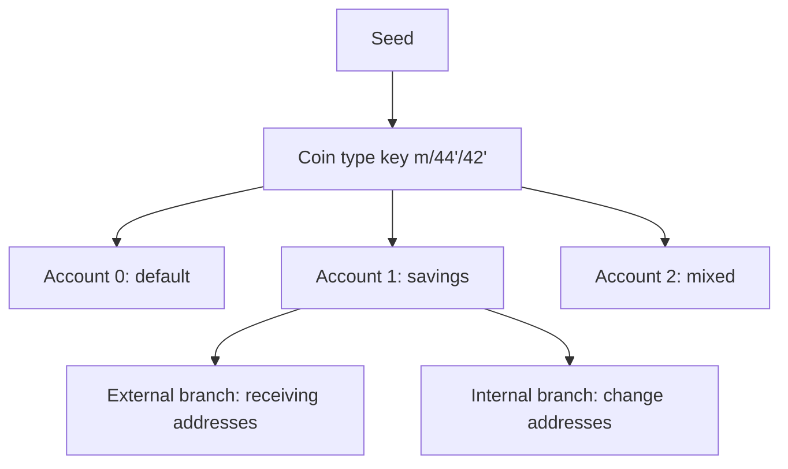

# Manage accounts and passphrases

This page shows how to organize a Decred wallet into accounts, read its balance figures, and change the passphrases that protect it, in Decrediton, Bison Wallet or the command-line wallet.

!!! info "Applies to"
    Decrediton 2.1.7, Bison Wallet 1.0.6 and dcrwallet 2.1.7. Checked November 2026.

## Before you start

- A working wallet: [Decrediton](decrediton.md), [Bison Wallet](bison-wallet.md), or `dcrwallet` with `dcrctl` set up as in [Set up the command-line wallet](command-line.md).
- Your private passphrase (in Bison Wallet, your app password).
- Your seed written down and checked, as in [Back up and restore your wallet](back-up-and-restore.md). Do this before you change any passphrase.
- A wallet that can sign. Watching-only wallets, including Trezor- and Ledger-backed wallets in Decrediton, cannot create accounts and have no private passphrase.

The command-line examples use `promptsecret` from the command-line bundle. It prints `Secret:`, reads what you type without showing it, and hands it to `dcrctl` wherever a `-` appears, keeping passphrases out of your shell history.

## Why use more than one account

An account is a separate set of addresses with its own balance, like separate envelopes in one wallet. Every account except the `imported` account comes from the same seed, so one backup covers them all, and anyone with the seed controls them all. Keys imported into a wallet are not in the seed and need their own backup. [How a Decred wallet works](how-wallets-work.md) explains seeds, keys and addresses.

Each account is one branch of the seed's key tree, with its own receiving and change addresses, as the whitepaper's sections on [hierarchical deterministic keys](../../whitepaper/05-addresses.md#sec:addresses-hd) and the [wallet account structure](../../whitepaper/05-addresses.md#sec:addresses-bip44) define:



Common reasons to add accounts:

- **Separate purposes**: savings, spending or business funds kept apart.
- **Staking**: a dedicated account for buying tickets.
- **Mixing**: StakeShuffle mixing uses a mixed and an unmixed account, which Decrediton and Bison Wallet create for you; see [Mix your DCR](../privacy/mix-your-dcr.md).
- **Lightning**: Decrediton recommends a dedicated account, because a running Lightning wallet keeps its keys unencrypted in memory and controls all funds in that account.

Moving DCR between your own accounts is an ordinary on-chain transaction: it pays a transaction fee and is public. Account names live only in your wallet file, not in the seed.

## Read the balance figures

=== "Decrediton"

    Open **Accounts** and click an account: its figures appear under **Balances**.

=== "Command line"

    ```bash
    dcrctl --wallet getbalance
    ```

    Every account is listed under `balances`, followed by wallet-wide totals. Add a name (`dcrctl --wallet getbalance savings`) to see one account.

Both show the same figures:

| Decrediton label | `getbalance` field | Meaning |
|---|---|---|
| **Spendable** | `spendable` | DCR you can send now. |
| **Immature Rewards** | `immaturecoinbaserewards` | Mining rewards still maturing (256 blocks, about 21 hours). Zero unless you mine. |
| **Locked By Tickets** | `lockedbytickets` | DCR committed to your tickets. It returns when each ticket votes or is revoked. |
| **Voting Authority** | `votingauthority` | The value of tickets this wallet can vote with. Not added to **Total**: those funds are already in **Locked By Tickets**, or held elsewhere for a voting-only wallet. |
| **Immature Staking Rewards** | `immaturestakegeneration` | Returned ticket funds and vote rewards waiting out the 256-block maturity. |
| **Unconfirmed** | `unconfirmed` | Incoming or change amounts that do not count as spendable yet. |
| **Total** | `total` | All of the above except **Voting Authority**. |

When a ticket votes, its funds leave **Locked By Tickets**, wait with the vote reward under **Immature Staking Rewards**, and become **Spendable** 256 blocks later; [How staking works](../staking/index.md) explains the ticket cycle.

Decrediton's account list counts a payment as **Spendable** as soon as it is broadcast, so **Unconfirmed** there is usually zero. `getbalance` waits for one confirmation by default, so an unmined payment shows under `unconfirmed`.

## Create an account

=== "Decrediton"

    1. Open **Accounts** in the sidebar and click **Add New**.
    2. In **Create new account**, enter your **Private Passphrase** and a **New Account Name**.
    3. Click **Continue**.

    You should see "Successfully created a new account." and the account in the list.

=== "Command line"

    The wallet must be unlocked. Unlock it for 60 seconds, then create the account:

    ```bash
    promptsecret | dcrctl --wallet walletpassphrase - 60
    dcrctl --wallet createnewaccount savings
    ```

    Both commands print nothing on success.

Bison Wallet does not let you create or rename DCR accounts. It manages them itself: the default account, plus accounts named `mixed` and `dextrading` for mixing and trading.

With default settings, the wallet refuses a new account when the last 10 accounts have never received DCR; the error ends with "last 10 accounts have no transaction history". Fund one of the empty accounts first. This rule lets a restore find all your accounts.

## Rename an account

=== "Decrediton"

    1. Open **Accounts** and click the account.
    2. Click the icon whose tooltip reads **Rename Account**.
    3. Type the **New Account Name** (up to 50 characters) and click **Rename**.

    You should see "Successfully renamed account.". The default account shows as **Primary Account** until renamed. The imported account and the account used by the decentralized exchange (DEX) cannot be renamed.

=== "Command line"

    ```bash
    dcrctl --wallet renameaccount savings longterm
    ```

    No unlock is needed, and nothing is printed on success.

!!! warning "Accounts named in dcrwallet.conf"
    If `dcrwallet.conf` names the account (in `purchaseaccount`, `changeaccount`, `mixedaccount` (as name/branch), `ticketsplitaccount` or `ticketbuyer.votingaccount`), update the file too. Otherwise, when the ticket buyer, `mixchange` or a voting service provider (VSP, set with `vsp.url`) is enabled, `dcrwallet` stops at startup with an error that the account cannot be found. `purchaseaccount` is `default` unless you set it.

Decrediton's **Hide** button removes an empty account from its lists. That is a Decrediton display setting; the account still exists.

## View an account's extended public key

An extended public key (xpub) lets software derive every address of one account, for example in a watch-only tool. On mainnet it begins with `dpub`.

=== "Decrediton"

    1. Open **Accounts** and click the account.
    2. Under **Properties**, read the **Account number** and **HD Path**, for example `m / 44' / 42' / 1'`.
    3. Click the icon whose tooltip reads **Reveal Pubkey**. The key appears under **Extended Public Key**, with a copy button.

    On mainnet, **HD Path** always shows coin type 42 (on testnet, 1). An old wallet may still use the legacy coin type 20; `dcrctl --wallet walletinfo` shows the one in use as `cointype`.

=== "Command line"

    ```bash
    dcrctl --wallet getmasterpubkey savings
    ```

    Without a name, you get the default account's key. Accounts are numbered in creation order, starting at 0 for the default account.

!!! danger "Never share the extended public key of these accounts"
    - **Any account you bought tickets from through a VSP.** For every ticket, the VSP receives a private voting key derived from that account. The xpub plus any one private key of the same account reveals every private key of the account.
    - **A mixed account.** The xpub lists all its addresses, linking every mixed output back together.

    An xpub cannot spend, but it reveals every address of the account and so its whole history. Give it only to software you run. See [Privacy beyond mixing](../privacy/privacy-practices.md).

## Accounts after a restore

A restore from seed scans the blockchain for used accounts and stops once it finds 10 unused accounts in a row. This account gap limit is a wallet default, not a network rule. The restore brings back:

- every account up to the last one that ever received DCR, named `account-1`, `account-2` and so on by account number, including empty accounts in between (the default account keeps its name);
- none of the empty accounts created after the last used account, because nothing on the blockchain shows they exist.

To get a missing trailing empty account back, create it again: accounts are derived in order, so it gets the same number and keys as before. Then rename your accounts.

A wallet that used a higher `accountgaplimit` than `10` needs the same value in `dcrwallet.conf` when restored; Decrediton has no such setting. For missing funds, see [Back up and restore your wallet](back-up-and-restore.md).

## Change the private passphrase

The private passphrase encrypts the keys that sign transactions. Changing it re-encrypts them in your wallet file.

=== "Decrediton"

    1. Click **Settings** at the bottom of the sidebar and open the **Privacy and Security** tab.
    2. Under **Private Passphrase**, click **Update Private Passphrase**.
    3. In **Change your passphrase**, enter the current **Private Passphrase**, then the **New Private Passphrase** and again under **Confirm**.
    4. If you use the DEX in Decrediton, also enter your **DEX App Passsword** (spelled this way in the app) so the DEX wallet gets the change too.
    5. Click **Continue**.

    You should see "Successfully changed private passphrase.". Decrediton also moves every account's own passphrase to the new value.

=== "Bison Wallet"

    1. Open **Settings** and click **Change App Password**.
    2. Enter your **Current Password**, then **New Password** and **Confirm New Password**.
    3. Click **Submit**.

    Bison Wallet's built-in DCR wallet has no passphrase for you to manage: Bison Wallet derives it from your app seed and keeps it encrypted with your app password.

=== "Command line"

    ```bash
    promptsecret -n 2 | dcrctl --wallet walletpassphrasechange - -
    ```

    At the two `Secret:` prompts, type the **old** passphrase, then the **new** one. Nothing is printed on success. `promptsecret` does not ask for the new passphrase twice, so test it at once; no output means it works:

    ```bash
    promptsecret | dcrctl --wallet walletpassphrase - 1
    ```

    Accounts with their own passphrase (see below) keep it. On a wallet that Decrediton has opened, every account has its own passphrase, so change the private passphrase in Decrediton instead. If you already changed it here, move each account across: unlock it with the **old** passphrase, then set the **new** one.

    ```bash
    promptsecret | dcrctl --wallet unlockaccount <ACCOUNT> -
    promptsecret | dcrctl --wallet setaccountpassphrase <ACCOUNT> -
    ```

    Replace `<ACCOUNT>` with the account name, and repeat for every account that `dcrctl --wallet getbalance` lists, except `imported`.

## Change the public passphrase

The optional public passphrase encrypts the public keys in the wallet file, including each account's xpub, and `dcrwallet` cannot open the file without it. It protects nothing you can spend and does not encrypt the transaction records. Without one, the wallet uses the built-in value `public`.

Only the command line can add or change it:

```bash
promptsecret -n 2 | dcrctl --wallet walletpubpassphrasechange - -
```

Type the old public passphrase first (`public` if you never set one), then the new one. From then on, start `dcrwallet` with `--promptpublicpass`, or put `walletpass=` in `dcrwallet.conf`, where anyone who can read the file can read it. Decrediton cannot set one, but asks for the **Public Passphrase** when it opens a wallet that has one.

## What a new passphrase does not protect

!!! danger "Your seed and old wallet files are not affected"
    - **A leaked seed** gives full control of every account, whatever the passphrase.
    - **Old copies of the wallet file** still open with the old passphrase.

    If your seed, or an old wallet file and its passphrase, may have been exposed, create a new wallet with a new seed and send your funds to it. Keep the old wallet running until any live tickets have voted. See [Keep your DCR safe](../security/index.md).

A forgotten private passphrase cannot be reset, but the funds are not lost: restore the wallet from its seed and choose a new passphrase. See [Wallet troubleshooting](troubleshooting.md).

## Give one account its own passphrase (command line)

`dcrwallet` can protect one account with a separate passphrase that the wallet passphrase does not unlock. Use it when the wallet stays unlocked for long periods, for example for automatic ticket buying, and you want a "cold" account that nothing running can spend.

| Command | Accounts on the wallet passphrase | Accounts with their own passphrase |
|---|---|---|
| `walletpassphrase` | Unlocks them | Stay locked |
| `unlockaccount` | Error: not encrypted with a unique passphrase | Unlocks the account, with no timeout |
| `lockaccount` | Error | Locks the account; `"*"` locks all of them |
| `walletlock` | Locks them | Locks them too, if the wallet itself was unlocked |
| `walletpassphrasechange` | Re-encrypts them | Keep their own passphrase |

To set it up for an account named `cold`:

1. Unlock the wallet briefly:
    ```bash
    promptsecret | dcrctl --wallet walletpassphrase - 60
    ```
2. Set the account's passphrase, one that differs from the wallet's:
    ```bash
    promptsecret | dcrctl --wallet setaccountpassphrase cold -
    ```
3. While the account is still unlocked, check what you typed. No output means it matches; an error means repeat step 2.
    ```bash
    promptsecret | dcrctl --wallet unlockaccount cold -
    ```
4. Lock the account and the wallet:
    ```bash
    dcrctl --wallet lockaccount cold
    dcrctl --wallet walletlock
    ```

To spend from `cold`, run `unlockaccount cold -` as in step 3, send as in [Send and receive DCR](send-and-receive.md), then run `lockaccount cold`; the rest of the wallet can stay locked. To put the account back on the wallet passphrase, unlock both, run `setaccountpassphrase cold -` and press ++enter++ at the prompt without typing anything.

Limits:

- The seed still controls the account. A forgotten account passphrase means restoring from seed.
- The ticket buyer and mixer, and `--pass` or `--promptpass` at startup, unlock only with the wallet passphrase. Do not give a separate passphrase to an account they spend from.
- Decrediton gives every account its own passphrase, equal to your private passphrase, and expects them to stay equal. Do not set a different one on a wallet you also open in Decrediton.

## When the wallet must stay unlocked

Some features sign in the background, so their keys must stay available.

| Feature | What must be unlocked | For how long |
|---|---|---|
| Mixing | The mixed and unmixed accounts | While the mixer runs |
| Automatic ticket buying | The purchase account | While the ticket buyer runs |
| VSP fee payment | The account each ticket's funds return to | Until that ticket's VSP fee is paid |
| Solo voting | The whole voting wallet | Always |
| Politeia proposal votes | The account that holds the tickets | Only while you cast the vote |

**Decrediton** asks for your passphrase per action and locks the accounts again afterwards, except as in the table and for the DEX account, which it never locks. Each account's **Lock status** under **Properties** shows its state.

**On the command line**, `walletpassphrase` takes a timeout in seconds; `0`, or starting `dcrwallet` with `--promptpass`, leaves the wallet unlocked until `walletlock` or shutdown. `--enableticketbuyer` asks for the private passphrase at startup unless `pass=` is set in `dcrwallet.conf` (in plain text), and either way leaves the wallet unlocked. While it is unlocked, any program with the wallet's remote procedure call (RPC) credentials can spend from it, so keep one-off unlocks short.

## Check that it worked

- **New or renamed account**: it appears under Decrediton's **Accounts** or in `dcrctl --wallet getbalance`.
- **New private passphrase**: the new one unlocks the wallet and the old one fails.
- **Account passphrase**: `dcrctl --wallet accountunlocked cold` shows the following. An account on the wallet passphrase shows only `"encrypted": false`.

    ```json title="Expected output"
    {
      "encrypted": true,
      "unlocked": false
    }
    ```

## Troubleshooting

### "last 10 accounts have no transaction history"

You have 10 empty accounts in a row. Receive DCR into one of them before creating another.

### Accounts stay locked after walletpassphrase

Those accounts have their own passphrase, which is normal for a wallet that Decrediton has opened. Unlock each with `unlockaccount`, using your private passphrase.

### "Update passphrase failed. Incorrect private passphrase, please try again."

Decrediton rejected the current passphrase in the first field. Check the keyboard layout and Caps Lock. If you no longer know it, restore from seed.

## Next steps

- [Mix your DCR](../privacy/mix-your-dcr.md): set up the mixed and unmixed accounts.
- [Stake with Decrediton or Bison Wallet](../staking/stake.md): buy tickets from a dedicated staking account.
- [Back up and restore your wallet](back-up-and-restore.md): what a seed restore brings back.
- [Cold storage with an offline wallet](../security/cold-storage.md): stronger separation than an account passphrase.
- [Privacy beyond mixing](../privacy/privacy-practices.md): keep accounts and addresses from being linked.

*[VSP]: voting service provider
*[DEX]: decentralized exchange
*[RPC]: remote procedure call
*[xpub]: extended public key
*[HD]: hierarchical deterministic
