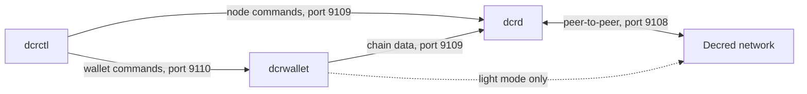

# Set up the command-line wallet

This guide sets up the Decred command-line suite for people comfortable in a terminal: a full node, a wallet connected to it through short config files, and the everyday commands. For a graphical wallet, see [Install and use Decrediton](decrediton.md) or [Install and set up Bison Wallet](bison-wallet.md).

!!! info "Applies to"
    dcrd, dcrwallet and dcrctl 2.1.7 (Decred release v2.1.7) and dcrinstall v2.1.7. Checked November 2026.

## Before you start

- A computer running Windows, macOS, Linux, FreeBSD or OpenBSD, and a terminal you know how to use.
- For full-node mode: free disk space for the whole blockchain, which keeps growing, and time for the first sync. [Run a full node](../run/full-node.md) lists current requirements.
- Paper and a pen for the wallet seed. [How a Decred wallet works](how-wallets-work.md) explains the seed and the two passphrases.

## What the suite contains

The command-line download (the `decred` archive) contains:

| Program | What it does |
|---|---|
| `dcrd` | Full node: checks and relays blocks and transactions. |
| `dcrwallet` | Wallet daemon: holds your keys, signs transactions, buys tickets and votes. |
| `dcrctl` | Sends one command to `dcrd` or `dcrwallet` and prints the reply. |
| `promptsecret` | Reads a secret without echoing it and pipes it to another program. |
| `gencerts` | Creates certificates for custom remote setups. |
| `dcrlnd`, `dcrlncli` | Lightning node and client (dcrlnd v0.8.1, as shipped in the v2.1.7 bundle). |
| `politeiavoter`, `politeiaverify` | Vote on Politeia proposals; verify Politeia records. |

Its sample config files (`sample-dcrd.conf`, `sample-dcrwallet.conf`, `sample-dcrctl.conf` and others) list the most common options, commented out with `;`. The full lists are in [dcrd configuration](../../dev/reference/dcrd-config.md) and [dcrwallet configuration](../../dev/reference/dcrwallet-config.md).

### How the programs fit together

`dcrctl` talks to both daemons over remote procedure calls (RPC) encrypted with Transport Layer Security (TLS). `dcrwallet` gets the chain either from your own `dcrd` or, as a light wallet (SPV, simplified payment verification; see [step 4](#4-run-dcrwallet)), directly from network peers.



Three things must match:

- **RPC credentials**: `rpcuser`/`rpcpass` in `dcrd.conf` and `dcrctl.conf`, `username`/`password` in `dcrwallet.conf` (used both to log in to `dcrd` and to protect the wallet's own RPC server). Use one pair everywhere. They are not your wallet passphrase.
- **Certificates**: each daemon creates a self-signed `rpc.cert` in its home folder on first start, where the others find it.
- **Network**: the same for all three (mainnet by default, or testnet).

!!! tip "Typing the commands"
    If the programs are not on your `PATH`, run them from their folder (`./dcrd`, or `.\dcrd.exe` in PowerShell). `dcrd` and `dcrwallet` run in the foreground: give each its own terminal and stop it with ++ctrl+c++.

## 1. Download, verify and install

**dcrinstall** downloads, verifies and configures everything, and creates your wallet. The **release archive** is the manual route, for full control over each file. Either way, verify your download first (manifest signature, then file hash), as [Verify your download](../security/verify-downloads.md) shows for every operating system.

### Option A: dcrinstall

Download `dcrinstall` for your system from the [decred-release v2.1.7 release page](https://github.com/decred/decred-release/releases/tag/v2.1.7), with `dcrinstall-v2.1.7-manifest.txt` and its `.asc` signature, verify it, and run it from a terminal:

=== "Windows"

    Pick `dcrinstall-windows-amd64-v2.1.7.exe` (or the `386` or `arm64` build). Run it from PowerShell, not by double-clicking, so the window stays open:

    ```powershell
    cd $env:USERPROFILE\Downloads
    .\dcrinstall-windows-amd64-v2.1.7.exe
    ```

=== "macOS"

    Pick `dcrinstall-darwin-arm64-v2.1.7` for Apple silicon or `dcrinstall-darwin-amd64-v2.1.7` for Intel.

    ```bash
    cd ~/Downloads
    chmod u+x dcrinstall-darwin-arm64-v2.1.7
    ./dcrinstall-darwin-arm64-v2.1.7
    ```

    If macOS refuses to open it because it cannot verify the developer, then, only after verifying the file, click **Open Anyway** under **System Settings** > **Privacy & Security**, or remove the download flag and run it again:

    ```bash
    xattr -d com.apple.quarantine dcrinstall-darwin-arm64-v2.1.7
    ```

=== "Linux"

    Pick the build for your processor: `amd64`, `386`, `arm`, `arm64` or `riscv64` (FreeBSD and OpenBSD builds work the same way).

    ```bash
    cd ~/Downloads
    chmod u+x dcrinstall-linux-amd64-v2.1.7
    ./dcrinstall-linux-amd64-v2.1.7
    ```

dcrinstall then:

1. Stops if a newer dcrinstall exists and asks you to download it.
2. Downloads the release manifests, checks their signatures with its built-in release key, and checks each archive's hash.
3. Copies the programs, plus Bison Wallet (`bisonw`, `bwctl`), to `~/decred` (`%USERPROFILE%\decred` on Windows), and logs to `dcrinstall.log` in that folder.
4. Writes mainnet config files for `dcrd`, `dcrwallet`, `dcrctl`, `dcrlnd` and `politeiavoter` with one RPC username (your system user name) and a random password.
5. Runs `dcrwallet --create`. Follow [step 3](#3-create-a-wallet), then continue with step 2.

Its closing messages include one saying that a Lightning wallet could not be created; ignore it unless you plan to use Lightning. To upgrade later, stop every program it installed (`dcrd`, `dcrwallet`, and also `dcrlnd`, `politeiavoter` or Bison Wallet if you run them) and run a newer dcrinstall; when its config files already exist, it replaces only the programs ([Upgrading and mandatory releases](../run/upgrades.md)).

### Option B: the release archive

From the [decred-binaries v2.1.7 release page](https://github.com/decred/decred-binaries/releases/tag/v2.1.7), download your system's archive plus `decred-v2.1.7-manifest.txt` and its `.asc` signature, verify the archive, and extract it:

=== "Windows"

    Download `decred-windows-amd64-v2.1.7.zip` (or the `386` or `arm64` build):

    ```powershell
    cd $env:USERPROFILE\Downloads
    Expand-Archive decred-windows-amd64-v2.1.7.zip -DestinationPath .
    cd decred-windows-amd64-v2.1.7
    ```

=== "macOS"

    Download `decred-darwin-arm64-v2.1.7.tar.gz` (Apple silicon) or `decred-darwin-amd64-v2.1.7.tar.gz` (Intel):

    ```bash
    cd ~/Downloads
    tar -xzf decred-darwin-arm64-v2.1.7.tar.gz
    cd decred-darwin-arm64-v2.1.7
    ```

    These programs are not signed by an identified developer, so macOS may refuse to run them. Only after verifying the archive, remove the download flag from the extracted folder:

    ```bash
    xattr -dr com.apple.quarantine .
    ```

=== "Linux"

    Download `decred-linux-amd64-v2.1.7.tar.gz` or the build for your processor (`386`, `arm`, `arm64`, `riscv64`; FreeBSD and OpenBSD archives follow the same pattern):

    ```bash
    cd ~/Downloads
    tar -xzf decred-linux-amd64-v2.1.7.tar.gz
    cd decred-linux-amd64-v2.1.7
    ```

Check that the programs run:

```bash
dcrd --version
```

```text title="Expected output"
dcrd version 2.1.7+release (Go version <GO VERSION> <OS>/<ARCH>)
```

## 2. Start dcrd and let it sync

Skip this step if you only want a light wallet, and continue with [step 3](#3-create-a-wallet).

```bash
dcrd
```

If no `dcrd.conf` exists yet, `dcrd` writes one on its first start with a random `rpcuser` and `rpcpass`, so its RPC server is enabled at once, listening only on this computer. It also logs `Generating TLS certificates...` as it creates `rpc.cert` and `rpc.key`.

It then downloads the chain; its `SYNC: Processed ... blocks` log lines show the height and a `progress` percentage. The first sync can take a long time. It is done when you see:

```text title="Expected output"
[INF] SYNC: Initial chain sync complete (hash <BLOCK HASH>, height <HEIGHT>)
```

Leave `dcrd` running. You can continue while it syncs; the wallet waits for it.

## 3. Create a wallet

dcrinstall users have already done this step. Everyone else, in a new terminal:

```bash
dcrwallet --create
```

The wallet asks a short series of questions:

```text title="Wallet creation prompts"
Enter the private passphrase for your new wallet:
Confirm passphrase:
Do you want to add an additional layer of encryption for public data? (n/no/y/yes) [no]:
Do you have an existing wallet seed you want to use? (n/no/y/yes) [no]:
Your wallet generation seed is:
WORD01 WORD02 WORD03 WORD04 WORD05 WORD06
(five more lines, 33 words in all)

Hex: <64 HEX CHARACTERS>
IMPORTANT: Keep the seed in a safe place as you
will NOT be able to restore your wallet without it.
(more warning text)
Once you have stored the seed in a safe and secure location, enter "OK" to continue:
Do you have an additional account to import from an extended public key? (enter account name, or 'no') [no]:
Creating the wallet...
The wallet has been created successfully.
```

1. **Private passphrase**: choose a strong, unique one. It encrypts your private keys and is needed to send, buy tickets and vote. Nothing is shown as you type.
2. **Public data encryption**: press ++enter++. A public passphrase hides your addresses and transactions in the wallet file, but must be supplied at every start (`--promptpublicpass`).
3. **Existing seed**: press ++enter++. To restore instead, see [Back up and restore your wallet](back-up-and-restore.md).
4. **Seed**: write all 33 words on paper, in order (the hex line is the same seed). Type `OK` only after checking them.
5. **Extra account**: press ++enter++.

!!! danger "Your seed is your money"
    Anyone who has the 33 words can take every coin in the wallet; if you lose them and the wallet file, nobody can recover your funds. Keep the paper offline and private. Never type the seed into a website, chat or "support" form; only an official wallet's restore prompt needs it.

The program creates `mainnet/wallet.db` in the dcrwallet home folder (see [where files live](#where-config-and-data-live)) and exits.

## 4. Run dcrwallet

`dcrwallet` needs a config file with RPC credentials. dcrinstall users already have one: for a light wallet add `spv=1` to it (see [Light mode](#light-mode-no-dcrd)), otherwise skip to [Start the wallet](#start-the-wallet).

### Full-node mode

Use the credentials `dcrd` generated. Show them:

=== "Windows"

    ```powershell
    Select-String -Path "$env:LOCALAPPDATA\Dcrd\dcrd.conf" -Pattern '^rpc(user|pass)='
    ```

=== "macOS"

    ```bash
    grep -E '^rpc(user|pass)=' ~/Library/Application\ Support/Dcrd/dcrd.conf
    ```

=== "Linux"

    ```bash
    grep -E '^rpc(user|pass)=' ~/.dcrd/dcrd.conf
    ```

Create `dcrwallet.conf` in the dcrwallet home folder (see [where files live](#where-config-and-data-live)) with this content:

```ini title="dcrwallet.conf"
[Application Options]
username=<RPCUSER>
password=<RPCPASS>
```

`<RPCUSER>` and `<RPCPASS>` are the `rpcuser` and `rpcpass` values from `dcrd.conf`. The wallet connects to `dcrd` on `localhost:9109` and uses `dcrd`'s `rpc.cert` automatically.

### Light mode (no dcrd)

A light wallet skips `dcrd`: it downloads block headers and compact filters from peers and fetches only the blocks that concern your wallet ([the whitepaper's light client model](../../whitepaper/16-filters.md#sec:filters-spv)). It is ready far sooner and needs far less disk space, but cannot vote on tickets itself (dcrwallet refuses `--spv` with `--enablevoting`), so light-wallet stakers use a voting service provider (VSP).

Without dcrinstall there is no `dcrd.conf`, so choose your own username and a long random password, and enable light mode:

```ini title="dcrwallet.conf"
[Application Options]
spv=1
username=<RPCUSER>
password=<RPCPASS>
```

### Start the wallet

```bash
dcrwallet
```

On its first start, a new wallet asks for the private passphrase once to find your accounts:

```text title="Expected output"
*** ATTENTION ***
Since this is your first time running we need to sync accounts. Please enter
the private wallet passphrase. This will complete syncing of the wallet
accounts and then leave your wallet unlocked. You may relock wallet after by
calling 'walletlock' through the RPC.
*****************
Enter private passphrase:
```

If `dcrd` is still syncing, the wallet logs `Waiting for dcrd instance to catch up to minimum block height` and continues on its own. In full-node mode it is ready when it logs `SYNC: Blockchain sync completed, wallet ready for general usage.` Leave it running.

## 5. Configure dcrctl

dcrinstall users already have a `dcrctl.conf` with the right credentials.

**Full-node mode:** nothing to write. On its first run, `dcrctl` creates `dcrctl.conf` and copies `rpcuser` and `rpcpass` from `dcrd.conf` into it. The wallet uses the same pair, so wallet commands work too:

```bash
dcrctl getblockchaininfo
```

`"initialblockdownload": false` in the reply means the node is synced.

**Light mode:** create `dcrctl.conf` in the dcrctl home folder (create the folder if needed) with the same values as `dcrwallet.conf`:

```ini title="dcrctl.conf"
[Application Options]
rpcuser=<RPCUSER>
rpcpass=<RPCPASS>
```

Add `--wallet` to send a command to `dcrwallet` (port 9110, its own certificate); without it, the command goes to `dcrd` (port 9109). In light mode only `--wallet` commands work.

## 6. Unlock and lock the wallet

Balances and new addresses work while the wallet is locked; sending, buying tickets and voting need it unlocked. To unlock without the passphrase showing on screen or in your shell history, pipe it from `promptsecret`:

```bash
promptsecret | dcrctl --wallet walletpassphrase - 300
```

Type the passphrase at the `Secret:` prompt. The `-` makes `dcrctl` read that argument from the pipe; `300` is the number of seconds until the wallet locks itself (`0` means until you lock it or stop the wallet). No output means success. To lock it again:

```bash
dcrctl --wallet walletlock
```

To unlock at startup instead, run `dcrwallet --promptpass` (or set `promptpass=1` in `dcrwallet.conf`): it asks for the passphrase and stays unlocked without a timeout. A wallet that buys tickets automatically or votes must stay unlocked.

!!! warning "Unlocked means spendable"
    Anything that reaches an unlocked wallet's RPC port with the credentials can spend from it. Keep the RPC on localhost (the default) and lock the wallet when done. The `pass=` option stores the private passphrase in plain text; the sample config advises it only for voting-only or low-balance wallets. Never put a passphrase on the command line.

## 7. Everyday commands

| Command | What it does |
|---|---|
| `dcrctl --wallet getbalance` | Balances per account (`spendable`, `unconfirmed`, `lockedbytickets`, `total` and more), in DCR. |
| `dcrctl --wallet getnewaddress` | A new receiving address in the `default` account; use a fresh one per payment. |
| `dcrctl --wallet sendtoaddress <ADDRESS> <AMOUNT>` | Sends `<AMOUNT>` DCR from the `default` account and prints the transaction ID (wallet must be unlocked). |
| `dcrctl --wallet listtransactions` | Your 10 most recent transactions; `listtransactions "*" 50` shows 50. |
| `dcrctl --wallet getstakeinfo` | Your tickets (immature, unspent, voted, revoked; full-node mode adds live, missed, expired and the network's ticket pool size) and the ticket price (`difficulty`, also called stake difficulty). |
| `dcrctl getblockchaininfo` | The node's chain height and sync state (full-node mode; light wallets use `dcrctl --wallet syncstatus`). |
| `dcrctl --wallet walletinfo` | Whether the wallet is connected (`daemonconnected`) or in light mode (`spv`), and whether it is `unlocked`. |
| `dcrctl -l` and `dcrctl --wallet help <METHOD>` | Lists every command; shows the parameters of one. |

`<ADDRESS>` is the recipient's address (mainnet addresses start with `D`, usually `Ds`), `<AMOUNT>` a number of DCR such as `1.5`, and `<METHOD>` a command name. `sendtoaddress` pays the wallet's fee rate, 0.0001 DCR per kB unless you change `txfee` (a wallet default, not a network rule). Check the address first: a sent transaction cannot be reversed. More in [Send and receive DCR](send-and-receive.md) and [Manage accounts and passphrases](accounts-and-passphrases.md).

## Check that it worked

```bash
dcrctl --wallet walletinfo
```

```text title="Expected output (excerpt, full-node mode)"
{
  "daemonconnected": true,
  "spv": false,
  ...
```

Then run `dcrctl --wallet getnewaddress`: the address should start with `Ds`. To test the whole path, send a small amount to it from another wallet and watch `getbalance` show it as `unconfirmed`, then as `spendable`.

## Run on testnet

Testnet is a separate network whose coins have no value. Add `--testnet` to every program, each in its own terminal as before, and create a separate testnet wallet (with its own seed) once:

```bash
dcrd --testnet
dcrwallet --testnet --create
dcrwallet --testnet
dcrctl --testnet --wallet getbalance
```

Testnet uses ports 19108 (peers), 19109 (`dcrd` RPC) and 19110 (wallet RPC), `testnet3` folders, and addresses starting with `Ts`. For testnet coins and other resources, see [Networks](../../dev/environment/index.md).

## Where config and data live

Each program has a home folder:

| Program | Linux and BSD | macOS | Windows |
|---|---|---|---|
| `dcrd` | `~/.dcrd` | `~/Library/Application Support/Dcrd` | `%LOCALAPPDATA%\Dcrd` |
| `dcrwallet` | `~/.dcrwallet` | `~/Library/Application Support/Dcrwallet` | `%LOCALAPPDATA%\Dcrwallet` |
| `dcrctl` | `~/.dcrctl` | `~/Library/Application Support/Dcrctl` | `%LOCALAPPDATA%\Dcrctl` |
| Programs installed by dcrinstall | `~/decred` | `~/decred` | `%USERPROFILE%\decred` |

The `dcrd` and `dcrwallet` folders each hold the config file, `rpc.cert`, `rpc.key` and logs in `logs/mainnet`; the chain is in `data/mainnet` and the wallet in `mainnet/wallet.db`. Testnet uses `testnet3` in place of `mainnet`. Any `--option=value` flag can go in a config file as `option=value`; command-line flags win.

## Troubleshooting

### dcrctl prints `401 Unauthorized`

The credentials do not match. Compare `dcrctl.conf` with `dcrd.conf` (node commands) or `dcrwallet.conf` (wallet commands), and restart a daemon after editing its file.

### dcrctl reports `connection refused`

Nothing is listening on that port. Check that the daemon is running, that every program uses the same network, and that wallet commands have `--wallet`. If `dcrwallet` logged `JSON-RPC server disabled`, its config lacks `username` or `password`.

### `This implementation does not implement wallet commands` or `Method not found`

You sent a wallet command to `dcrd` (`-1: This implementation does not implement wallet commands`, or `-32601: Method not found` for some newer wallet commands). Add `--wallet`.

### `-13` and a message that the wallet is locked

Unlock it first ([step 6](#6-unlock-and-lock-the-wallet)).

### dcrwallet says `The wallet does not exist`

No wallet exists for the network you started. Create one ([step 3](#3-create-a-wallet)), or check whether you meant to add (or leave out) `--testnet`.

### dcrinstall stops with `requires all or none of the configuration files`

It found some config files but not others, for example a `dcrd.conf` from an earlier `dcrd` run. Move your existing config files aside and run it again, or use the release archive (Option B).

## Next steps

- [Stake with dcrwallet](../staking/stake-with-dcrwallet.md): buy tickets through a VSP from this wallet.
- [Run a full node](../run/full-node.md): run `dcrd` unattended as a service, open the peer port and use Tor.
- [Back up and restore your wallet](back-up-and-restore.md): what to back up besides the seed, and how to restore.
- [Upgrading and mandatory releases](../run/upgrades.md): keep the suite current, which matters for staying in consensus.
- [dcrwallet JSON-RPC API](../../dev/api/dcrwallet-json-rpc.md): every wallet command, for scripting.

*[RPC]: remote procedure call
*[SPV]: simplified payment verification
*[TLS]: Transport Layer Security
*[VSP]: voting service provider
