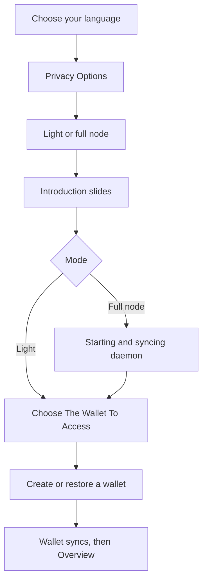

# Install and use Decrediton

Decrediton is the official Decred desktop wallet. This page takes you from download to a working wallet, explains the choices the first launch asks for, and shows where each feature lives, from staking and mixing to voting, Lightning and the DEX.

!!! info "Applies to"
    Decrediton 2.1.7, part of the Decred 2.1.7 release. Checked November 2026.

## Before you start

- **A supported computer.** Decrediton 2.1.7 is built for Windows (64-bit x86), macOS (Intel and Apple silicon) and Linux (64-bit x86). Other platforms can use [Bison Wallet](bison-wallet.md) or the [command-line wallet](command-line.md).
- **Disk space.** Light mode stores only block headers and filters. Full-node mode stores every block: the [dcrdata blockchain size chart](https://dcrdata.decred.org/charts?chart=blockchain-size) showed about 19.5 GB in November 2026, and it keeps growing, so leave generous room on top.
- **Pen and paper** for the 33-word seed. Do not store it as a screenshot, an email or a cloud file.
- **Time.** A light wallet is ready in minutes; a full node must first download and check the whole chain.

[How a Decred wallet works](how-wallets-work.md) explains the seeds, passphrases and accounts this page uses.

## Step 1: Download and verify

1. Download the installer for your system from the [Decred 2.1.7 release](https://github.com/decred/decred-binaries/releases/tag/v2.1.7). [decred.org/wallets](https://decred.org/wallets/) links to this release and directly to the Windows, Apple-silicon and AppImage files.

    | System | File |
    |---|---|
    | Windows | `decrediton-windows-amd64-v2.1.7.exe` |
    | macOS, Apple silicon | `decrediton-darwin-arm64-v2.1.7.dmg` |
    | macOS, Intel | `decrediton-darwin-amd64-v2.1.7.dmg` |
    | Linux | `decrediton-linux-amd64-v2.1.7.AppImage` or `decrediton-linux-amd64-v2.1.7.tar.gz` |

2. Download `decrediton-v2.1.7-manifest.txt` and `decrediton-v2.1.7-manifest.txt.asc` from the same release, and check the signature and your file's hash as described in [Verify your download](../security/verify-downloads.md).

!!! warning
    Fake wallet downloads are one of the most common ways people lose DCR. Do not install a file that fails verification, and never install Decrediton from a link sent to you in a chat or an advertisement.

## Step 2: Install

=== "Windows"

    Run `decrediton-windows-amd64-v2.1.7.exe` and follow the installer.

=== "macOS"

    Open the `.dmg` file and drag **Decrediton** onto the **Applications** folder link in the window. Start it from Applications.

=== "Linux"

    For the AppImage, make it executable and run it:

    ```bash
    chmod u+x decrediton-linux-amd64-v2.1.7.AppImage
    ./decrediton-linux-amd64-v2.1.7.AppImage
    ```

    For the `.tar.gz`, extract the archive and run `decrediton` from the extracted folder.

## Step 3: First launch

The first launch walks you through four screens, then starts the wallet software in the mode you chose. On the first, pick a language and click **Continue**. The diagram shows the order; the two choices that matter are explained below it.



### Privacy Options: which outside services Decrediton may contact

Besides the Decred network, Decrediton can fetch data from five web services, each of which learns at least your IP address. **Standard** turns on all of them except **Politeia**. **No Outbound Connections** turns all five off: the wallet still works, but you type a voting service provider (VSP) address by hand, see no proposals and get no update notices. **Customize Allowed Connections** lets you tick each one, then click **Accept**.

| Service | What it does | Contacts |
|---|---|---|
| **Network Information** | General network information such as block height | decred.org |
| **Decred Block Explorer** | Chain information from the explorer | dcrdata.decred.org |
| **VSP Listing** | The list of VSPs shown when you buy tickets | api.decred.org |
| **Politeia** | Lists proposals and lets you vote on them | proposals.decred.org |
| **Update Check** | Tells you when a newer Decrediton exists | api.github.com |

You can change these later in **Settings** > **Privacy and Security**. To vote on proposals, turn **Politeia** on there or click **Enable Politeia Integration** on **Governance** > **Proposals**.

### Light wallet or full node

The **Simple Payment Verification (SPV)** screen asks how Decrediton connects to the network. Click **Enable SPV** for a light wallet or **Disable SPV** for a full node.

| | Light wallet (SPV) | Full node |
|---|---|---|
| What runs | `dcrwallet` alone, talking to network peers | `dcrwallet` plus a bundled `dcrd` node |
| First start | Minutes | Downloads and checks every block first |
| Disk use | Small | The whole blockchain |
| What it checks | Block headers and proof of work, plus filters committed in the headers; it does not validate every transaction | Every block and transaction against the consensus rules |
| What peers can see | Your IP address, the transactions your wallet broadcasts, and which blocks it downloads, which hints at your addresses | Your IP address and the transactions your node broadcasts first, but not which addresses are yours (it downloads every block) |
| Staking through a VSP, mixing, voting | Yes | Yes |

Light mode is the practical choice for most people. Choose a full node if you want your wallet to rely only on its own verification; the whitepaper's [compact filters and light clients](../../whitepaper/16-filters.md#ch:filters) chapter explains what a light wallet does and does not check. The bundled node accepts no incoming connections; to serve other peers, see [Run a full node](../run/full-node.md). You can switch modes later in **Settings** > **Connectivity** > **SPV**.

### Introduction slides and the launcher

Short slides introduce Decred (**Next**, **Skip**, **Finish**). Then comes the launcher, whose links at the top stay available on every start: **Learn the Basics** (the slides again), **Release Info**, **Settings** and **Logs**.

In full-node mode, the launcher first shows **Starting Daemon...**, then **Syncing Daemon...** with a progress bar and an estimated completion time, and lists your wallets only when the node has caught up. You can close Decrediton meanwhile; the download resumes on the next start.

## Step 4: Create a new wallet or restore one

The **Choose The Wallet To Access** screen lists your wallets and offers **Create a New Wallet**, **Restore Existing Wallet**, **Setup a Trezor Wallet** and **Setup a Ledger Wallet**. Hardware wallets have their own guide: [Use a hardware wallet](hardware-wallets.md).

### Create a new wallet

1. Click **Create a New Wallet**.
2. Type a name in **Wallet Name** and click the button below it (labeled **Creating**). The name only identifies the wallet on this computer.
3. Write down the 33 seed words, in order, on paper. Check every word.
4. Click **Continue**.
5. On **Seed phrase verification**, pick the correct word in each row. Each row has exactly one right answer.
6. Type a private passphrase in **Private passphrase** and again in **Repeat Private Passphrase**.
7. Click **Create Wallet**.

Decrediton opens the wallet, syncs it and shows **Overview**.

!!! danger "Your seed is your money"
    Anyone who sees your seed can take everything in the wallet, and the theft cannot be reversed. Never type it into a website, a chat or a "support" form. Avoid the **Copy seed words to clipboard** option: other programs can read the clipboard. If you lose both the seed and the wallet file, the funds are gone for good.

The private passphrase encrypts the wallet's private keys on this computer and is asked for when you send, buy tickets or mix. It is not a backup; the seed is. If you forget it, restore from the seed and choose a new one.

### Restore a wallet from its seed

1. Click **Restore Existing Wallet**.
2. Type any name in **Wallet Name**; it does not need to match the old one.
3. Leave **Advanced Options** alone unless you need them: **Watch only** (with **Master Pub Key**, for a wallet that can watch but not spend), **Disable coin type upgrades** and **Gap Limit** (default 20).
4. Click **Continue**.
5. Enter your 33 words. For a hexadecimal seed, switch the toggle at the top from **words** to **hex**.
6. Enter and repeat a private passphrase. It can be new.
7. Click **Create Wallet**.

Decrediton then scans the chain for your transactions (in light mode: **Fetching block headers**, **Discovering addresses**, **Scanning blocks for transactions**). It may ask you to **Set Mixed Account**, **Process Managed Tickets** or **Process Unmanaged Tickets**, which reconnect mixing and VSP tickets to the restored wallet. [Back up and restore your wallet](back-up-and-restore.md) explains these steps and what to do if funds or tickets seem to be missing.

### More than one wallet

Decrediton keeps any number of wallets side by side. To return to the launcher, open **Settings** and click **Close Wallet**. On the launcher, **Edit Wallets** shows a **Remove Wallet** button for each wallet.

!!! danger "Removing a wallet cannot be undone"
    **Remove Wallet** deletes the wallet's folder, including its Lightning wallet and DEX data. Do it only when you have the seed. If the wallet has Lightning channels, close them first, or keep a channel backup as described in [Back up and protect Lightning funds](../lightning/backups-and-watchtowers.md): the seed alone does not recover funds that are still in channels.

## Check that it worked

- The bar at the bottom of the sidebar shows **Block** followed by a height and how long ago that block arrived, and **Connected to** a number of **peers**. The height should match the latest block on [dcrdata](https://dcrdata.decred.org/).
- Hover over the icon in that bar: its tooltip says **SPV Mode** in light mode and **SPV disabled** with a full node.
- **On-chain Transactions** > **Receive** gives you an address that starts with `Ds`. See [Send and receive DCR](send-and-receive.md) for a first small test payment.

## A tour of Decrediton

The sidebar on the left holds every feature. **Total Balance** and the sync status sit at its bottom, along with a rescan button and the gear icon for **Settings**.

| Sidebar | Tabs | What it is for | Guide |
|---|---|---|---|
| **Overview** | **Balance**, **Tickets**, **Transactions** | Your balance and recent activity at a glance | [Send and receive DCR](send-and-receive.md) |
| **On-chain Transactions** | **Send**, **Receive**, **History**, **Export** | Pay, get a receiving address, browse history, export it to a file | [Send and receive DCR](send-and-receive.md) |
| **Lightning Transactions** | **Overview**, **Channels**, **Send**, **Receive**, **Advanced** | Start a built-in Lightning wallet, open channels, pay and receive invoices | [Use Lightning](../lightning/use-lightning.md) |
| **Governance** | **Proposals**, **Consensus Changes**, **Treasury Spending** | Set how your tickets vote on proposals, rule changes and treasury spends | [Vote with your tickets](../governance/vote.md) |
| **Staking** | **Purchase Tickets**, **Ticket Status**, **Ticket History**, **Statistics** | Buy tickets through a VSP, by hand or automatically, and track them | [Stake with Decrediton or Bison Wallet](../staking/stake.md) |
| **Privacy and Security** | **Privacy**, **Security Center** | Run the StakeShuffle mixer; sign and verify messages and validate addresses | [Mix your DCR](../privacy/mix-your-dcr.md) |
| **Accounts** | | Create (**Add New**), rename and inspect accounts | [Manage accounts and passphrases](accounts-and-passphrases.md) |
| **DEX** | | A built-in DCRDEX client (the same 1.0.6 protocol as Bison Wallet) for non-custodial trading | [DCRDEX: Trading without custody](../dex/index.md) |

Worth knowing:

- **Staking** first asks you to click **I understand and accept the risks**. Tickets lock funds for weeks or months and cannot be cancelled; read [How staking works](../staking/index.md) first.
- **DEX** must be switched on with **Enable DEX**, which restarts the wallet. Decrediton suggests a separate wallet for trading; standalone [Bison Wallet](bison-wallet.md) offers the same trading.
- The mixer and the automatic ticket buyer run only while Decrediton is open.
- Watch-only wallets have no **Lightning Transactions**. Trezor and Ledger wallets have no **Staking**, **Governance**, **DEX** or Lightning, and Ledger wallets also have no **Privacy and Security**.

### Settings

Open **Settings** with the gear icon at the bottom of the sidebar or the **Settings** link on the launcher. From the launcher, only the **Connectivity**, **General** and **Privacy and Security** tabs appear; the other tabs, **Update Private Passphrase** and **Discover Address Usage** need an open wallet. Changes save as you make them, but changing **Network**, **SPV**, **Adv. Daemon Startup** or the proxy settings first asks you to confirm a restart (**Reset required**).

| Tab | What you find there |
|---|---|
| **Connectivity** | **Network** (**Mainnet** or **Testnet**), **SPV**, **Adv. Daemon Startup**, **SPV Connect**, **Proxy Type** and **Proxy Location** |
| **General** | **Open wallet automatically**, **Displayed Units**, **Locale**, theme (**Tonality**), **UI Animations** and **Discover Address Usage** (under **Address Usage**) |
| **Privacy and Security** | **Update Private Passphrase** and the five outside services from Step 3 |
| **Sources**, **Tutorials** | Source code links; short illustrated lessons on Decred, staking, voting and Lightning |
| **Logs** | Live logs of `dcrd`, `dcrwallet`, Decrediton and, when running, `dcrlnd` |

The **Trezor** tab works only with a Trezor wallet. Any proxy type covers Decrediton's own web requests, but only a **SOCKS5** proxy is also passed to the bundled `dcrd` and `dcrwallet`, so use SOCKS5 for Tor. [Privacy beyond mixing](../privacy/privacy-practices.md) covers Tor and what each service can learn.

## Advanced setup: use your own node

If you already run `dcrd`, Decrediton can use it instead of its bundled node; `dcrwallet` and your keys stay on this computer. Use only a node you control: it learns which addresses your wallet watches.

1. Open **Settings** > **Connectivity**, set **SPV** to **Disabled** and **Adv. Daemon Startup** to **Enabled**, and confirm the restart.
2. On the next start, Decrediton shows the remote form, for a `dcrd` already running here or elsewhere. Fill in **RPC User** and **RPC Password** (the node's `rpcuser` and `rpcpass`), **RPC Cert Path** (a local copy of its `rpc.cert`, on `dcrd`'s default P-256 curve), **RPC Host** and **RPC Port** (default 9109 on mainnet, 19109 on testnet), then click **Use Remote Daemon**.
3. To reuse a blockchain folder on this computer instead, turn on the **Different Local Daemon Location** toggle to switch to the **Daemon Data Directory** form, enter the folder and click **Start AppData Daemon**. Decrediton runs its own `dcrd` on it, with the folder's `dcrd.conf` if present; stop any other `dcrd` using that folder first.

**Skip** on that screen starts the bundled node as usual.

To stay in light mode but take data only from your own node, enter its address in **Settings** > **Connectivity** > **SPV Connect** as `host` or `host:port` (several separated by commas). Use the node's peer-to-peer port (9108 on mainnet), not its RPC port.

## Use testnet

Testnet is a separate Decred network whose coins have no value, for practicing staking, mixing or the DEX without risk.

1. Open **Settings** > **Connectivity**, from the launcher or a wallet.
2. Set **Network** to **Testnet** and confirm the restart.
3. Create a new wallet. Testnet wallets are listed only while Decrediton is on testnet.

Testnet addresses start with `T` instead of `D`. For test coins, ask in the official channels on [decred.org/community](https://decred.org/community/); [Networks](../../dev/environment/index.md) lists current testnet services. Switch back the same way.

!!! warning
    Use a fresh seed for testnet, never your mainnet seed, and never send mainnet DCR to a testnet address.

## Upgrade Decrediton

Upgrading replaces the program, not your wallets, which stay in the data folder (see the next section).

1. Make sure you have the written seed for every wallet. Optionally, with Decrediton closed, copy the data folder somewhere safe.
2. Download and verify the new release as in Step 1. With **Update Check** allowed, the launcher shows an **Update Available** link.
3. Close Decrediton and install the new version over the old one.
4. Start it. The first start can take longer while databases upgrade, and an older wallet may ask for your private passphrase for a one-time step such as **Migrate to per-account passphrases**.
5. Read **Release Info** on the launcher, and check **Governance** for new rule changes to vote on.

Some releases are mandatory: a node that does not upgrade before a rule change activates can end up on the wrong chain. See [Upgrading and mandatory releases](../run/upgrades.md).

## Where Decrediton keeps its files

Decrediton keeps its settings, logs and wallets in one data folder. In full-node mode, the blockchain goes to the standard `dcrd` data folder.

| System | Decrediton data folder | Blockchain (full-node mode) |
|---|---|---|
| Windows | `%USERPROFILE%\AppData\Local\Decrediton` | `%USERPROFILE%\AppData\Local\Dcrd` |
| macOS | `~/Library/Application Support/decrediton` | `~/Library/Application Support/dcrd` |
| Linux | `~/.config/decrediton` | `~/.dcrd` |

Each wallet has its own folder, `wallets/mainnet/<WALLET NAME>/` (or `wallets/testnet/...`), holding the wallet database (`mainnet/wallet.db`, or `testnet3/wallet.db` on testnet), its logs and, if used, its Lightning wallet (`dcrlnd/`) and DEX data (`dexc/`). **Settings** > **Logs** shows the logs without opening any folder. A copy of a wallet folder is no substitute for the seed.

!!! danger "Never restore an old Lightning folder"
    Never copy a wallet's `dcrlnd` folder back over a newer one: restoring an old channel state can lose all the funds in your channels. See [Back up and protect Lightning funds](../lightning/backups-and-watchtowers.md).

## Troubleshooting

### Full-node sync seems stuck

The first sync checks the whole chain, and its estimate swings a lot early on. Check **Logs** on the launcher: if the `dcrd` log keeps showing new blocks, it is working. If you cannot wait, switch to light mode in **Settings** > **Connectivity** > **SPV**.

### The built-in node will not start

Another `dcrd` may be using the same blockchain folder. Stop it, or connect to it with advanced mode's remote form. The `dcrd` log names the error.

### No proposals, or no VSPs in the list

**Governance** > **Proposals** shows "Politeia integration is disabled by privacy settings" until you click **Enable Politeia Integration** or tick **Politeia** in **Settings** > **Privacy and Security**. An empty VSP list on **Purchase Tickets** means **VSP Listing** is off there.

### The balance looks wrong

Click the rescan button at the bottom of the sidebar; it scans the chain again for your transactions without re-downloading it. If funds are still missing after a restore, **Settings** > **General** > **Discover Address Usage** searches for used addresses with a gap limit you choose instead of the default 20 (above 100 it gets very slow). [Back up and restore your wallet](back-up-and-restore.md) covers missing funds and tickets.

### Linux: the AppImage does not start (FUSE error)

A message such as "AppImages require FUSE to run" means the FUSE 2 library is missing. Install your distribution's libfuse2 package (on Ubuntu 22.04 `libfuse2`, on 24.04 and later `libfuse2t64`), or use the `.tar.gz` instead.

### Linux: "error while loading shared libraries: libXss.so.1"

Some distributions, such as Fedora, need the libXScrnSaver package. On Fedora, install it with `sudo dnf -y install libXScrnSaver`.

For other problems, see [Wallet troubleshooting](troubleshooting.md).

## Next steps

- [Back up and restore your wallet](back-up-and-restore.md): make sure your seed backup really works before you add funds.
- [Send and receive DCR](send-and-receive.md): make a first small payment.
- [Stake with Decrediton or Bison Wallet](../staking/stake.md): buy your first ticket through a VSP.
- [Mix your DCR](../privacy/mix-your-dcr.md): start the mixer before staking or spending.
- [Keep your DCR safe](../security/index.md): the habits that stop the attacks that actually happen.

*[DEX]: decentralized exchange
*[RPC]: remote procedure call
*[SPV]: simplified payment verification
*[VSP]: voting service provider
