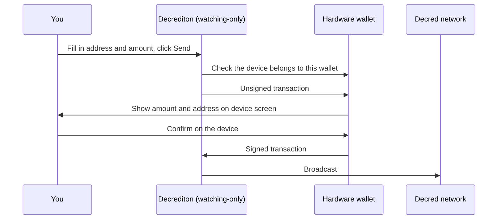

# Use a hardware wallet

This page shows how to hold DCR with a Trezor or Ledger device in Decrediton, and what you give up by doing so. Read the limits before you move funds: a hardware-backed wallet cannot stake, mix or vote.

!!! info "Applies to"
    Decrediton 2.1.7. Device support was checked against the Decrediton, Trezor and Ledger source code in November 2026, not on physical devices, so current device firmware may behave differently. Bison Wallet 1.0.6 and dcrwallet 2.1.7 have no hardware wallet support.

## What a hardware wallet protects you from

A software wallet keeps its private keys on your computer, where malware can wait for you to unlock the wallet and sign its own payments. A hardware wallet keeps the keys on a small device that never releases them. Every payment needs a button press or touch on the device after you check the amount and address on its screen, so a compromised computer cannot spend your DCR without your approval.

It does not protect you from:

- **Losing the recovery phrase.** It is the only backup of the keys, and anyone who has it can take the funds.
- **Approving without reading.** If you confirm without checking the address on the device screen, the device signs.
- **A swapped receive address.** Decrediton does not display receive addresses on the device, so you cannot confirm there that the address on your computer screen belongs to it. Malware could show its own address. Test a new address with a small amount first.
- **Fake software.** Check Decrediton as described in [Verify your download](../security/verify-downloads.md).

## How it works in Decrediton

A hardware-backed Decrediton wallet is a *watching-only* wallet: it holds public keys only (see [How a Decred wallet works](how-wallets-work.md)). At creation, Decrediton reads the extended public key of the device's first Decred account (path m/44'/42'/0', where 42 is Decred's coin type). With it the wallet finds your addresses, shows balance and history, and builds transactions; signing happens on the device, as the sequence shows.

Before signing, Decrediton checks that the device's first address belongs to the wallet, so a different device or Trezor passphrase stops with an error. The wallet has no private passphrase; the device and its PIN protect the funds.

## What does not work

Staking, mixing and governance need the wallet to sign special transactions, often automatically while you are away. Decrediton 2.1.7 cannot do that with a hardware device, so it removes **Staking**, **Governance**, **DEX** and **Lightning Transactions** from the sidebar and hides the **Privacy** (mixing) tab. A Ledger wallet loses **Privacy and Security** entirely.

| Feature | Trezor | Ledger |
|---|---|---|
| Receive, send, history | Yes | Yes |
| Several recipients in one transaction | Yes | No (one recipient plus change) |
| **Staking** (tickets, voting service providers (VSPs)) | No | No |
| **Governance** (votes, treasury spending policies) | No | No |
| Mixing (the **Privacy** tab) | No | No |
| Sign a message (**Privacy and Security** > **Security Center**) | Yes | No |
| **Lightning Transactions** and **DEX** | No | No |
| More than one account | No | No |

Tickets give holders their vote and staking rewards (see [How staking works](../staking/index.md)), so DCR on a hardware wallet gets neither. Trezor staking is tracked in [decrediton issue #1491](https://github.com/decred/decrediton/issues/1491), open since 2018.

### Only receive ordinary payments

When you open **On-chain Transactions** > **Receive** in a hardware-backed wallet, Decrediton shows this warning above the address:

> Caution! Hardware wallets cannot spend from special/staking inputs. Only use this address for receiving funds from normal transacitons. Do not use for staking or treasury related receives.

It means Decrediton 2.1.7 asks the device to sign spends of ordinary payments only, never of stake or treasury outputs. Funds paid to your address by a stake transaction (a ticket purchase or its change, a vote reward, a revocation returning a ticket's price) or by a treasury spend (TSPEND) from the [treasury](../governance/treasury.md) appear in your balance, but Decrediton cannot spend them.

!!! danger "Do not use a hardware wallet address for stake or treasury payouts"
    Never give a hardware wallet address as a ticket's reward address, or for any payment that may come from a treasury spend. Receive such funds in a software wallet with a 33-word seed, then send them to the device with an ordinary payment.

## Before you start

- Decrediton 2.1.7, installed and verified, in light (SPV) or full node mode. See [Install and use Decrediton](decrediton.md).
- A supported device:
    - **Trezor Model One** with firmware 1.9.0 or later, or **Trezor Model T** with 2.3.0 or later. Older firmware makes wallet creation fail with a "needs to run on firmware" error. Update only with Trezor's official software, after confirming your recovery phrase: an update can wipe the device.
    - Not the Trezor Safe 3, Safe 5 or Safe 7, whose firmware lacks Decred ([Trezor's coin support list](https://github.com/trezor/trezor-firmware/blob/main/common/defs/support.json), checked November 2026).
    - **Ledger** with the **Decred** app, which Ledger builds for the Nano X, Nano S Plus, Nano Gen5, Stax and Flex ([app-decred](https://github.com/LedgerHQ/app-decred), checked November 2026). Decrediton connects over USB.
- The device's recovery phrase written down and stored safely, and its PIN set.
- About 15 minutes, plus sync time.

## Set up a Trezor wallet in Decrediton

1. Connect the Trezor and close any other app that may be using it.
2. Start Decrediton and click **Setup a Trezor Wallet**. If it shows "No Trezor is detected", reconnect the device and click **Connect to Trezor**.
3. On **Create a Trezor-backed Decrediton Wallet**, choose what to do with the device:
    - **Already set up** (it has a recovery phrase): stay on **Create a Wallet**.
    - **New or wiped:** switch to **Device Setup**, expand **Device Setup and Recovery**, click **Initialize Device** under **Initalize Device (Create New Wallet)**, and follow the device. Write down all 24 words it shows; they are your only backup. Then switch back to **Create a Wallet**.
4. Type a **Wallet Name** and click **Create Wallet**.
5. Answer the prompts:
    - **Enter PIN**: on a Model One, click the positions in Decrediton's blank grid that match where your PIN digits appear on the device screen.
    - **Type Wallet Creation PassPhrase**: appears only if passphrase protection is on. See the warning below.
6. Decrediton creates the watching-only wallet and syncs, then shows the **Overview** with your balance.

A device initialized from Decrediton has no PIN. Before funding it, open **Settings** > **Trezor** > **Security** and turn on **Toggle PIN Protection**. The **Trezor** tab appears only while a Trezor-backed wallet is open.

!!! warning "A Trezor passphrase makes a different wallet"
    Each passphrase opens a separate set of keys. The Decrediton wallet is tied to the passphrase typed at creation; a typo or a forgotten passphrase puts the funds out of reach. Turning passphrase protection on later makes operations fail. To use a passphrase, create a new Decrediton wallet with it and send your funds there.

## Set up a Ledger wallet in Decrediton

Decrediton cannot set up a Ledger, so do that first in Ledger's own app.

1. In Ledger Live (called Ledger Wallet on [Ledger's Decred page](https://www.ledger.com/coin/wallet/decred), checked November 2026), set up the device with a PIN and recovery phrase, and install the **Decred** app. Then close Ledger Live so it does not hold the device.
2. Connect the Ledger, unlock it and open the **Decred** app on the device.
3. Start Decrediton and click **Setup a Ledger Wallet**. If it shows "No Ledger is detected", check that the Decred app is open, then click **Connect to Ledger**.
4. On **Create a Ledger-backed Decrediton Wallet**, type a **Wallet Name** and click **Create Wallet**. Decrediton creates the watching-only wallet and syncs.

Ledger Live can also hold DCR itself ([decred.org/wallets](https://decred.org/wallets/) lists it, checked November 2026). Decrediton sees only the first Decred account on the device, so DCR in other Ledger Live accounts does not appear in it.

## Send DCR from the device

1. Connect and unlock the device (for Ledger, open the **Decred** app).
2. In Decrediton, open **On-chain Transactions** > **Send**, enter the address and amount, and click **Send**. Decrediton does not ask for a private passphrase. A Trezor may ask for its PIN (**Enter PIN**) and, if passphrase protection is on, its passphrase (**Enter Trezor Passphrase**).
3. Check the address and amount on the **device screen**, not the computer screen, and confirm on the device.
4. Decrediton broadcasts the transaction. It appears under **On-chain Transactions** > **History**.

Sent transactions cannot be reversed. For fees and confirmations, see [Send and receive DCR](send-and-receive.md).

## Check that it worked

Send a small amount to an address from **On-chain Transactions** > **Receive**, wait for it in **History**, then send a small amount back out. A successful send proves the device and the wallet match. Only then move larger amounts.

## Device phrases are not Decred seeds

Decred software wallets use a 33-word seed from Decred's own word list. Trezor and Ledger devices use 12, 18 or 24 BIP-39 words, or on a Trezor Model T possibly a 20-word Shamir (SLIP-39) backup ([Trezor's guide](https://trezor.io/guides/backups-recovery/general-standards/single-share-backup-on-trezor), checked November 2026). They are not interchangeable:

- Decrediton's restore screen does not accept a device phrase, and a Decred seed cannot be loaded onto a device.
- Decrediton's **Recover Device** accepts only 24-word Trezor phrases. Restore other formats with Trezor's own app.
- Never type a device phrase into a computer to "convert" it: that exposes the keys the device protects.

Software wallet backups are covered in [Back up and restore your wallet](back-up-and-restore.md).

## Recover from a lost or broken device

Your DCR is on the blockchain, not on the device. The Decrediton wallet file holds no private keys, so losing the computer loses only labels and settings.

1. Get a supported device (see [Before you start](#before-you-start)).
2. Restore your recovery phrase onto it with the maker's instructions. For a 24-word Trezor phrase you can use Decrediton instead: click **Setup a Trezor Wallet**, switch to **Device Setup**, expand **Device Setup and Recovery**, click **Recover Device** and enter the words as prompted. Turn on a PIN afterwards; Decrediton restores without one.
3. If you used a Trezor passphrase, turn passphrase protection on and use exactly the same passphrase.
4. Create a new hardware wallet in Decrediton. It derives the same account and finds your funds when it syncs.

!!! warning "Plan for the device you can replace"
    Trezor's Safe models do not support Decred, so a Model One or Model T may get harder to replace. If you could not obtain a compatible device, move the DCR to a software wallet with a 33-word seed.

## Troubleshooting

### "No Trezor is detected"

Reconnect with a data-capable USB cable, close other wallet apps, and click **Connect to Trezor**. Decrediton reaches the device through Trezor bridge (`trezord-go`). If it still fails, open **Settings** > **Logs**, expand **decrediton** and look for `trezord-go` errors such as "The trezord-go executable does not exist"; Decrediton's message asks you to check that Trezor bridge is installed and running.

### "Udev Rules Error" on Linux

When Decrediton cannot reach the Trezor on Linux and `/etc/udev/rules.d/51-trezor.rules` does not exist, it stops with this error; it checks only that path. Follow [Trezor's udev instructions](https://trezor.io/learn/a/udev-rules), which Decrediton links, then restart Decrediton.

### "No Ledger is detected" on Linux

On Linux, an app can open a Ledger over USB only when udev rules allow it, and Decrediton does not check for them. Install the `20-hw1.rules` file from [Ledger's udev-rules repository](https://github.com/LedgerHQ/udev-rules) (checked November 2026), reconnect the device and click **Connect to Ledger**.

### "the decred ledger app is not open on the device"

The Ledger is on its home screen or in another app. Open the **Decred** app and try again.

### "Trezor and dcrwallet not running from the same extended public key"

The device is not the one this wallet was created from, or a different Trezor passphrase is in use. Connect the right device or enter the original passphrase. The Ledger message reads the same with "Ledger" in place of "Trezor".

## Next steps

- [Choose a wallet](index.md): compare other options if these limits rule a hardware wallet out.
- [Cold storage with an offline wallet](../security/cold-storage.md): Decred's own way to keep keys offline, with dcrwallet.
- [How staking works](../staking/index.md): what you give up by keeping DCR on a device.
- [Keep your DCR safe](../security/index.md): the attacks a hardware wallet does and does not stop.

*[BIP-39]: Bitcoin Improvement Proposal 39, the recovery phrase standard most hardware wallets use
*[DEX]: decentralized exchange
*[PIN]: personal identification number
*[SLIP-39]: SatoshiLabs Improvement Proposal 39, the Shamir backup standard
*[SPV]: simplified payment verification
*[TSPEND]: treasury spend
*[VSP]: voting service provider
*[VSPs]: voting service providers
