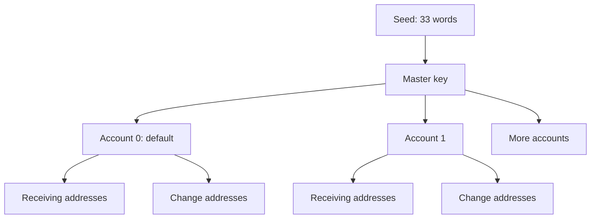
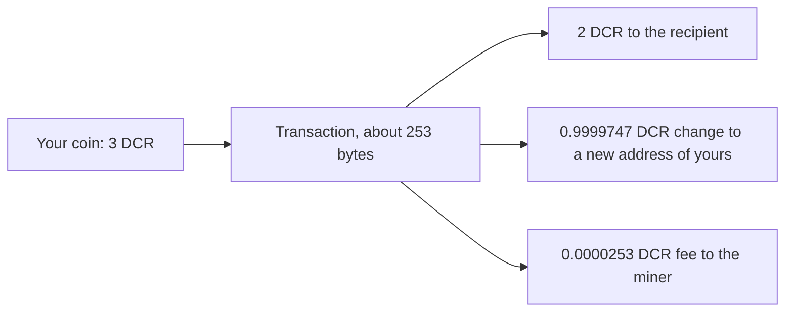
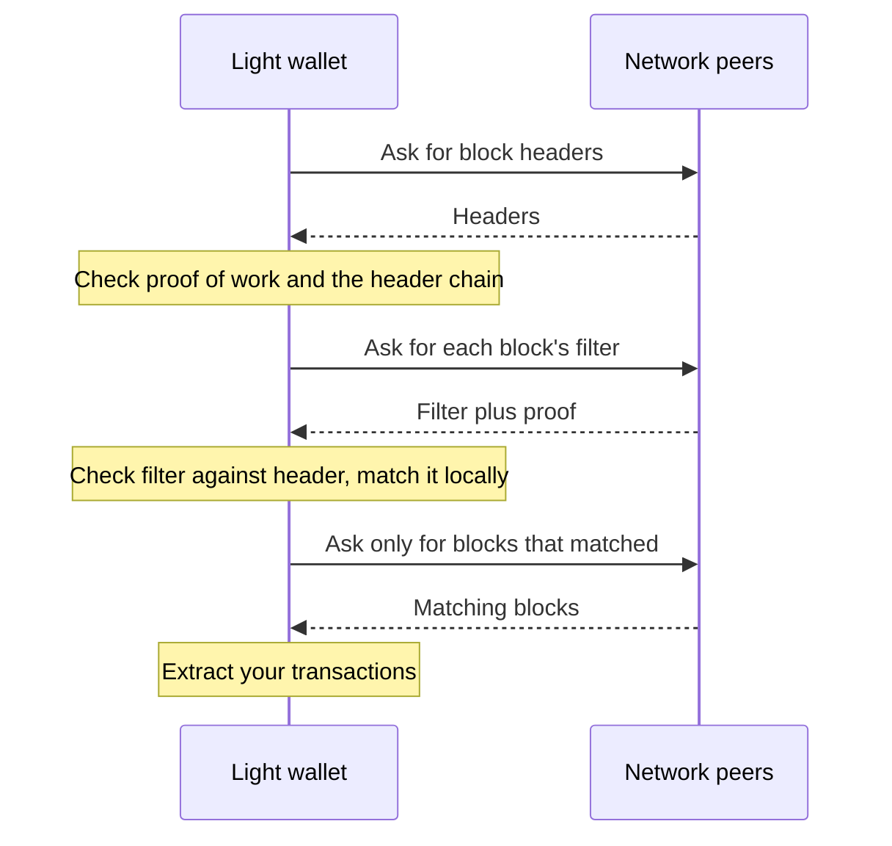

# How a Decred wallet works

This page explains what a Decred wallet keeps, what each of its secrets protects, and how it follows the blockchain. It is for anyone who holds DCR, in any wallet app.

!!! abstract "The short version"
    - **The seed is the wallet.** Its 33 words recreate every key in Decrediton or `dcrwallet`. Anyone who has it owns your funds.
    - **The private passphrase only protects this copy.** If you forget it, restore from the seed and choose a new one.
    - **The wallet file is not a backup.** Back up the seed (in Bison Wallet, the app seed).
    - **Light wallets (SPV) keep your addresses private, but cannot vote on their own.** Stake through a voting service provider (VSP).

## What a wallet holds

A wallet does not hold coins. Your DCR exists as entries on the public blockchain, each locked to a particular key. The wallet holds those keys, watches the blockchain for payments to their addresses, totals them as your balance, and signs transactions when you spend.

Decrediton runs the command-line wallet `dcrwallet` underneath, and Bison Wallet's built-in DCR wallet uses the same wallet code, so most of what follows applies to all three; Bison Wallet's seed and password differ, as a section below explains.

## One seed, many keys

A new wallet generates a **seed**: 32 random bytes, shown as 33 words, the last of which is a checksum. The words come from the PGP word list, which alternates between two lists of 256 words, so a skipped or swapped word usually shows up as an error on restore. It can also be written as 64 hexadecimal characters.

Every key the wallet will ever use is derived from the seed by hierarchical deterministic (HD) derivation: the seed produces a master key, the master key produces account keys, and each account produces two chains of addresses, one for receiving and one for change. Derivation is one-way, so an address reveals nothing about the keys above it, and repeatable, so the same seed always produces the same keys in the same order. That is how a seed written on paper rebuilds a wallet years later. This diagram shows one seed fanning out into accounts and addresses.

Some consequences:

- **The 33 words alone are enough.** Decred seeds have no extra "seed passphrase", and your private passphrase is not needed to restore.
- **The wallet does not store the seed.** It stores the derived keys, encrypted, so Decrediton and `dcrwallet` show the seed only once, at creation.
- **Only Decred-format seeds work.** A 12- or 24-word phrase from another wallet uses a different scheme and will not restore in Decrediton or `dcrwallet`.

## Accounts

An account is a numbered branch of the key tree with its own balance and addresses. Account 0 is the default account; Decrediton shows it as **Primary Account**. Accounts you add are numbered 1, 2, 3 and so on; their names live only in the wallet file, so after a restore you have to rename them. A separate **imported** account holds keys you imported individually, which the seed cannot restore.

Mixing uses accounts of its own:

| Wallet | Accounts used for mixing |
|---|---|
| Decrediton | **Mixed Account** and **Unmixed Account**, named `mixed` and `unmixed` by default |
| Bison Wallet | a `mixed` account it creates, with its default account as the unmixed account |
| `dcrwallet` | the accounts you name in `mixedaccount` and `changeaccount`; the ticket buyer also needs `ticketbuyer.votingaccount` |

Mixed coins and voting rewards go to the mixed account, and unmixed change to the change account, so the wallet never spends mixed and unmixed coins together, which would undo the mixing; see [Privacy and mixing](../privacy/index.md).

In Decrediton and `dcrwallet`, a restore looks for used accounts and stops after 10 unused ones in a row (`accountgaplimit`, a wallet default). They also refuse to create a new account while the last 10 have never been used.

## Addresses you will see

An address tells a payer how to lock coins so that only your key can spend them. Its first two characters give the network and type; the [whitepaper's network prefixes table](../../whitepaper/05-addresses.md#sec:addresses-prefixes) lists them all.

| Starts with | What it is | Where you meet it |
|---|---|---|
| `Ds` | Standard address (pays to one public key's hash) | Receiving, in any Decred wallet |
| `Dc` | Script address (pay to script hash) | Multisignature and other script-controlled funds |
| `DS`, `De` | Standard addresses for the alternative Schnorr and Ed25519 signature types | Rarely; wallets do not create them for everyday use |
| `Ts`, `Tc` | Testnet versions of `Ds` and `Dc` | Testnet only; the coins are worthless |
| `dpub` | An account's extended public key, not an address | Watching-only wallets; it reveals every address in the account |
| `Pm` | A private key | Never share it: anyone who has it can spend |

An address from the wrong network does not decode, so a mainnet wallet refuses a testnet address. Two habits matter:

- **Use each address once.** Every payment to an address is public, so reusing one links your payments. Wallets give out a fresh address each time you ask.
- **Do not hand out large batches of unused addresses.** A restore scans addresses in order and stops after 20 unused ones in a row (the gap limit, a wallet default), so a payment to the 25th of 25 unused addresses could be missed. Decrediton never goes past the limit: it hands out an earlier unused address again. If a restore misses funds, see [Back up and restore your wallet](back-up-and-restore.md).

## Coins, change and fees

Your balance is the sum of separate **coins**: unspent outputs of earlier transactions, each with a fixed amount, like banknotes. A transaction spends whole coins and creates new ones: one for the recipient and usually one that returns the difference to you as **change**. What is left over is the fee, paid to the miner.

For example, suppose your wallet holds coins of 3 DCR and 1.5 DCR, and you send 2 DCR. The wallet spends the 3 DCR coin like this (all numbers are examples):

- **The change is still yours.** It goes to a fresh change address, so a block explorer shows what looks like two payments, but your balance drops only by the payment plus the fee.
- **The fee depends on size, not amount.** Sending 1 or 1,000 DCR from one coin costs about the same; spending many small coins costs more. `dcrwallet` and Decrediton default to 0.0001 DCR per kilobyte, the lowest rate nodes relay by default (a wallet default and relay policy, not a consensus rule).

### Why a transaction can expire

A Decred transaction can carry an **expiry**: a block height after which it can never be mined. If it is not mined by then, the coins it tried to spend stay in your wallet. This is a consensus rule; see the [whitepaper's expiry rules](../../whitepaper/07-transactions.md#sec:transactions-expiry).

Ordinary payments from `dcrwallet` and Decrediton carry no expiry. Automatic ticket purchases expire at the end of the current ticket price window, because a ticket is valid only at the ticket price (also called stake difficulty) of the window it is mined in. Mix transactions carry no expiry; a wallet's request to join a mix lapses within about an hour, so a mix that fails leaves the coins where they were. Outputs of a transaction that does carry an expiry can be spent only after 256 confirmations (about 21 hours).

## Three secrets and what each protects

A Decred wallet has up to three secrets; confusing them can cost you your funds.

| Secret | What it does | If you lose it | If someone else gets it |
|---|---|---|---|
| **Seed** (33 words) | Recreates every key, on any device, in Decrediton or `dcrwallet` | While the wallet still opens, create a new wallet and move your funds, keeping the old wallet until its live tickets have voted. Once the device or passphrase is gone too, the funds are lost for good. | They can take everything, from anywhere, without any passphrase |
| **Private passphrase** | Decrypts the keys in this wallet file, so you can send, buy tickets and mix | Restore from the seed and choose a new passphrase. All funds on seed-derived keys come back; imported keys, account names and other local data do not. | They also need your wallet file or device |
| **Public passphrase** (optional) | Encrypts the wallet's public keys, so the file cannot be opened without it | Restore from the seed, with the same losses as for the private passphrase | With your wallet file, they can see your addresses and balance, but not spend |

**The private passphrase is a lock on one copy of the wallet. The seed is the wallet itself.** Forgetting the passphrase costs you a restore. Losing the seed costs nothing until the device fails, and then it costs everything.

- No one, including the Decred developers, can reset a private passphrase. The wallet slows every guess, but a short passphrase can still be cracked by anyone who copies the wallet file, so choose a long one.
- The public passphrase is off by default. `dcrwallet` offers it at creation; Decrediton does not set one, but asks for it when opening a wallet that has one. It does not encrypt the transaction records.

!!! danger "Your seed is the only key that matters"
    Anyone who sees your seed can take all your DCR, and no one can reverse it. Keep it offline, on paper or metal, and type it only into the restore screen of an official Decred wallet. No genuine support person will ever ask for it.

### Bison Wallet: the app password and the app seed

Bison Wallet holds wallets for several assets plus your accounts on DCRDEX, Decred's decentralized exchange, so it uses two secrets of its own. The **app seed** (15 words in new installations, 128 hexadecimal characters in older ones) restores your DCRDEX accounts, fidelity bonds and every built-in wallet, including the DCR wallet. The **app password** unlocks the app and approves sends, orders and bonds, like a private passphrase for every built-in wallet at once; if you forget it, the app seed lets you set a new one.

An app seed and a 33-word Decred seed are not interchangeable: each restores only in the app that created it. [Install and set up Bison Wallet](bison-wallet.md) explains what else to back up.

## Watching-only and hardware-backed wallets

An account's extended public key (`dpub...`) produces all its addresses but none of its private keys, so a wallet can be split in two:

- **A watching-only wallet** shows balance and history and makes receiving addresses, but cannot sign: useful for funds whose keys stay offline ([Cold storage with an offline wallet](../security/cold-storage.md)).
- **A hardware-backed wallet** is a watching-only wallet on your computer plus a Trezor or Ledger that holds the keys and signs transactions. The device has its own backup, not a Decred 33-word seed. In Decrediton, hardware-backed wallets cannot buy tickets or vote, and cannot spend staking outputs; [Use a hardware wallet](hardware-wallets.md) covers the setup and its limits.

## Full node or light wallet

**Full-node mode.** The wallet connects to a Decred node, `dcrd`, that you run. The node downloads and checks every block against all the consensus rules, and the wallet trusts it. Decrediton can run `dcrd` for you.

**Light mode.** A light wallet, using simplified payment verification (SPV), connects directly to nodes on the Decred network and never downloads the whole chain. It finds your transactions without telling anyone which addresses are yours:

A **compact filter** is a small summary of the addresses (strictly, the scripts) used in a block. Since block 431,488, when Decred Change Proposal DCP-0005 activated, every block header commits to its block's filter. Headers are protected by proof of work, so a peer cannot hide one of your transactions behind a false filter: the wallet notices the mismatch and asks another peer. Filters for older blocks are checked against a value built into the wallet.

| | Full-node mode | Light mode (SPV) |
|---|---|---|
| First sync | Slow: the whole blockchain | Much faster: headers, filters and the blocks you need |
| Disk space | The whole blockchain | Small |
| What it checks | Every block and transaction against every rule | Headers, proof of work and filters; trusts that most miners and voters follow the rules and that at least one peer is honest |
| What peers learn | Nothing from your downloads | Which blocks you fetch, not which transactions in them are yours |
| Solo voting | Possible with an always-online wallet | **Not possible**: stake through a VSP |
| Apps | Decrediton, `dcrwallet` | Decrediton, Bison Wallet's native DCR wallet, `dcrwallet --spv` |

A light wallet cannot vote: a vote approves or disapproves the previous block's transactions, which only a wallet that checks every transaction can judge, so `dcrwallet` refuses to start with both light mode and voting enabled. Light wallets can still buy tickets and have a [voting service provider](../staking/vsps.md) vote them. To [vote without a VSP](../staking/solo-voting.md), use a full-node wallet ([Run a full node](../run/full-node.md)).

## What the wallet keeps on disk

A wallet keeps its state in a file named `wallet.db`. On mainnet, `dcrwallet` keeps it in `mainnet` inside its data directory (`~/.dcrwallet` on Linux, `%LOCALAPPDATA%\Dcrwallet` on Windows, `~/Library/Application Support/Dcrwallet` on macOS). Decrediton keeps one per wallet under `wallets/mainnet/` in its data directory, and Bison Wallet keeps its DCR wallet's file under `assetdb` in its data directory. The file holds your encrypted keys, addresses, account names, transaction and ticket history, imported keys, and block headers and compact filters. It does not hold the seed.

!!! warning "A copy of wallet.db is not a backup"
    - It is useless if you forget the private passphrase it was made with.
    - If kept on the same disk, it is lost, stolen or encrypted by ransomware along with the wallet.
    - Anyone who copies it can try to guess your passphrase offline.
    - The seed already recreates every key in it except imported ones.

    Back up the seed. A copy of the wallet file only saves a resync.

Lightning channel funds need a separate backup as well as the seed; read [Back up and protect Lightning funds](../lightning/backups-and-watchtowers.md) before opening channels.

## Go deeper

- [Hierarchical deterministic keys](../../whitepaper/05-addresses.md#sec:addresses-hd): how the seed becomes a tree of keys.
- [Light clients' security model](../../whitepaper/16-filters.md#sec:filters-spv-security): what a light wallet verifies and what it trusts.
- [Wallets and light clients](../../whitepaper/19-ecosystem.md#sec:ecosystem-wallets): `dcrwallet`'s design, its two sync modes and its mixing accounts.

## Next steps

- [Back up and restore your wallet](back-up-and-restore.md): back up the seed, and recover funds or tickets after a restore.
- [Send and receive DCR](send-and-receive.md): put addresses, change and fees into practice.
- [Manage accounts and passphrases](accounts-and-passphrases.md): create accounts and change passphrases.
- [How staking works](../staking/index.md): what tickets are and why light wallets stake through a VSP.

*[DCP]: Decred Change Proposal
*[DCRDEX]: Decred's decentralized exchange
*[HD]: hierarchical deterministic
*[PGP]: Pretty Good Privacy
*[SPV]: simplified payment verification
*[VSP]: voting service provider
