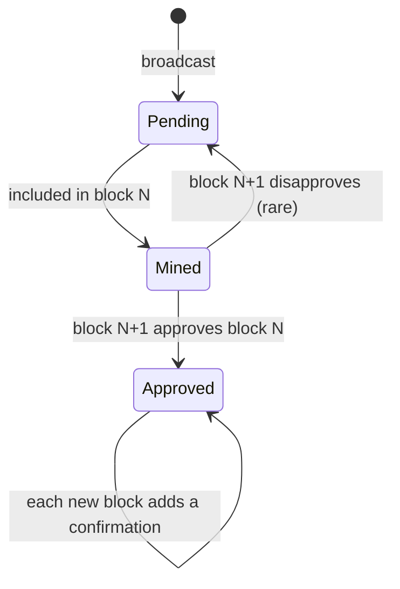

# Send and receive DCR

This page covers everyday payments in Decrediton, Bison Wallet and the command-line wallet: getting an address, sending with the right fee, knowing when a payment is final, and proving that you control an address. It is for anyone with a working wallet.

!!! info "Applies to"
    Decrediton 2.1.7, Bison Wallet 1.0.6 and dcrwallet 2.1.7 with dcrctl 2.1.7. Checked November 2026.

## Before you start

- A wallet that has finished syncing; see [Your first Decred wallet](../start/first-wallet.md).
- Your seed written down and checked; see [Back up and restore your wallet](back-up-and-restore.md).
- To send or sign: your **private passphrase** (Decrediton and dcrwallet) or **app password** (Bison Wallet).
- To send: enough spendable DCR for the amount plus a small transaction fee.
- Command line only: `dcrwallet` running, connected to your own `dcrd` or as a light wallet (SPV), set up as in [Set up the command-line wallet](command-line.md). The `dcrctl` examples are for mainnet; on testnet, add `--testnet` to each one.

## Check an address before you use it

Only the wallet holding an address's key can spend what is sent to it ([How a Decred wallet works](how-wallets-work.md) explains the model). The first two characters give the network and type:

| Network | Ordinary address | Script address (multisignature and similar) |
|---|---|---|
| mainnet (real DCR) | `Ds…` | `Dc…` |
| testnet (valueless test coins) | `Ts…` | `Tc…` |

Each network has its own [prefixes](../../whitepaper/05-addresses.md#sec:addresses-prefixes) and every address ends in a checksum, so wallets reject practically any mistyped address, an address from another network and an address of another coin (Decrediton shows "Please enter a valid address"). No wallet can catch a valid address that is not the one you meant, such as one that malware swapped into your clipboard.

!!! danger "Sent DCR cannot be recalled"
    Nobody can reverse, cancel or refund a Decred payment once it is sent. Before you confirm, compare at least the first and last six characters of the destination with the address the recipient gave you through a channel you trust. For a large amount, send a small test payment first.

## Receive DCR

Give the sender a fresh address for each payment. Reusing an address works, but it lets anyone link those payments together on the public blockchain.

=== "Decrediton"

    1. In the sidebar, click **On-chain Transactions**, then the **Receive** tab.
    2. Under **This address is for**, choose the receiving account.
    3. Click the **Copy** icon next to the address, or the **QR code** icon to show it for a phone wallet. **Generate new address** gives you another one.

    After 20 unused addresses Decrediton starts again from the first unused one, so a restore from seed always finds them.

=== "Bison Wallet"

    1. Click **Wallet** in the top bar and select **Decred** in the list of wallets.
    2. Click **Receive**.
    3. Copy the address with the copy icon (**Copied!** appears) or scan the QR code.
    4. If you see "address has been used", click **New Address**.

    With privacy (mixing) turned on, the addresses belong to the unmixed account, so received coins are mixed before trading.

=== "Command line"

    ```bash
    dcrctl --wallet getnewaddress
    ```

    This returns a new address of the `default` account. After 20 unused addresses, it fails with "generating next address violates the unused address gap limit policy", because a restore from seed looks only 20 addresses past the last used one (the gap limit). To get one of those unused addresses again, as Decrediton does, add the `wrap` policy:

    ```bash
    dcrctl --wallet getnewaddress <ACCOUNT> wrap
    ```

    `<ACCOUNT>` is the account name, for example `default`. Avoid giving out an address that has already received a payment.

## Send DCR

Your wallet builds a transaction that pays the recipient, returns any surplus to a new change address of your own and leaves a small fee for the miner.

=== "Decrediton"

    1. Click **On-chain Transactions**, then the **Send** tab.
    2. In the account selector at the top, choose the account to pay from.
    3. Paste the destination into **Send to**, or click **Paste**.
    4. Enter the **Amount** in DCR. To pay several people in one transaction, click the **Add output** (**+**) icon and fill in another row.
    5. Check **Total amount sending** and **Estimated Fee**, then click **Send**.
    6. The **Transaction Confirmation** window lists the **Destination address** and the **Total Spent**. Check both, enter your **Private Passphrase** and click **Continue**.

=== "Bison Wallet"

    1. Click **Wallet**, select **Decred** and click **Send**.
    2. Paste the destination into **Address** and enter the **Amount**.
    3. Leave **Subtract fees from amount sent.** unticked, so the recipient gets exactly the amount.
    4. Click **Send**. The "Confirm Transfer" screen shows the destination, the **Estimated Fee**, the **Estimated Total Spend** and the **Estimated Balance After**.
    5. Enter your app password under **Password** and click **Confirm**.

=== "Command line"

    Unlock the wallet for 60 seconds. `promptsecret`, part of the command-line bundle, reads your private passphrase without echoing it or saving it in shell history:

    ```bash
    promptsecret | dcrctl --wallet walletpassphrase - 60
    ```

    Then send from the `default` account, or from a named account with `sendfrom`:

    ```bash
    dcrctl --wallet sendtoaddress <ADDRESS> <AMOUNT>
    dcrctl --wallet sendfrom <ACCOUNT> <ADDRESS> <AMOUNT>
    ```

    `<ADDRESS>` is the destination and `<AMOUNT>` is in DCR, for example `1.25`. Both commands spend only coins with at least one confirmation and return the transaction ID:

    ```text title="Expected output (example)"
    238b7697154d84b53685c18bbdd67d4798a4f3b2fe6f66bd909c715d40152728
    ```

    To pay several addresses at once: `dcrctl --wallet sendmany <ACCOUNT> '{"<ADDRESS1>":<AMOUNT1>,"<ADDRESS2>":<AMOUNT2>}'`.

If you use mixing, spend from the mixed account to keep the privacy it bought; [Mix your DCR](../privacy/mix-your-dcr.md) explains how.

## Fees

Decred fees are charged per kilobyte (1,000 bytes) of transaction data, not per DCR sent. Size depends mostly on how many coins (inputs) the wallet has to combine. For example, at the default rate of 0.0001 DCR/kB and with sizes as dcrwallet estimates them:

| Transaction | Estimated size | Fee |
|---|---|---|
| 1 input, payment plus change | 253 bytes | 0.0000253 DCR |
| 2 inputs, payment plus change | 419 bytes | 0.0000419 DCR |

Fees stay this small for two reasons. First, dcrd relays transactions paying at least [0.0001 DCR/kB](../../whitepaper/17-policy.md#sec:policy-minfee), a relay policy set by each node's `minrelaytxfee` option rather than a consensus rule. Second, blocks have spare room: a block can hold 393,216 bytes, recent blocks on [dcrdata](https://dcrdata.decred.org/blocks) use a small fraction of that, and a payment at the minimum rate is normally mined in the next block. Each wallet picks the rate as follows:

=== "Decrediton"

    Decrediton always uses 0.0001 DCR/kB. There is no fee setting.

=== "Bison Wallet"

    Bison Wallet chooses a rate automatically, from a fee estimate or a rate suggested by a connected DCRDEX server, and shows the result as **Estimated Fee** before you confirm. The send form has no rate setting.

=== "Command line"

    dcrwallet uses its `txfee` option, 0.0001 DCR/kB by default. Never set it below 0.0001. To show the rate, and to change it until the wallet restarts:

    ```bash
    dcrctl --wallet getwalletfee
    dcrctl --wallet settxfee <AMOUNT>
    ```

    `<AMOUNT>` is the rate in DCR per kB, for example `0.0002`, not a total fee. To change it permanently, set `txfee` in `dcrwallet.conf`.

## Confirmations

A broadcast payment waits in nodes' memory pools (the mempool) until a miner includes it in a block. The tickets voting in the next block (five per block, at least three required) then approve or disapprove the ordinary transactions of the block before. [If they disapprove](../../whitepaper/10-blocks.md#sec:blocks-approval-consequences), those transactions return to the mempool and are normally mined again later. Disapproval is rare, but it means a payment in the newest block is not yet settled. [Miners, voters and the life of a block](../start/life-of-a-block.md) explains the voters' role.

The diagram shows the states a payment passes through, about 5 minutes apart on average.



Wallets count these states differently:

| State | Decrediton shows | Bison Wallet shows | `dcrctl --wallet gettransaction <TXID>` |
|---|---|---|---|
| Waiting in the mempool | **Pending** | **Mempool** | `"confirmations": 0` |
| In the newest block | "Mined, block awaiting approval" | no mark | `"confirmations": 1` |
| Approved by the next block | "1 confirmation" | no mark | `"confirmations": 2` |

**How many is enough?** There is no protocol rule; it depends on what you stand to lose.

- Do not hand over goods for a payment that is pending or in the newest block: until it is mined and approved, the sender could still get a conflicting transaction mined instead.
- Once the block is approved, an everyday payment is settled.
- For large amounts, wait for more blocks. Each one makes it less likely that a chain reorganization (the network switching to a competing branch of the chain) replaces the block holding your payment. Exchanges set their own number; developers should read [Blocks, confirmations and reorganizations](../../dev/protocol/blocks-and-confirmations.md).

## Can a payment expire?

Ordinary payments from Decrediton, Bison Wallet and dcrwallet do not expire: an unmined payment stays pending until it is mined or you abandon it. Some transactions, such as ticket purchases by the automatic ticket buyer, carry an [expiry height](../../whitepaper/07-transactions.md#sec:transactions-expiry) after which they can never be mined. If one expires, dcrwallet removes it and its coins become spendable again; no fee is lost, so create a new transaction to retry.

## Send everything or sweep an account

To empty an account, for example when moving to a new wallet, the wallet sends every spendable coin to one address and takes the fee out of the total, leaving no change. Coins locked in tickets and immature rewards stay where they are.

=== "Decrediton"

    1. On the **Send** tab, choose the account.
    2. Click the **Send all funds from selected account** icon next to the account selector. The amount is filled in and cannot be edited.
    3. Paste the destination into **Send to**, then click **Send** and confirm as usual.

    The icon is disabled while the form has more than one output.

=== "Bison Wallet"

    1. Open **Send** for Decred.
    2. Click the **Balance** figure or the **Max Estimated Send** value. Bison Wallet enters your whole available balance and ticks **Subtract fees from amount sent.**
    3. Check **Max Estimated Send Fee**, click **Send** and confirm.

=== "Command line"

    `sweepaccount` builds an unsigned transaction that moves everything from an account with at least one confirmation:

    ```bash
    dcrctl --wallet sweepaccount <ACCOUNT> <ADDRESS>
    ```

    Check `totalpreviousoutputamount` (what you are moving) and `totaloutputamount` (what arrives after the fee). If they are right, unlock, sign and broadcast:

    ```bash
    promptsecret | dcrctl --wallet walletpassphrase - 60
    dcrctl --wallet signrawtransaction <UNSIGNED_HEX>
    dcrctl --wallet sendrawtransaction <SIGNED_HEX>
    ```

    `<UNSIGNED_HEX>` is the `unsignedtransaction` value; `<SIGNED_HEX>` is the `hex` value from `signrawtransaction`, which must report `"complete": true`.

## Prove you own an address

A [signed message](../../whitepaper/05-addresses.md#sec:addresses-messages) proves that its maker holds the private key of an address, without moving any coins. Signing reveals neither your key nor your seed, and a signature cannot authorize a payment.

- The person checking should choose the message and include something fresh, such as their name and the date, so an old signature cannot be reused.
- Only ordinary `Ds` addresses from your own wallet can sign.
- The message must match exactly; one changed space or capital letter makes the check fail.

=== "Decrediton"

    1. In the sidebar, click **Privacy and Security**, then the **Security Center** tab.
    2. Select **Sign Message** and enter your **Address** and the **Message**.
    3. Click **Sign Message**, enter your **Private Passphrase** and click **Continue**.
    4. Copy the **Signature** and send it with the address and the exact message.

    To verify, select **Verify Message**, enter the **Address**, **Signature** and **Message**, and click **Verify Message**. A match shows "Valid Signature". The **Validate Address** box on the same tab shows whether an address is valid and whether your wallet owns it.

=== "Command line"

    Sign (the wallet must be unlocked), then verify (no unlock needed):

    ```bash
    dcrctl --wallet signmessage <ADDRESS> "<MESSAGE>"
    dcrctl --wallet verifymessage <ADDRESS> <SIGNATURE> "<MESSAGE>"
    ```

    `signmessage` returns the signature, a base64 string such as `H5ikHFhQ…LyUvmDM=`. `verifymessage` returns `true` if the signature matches the address and message, otherwise `false`. Without `--wallet`, `dcrctl verifymessage` asks dcrd instead.

Bison Wallet 1.0.6 has no message-signing feature. In Decrediton, Ledger-backed and watch-only wallets cannot sign messages; Trezor-backed wallets can.

## Check that it worked

- **Sent:** look up the transaction ID from the transaction details or the command output on [dcrdata](https://dcrdata.decred.org). It shows the outputs, the fee and the confirmations.
- **Received:** the payment appears in your wallet's history and advances through the states in [Confirmations](#confirmations).

## Troubleshooting

### The Send button is greyed out in Decrediton

Decrediton does not send while the mixer, the automatic ticket buyer or a ticket purchase is running, as the button's tooltip says ("Privacy Mixer, Autobuyer or Purchase Ticket Attempt running…"). Stop it, send, then restart it. Otherwise look for an error under the address or amount field.

### An account is missing from the list of accounts to send from

With mixing set up, Decrediton hides unmixed accounts to protect your privacy. To send from one anyway, turn on **Allow sending from unmixed accounts** under **Privacy and Security** > **Privacy**; Decrediton asks you to type a confirmation phrase first.

### "Insufficient funds"

The amount plus the fee exceeds the account's spendable balance. Coins in tickets, immature rewards and, for `sendtoaddress` and `sendfrom`, unconfirmed coins do not count. Lower the amount slightly or send everything as described above.

### A payment stays pending

Look up the transaction ID on [dcrdata](https://dcrdata.decred.org). If it is there, it is normally mined within a block or two. If not, it never reached the network: in Decrediton, open it from **History** and click **Rebroadcast Transaction**; dcrwallet resends unmined transactions whenever it connects to dcrd or a new peer, so restarting it has the same effect.

!!! warning "Abandon only what the network never saw"
    **Abandon Transaction** in Decrediton, and the `abandontransaction` RPC in dcrwallet, only make your wallet forget the transaction and free its coins. If a copy is still circulating, it can still be mined. If you then send again using different coins, the recipient may be paid twice.

More fixes are in [Wallet troubleshooting](troubleshooting.md).

## Next steps

- [Mix your DCR](../privacy/mix-your-dcr.md): break the public link between your coins and their history before you spend them.
- [Use the block explorer](block-explorer.md): follow any payment, block or address on dcrdata.
- [Manage accounts and passphrases](accounts-and-passphrases.md): keep funds for different purposes apart.
- [How staking works](../staking/index.md): put idle DCR to work in tickets and gain a vote.
- [Keep your DCR safe](../security/index.md): the address-swapping malware and scams to watch for.

*[DCR]: the Decred currency
*[DCRDEX]: Decred's decentralized exchange protocol and server network
*[SPV]: simplified payment verification
