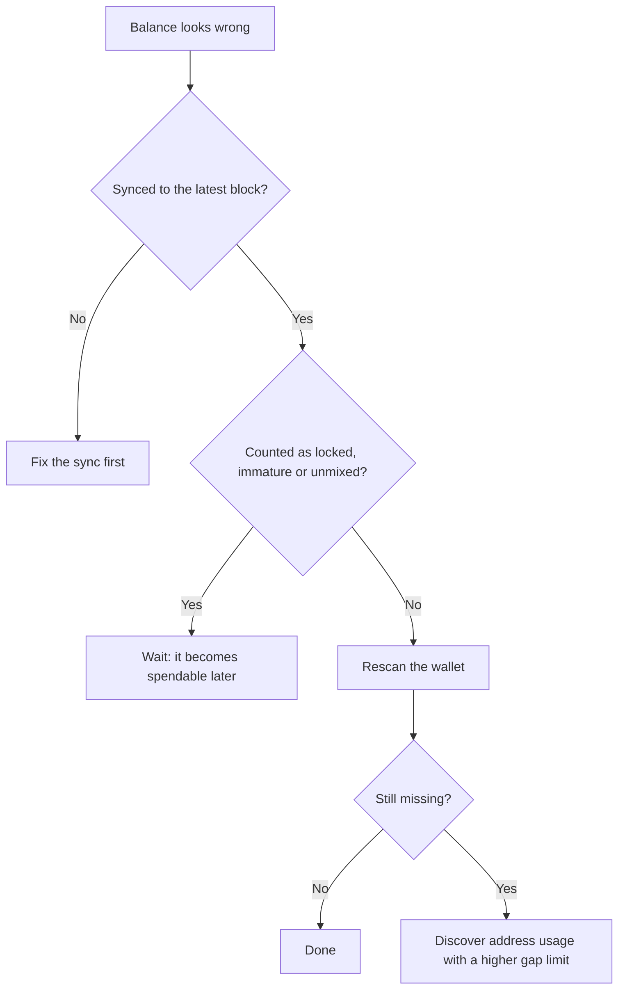

# Wallet troubleshooting

Quick answers to the wallet problems people raise most often in Decred community chats. Each answer gives the fix, or the next thing to check, in Decrediton, Bison Wallet and the command-line wallet (`dcrwallet`).

!!! info "Applies to"
    Decrediton 2.1.7, Bison Wallet 1.0.6 and dcrwallet 2.1.7. Checked November 2026.

!!! danger "Before you try any fix"
    Make sure you have your wallet's **seed** written down and readable: 33 words in Decrediton and `dcrwallet`, or the **app seed** in Bison Wallet. With the seed, the coins the wallet controls can be restored even if its files are lost or deleted. Without it, almost nothing can be recovered. Never type your seed anywhere except the official wallet's restore screen, and never give it to anyone who offers help.

## Where are the logs?

Logs record what the wallet and node were doing when something went wrong. Lines marked `[ERR]` (error) and `[WRN]` (warning) are the ones to read first; start at the bottom of the file for the newest.

=== "Decrediton"

    To read logs inside the app, open **Settings** (the gear icon at the bottom of the sidebar) > **Logs**. Under **System Logs** there is one expandable log for `dcrd` (in full-node mode), `dcrwallet` and `decrediton`, plus `dcrlnd` when Lightning is running. If the wallet will not open, the launcher has its own **Logs** button. Mixing has a separate **Logs** panel on **Privacy and Security** > **Privacy**.

    The files are in the Decrediton data directory and the `dcrd` data directory:

    | Log | File |
    |---|---|
    | Decrediton | `decrediton.log` in the Decrediton directory |
    | Wallet | `wallets/mainnet/<WALLET NAME>/logs/mainnet/dcrwallet.log` in the Decrediton directory |
    | Node (full-node mode only) | `logs/mainnet/dcrd.log` in the `dcrd` directory |
    | DEX tab | `wallets/mainnet/<WALLET NAME>/dexc/logs/dexc.log` in the Decrediton directory |
    | Lightning | the `wallets/mainnet/<WALLET NAME>/dcrlnd/logs` folder in the Decrediton directory |

    `<WALLET NAME>` is the name shown in the launcher. On testnet, replace `wallets/mainnet` with `wallets/testnet`, and the `logs/mainnet` folders with `logs/testnet3`.

    Starting Decrediton with the `--debug` option also prints the node and wallet messages to the terminal.

=== "Bison Wallet"

    | Log | File, inside the Bison Wallet directory |
    |---|---|
    | App | `mainnet/logs/dexc.log` |
    | Built-in Decred wallet | `mainnet/assetdb/dcr/mainnet/spvlogs/neutrino.log` |

    The **Wallet Logs** button in a wallet's settings is not offered for the Decred wallet in 1.0.6, so open the file directly.

=== "Command line"

    | Program | File, inside its data directory |
    |---|---|
    | `dcrwallet` | `logs/mainnet/dcrwallet.log` |
    | `dcrd` | `logs/mainnet/dcrd.log` |

    On testnet the folder is `logs/testnet3`. The `logdir` and `debuglevel` options change where and how much is logged; `debuglevel=debug` is useful while chasing a problem.

The data directories are:

| Program | Windows | macOS | Linux |
|---|---|---|---|
| Decrediton | `%USERPROFILE%\AppData\Local\Decrediton` | `~/Library/Application Support/decrediton` | `~/.config/decrediton` |
| `dcrd` (also used by Decrediton) | `%LOCALAPPDATA%\Dcrd` | `~/Library/Application Support/Dcrd` | `~/.dcrd` |
| `dcrwallet` | `%LOCALAPPDATA%\Dcrwallet` | `~/Library/Application Support/Dcrwallet` | `~/.dcrwallet` |
| Bison Wallet | `%LOCALAPPDATA%\Dexc` | `~/Library/Application Support/Dexc` | `~/.dexc` |

## My balance is wrong or transactions are missing

Most "missing" coins are in one of three places: in blocks the wallet has not scanned yet, in a balance category that is not spendable yet, or on addresses the wallet has not looked at. Work through them in this order:



### Is my wallet fully synced?

Compare the block height your wallet shows with the latest block on [dcrdata](https://dcrdata.decred.org). Decrediton shows it at the bottom of the sidebar, next to **Block**, with the number of peers after **Connected to**. Until the heights match, recent transactions cannot appear. If the height is not moving, see [Sync is stuck or slow](#sync-is-stuck-or-slow).

Command line: `dcrctl --wallet syncstatus` returns `"synced": true` once the wallet has caught up.

### Where did part of my balance go?

The total includes coins you cannot spend yet. The wallet sorts them into categories:

| What happened to the coins | Decrediton | Bison Wallet | `getbalance` field |
|---|---|---|---|
| Spent on a ticket that has not voted yet | **Locked by tickets** | **Locked** > **Staked** | `lockedbytickets` |
| Returned by a vote or revocation, waiting 256 blocks (about 21 hours) | **Immature Staking Rewards** | **Immature** | `immaturestakegeneration` |
| Received but not yet in a block | **Unconfirmed** | — | `unconfirmed` |
| Waiting in the unmixed account while mixing is on | **Unmixed Balance** on the **Privacy** tab | **Immature** > **Unmixed** | the unmixed account's `spendable` |
| Reserved for open orders or fidelity bonds | — | **Locked** (**Bonded**, **Bond Reserves**) | — |

Ticket funds stay locked until the ticket votes, on average about 8,448 blocks (about 29 days) after purchase, counting its 256-block maturity. A ticket that is missed or expires is revoked instead; expiry comes at most 256 + 40,960 = 41,216 blocks (about 143 days) after purchase. Either way, the returned funds then mature for 256 blocks. A ticket cannot be cancelled. **Voting Authority** in Decrediton is the value of the tickets this wallet can vote. It is not added to your total; your own ticket funds are counted under **Locked by tickets**. See [How staking works](../staking/index.md).

### Transactions are missing, or funds are gone after a restore

Try two fixes, in this order:

1. **Rescan.** A rescan reads the whole blockchain again for your addresses, without downloading it again.
2. **Discover address usage with a higher gap limit.** The wallet stops looking for addresses after 20 unused ones in a row, the default *gap limit* (a wallet default, not a network rule). Coins sent to an address beyond that gap stay invisible until you raise it.

!!! note "Example: Why a payment can stay invisible"
    Your wallet used addresses 0 to 4. You then generated 31 addresses for an invoice tool (5 to 35), and a payment arrived at address 35. After a restore, the wallet checks addresses 5 to 24, finds them all unused, and stops: address 35 is never checked. Discovering again with a gap limit of 40 checks up to address 44, finds the payment, and keeps going from there.

=== "Decrediton"

    **Rescan:** click the rescan button at the bottom of the sidebar, to the left of **Block** (its tooltip reads "Initiate a transaction rescan.").

    **Discover address usage:** open **Settings** > **General**, and under **Misc** > **Address Usage** click **Discover Address Usage**, enter a **Gap Limit** and confirm. Decrediton rescans by itself afterwards. Its own help text warns that limits above 100 make this very slow.

=== "Bison Wallet"

    **Rescan:** open the Decred wallet's **Settings** and click **Rescan** under **Other Actions**.

    **Discover address usage:** the same settings have an **Address Gap Limit** option. [Back up and restore your wallet](back-up-and-restore.md) gives the steps.

=== "Command line"

    To rescan:

    ```bash
    dcrctl --wallet rescanwallet
    ```

    To discover address usage from the first block with a gap limit of 40, then rescan:

    ```bash
    dcrctl --wallet discoverusage 298e5cc3d985bfe7f81dc135f360abe089edd4396b86d2de66b0cef42b21d980 false 40
    dcrctl --wallet rescanwallet
    ```

    The long hexadecimal value is the hash of the mainnet genesis block (block 0); on testnet, use the output of `dcrctl --wallet getblockhash 0`. `false` limits the search to addresses. Setting it to `true` also discovers accounts, which needs an unlocked wallet. Discovery alone only finds the addresses; the rescan finds their transactions.

Restores have more causes (the account gap limit, a late wallet birthday, wallets from before December 2017) and tickets bought through a voting service provider (VSP) must be linked to it again. [Back up and restore your wallet](back-up-and-restore.md) covers each case, with the commands for every app.

## Sync is stuck or slow

A light wallet (SPV, simplified payment verification) downloads block headers and small compact filters, so a first sync takes minutes. A full node downloads and checks every block, which takes much longer the first time. Decrediton shows which stage it is in: **Fetching missing committed filters**, **Fetching block headers**, **Discovering addresses**, **Scanning blocks for transactions**, then **Finishing to load wallet**.

If progress stops for a long time:

- **Check the peer count.** Zero peers means the wallet cannot reach the network. Check your internet connection and firewall. In Decrediton, check **Settings** > **Connectivity**: a wrong **Proxy Type** or **Proxy Location**, or a single unreachable peer in **SPV Connect**, stops the sync. Command line: `dcrctl --wallet getpeerinfo` lists the peers.
- **Check your version.** Version 2.1.6 was a mandatory consensus fix, and older software risks being forked off the network. Install the current release; see [Upgrading and mandatory releases](../run/upgrades.md).
- **Read the logs** for `[ERR]` lines, as described in [Where are the logs?](#where-are-the-logs)
- **Damaged compact filters** (command line). If `dcrctl --wallet validatepredcp0005cf` returns `false`, the filters the wallet stored for blocks before block 431,488 (where the Decred Change Proposal DCP-0005 took effect) are wrong. Restoring the seed into a new, empty wallet downloads them again. The `repaircfilters` tool can instead import known-good filters into the existing wallet; see [Command-line repair tools](#command-line-repair-tools).

## Why does it say "Insufficient funds" when I have a balance?

Only the **spendable** part of the selected account can be sent. Check, in order:

- **Locked or immature coins.** Coins in tickets, or returned by a vote less than 256 blocks ago, cannot be spent yet (see [Where did part of my balance go?](#where-did-part-of-my-balance-go)).
- **The fee.** A transaction must also pay its transaction fee, so you cannot send the exact balance. Use **Send all funds from selected account** in Decrediton, which subtracts the fee for you.
- **The unmixed account is locked for sending.** Once mixing is set up, Decrediton offers only the mixed account in the **From** list, so unmixed coins are not spent by mistake. To send from them anyway, check **Allow sending from unmixed accounts** on **Privacy and Security** > **Privacy**, and type "I understand the risks" when asked. This is a Decrediton rule; `dcrwallet` has no such lock.
- **A background task is running.** Decrediton disables **Send** while the mixer, the automatic ticket buyer or a ticket purchase is running ("Privacy Mixer, Autobuyer or Purchase Ticket Attempt running, please shut them off before sending a transaction."). Stop it first.
- **Bison Wallet with mixing on.** Unmixed coins are counted in the **Immature** balance, listed beneath it as **Unmixed**, until they are mixed. Only **Available** coins can be sent or traded.

When buying tickets, "Not enough funds" means the account cannot cover the ticket price plus the transaction and VSP fees. See [Mix your DCR](../privacy/mix-your-dcr.md) for how funds move between the mixed and unmixed accounts.

## My transaction never confirmed or expired

A transaction is final only once it is in a block. In Decrediton, an unconfirmed transaction shows as **Pending**. "Mined, block awaiting approval" means it is in a block whose regular transactions the next block's voters have not yet approved; this normally clears within one block, about 5 minutes. See the whitepaper's [stakeholder approval of the previous block](../../whitepaper/10-blocks.md#sec:blocks-approval).

If it stays pending:

1. **Look it up** by its transaction ID on [dcrdata](https://dcrdata.decred.org). If dcrdata shows it in a block, your wallet is not synced (see above). See [Use the block explorer](block-explorer.md).
2. **Rebroadcast it.** Open the transaction and click **Rebroadcast Transaction**, which sends all your unconfirmed transactions to the network again. Wallets also resend them each time they connect to peers. An "already have transaction" error is harmless: the node already has it.
3. **Abandon it,** only if the network does not know it and rebroadcasting fails. **Abandon Transaction** removes the transaction, and any that depend on it, from your wallet so its coins can be spent again. Command line: `dcrctl --wallet abandontransaction <TXID>`, where `<TXID>` is the transaction ID.

!!! warning "Abandoning does not cancel a payment"
    Abandoning only changes your wallet's records. If a copy of the transaction is still held by nodes on the network, it can still be mined. Sent transactions cannot be reversed.

A transaction can carry an *expiry* height after which it can never be mined. Regular payments from Decrediton and `dcrwallet` have none, but tickets can. When a transaction expires, or a ticket's price window passes, the wallet removes it on its own and the coins become spendable again. The `dcrwallet` log then shows "Removing expired unmined transaction" or "Removing old unmined ticket purchase". See the whitepaper's [expiry rule](../../whitepaper/07-transactions.md#sec:transactions-expiry).

## Ticket purchase or VSP fee payment failed

### My ticket disappeared before it was mined

A ticket must pay at least the current ticket price (also called stake difficulty), which is recalculated every 144 blocks (about 12 hours), and at most 20 new tickets fit in each block. If the price changes before your ticket is mined, the wallet removes the unmined ticket and the coins return to your spendable balance. Buy again at the new price. For this reason the automatic ticket buyer sets each ticket to expire when its price window ends. See [Ticket price, rewards and costs](../staking/ticket-price-and-rewards.md).

Decrediton also refuses to start a purchase while the mixer or automatic ticket buyer is running ("Privacy Mixer or Autobuyer running, please shut them off before purchasing a ticket."). Mixed ticket purchases wait for a mix, which runs every 10 minutes and needs other participants.

### The fee status says Unpaid Fee or Fee Error

After a purchase, the wallet pays the VSP fee in a separate transaction. The VSP broadcasts that fee only after the ticket has 6 confirmations (about 30 minutes), and starts voting the ticket only after the fee itself has 6 confirmations. So **Unpaid Fee** and **Paid Fee** can last about an hour. On **Staking** > **Ticket Status**, the filter menu above the list selects tickets by these four states; the **Fee Status** column of each ticket shows the short form (**Paid**, **Error** or **Confirmed**):

| State in the filter menu | Meaning | What to do |
|---|---|---|
| **Unpaid Fee** | The wallet has not finished paying | Keep Decrediton open. If it was closed, enter your private passphrase at **Process Managed Tickets** when the wallet next opens |
| **Paid Fee** | The fee transaction was sent | Wait for confirmations |
| **Confirmed Fee** | The VSP has the fee and will vote the ticket | Nothing |
| **Fee Error** | The payment failed, for example because its coins were spent elsewhere | Click **Sync Failed VSP Tickets**, choose the VSP and account, and enter your private passphrase |

!!! warning "A ticket whose fee is never confirmed does not vote"
    The VSP votes only tickets with a confirmed fee. A ticket that never votes is missed or expires, and you get the ticket price back without a reward.

Command line: set `vsp.url` and `vsp.pubkey` in `dcrwallet.conf`, unlock the wallet, and run `dcrctl --wallet processunmanagedticket <TICKET HASH>`, where `<TICKET HASH>` is the ticket's transaction hash. The log error "server fee amount too high" means the VSP asks more than `vsp.maxfee` (a wallet default of 0.2 DCR). See [Stake with dcrwallet](../staking/stake-with-dcrwallet.md) and, after a restore, [Back up and restore your wallet](back-up-and-restore.md).

## Decrediton will not start or reports a database error

When the node or wallet fails, Decrediton shows a **Fatal error** page with the message under **Daemon Error** or **Wallet Error** and a copy button; for node errors it also gives a **Suggested action to resolve the error**. Other messages appear in the launcher or on a separate wallet-disconnected screen. The common cases:

| Message contains | Cause | Fix |
|---|---|---|
| "resource temporarily unavailable" | Another `dcrd` is already running, often left over from a crash | Close it in Task Manager (Windows) or Activity Monitor (macOS), or end the process (Linux), then restart Decrediton |
| "corrupted" or "checksum does not match" | The blockchain data is damaged, usually by a failing disk or bad memory | Click **Delete and Shutdown**, then start Decrediton again to download the blockchain again |
| "daemon and decrediton does not have the same network" | `dcrd.conf` sets `testnet=1` while Decrediton runs on mainnet | Remove `testnet=1` from `dcrd.conf` in the Decrediton directory |
| "We have detected that your wallet has disconnected" (wallet-disconnected screen) | The wallet process stopped | Restart Decrediton, then read the `dcrwallet` log |
| "Wrong public passphrase inserted." (launcher) | The public passphrase that encrypts this wallet's data is wrong | Try again; if it is lost, restore from the seed (next section) |

**Delete and Shutdown** removes only the node's blockchain data (`data/mainnet` in the `dcrd` directory). Your wallet, keys and coins are not touched. Since 2.1.7, `dcrd` also shuts itself down rather than continue in a potentially unsafe state if its spend safeguards trigger; if the log shows that, report it with the log lines (see the last section). For any other message, copy it and ask in the support channel.

## I forgot my private passphrase

The private passphrase encrypts the keys inside one wallet file. It cannot be reset or recovered, but the seed recreates everything:

1. In the Decrediton launcher, choose **Restore Existing Wallet**, give the wallet a new name, enter the seed and set a new private passphrase. With `dcrwallet`, create a new wallet from the seed in a fresh data directory.
2. Let it sync, and relink your VSP tickets when asked.
3. Once the restored wallet shows your funds, you can delete the old one with **Edit Wallets** > **Remove Wallet**.

    !!! warning "Removing a wallet cannot be undone"
        **Remove Wallet** permanently deletes the wallet's folder (`wallets/mainnet/<WALLET NAME>` in the Decrediton directory), including any Lightning (`dcrlnd`) and DEX tab (`dexc`) data inside it. If you used Lightning or the DEX tab in the old wallet, copy that folder somewhere safe first. Never start Lightning from that copy once the wallet's channels have changed: an old channel database can hand all your channel funds to your peers. See [Never restore an old channel database](../lightning/backups-and-watchtowers.md#never-restore-an-old-channel-database), and recover Lightning funds from the seed plus a channel backup instead.

A lost public passphrase is solved the same way. In Bison Wallet, the password is called the **app password**: click **Forgot Password?** on the **Unlock** screen and enter your **app seed** to set a new one. If the seed is lost too, the funds cannot be recovered by anyone. See [Back up and restore your wallet](back-up-and-restore.md) and [Manage accounts and passphrases](accounts-and-passphrases.md).

## Someone else may have my seed

Anyone with your seed can spend your coins, and there is no way to freeze them. Act at once:

1. Create a **new** wallet with a **new** seed, and back that seed up.
2. Send everything spendable from the old wallet to an address of the new one. In Decrediton, use **Send all funds from selected account** for each account, after stopping the mixer and ticket buyer. If mixing is set up, first check **Allow sending from unmixed accounts** on **Privacy and Security** > **Privacy** so the unmixed account can be emptied too. Command-line users can use `sweepaccount` (see [Command-line repair tools](#command-line-repair-tools)).
3. Coins locked in tickets return to the old wallet when each ticket votes or is revoked, and the person with the seed can take them then. Keep the old wallet running and move each amount as soon as it becomes spendable.

Then find out how the seed leaked; see [Keep your DCR safe](../security/index.md).

## Command-line repair tools

The `dcrwallet` source includes three helper programs. They are not in the release downloads, so you build them with Go from `decred.org/dcrwallet/v5` at tag `v5.1.2` (the module version in Decred 2.1.7), for example `go install decred.org/dcrwallet/v5/cmd/sweepaccount@v5.1.2`. `repaircfilters` and `sweepaccount` connect to a running `dcrwallet` over its JSON-RPC interface (default port 9110 on mainnet), which Decrediton's built-in wallet does not offer for outside use; to use them, run `dcrwallet` on its own, restored from the seed. `movefunds` works offline: it reads a `listunspent` export (`unspent.json`) and a `config.json` from the current folder. See [Build from source](../../dev/environment/build-from-source.md).

| Tool | What it does | When to use it |
|---|---|---|
| `repaircfilters` | Imports known-good compact filters for blocks before DCP-0005 from a data file (`--cfiltersfile`) | `validatepredcp0005cf` returns `false`. The file format is in the tool's [README](https://github.com/decred/dcrwallet/tree/release-v2.1.7/cmd/repaircfilters) |
| `sweepaccount` | Moves all unspent outputs of an account (`--sourceacct`) or address to another account (`--destacct`) or address (`--destaddr`). Prompts for the passphrases; `--dryrun` shows what it would do | Emptying a compromised wallet, or consolidating an account |
| `movefunds` | Builds an unsigned transaction from a `listunspent` export and writes a script to sign it on an offline machine | Moving funds out of an offline wallet; see [Cold storage with an offline wallet](../security/cold-storage.md) |

## Asking for help without getting scammed

Ask in the public channels listed on [decred.org/community](https://decred.org/community), such as the support channel on Matrix. Decred admins never offer support by direct message, so treat anyone who messages you first with an offer of help as a scammer.

Include:

- the app and its version, your operating system, and whether you run a light wallet or a full node;
- what you did, what you expected and what happened instead;
- the exact error text (Decrediton's error page has a copy button);
- the relevant `[ERR]` and `[WRN]` log lines, not whole log files.

Never share, with anyone, for any reason:

- your seed, Bison Wallet app seed or Trezor/Ledger recovery phrase;
- your private passphrase, public passphrase or app password;
- your wallet files (`wallet.db`, `dexc.db`) or RPC passwords from `.conf` files.

No real helper needs these. A website that asks you to "validate", "sync" or "fix" your wallet by entering your seed is stealing it. Logs can also contain addresses, transaction IDs and peer IP addresses, so read what you paste. See [Get help and join the community](../reference/index.md) for reporting bugs and vulnerabilities.

## Next steps

- [Back up and restore your wallet](back-up-and-restore.md): the full restore procedure, including relinking VSP tickets.
- [Stake with Decrediton or Bison Wallet](../staking/stake.md): buy tickets and follow their fee status.
- [Upgrading and mandatory releases](../run/upgrades.md): keep the wallet on a version the network accepts.
- [Keep your DCR safe](../security/index.md): the scams and mistakes that cost people coins.
- [DEX troubleshooting](../dex/troubleshooting.md): stuck swaps and other Bison Wallet trading problems.

*[SPV]: simplified payment verification
*[VSP]: voting service provider
*[RPC]: remote procedure call
*[DCP]: Decred Change Proposal
*[DEX]: decentralized exchange
